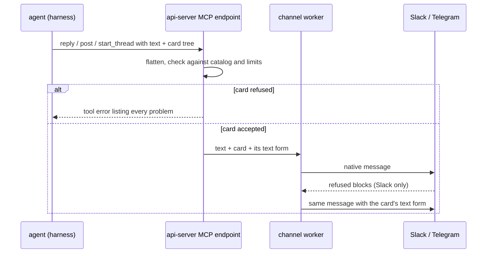

# Channel cards

Last verified: 2026-11-10

## Overview

An agent can attach a **Channel Card** to a message it posts to Slack or Telegram: key facts as label and value, a table, a chart, an image, link buttons.
The card is data against a fixed component catalog, json-render's chat catalog, and each messenger shows it as its own native message through Chat SDK's card format.
Nothing the agent sends runs as code.
Plain text stays the default; a card is for an answer whose structure helps the reader, such as a status with its key facts or numbers in a table.

## How an agent sends one

- **The posting tools take it.** `reply`, `post` and `start_thread` take an optional card beside the text, on the per-Agent MCP endpoint ([channel-turns](channel-turns.md#outbound--agent-to-channel)).
  The text shows above the card, and a post may carry a card alone.
- **The catalog is disclosed on demand.** A card's components, their props as JSON Schema, where each one goes and an example come from `describe_card_components`, not from every session's tool list, because most agents never post a card.
  The answer is generated from json-render's catalog at runtime, so a component a later catalog adds reaches agents with the upgrade, without a change here.
- **The agent writes a tree.** Each node is a component with its props and children; the platform flattens it into the catalog's spec before checking it.

## The check

Every card is checked before anything posts, and a card that fails comes back as a tool error that lists every problem and points at `describe_card_components`.
Nothing is posted, so the channel never shows half an answer; the agent fixes the card or sends text.

- **Catalog and structure.** Props are checked against each component's schema, and children against where a component may go, by json-render.
- **Per-message limits.** A card holds what one Slack message can show: one table, two charts, ten fields per group, 100 rows and 20 columns per table, Slack's limits on chart titles, labels, series and points, and 25 link buttons per row.
  The same limits apply in Telegram, so a card that fits one messenger fits both.
- **No interactive elements.** A channel has no way yet for a click to reach the agent, so a button that sends a choice back, a select menu, radio buttons and a text input are refused; only link buttons remain.
  The rule judges the rendered card, not component names, so an interactive component a later catalog adds is refused too, and the catalog an agent reads leaves out every component whose example renders one.
- **Artifact links.** An in-app artifact link inside a card becomes the artifact's share URL, under the same rule as links in the text.
- **Slack's block cap.** In Slack, a message whose text, card and footer exceed 50 blocks is refused with its length.

## Rendering

- **Slack.** The agent's text renders as before, the card's blocks follow, and the [Agent Footer](channel-turns.md#the-agent-footer) ends the post.
  The blocks come from Chat SDK's standalone Slack converter on the existing Slack connection, so Slack's own table and chart parts show tables and charts.
  Card text is standard Markdown, converted to Slack's mrkdwn so links and emphasis read as they do in the text.
  When Slack refuses the blocks, such as a part a workspace lacks or an image it cannot fetch, the same message goes out once more with the card's text form in place of its blocks, so the answer always arrives.
  A message with a file keeps its one-post rule: the share carries the text, the card and the footer where Slack takes them, and otherwise the message goes first and the file after it.
  A whisper's private answer carries the card the same way.
- **Telegram.** The card goes through the Telegram channel's Chat SDK adapter with the agent's text first: the adapter shows the card's text form and turns each link button into a Telegram button.
  Telegram has no tables or charts, so they arrive as text.

## The text form

Every card has a Markdown text form derived from it.
It is the post's notification text in Slack, the fallback when Slack refuses the blocks, and the reply text the turn records.
History lines and `read_thread` read an Agent's post with text from that text alone, never again from its blocks, so a card's facts are not repeated.

## Libraries

The catalog and its check come from json-render; the card format and the Slack rendering come from Chat SDK, the library the Telegram channel already runs on.
An upgrade can add components and change how Slack shows them; the catalog an agent reads follows it, while the limits and the interactive rule stay the platform's.

The code lives in the channels module of the api-server ([`packages/api-server/src/modules/channels/`](../../packages/api-server/src/modules/channels/)) and the MCP endpoint that offers the tools.
