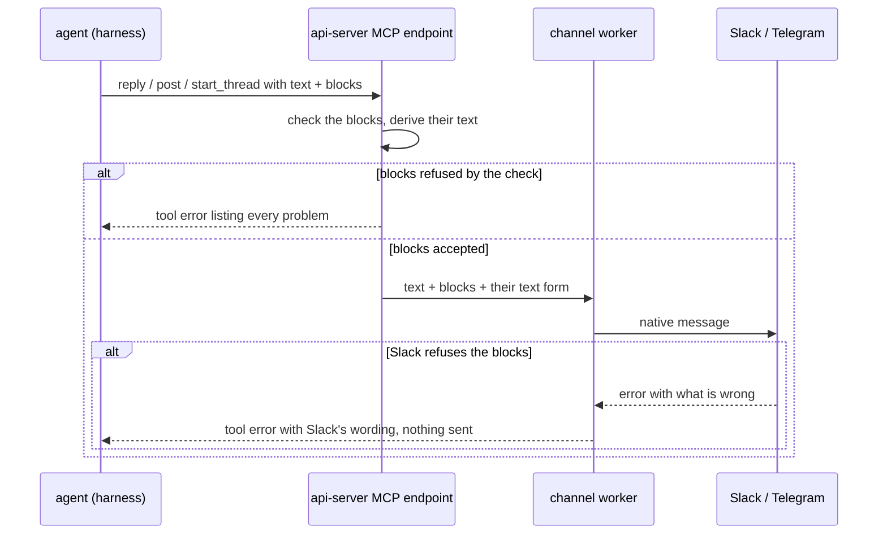

# Channel cards

Last verified: 2026-11-16

## Overview

An agent can attach a **Channel Card** to a message it posts to Slack or Telegram: tiles side by side, columns, a table, a chart, an image, buttons, a form.
The card is Slack Block Kit, written by the agent exactly as Slack defines it.
The platform does not render it: it checks the blocks, derives their text, and hands them to Slack as they are.
So every block Slack has, and every block it adds later, is usable without a platform change.
Nothing the agent sends runs as code.
Plain text stays the default; a card is for an answer whose structure helps the reader, such as numbers in tiles or a trend in a chart.

## How an agent sends one

- **The posting tools take it.** `reply`, `post` and `start_thread` take optional blocks beside the text, on the per-Agent MCP endpoint ([channel-turns](channel-turns.md#outbound--agent-to-channel)).
  The text shows above the blocks; a reply or a post may carry blocks alone, while a new thread opens with text.
  An edit of an Agent's own post takes blocks the same way, under the same check ([slack-edits](slack-edits.md#an-agent-changes-its-own-post)).
- **The rules are disclosed on demand.** The rules the platform applies, what each messenger shows, and a reference of the newer blocks with worked examples come from `describe_blocks`, not from every session's tool list, because most agents never post a card.
  The reference is written by hand from Slack's own reference and is a starting point, not a boundary: a block it does not list is allowed.
- **A removed argument is refused, not dropped.** A tool's input drops an argument it does not declare, so a call that still sends the component card of the earlier design is answered with an error that names the blocks, and nothing posts.

## The check

Every card is checked before anything posts, and a card that fails comes back as a tool error that points at `describe_blocks`.
Nothing is posted, so the channel never shows half an answer; the agent fixes the blocks or sends text.

- **Any block and any element passes.** The platform keeps no list of allowed blocks or elements, and does not know their schema.
  What a post holds, a set of buttons, a select menu, a form of input blocks, is the agent's to decide.
- **The platform owns the element identifiers.** An interaction is routed by the identifier on the element, and the private command menu runs its commands by that identifier ([slack-commands](slack-commands.md)).
  So the platform writes its own identifier on every button and every field, in place of whatever the agent wrote, and drops the value of a link button.
  An agent can therefore not post an element that acts as one of the platform's own.
  A field's identifier keeps the name the agent gave it, so the field's value comes back to the agent under that name.
  A name used twice in one post gets a number, in the order the agent wrote the fields.
- **Artifact links.** An in-app artifact link inside a card becomes the artifact's share URL, under the same rule as links in the text.
- **Slack's block cap.** In Slack, a message whose text, card and footer exceed 50 blocks is refused with its length; blocks nested inside a layout or a container count.
- **Slack is the judge of the rest.** A block's fields and limits are Slack's to check, see [rendering](#rendering).
  In Telegram, a text and card longer than one message, or than a file's caption, is refused.

## Interactions

A card can hold elements a person acts on.
A **link button** opens a page and sends nothing to the agent.
A **choice button** and a **field**, such as a select menu, a checkbox or a text input, send what the person did back to the agent.

- **An interaction is a message.** A click on a choice button, or a change of a field, behaves as a message in the post's thread, addressed to the Agent that made the post.
  It enters the same inbound path as a typed message ([channel-turns](channel-turns.md#inbound--channel-message-to-acp-session)), so the binding check, the gates, wake, burst gathering and steering apply to it unchanged.
  The turn names the element and the post; who acted is the turn's sender.
- **A form is fields and a button.** A click carries the button's label, the value the agent set on it, and the values of every field of the post, each under the name the agent chose.
  A field inside an input block waits for that click; an element outside one, such as a select beside a section, sends each change at once.
  A field that reports every change, as one that sends each keystroke does, is passed on once it has been quiet, with its last value.
  Slack does not check a form in a message, so an empty field arrives empty and the agent checks the values itself.
  A file a person adds in a form does not reach the agent, only its name.
- **It goes where a message in that thread goes.** An interaction with a post inside a turn's thread reaches that thread's session; with the opening post of an owned thread, the Session that owns it ([slack-threads](slack-threads.md)); with a plain post, which is one-way, a fresh session with the thread's history ([threading model](channel-turns.md#threading-model)).
  So an agent that wants the answer in the session that asked uses `start_thread`, as for a typed answer.
  An interaction belongs to the Agent whose post it is on: inside a thread another Agent's Session owns, it goes to the Agent that made the post and not to the thread's owner.
- **Anyone who sees the post may act.** An interaction resolves no more identity than a message does; the agent decides whose answer counts.
- **The Agent comes from the element, not from the post.** The platform's identifier on a choice button or a field names the Agent, and the platform writes a different one on a link button.
  So an interaction is delivered only for an element of an Agent's own post, and never on the strength of what a post's content says.
  An interaction has no message of its own: its moment stands in for one, so catch-up reads the thread up to it.
- **The post is the agent's.** The platform never changes a post after an interaction.
  What it shows next, the result, an error beside a field, no buttons, new buttons, is the agent's to decide, with an edit of its own post ([slack-edits](slack-edits.md#an-agent-changes-its-own-post)).
  Until the agent edits it, the post stays as it was and its buttons stay live, so several people can each answer.
- **The person is told, and a repeat is held back.** A post that does not change gives a click no visible effect, so the person who clicked a button gets a private notice that the click was passed to the Agent.
  The same click by the same person, with the same field values, is not passed on again for a minute, and the person is told it was already passed on.
  A different person, another button, or changed field values count as a new answer, and an edit of the post by the agent ends the hold.
  A changed field shows its new value in the post itself, so it gets no notice and is never held back.
- **Where an interaction cannot reach.** In a conversation the Agent is no longer connected to it starts no turn, and the person is told privately.
  A private answer to a whisper is seen by one person, has no thread and cannot be edited, so it takes link buttons only.
  Choice buttons and fields work in Slack only: in Telegram they show in the text, and the person answers by typing.

## Rendering

- **Slack.** The agent's text renders as before, the card's blocks follow as the agent wrote them, and the [Agent Footer](channel-turns.md#the-agent-footer) ends the post.
  When Slack refuses the blocks, such as a field it does not know, a block a workspace lacks or an image it cannot fetch, nothing is sent: the tool returns Slack's own wording of what is wrong, so the agent can fix the blocks or send text.
  The message is never sent a second time in another form, so a channel does not show a rough version the agent knows nothing about.
  A message with a file keeps its one-post rule: the share carries the text, the card and the footer where Slack takes them, and otherwise the message goes first and the file after it.
  A whisper's private answer carries the card the same way, with link buttons only.
- **Telegram.** Telegram has no Block Kit, so the card goes as its text form under the agent's text, through the Telegram channel's Chat SDK adapter, and each link button as a Telegram button.
  A link that is sent as a button is not also a line of the text.

## The text form

Every card has a text form derived from its blocks: their texts in reading order, a table row by row, a chart series by series with its numbers, a link button as a link.
The derivation walks the blocks generically, so a block the platform has never seen still gives its texts.
What a layout offers a client that cannot show it repeats the content and is left out.
The text form is the post's notification text in Slack, the message in Telegram, and the reply text the turn records.
History lines and `read_thread` read an Agent's post that opens with its text block from its text alone, so a card's facts are not repeated.
A post with no text block, an Agent's file share or a card sent alone under the Agent's own name, is read like any other post: its text first, then the block content the text does not already hold.
Another app's post that uses the newer blocks is read through the same derivation, so its content reaches the agent too.

## Libraries

No library sits between the agent's blocks and Slack: the check and the text form are the platform's own, and the Slack connection posts the blocks.
Telegram runs on Chat SDK, which shows the text and turns each link button into a Telegram button.

The code lives in the channels module of the api-server ([`packages/api-server/src/modules/channels/`](../../packages/api-server/src/modules/channels/)) and the MCP endpoint that offers the tools.
