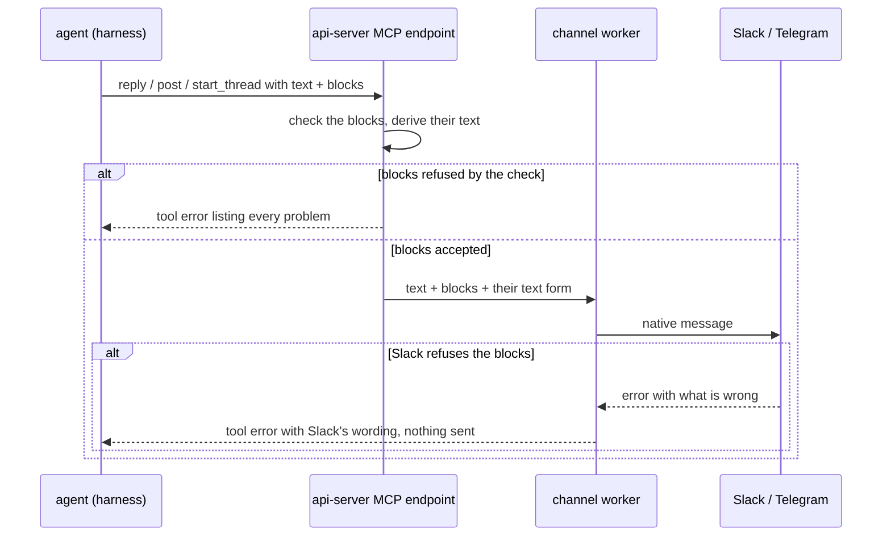

# Channel cards

Last verified: 2026-11-16

## Overview

An agent can attach a **Channel Card** to a message it posts to Slack or Telegram: tiles side by side, columns, a table, a chart, an image, link buttons.
The card is Slack Block Kit, written by the agent exactly as Slack defines it.
The platform does not render it: it checks the blocks, derives their text, and hands them to Slack as they are.
So every block Slack has, and every block it adds later, is usable without a platform change.
Nothing the agent sends runs as code.
Plain text stays the default; a card is for an answer whose structure helps the reader, such as numbers in tiles or a trend in a chart.

## How an agent sends one

- **The posting tools take it.** `reply`, `post` and `start_thread` take optional blocks beside the text, on the per-Agent MCP endpoint ([channel-turns](channel-turns.md#outbound--agent-to-channel)).
  The text shows above the blocks; a reply or a post may carry blocks alone, while a new thread opens with text.
  An edit of an Agent's own post takes blocks the same way, under the same check ([slack-edits](slack-edits.md#an-agent-changes-its-own-post)).
- **The rules are disclosed on demand.** What the platform refuses, what each messenger shows, and a reference of the newer blocks with worked examples come from `describe_blocks`, not from every session's tool list, because most agents never post a card.
  The reference is written by hand from Slack's own reference and is a starting point, not a boundary: a block it does not list is allowed.
- **A removed argument is refused, not dropped.** A tool's input drops an argument it does not declare, so a call that still sends the component card of the earlier design is answered with an error that names the blocks, and nothing posts.

## The check

Every card is checked before anything posts, and a card that fails comes back as a tool error that lists every problem and points at `describe_blocks`.
Nothing is posted, so the channel never shows half an answer; the agent fixes the blocks or sends text.

- **Any block passes.** The platform keeps no list of allowed blocks, and does not know their schema.
- **No element whose answer cannot reach the agent.** A channel has no way yet for a selection or typed input to reach the agent, so a select menu, an input, checkboxes, radio buttons, a date or time picker, an overflow menu, a workflow button and a button that sends a choice back are refused, at any depth; only link buttons remain.
  An element Slack adds later is refused too when it carries the identifier Slack routes a click by.
- **The platform owns the button identifiers.** A click is routed by the identifier on the button, and the private command menu runs its commands by that identifier ([slack-commands](slack-commands.md)).
  So the platform writes its own identifier on every button, in place of whatever the agent wrote, and drops the value of a link button.
  An agent can therefore not post a button that acts as one of the platform's own.
- **Artifact links.** An in-app artifact link inside a card becomes the artifact's share URL, under the same rule as links in the text.
- **Slack's block cap.** In Slack, a message whose text, card and footer exceed 50 blocks is refused with its length; blocks nested inside a layout or a container count.
- **Slack is the judge of the rest.** A block's fields and limits are Slack's to check, see [rendering](#rendering).
  In Telegram, a text and card longer than one message, or than a file's caption, is refused.

## Rendering

- **Slack.** The agent's text renders as before, the card's blocks follow as the agent wrote them, and the [Agent Footer](channel-turns.md#the-agent-footer) ends the post.
  When Slack refuses the blocks, such as a field it does not know, a block a workspace lacks or an image it cannot fetch, nothing is sent: the tool returns Slack's own wording of what is wrong, so the agent can fix the blocks or send text.
  The message is never sent a second time in another form, so a channel does not show a rough version the agent knows nothing about.
  A message with a file keeps its one-post rule: the share carries the text, the card and the footer where Slack takes them, and otherwise the message goes first and the file after it.
  A whisper's private answer carries the card the same way.
- **Telegram.** Telegram has no Block Kit, so the card goes as its text form under the agent's text, through the Telegram channel's Chat SDK adapter, and each link button as a Telegram button.
  A link that is sent as a button is not also a line of the text.

## The text form

Every card has a text form derived from its blocks: their texts in reading order, a table row by row, a chart series by series with its numbers, a link button as a link.
The derivation walks the blocks generically, so a block the platform has never seen still gives its texts.
What a layout offers a client that cannot show it repeats the content and is left out.
The text form is the post's notification text in Slack, the message in Telegram, and the reply text the turn records.
History lines and `read_thread` read an Agent's post that opens with its text block from its text alone, so a card's facts are not repeated.
A post with no text block, an Agent's file share or a card sent alone under the Agent's own name, is read like any other post: its text first, then the block content the text does not already hold.
Another app's post that uses the newer blocks is read through the same derivation, so its content reaches the agent too.

## Libraries

No library sits between the agent's blocks and Slack: the check and the text form are the platform's own, and the Slack connection posts the blocks.
Telegram runs on Chat SDK, which shows the text and turns each link button into a Telegram button.

The code lives in the channels module of the api-server ([`packages/api-server/src/modules/channels/`](../../packages/api-server/src/modules/channels/)) and the MCP endpoint that offers the tools.
