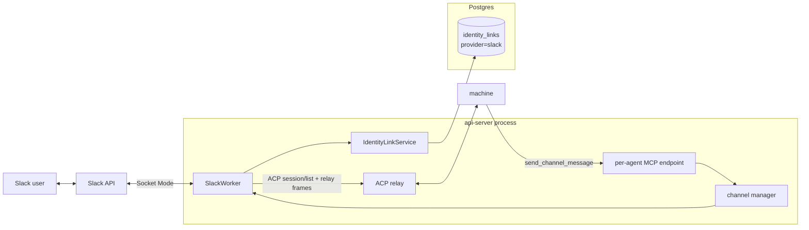
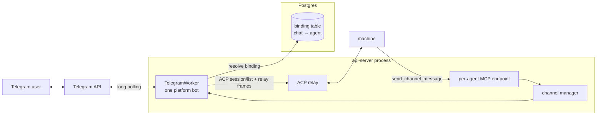

# Channels

Last verified: 2026-10-26

Which Slack outcomes are guaranteed, which are the agent's judgement, and which depend on setup is mapped on [slack-guarantees](slack-guarantees.md); a behavior change here updates that page in the same PR.

## Overview

A **channel** is a messenger surface (Slack, Telegram) that lets users drive an Agent from outside the UI.
Channels are pluggable adapters that live inside the api-server process — no separate Deployment, no sidecar on the agent's machine.
Each adapter (the *worker*) owns its inbound socket, its outbound API, and its thread-to-session bookkeeping; a channel manager composes the workers and reacts to lifecycle events on the in-process event bus.

The workers are **single-holder across the deployment**: both transports admit one consumer per install, and a worker's turn bookkeeping lives in its process.
One replica runs them, elected on a Kubernetes Lease; the rest run none, and take over within a lease TTL if it dies.
Inbound therefore always reaches the worker holding the turn state.
Outbound doesn't — a reply lands on whichever replica served the MCP call — so a non-leader marshals it to the leader over the Redis bus.
Channel throughput is thus one replica's, below Slack's own ten-connection ceiling.

Channels are a **standard Agent surface**, not a pre-release one: every Agent exposes it, with no per-user opt-in in front of it.
What can be bound there is the install's own decision — a worker exists only where its token is configured — and an install with no messenger says so on the surface rather than withdrawing it.
Slack as a *Connection* is a separate surface; a channel needs nothing from it ([connections](connections.md)).

Bindings are **many-to-many**: an Agent may hold several at once — the same workspace, memory and skills reachable from many conversations without duplicating it — and a Slack conversation may hold several Agents, so a project channel reaches every Agent its team relies on.
What a binding cannot be is doubled: one Agent connects to one conversation once.
Agent delete releases all of that Agent's; a disconnect names the one to release.
A binding **is** its (Agent, workspace, conversation) triple — a conversation id names one conversation only inside the Slack workspace it belongs to, so the workspace is part of what a binding is — and nothing moves one: reaching an Agent from somewhere else is a connect there and a release here, each its own deliberate act.
No surface offers a compound that could release a binding and then fail to replace it.
A Slack "conversation" is any surface the bot is party to: a public/private **channel**, a **group DM**, or a **1:1 DM**.
The binding key is the conversation id in every case, so DMs and group DMs reuse the channel binding mechanics wholesale.

Because one bot serves every Agent in a workspace, a bare `@bot` cannot say which Agent is meant.
So a conversation carries at most one **default Agent** — the first connected, and the one a bare mention reaches — while a mention opening with an Agent's name reaches that Agent.
Which Agent holds it can be changed, in-chat.
A name matching nobody is not an address at all: it falls through to the default as ordinary prose.
A name matching *several* Agents also falls through, but carries the unresolved name forward, so the default can say it could not tell them apart.
Releasing the default leaves the conversation with **none** — nothing is promoted, since that would hand the load to an owner who never accepted it.
Unnamed mentions are then refused, naming the connected Agents and how to set one; named mentions still work.
A single-Agent conversation therefore behaves exactly as it always did, and nothing about the default surfaces until a second Agent joins.

Multiple bindings share the Agent but never each other's conversations: routing is by conversation id both ways, and every session key is qualified by the conversation it belongs to, so a thread — and a channel's read-along flow — stays inside the channel it happened in.

Channels split along a structural axis that has real consequences for secrets and identity:

- **Platform channel** — one app serves the whole install.
  The operator configures the app once via Helm values; on Slack each workspace adds its own bot token by completing the install handshake, and per-Agent config stays just *which conversation this Agent listens to*.
  Both messengers are platform channels today.
  On Slack, identity linking ties messenger users to Keycloak subs at the workspace level.
- Telegram's variant: there is no workspace to anchor per-user identity in, so a Telegram *chat* binds to exactly one Agent — the owner consents by completing an in-chat `/bind` plus a web agent-picker flow — and anyone in the bound chat may drive that Agent.

### Shared access — the one model

The binding itself is the authorization: anyone the messenger admits to the conversation drives the Agent under the Agent's own credentials.
There is no per-person access mode, no identity link required to drive a turn, and no allow-list.
Every turn relays single-track to the main agent; the **binding owner's** Terms-of-Use acceptance gates each turn (the terms bind the party whose credentials run it, not the member who typed); the security log records each allow with basis *place* and the sender's Slack user id, or for a bot post which Agent or app wrote it; and the prompt text is speaker-labelled with the sender's Slack mention, or the Agent's or app's name, so a multi-speaker session stays attributable inside the conversation itself.

Telegram is structurally identical — with no workspace to anchor per-user identity, consent covers the whole chat, every forum topic and reply in it included, and everyone in the bound chat drives the Agent.

Members use every granted Connection and Satellite; the UI warns, never blocks, when a group binding and grants meet.

#### Ambient mode

A Slack binding can additionally run in **ambient mode**: the agent reads along with the whole channel conversation and decides for itself when to chime in.
A Telegram binding has the same switch, with its own command and gate (see the Telegram adapter under Adapters).
It is a property of the **binding**, not the conversation, so one Agent can read along where another only answers mentions — answering a question it can answer, picking up a task someone described, flagging a clear mistake — staying silent otherwise.
Mentions keep the addressed-turn treatment unchanged; ambient only adds a second, quieter inbound path.

On Slack, ambient is **mutable** and **off by default** on every connect path — the in-chat `/platform bind`, the UI form, and the CLI flag all leave it off, and the binding owner opts a channel in explicitly.
Ambient has the agent read every message in the channel, so keeping that broader exposure a deliberate opt-in is the safe default.
It can be flipped later — a re-connect updates it in place, and an in-chat ambient command (allowed for the binder or the agent's owner, the unbind authorization) is the in-channel dial.
Every enable/disable is recorded in the security log, and that audit record is authoritative.
On Slack the change is deliberately **not** announced in the channel — not on a connect, a re-connect, or the in-chat dial: whoever made it sees it confirmed on their own surface (the UI, the CLI, or the ephemeral slash-command reply for the in-chat command), and the channel's members get no ambient status post.
On Telegram every `/bind` leaves it off, and `/ambient on|off` from a chat admin is the only dial; Telegram has no private reply, so that confirmation posts in the chat.

Where several Agents read along in one channel, they take each message **one at a time**, each starting only once the one before it finished.
Running them concurrently would have them talk over each other; in sequence, a later Agent is handed what the ones before it said — it has no other way to know — so it builds on that or stays silent rather than repeating it.
The **default Agent goes first** where it reads along, being the conversation's primary; the rest follow **shuffled**, freshly per message — past the default there is nothing to rank them by, and a stable order would quietly hand one Agent every second look.
The cost is deliberate: a channel with several read-along Agents spends that many turns per message, which is why ambient stays a per-Agent opt-in.

#### Posts by Agents and apps

A post by another Agent, another app or an incoming webhook starts turns the same way a person's post does: a tag routes it to one Agent, and in ambient mode it reaches the readers.
This is what lets one Agent ask another for help, and an Agent react to a CI, alerting or deployment post, without a person posting again.
Every Agent posts as the one bot, so the worker tells an Agent's post from the platform's own by its [Agent Footer](channel-turns.md#the-agent-footer); a footer-less bot post (a notice, a whisper root) is not any Agent's words and starts nothing.
An Agent's own post **never starts a turn for that Agent**; every other Agent in the conversation still gets it.
The exception is an Agent's **reply in an ambient round**: the round already hands it to the readers after it, so feeding it back as a new post would spend a second turn on words they were given — and a reply in the thread under a top-level message would run alongside the round, in that thread's own queue.
So a reply an ambient turn posts with its reply tool is marked in its Agent Footer link, and a marked post reaches no reader; the mark travels with the post, so the check needs no timing and spares the same Agent's other posts.
A proactive post is never marked: that tool does not name the session calling it, and a post from a schedule or another session must still reach the readers.
A tag still routes: an Agent can ask a peer from inside its reply, and that peer then **skips its own turn in the round**, since the tag already gave it an addressed turn on the same request — otherwise it would answer twice, once in each session.
The peer's answer is not a round reply, so it reaches the Agent that asked.

Apps reach the Agents **by default**, because an integration posting into a bound channel was put there to be seen.
A noisy one would spend a turn per post on every reader, so a channel can **ignore an app**: an in-chat ignore command takes a link to one of the app's posts, and the app that wrote it — by its bot id, since a webhook may change its display name per post — then reaches no Agent in that conversation, including ones connected later.
An unignore command takes the app back by name or by link.
The list belongs to the **conversation**, not a binding, so anyone who connected an Agent there or owns one connected there may change it; every change is security-logged.
Other Agents' posts are never ignored.

Bot posts can answer each other — two readers, or an Agent and a webhook — so a conversation admits at most **three bot posts since a person last posted there**; later ones start nothing until a person posts.
The count is per thread (and per channel top level) and lives in the leader's memory, so a restart only allows a new run of the same size.
A dropped post leaves a record for its channel in Postgres — how many were dropped, the time of the last one, and the newest few with their sender — and every connected Agent's Channels page shows it until a day passes without a drop; the record is only a view of the guard, which never reads it.
A bot sender gets no private notices, since a notice needs a person, and a bot post in a 1:1 DM starts nothing — that conversation is with one person.
A tag of an Agent at a [spend limit or the Spend Ceiling](spend-limits.md#unattended-work) starts no turn; whoever tagged it gets the reason instead — a person privately, a bot in one footer-less notice in the thread, which starts nothing.

Ambient turns are deliberately unobtrusive on the platform's side: the platform posts no acknowledgment reaction and no wake notices, and failures are logged and evented but never posted — nobody summoned the agent, and a turn dropped after the wait is recovered by catch-up on the next one.
Acknowledgement instead comes from the agent itself: when a message is worth engaging, the ambient frame has it open with a fitting emoji reaction — a quiet, notifies-no-one signal that it has picked the message up, chosen to suit the message rather than a rote mark.
The agent declines explicitly, or by ending its turn without posting.
The frame also announces how the agent appears in the channel — the install's bot name and Slack id, and the agent name its posts are signed with — so a message that calls it by any of them is answered like a mention; the persona behind that name comes from the agent's workspace setup, never from the relay.
Each relayed message is still security-logged as a place-basis allow (marked as ambient-triggered), and the binding owner's Terms-of-Use acceptance gates ambient turns like any shared turn — silently.
An Agent at a [spend limit or the Spend Ceiling](spend-limits.md#unattended-work) is skipped the same silent way.

Inbound traffic and outbound traffic take different paths.
Inbound is push from the messenger into the api-server worker, which routes the message to the agent over ACP.
Outbound is pull initiated by the agent: the harness calls a tool on the api-server's per-Agent MCP endpoint, and the api-server delegates to the right worker.

One cross-cutting concern is owned elsewhere and only summarized here:

- **Thread-session binding.** A thread maps to one resumable session, so the agent gets real conversational continuity.
  The binding is carried on the session itself, resolved by listing sessions over ACP and matching — there is no server-side session store.

## Topology

Both adapters share the same shape inside the api-server — a worker that owns the messenger socket, the channel manager that supervises lifecycle, the ACP relay for inbound, and the per-Agent MCP endpoint for outbound.
The interesting parts are where the two diverge: Slack hangs off a workspace-wide identity link table; Telegram hangs off its own binding table (chat → Agent).
Telegram's token comes from Helm values; Slack's app-level token does too, but a Slack bot token is per workspace and comes from the install handshake.

### Slack — platform channel

The App-Level Token comes from Helm values and lives in api-server env; a Bot Token is per workspace, comes from the install handshake and lives in a K8s Secret — neither is per-Agent.
Resolving the channel's binding yields the Agent and the binding owner; the relay is single-track to the main agent.
The workspace-wide identity-link table backs the `/platform login` flow, which authorizes the in-chat bind, unbind, ambient, whisper on/off and default commands — never who may drive a turn.

### Telegram — platform channel

The bot token comes from Helm values and lives in api-server env, like the Slack tokens.
A chat binds to exactly one Agent in its binding table (the chat's id is the primary key); the single bot polls for the whole install and resolves each inbound message to its chat's binding, a forum topic's message included.
A forum topic or a reply chain never has a row of its own.
The relay path is single-track — the main agent handles every turn.

## Adapters

Both workers implement the same internal contract — start and stop, list conversations, post a message — keyed by agent id.
The differences are transport, identity model, and where the bot token comes from.

### Slack — platform channel

- **Message formatting.** Agent posts use standard Markdown, with compact Slack-style code fences moved onto their own lines by the shared [outbound renderer](channel-turns.md#outbound--agent-to-channel).
- **Transport.** Socket Mode, one workspace-level WebSocket to Slack, opened by the lease-holding replica at boot so slash commands, mentions and DMs work in chats that have no binding yet (mirroring the Telegram client).
  The api-server has no inbound network access requirement; events arrive over the socket the api-server itself opened.
  Slack caps Socket Mode at ten concurrent connections per app, which is the install-level scale ceiling for Slack.
  The gateway reconnects a dropped socket itself, with the Socket Mode client's own reconnect turned off: the first reconnect runs 1 s after the drop, and a reconnect Slack refuses, even `invalid_auth` on the app token, is retried after 5 s, 15 s, 30 s and then every 60 s, so a Slack auth outage stops only Slack, never the api-server, and the socket comes back once Slack accepts the token again.
- **Token provenance.** The App-Level Token (`xapp-…`) is app-scoped: it comes from Helm values and stays singular, so one Socket Mode connection serves every installed workspace, and it alone decides whether the Slack worker runs.
  A **Bot Token is per workspace**, because Slack scopes one to one workspace, and every workspace gets its token the same way: by completing Slack's install handshake, the token that mints landing in a K8s Secret with a row pointing at it — no credential in Postgres, and none served from api-server env.
  Neither token is per-Agent.
- **Token rotation.** Where the Slack app has token rotation turned on, the handshake mints a bot token that expires after twelve hours together with a single-use refresh token, and both go into the workspace's Secret.
  The token is swapped for a fresh pair once it is an hour old — by a sweep every ten minutes, or by whichever replica needs it first — so an outage has eleven hours to pass before any workspace goes dark, and Slack's two-live-tokens-per-workspace limit is never crossed.
  The swap runs under the workspace's lock — two replicas spending the same refresh token would leave one holding a revoked pair — with the Secret re-read inside the lock so the later one takes what the earlier one wrote.
  A refresh that fails while the token still works keeps serving it; once the token has expired, a refresh Slack refuses as a dead credential marks it like any other rejection, while a refusal that may pass — being rate limited — or one Slack never answered leaves it unmarked for the next try.
  Slack reports revoked tokens by workspace rather than by token, and a rotated-out token may be the one it reports, so a revocation marks the credential only when the workspace's current token is refused too.
  Rotation is one switch on the Slack app, but a token minted before it was on keeps not expiring until it is exchanged, one call per token: once the install says rotation is on, every such token is exchanged in one sweep as soon as the lease-holding replica's socket is up, under the same lock.
  Slack retires the old token as it answers, so the pair replaces it in the workspace's Secret at once.
  A failed exchange keeps serving the old token and tries again later.
  Renewing depends only on what a Secret holds, so the install setting only starts exchanges — turning it back off changes nothing for tokens already exchanged, and cannot, since Slack's own switch is one-way.
- **Connecting a workspace is an operator act, and an invitation rather than open enrollment.** A new workspace is install-wide reach, not one Agent's config, so starting the handshake sits behind its own realm role (`platform-slack-installer`) — the chart creates it and a group mapped to it, the same shape the inspector role uses ([usage-tracking](usage-tracking.md)) — and an install that configured no Slack client credentials mounts no install surface at all.
  What the operator issues is a one-time invitation; the consent itself belongs to an admin of the workspace being added, who needs no platform account.
  Both sides therefore agree before a workspace is served.
  Since only an operator can start that handshake, an install may name where people ask for an invitation, and the Slack setup help — the channel and account explainers and the bind instructions — points there; an install that names none shows no such pointer.
  A consent redirect the platform did not issue is refused, which is what keeps the app's own distribution URL from being a way in.
  An install may also name the Slack **organization** it serves, and then a workspace outside it is refused where the credential would be accepted: a conversation id and a person's user id each name one thing only inside one organization, so two organizations at once would let a mention reach the wrong Agent and a person inherit someone else's platform identity.
  Naming none is the only thing a standalone app can do — Slack reports no organization for one — so the check is off by default rather than refusing every install.
  Refusing has to withdraw access, not only withhold a record, because by then Slack has installed the app and its events keep arriving: the token Slack minted is revoked, and whether that succeeded is part of what the refusal records, or the record would claim an access that is still live.
  Nothing else is needed to keep the workspace out — a workspace with no row is served by no credential at all.
- **A binding learns its workspace rather than being told.** The person pasting a conversation id was standing in a workspace when they copied it; the bind surface does not carry that, so Slack is asked instead of the person.
  Several workspaces answering yes is ordinary — an organization shares one channel into many of them, and each is looking at the same conversation — so **membership decides**: a workspace the bot was invited to can post, one that merely sees the channel cannot, and among equals the workspace connected first wins so repeated binds settle the same way.
  Only a conversation no connected workspace can see is refused.
  An in-chat bind skips the question, the slash command having named its workspace; so does a single-workspace install, which answers without asking Slack.
  A 1:1 DM or a group DM is seen only by the workspace whose bot is in it.
  A re-connect of an existing binding, which is how the UI changes ambient mode, asks nothing: the binding already names its workspace, and that name is kept.
- **Which workspace a call acts for is carried, never guessed.** Every binding, bound conversation and turn names its workspace by Slack's team id, and an outbound call takes the workspace of the conversation it acts for.
  A call that cannot name one is refused rather than sent to a default.
  Attribution is never inferred — a workspace connected over OAuth is named in the same response that mints its token, so its row records both together.
- **Installs that predate the handshake are migrated, not special-cased.** Such an install was served by a bot token pasted into Helm values, and its bindings name no workspace.
  While that token is still configured, the lease-holding replica asks Slack which workspace it belongs to **before the socket opens**, makes it that workspace's row — unless the workspace already has one from re-authorizing, whose newer token is kept — and rewrites every binding that names no workspace to name that one, dropping a duplicate the workspace already holds and a second default it already has.
  It is safe to repeat, so it runs on every boot while the Helm value is set, and the value can be removed once it has run.
  Doing it before the socket opens means no message is routed while those bindings still name nothing.
  Slack answering that the Helm token is no good leaves it unimported and those bindings unserved; Slack not answering at all is a failure to start, which the worker already retries.
- **Re-install, not uninstall, is the lifecycle event.** A workspace re-authorizes to pick up scopes added to the manifest later; the handshake rewrites the same Secret in place, and bindings and identity links key on conversation and user id so they are untouched.
  A credential Slack rejects is **marked**, never cleaned up, and re-authorizing clears the mark.
  Nothing is deleted.
- **Identity linking.** A `/platform login` slash command starts a Keycloak OAuth flow; on callback the api-server stores `slack_user_id ↔ keycloak_sub` and the workspace the command ran in.
  The link table is the source of truth for "who is this Slack user in Platform terms" — consulted to authorize the in-chat `bind`, `unbind`, `ambient`, `whisper on|off`, `ignore`, `unignore`, `default` and `delete` commands, never to admit a turn, and to reach a person directly.
- **A connect from the platform needs the person in the conversation.** A connect from the UI or the CLI binds only a conversation the person and the bot are both in: one of the person's linked Slack identities shares the channel with the bot in some connected workspace, or is the other side of the 1:1 DM.
  A group DM is outside what Slack lists for a person, so it is connected in-chat only.
  Without it, anyone who knows a conversation id could lend an Agent to a private channel they are not in.
  An unlinked person is refused and pointed at `/platform login`, or at the in-chat bind, whose run inside the conversation is the proof and so needs no check.
  Only a new binding is checked; a re-connect of an existing one, which changes ambient mode or custom emoji, is not.
  The UI therefore picks channels by name from the same rule rather than taking an id: the channel choices are the bot's channels that the person's linked identities also share, across every connected workspace and listed once per conversation id, and a pasted id is matched against that list.
- **The platform can message a linked person.** A notice the platform raises itself, such as a resource alert or an outage alert, goes as a direct message from the app — no Agent persona — to each Slack identity linked to that user, in the workspace the link recorded.
  A link made before links recorded their workspace reaches the one active install, and nothing when several are active, until the user logs in again.
  A workspace whose credential is rejected or that did not grant `im:write` is skipped, and a user with no link gets nothing in Slack.
  A notice that reaches nobody in Slack goes to Telegram instead (below), so a person gets one copy.
  Only the channel leader sends; other replicas reach it over the channel RPC.
  `login`/`logout` stay working but are not listed in the bare-`/platform` usage help (which advertises the other eight); the flows that need a linked identity still point users at `/platform login` in context.
- **In-chat binding.** Beyond the platform UI and CLI, a channel can be bound from inside Slack, mirroring Telegram: anyone runs `/platform bind`, authenticates through the same Keycloak OAuth flow, and picks one of *their own* Agents on a web picker — the binding lends that Agent, under its own credentials, to the whole channel, exactly like every binding.
  Being invited offers the same link without the command: when the bot itself is added to a conversation, it answers the inviter alone, privately, with the bind link, so nobody has to discover the slash command first.
  The binding is created ambient-off; an in-chat ambient command reports and flips the binding's ambient mode afterward under the same binder-or-owner authorization as unbind.
  There is no admin gate (unlike Telegram's group-admin check); the ownership check on the picked Agent is the control, and the bind also links the initiator's identity so they can later release it.
  A bind never overrides an existing one — it adds an Agent to the conversation, and only the same Agent twice is refused.
  The commands take the Agent's name where more than one is connected, refusing and listing candidates rather than guessing.
  Changing the default is **in-chat only** — choosing well means seeing who else is connected, and only the channel shows that — and only its Agent's **owner** may take it, since the default absorbs every unnamed mention and that load runs on their credentials.
  The owner can also disconnect from the platform UI/CLI as an escape hatch.
- **DMs and group DMs** reuse the in-chat bind verbatim — the conversation id (`D…` for a 1:1 DM, an `mpim` id for a group DM) is the binding key, so `/platform bind` connects one of the binder's own Agents to the DM or group, exactly as it binds a channel.
  Only the *trigger* differs: a bound **1:1 DM** relays every plain message, because every DM message is addressed to the bot — no `@mention`, and the prompt isn't speaker-labelled (a single human).
  A bound **group DM** stays mention-driven like a channel.
  Slack admits an app to a group DM only at its start, so `/platform bind` in a group DM without the bot is refused with that reason rather than creating a binding nothing reaches.
  If Slack cannot answer, the bind goes ahead.
  A message into an *unbound* DM or group is declined with an ephemeral pointing at `/platform bind` — the app's DM surface must be turned on first, or Slack refuses to send at all.
  Channels, DMs and groups mix freely in an Agent's binding set; each is just another conversation id.
- **Whispering.** Anyone in a connected conversation can reach one of its Agents privately with `/platform whisper`, whose text Slack never shows the conversation.
  It needs no identity link — being in the conversation admits it, as it admits a mention — and it names the Agent as the other commands do: the default where none is named, and a name it cannot match is refused rather than handed to the default as the message.
  A **quoted message** is one turn on a fresh session, answered so only the whisperer sees it ([channel-turns](channel-turns.md#outbound--agent-to-channel)).
  **No message** opens a whisper thread in the person's DM with the bot.
  The bot's own opening post carries, in its message metadata, the Agent, the conversation the whisper came from with its workspace, and the person; a reply in that thread goes to that Agent whatever the DM itself is bound to.
  The override is that thread's alone, only a post the bot itself made counts, and nothing is stored platform-side, so it survives a restart.
  Every turn re-checks the consent it borrows: the Agent must still be connected where the whisper started, and where that is a channel the person must still be a member, asked of that workspace — in an enterprise organization a DM reply arrives tagged with the person's home workspace, which may not see the channel; otherwise the whisper ends.
  A whisper is private from the conversation, never from the Agent's owner: each runs as an ordinary session the owner can open, naming who whispered and what they wrote, and the copy says so.
  Being private is also what makes a whisper an easy place to hide a prompt injection, so it carries **no more trust** than the same message sent openly by someone who is not the owner — the same gates, the same permission mode — and the prompt tells the Agent as much, and never to hide a whisper from its owner.
  Whispers are a **per-Agent switch**, on by default, because putting an Agent in a shared conversation already opens it to everyone there.
  It belongs to the Agent, not to a binding, because what a whisper puts at risk is the Agent itself: someone can ask it to change its instructions, memory or settings, nobody else in the conversation sees the request, and the change then holds everywhere the Agent is connected.
  It is stored in the Agent's spec, and the controller does not act on it.
  Only the Agent's owner flips it: with `/platform whisper <agent> on|off` from any conversation (the command looks the name up among the invoker's own Agents), in the Agent's channel settings in the UI, or on the page an in-chat bind ends on.
  While whispers are on, the bind warning says so, before the bind.
  A connect that leaves it unset keeps the binding's current value.
  With whispers off, a whisper to that Agent is refused before anything is relayed, and an open whisper thread ends at its next message, the same re-check that ends one whose Agent was disconnected.
  Both checks read the Agent's current setting, never a cached one.
  A whisper turn already running when whispers go off finishes, and the whisperer is told right after it that the whisper has ended.
- **Access control.** Channel membership is the only per-person gate, and Slack owns it — the platform never resolves who is typing; binding the channel is the consent that lends the Agent to the channel.
- **Agent resolution.** A mention (channel, group DM) or a plain 1:1-DM message resolves to exactly one Agent: the one whose name opens the message, else the conversation's default.
  Name matching is over the Agents connected to that conversation only, whole-name and case-insensitive, longest name first — Agent names are not unique, so a name matching two of them resolves to the default rather than a guess.
  An addressed message in an unconnected conversation is refused with an ephemeral.
- **Message intake.** The gateway subscribes to plain messages on three surfaces and pre-filters them all the same way: message edits, joins and other subtypes never reach the worker, and neither do the bot's own footer-less posts.
  Every post that passes carries its **sender** — a person, an Agent (the bot's own post, named by its footer), or an app (any other bot or webhook, named by its username).
  While the bot's own ids are unknown, every bot post is dropped, so an Agent's reply can never pass for an app's.
  A person's tag arrives on the mention path, so their plain-message copy is dropped; a bot post that tags the bot is handed to the mention path too, because Slack may not send it as a mention, and the worker takes each such post once.
  Surface then decides the route: **channel/group** messages feed ambient mode (relayed only when the binding has ambient on; everything else drops silently); **1:1 DM** messages feed the bound-DM relay (no mention needed); **group DM** plain messages are ignored — group DMs are mention-driven, so they arrive on the mention path.
  This requires the Slack app to subscribe to plain messages on all three surfaces with the matching history scopes, and to enable the App Home messages tab ([`etc/slack/app-manifest.yaml`](../../etc/slack/app-manifest.yaml)).
  A fourth subscription, to member joins, is acted on only when the joining member is the bot itself — that is what hands the inviter the bind link — and every other join is ignored.

### Slack scopes: required vs. optional

Bot scopes in [`etc/slack/app-manifest.yaml`](../../etc/slack/app-manifest.yaml) split into two tiers.
**Required** scopes back core turn handling (inbound delivery, posting, the working status); nothing works without them.
The working status also needs Slack's agent messaging feature declared (`agent_view`) — Slack grants its scope only with it.
**Optional** scopes back individual affordances that must degrade rather than take anything else down when the workspace withholds them.

A withheld scope has no symptom of its own — the capability it backs behaves as though it were broken — so at startup the granted set is checked against what the running features need and any gap is reported with what it costs.
A scope added to the manifest later never reaches an app already installed, which is what a **re-install** is for; granted sets therefore differ between workspaces, and each is read against the workspace the call acts for.

Which of two strategies an optional scope gets follows from what its absence means:

- **Degrade to a smaller result**, when a partial answer is still useful: attempted reactively, with a missing-scope failure caught and turned into a narrower result rather than an outright failure.
  `describe_channel` without the channel-list scopes still returns the bound conversations; a user profile without `users:read.email` still resolves, minus its `email` field; a bound conversation's label, shown beside the binding in the UI, is the channel's name, the person a 1:1 DM is with, or a group DM's members; it falls back to the raw conversation id when Slack refuses the lookup or does not answer within a short budget, and a conversation Slack no longer knows (deleted, or private with the bot removed) is marked unavailable so its binding can be disconnected — the agent list is a core read and never waits on Slack for long, and names are cached briefly so it rarely asks at all.
- **Agent persona on posts** is the one optional scope read proactively.
  With `chat:write.customize`, an agent's own posts (`send_channel_message`, `reply`) carry its name as the username and its avatar as the icon, so a conversation with several Agents shows who said what.
  Slack does not say whether it refuses or ignores those fields without the scope, so the override is sent only where the granted set is **known** to include it; an unknown set posts under the app's identity, the same message as before.
  Slack fetches the icon from the public internet and an install has no public URL of its own, so the api-server draws the [avatar](agent-avatars.md) — the one the owner sees in the UI: the one stored on the Agent, or else the character picked from the owner and the Agent name — to a PNG, or reads the uploaded one, and uploads it to ImgBB, named by a hash.
  An emoji avatar is not uploaded: the icon is the public Twemoji PNG for it.
  The URL is kept in Postgres under the SHA-256 of the PNG ([persistence](persistence.md)), so each image is uploaded once per install, and a restart or another replica reuses it.
  The api-server resolves every character at startup, so a post rarely waits on the image host.
  A post never waits long on that host: past a short wait it goes out with the name and the app's icon while the upload finishes for later posts, and a warning (`slack.agent_icon.missing`) records it.
  A failed upload is not retried for a minute.
  With no ImgBB key configured the post always keeps the name and the app's icon.
  Where the scope is not known to be granted, the post goes out as the app and its text opens with an emoji and the Agent's name in bold, so the Agents are still told apart.
  The emoji is the Agent's emoji avatar if it has one, else the robot face, unless the conversation's binding names custom emoji: whoever connects or edits the conversation can switch them on and name the workspace's emoji for each of the eight characters, prefilled `<brand.short>-agent-1` to `-8` in the order the set was drawn.
  The names are trusted as given — Slack shows an unknown name as literal text — and a post to a conversation the Agent is not connected to uses the robot face.
  When such a post reaches another Agent, the opening is removed first, so a peer named at the start of the reply is still addressed.
  The same emoji opens the post's [Agent Footer](channel-turns.md#the-agent-footer), before "Sent by" and the Agent's name, with or without the persona scope.
  Slack returns the line break after the opening as spaces, so the opening is found by its shape — an emoji in any form, then the bold name — and is removed only in a workspace where the platform signs posts.
  Platform notices (a failed turn, a slow start) are the platform speaking and always post as the app.
- **Omit the capability entirely**, when no partial answer is possible: checked once proactively, not per call, and the affordance drops out of the tool list rather than staying registered to fail forever.
  **No Slack capability takes this path.** It is the tool list that would have to carry the verdict, and a tool list is per Agent while a grant is per workspace — so with several installed there is always a partial answer to give, and the rule above selects the first strategy for every one of them.

Either way an unreachable bot or unanswered check counts as *unknown*, never *missing*, and fails open, so a transient hiccup never hides a working capability.
The agent persona above is the one exception and fails closed: the cost of guessing wrong there is a refused post, while the cost of not guessing is only the app's own name.

### Telegram — platform channel

- **Transport.** Long-poll `getUpdates` — one client for the install, started by the lease-holding replica at boot (the Bot API admits no second consumer) so `/bind` works in chats that have no binding yet.
  The same boot step advertises the command list to the Bot API, which is what makes the commands offered when someone types `/`.
  The client fetches nothing new until every update it handed over is handled, so an inbound message is only queued there; waiting on its turn would stop the bot reading every chat.
  One conversation's messages are handed over one at a time, in order, inside the process rather than under a shared lock: the client retries a message that meets a held lock only after a backoff, which held back every burst.
- **Token provenance.** The operator creates one bot via `@BotFather` and sets the token in Helm values; it reaches the api-server as env.
  No per-Agent Secrets, no token at rest in Postgres.
- **Identity model — there is none per user.** Telegram has no workspace to anchor a user-to-Keycloak link against, so consent covers the whole *chat*, all its forum topics included: someone sends `/bind` anywhere in it (in groups, only chat admins; `/start` counts as bind intent too, so deep links and the Start button work), the bot replies with a Keycloak OAuth link, and after authenticating the user lands on the UI's agent picker listing *their own* Agents.
  The bot posts a confirmation in the chat.
  The chat's members never authenticate.
  `/unbind` releases the binding, and the owner can also disconnect a bound chat from the web UI — the bot posts a farewell note in the chat before the binding is released.
  Unbound groups stay silent so the bot does not spam every chat it has been added to.
  The command surface is bare — `/bind`, `/unbind`, `/start`, `/ambient` — not Slack's brand-prefixed form: a Telegram command is already scoped to the bot it reaches.
- **Addressed and ambient.** In a group, a message is addressed to the Agent when it mentions the bot by its handle — the one the Bot API reports, whatever Helm names — or replies to one of the bot's messages; a direct chat is always addressed.
  Ambient mode works as on Slack: off by default, it adds every other message of the chat as a read-along turn, which posts nothing on failure and is never steered into a running turn.
  Bare `/ambient` reports the mode to anyone, and `/ambient on|off` switches it for chat admins only, the same gate as `/bind`; Telegram has no private reply, so the chat sees the answer.
  Telegram hides ordinary group messages from a bot with **Group Privacy** on, its default, unless the bot is an admin there: such a bot gets only commands and replies to its messages, so the api-server warns at boot and `/ambient on` says so in the chat.
- **The platform can message an owner in their own private chat.** A notice the platform raises itself, such as an outage alert, goes from the bot to each private chat that the owner bound to one of their own Agents when it reached nobody in Slack, with times in UTC, because a Telegram message carries no reader's time zone.
  It never goes to a group or a business chat: a business chat is one-to-one with a customer of the business, not with the owner.
  The binding flow makes the binder the Agent's owner, so the platform trusts that the person in such a chat is the owner, as the binding already does; there is still no per-person link.
  A reply there is a turn of the bound Agent.
  Only the channel leader sends, as for Slack.
- **Lifecycle.** There is none per Agent — bindings are rows, not runtime state.
  Agent deletion clears the Agent's rows, on any deletion path.

Slack keeps per-Agent worker registration via `SlackConnected` / `SlackDisconnected` / `AgentDeleted` events on the rxjs bus, which is in-process, so they act only where the workers run — a bind served by another replica reaches the worker through the binding rows, which every path re-reads.
Bootstrap runs when a replica takes the api-server lease: transports start independently, so one outage does not stop the others, and a failed one retries on a timer.
It then walks the bindings to restore the registrations.

## Turn lifecycle

A channel message becoming an agent turn — the inbound relay into an ACP session, the outbound tools a turn answers with, the liveness watch on a running relay, and the recovery of an undelivered answer — is its own subsystem page: [channel-turns](channel-turns.md).

## Per-Agent vs. platform channel

Both messengers are platform channels: credentials belong to the install rather than to an Agent — Telegram's token and Slack's app-level token from Helm, a Slack bot token per workspace from its install handshake — and a binding table, keyed by conversation on Slack and by chat on Telegram, differing mainly in where the binding is gestured — Slack from the UI/CLI, an in-chat `/platform bind`, or the link the bot posts when it is invited; Telegram from an in-chat `/bind` plus the web agent picker.
The verbs match; the spelling follows each messenger — Slack prefixes its registered slash command, Telegram uses bare ones.
Future channels (WhatsApp Business, Discord, SMS) follow the same pattern — the Telegram flow is the template for messengers without a workspace identity to anchor per-user links against.

## Persistence touchpoints

Channels touch these stores; the substrate details live on [persistence](persistence.md):

- **Identity-link and binding tables (Postgres).** A binding **is** its (Agent, workspace, conversation) triple, so an Agent cannot connect to one conversation twice while several Agents may share it, and a conversation with **no** default is a state the store permits and the routing handles.
  An identity link ties a messenger user to a platform identity, populated by Slack's `/platform login` — which is what authorizes the in-chat bind/unbind/ambient/default commands.
  Table shapes and indexes: [persistence](persistence.md).
  Telegram's token and Slack's app-level token live in api-server env from Helm values; a Slack workspace's bot token is a K8s Secret, which its install row points at.

- **Loop guard drops (Postgres).** One row per Slack conversation where the bot-post limit dropped a post, written by the leader and read with the Agent's channels; a drop more than a day after the last starts the count again.

- **The Agent's workspace (its machine's disk).** A Slack attachment lands there for the agent to open, so a channel speaker writes to persistent state ([persistence](persistence.md)).

Channels do **not** participate in the Agent ConfigMap spec/status split: channel routing metadata lives in Postgres, secrets in k8s Secrets, Agent ConfigMaps stay channel-free.
