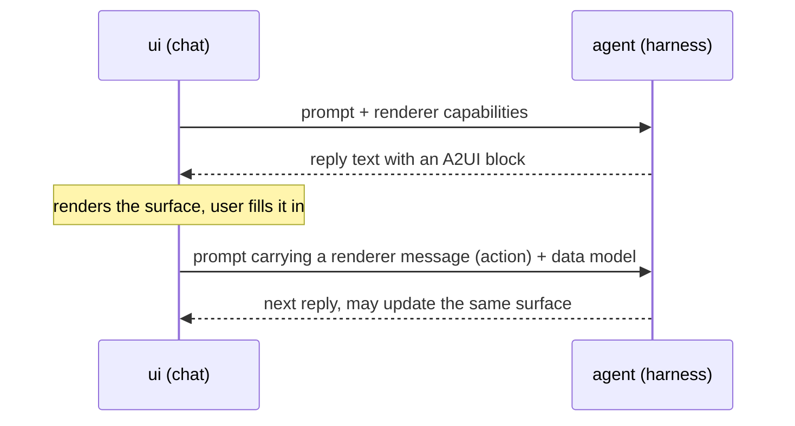

# Chat forms

Last verified: 2026-10-12

## Overview

An agent can put interactive UI into its reply in the web chat — a form, a set of choices, a card, a list built from data, tabs, a dialog, a callout, a diff.
The format is [A2UI](https://a2ui.org) v1.0: the agent describes the UI as data against a component **catalog**, and the chat renders it with the app's own components.
Nothing the agent sends runs as code in the browser.
The user's answer goes back to the agent as text in their next prompt.

Chat forms are an [experimental feature](features.md), off by default.
With it off, a block in a reply shows as a collapsed note with its source.

The first users are [Kit Onboarding and Kit Update](starter-kits.md): the questions an agent asks there — which upstream changes to take, values only the owner knows — become choices and fields instead of free text.

## The conversation is the transport

There is no dedicated tool and no side channel.
Everything travels inside the Session Transcript:

- **Agent → chat.** The reply contains an A2UI block: a tag on a line of its own, holding agent-to-renderer messages that create, update or delete **surfaces** (one rendered form or card each).
  The chat cuts blocks out of the reply as it streams and renders the rest of the reply as markdown.
- **Chat → agent.** A button press, an error the user chooses to forward, and the answer to an agent's function call each travel as an A2UI **renderer message** in a block of the user's prompt.
  A surface that asks for it also gets its whole **data model** attached to every prompt, so the agent sees the current state of the form.
- **Renderer capabilities.** While the owner has the feature on, the web chat attaches the catalogs it renders to every prompt, and the platform adds the same announcement to the onboarding and Kit Update briefings it composes.
  An agent uses forms only in a conversation that announces them.
  Channel turns never carry the announcement, so in [Slack and Telegram](channels.md) the agent asks in plain text.
- **The skill.** Agents learn the format from the `platform-chat-forms` [platform skill](skills.md#platform-skill), which ships in the base image and is listed under this feature.
  It names the catalogs, components, functions and rules, with worked examples.
  Where the context supports one, it asks the agent to preselect a recommended answer, mark it and say why; matters of taste, values only the user knows and risky choices stay empty.
  The chat shows a label's trailing `(Recommended)` as a muted tag.

In the user's own message the chat shows a short summary — the action's human-readable label and the values sent — instead of the raw renderer messages.

## Surfaces across a session

The chat replays every block of the session in order, so a surface outlives the reply that created it:

- A surface identifier is unique within the session; creating one that exists is an integrity error.
- A later reply may **update** a surface (replace components, change its data) or **delete** it.
  The surface re-renders where it was created; the later reply shows a one-line note instead.
- **Only the surface the newest finished reply created or touched accepts input.** Older surfaces stay visible and locked, so the user cannot answer a question the agent has moved past.
- The user's unsent edits are kept per surface version: they survive scrolling and re-renders, and are replaced when the agent updates that surface.
  Editing a form in another session drops them.
- Reloading the session rebuilds every surface from the loaded part of the transcript.
  An update to a surface whose creating reply is not loaded yet shows as a surface-not-found error.

While a reply streams, the chat renders the complete part of the block and shows placeholders for components still being written.
Validation errors are reported only once the block is complete.
A block that a finished reply never closes counts as complete, so its errors show.

## Catalogs and validation

Two catalogs are supported: the A2UI **basic catalog** (layout, text, media, inputs, buttons, tabs, dialogs) and the **platform catalog**, a superset that adds callouts, badges, switches, code blocks and diffs.
A component resolves through its own catalog identifier, else the surface's default; a component that resolves nowhere, or is not in its catalog, is not rendered.
Messages and components are validated strictly against the v1.0 schema, so an unknown component or property is an error rather than a guess.

Errors are listed under the block, each with a machine-readable code and the location in the block, and a button that forwards them to the agent as renderer error messages.
The agent fixes the block and sends it again.

## Functions and checks

Values in a surface can be literals, data bindings (absolute, or relative to the item inside a list template) or calls to catalog functions — string interpolation, number, currency and date formatting, pluralization, validators, boolean logic, the template index, and opening a link.
They run in the browser.
The validators, formatters and logic come from the official A2UI renderer core; the chat keeps its own interpolation (the core cannot read the template index inside it) and its own link opening, which is stricter than the core.

**Checks** attach validators to inputs and buttons.
A failed check shows its message under the input once the user has edited it, and disables a button until it passes.
A message the agent wrote on a check wins over a validator's built-in one.

An agent may ask the chat to run a function.
Every basic-catalog function may only be called by the renderer, so such a call is refused.
The specification requires a reply to each call, and the chat sends it on its own; it stops after three automatic replies in a row until a person writes, so an agent that keeps calling cannot keep itself busy.

## Trust boundary

- The agent sends data, never code: no HTML, no scripts, no iframes.
  The chat maps every component to an app component.
- Image, Video and AudioPlayer components load media only over HTTPS (images also from inline data); the `openUrl` function opens only HTTP(S) links, in a new tab without opener access, and only from a click.
  Markdown in Text and Callout follows the same rules as the rest of the agent's reply.
- Regular expressions in checks are screened for catastrophic backtracking before they run.
- The skill tells the agent never to ask for passwords, tokens or keys; credentials go through [connections](connections.md).
  The renderer still draws an obscured text field, and its value reaches the transcript as plain text.
  The agent treats every value it gets back as user input, like anything else the user typed.
- Renderer messages are ordinary prompt text: they carry no authority beyond the user's own message.

## Where forms do not render

- **Channels** — Slack and Telegram never announce the capability; see above.
- **Read-only views**, such as a delegated agent's transcript, render surfaces without input.
- **Feature off** — a collapsed note with the block's source.

The renderer lives in the UI ([`packages/ui/`](../../packages/ui/)); the catalog identifiers and the capability announcement are shared with the api-server through the contract package ([`packages/api-server-api/`](../../packages/api-server-api/)).
