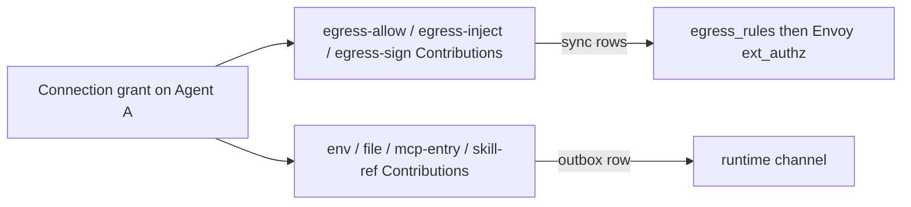

# Connections

Last verified: 2026-11-10

## Overview

A Connection is everything an agent needs to talk to one external integration — credentials, hosts to reach, config files to author, MCP entries to expose, skills to install.
Connection Templates are code-level catalog entries that ship defaults; granting a Connection to an Agent materializes its Contributions into the right destinations.

The Connections context owns Connection Templates, Connections, and grants.
It computes each Agent's Contribution set and routes every Contribution to the rail that delivers it.

Contributions on the runtime-channel rail are carried by a separate subsystem — the transactional outbox, the delivery worker, and the agent-side drivers and event handlers are documented in [runtime delivery](runtime-delivery.md).
This page stops at the rail boundary.

A grant of one Connection produces Contributions of several kinds.
They don't all travel the same rail:

There are two rails.
`egress-allow`, `egress-inject` and `egress-sign` Contributions sync into Postgres `egress_rules` and are read live by Envoy; `egress-inject` additionally carries a credential the gateway injects on the wire, and `egress-sign` names a host whose requests the gateway re-signs with the Connection's keys (mechanics in [credential gateway](credential-gateway.md)).
Everything else — `env` (formerly a controller-render/pod-roll rail; moving it onto the runtime channel means a grant change no longer rolls the agent), `file`, `mcp-entry`, `skill-ref` — travels the runtime channel, and how it gets there is [runtime delivery](runtime-delivery.md).
The rest of this page is what a Connection is and what a grant produces.

## Concepts

### Connection Template

A code-level catalog entry.
Premade templates (GitHub, Anthropic, Spotify, Figma MCP, …) ship with full defaults — auth flow, hosts, scopes, recommended contributions.
Custom templates (Custom MCP, Custom OAuth, Custom Header) ship the *shape* but leave the integration's identity for the user to fill in.

Three display-axis attributes drive UI grouping.
`category` and `isCustom` place a template in a section; an optional **family** (`github`, `github-enterprise`, `kubernetes`, `modal`, `mcp-server`, `custom-header`) groups templates the catalog shows as one connect page with several methods, and is what a [starter kit](starter-kits.md) names when it accepts any method of a provider.
Families are declared on the templates themselves and carried on the template view, so nothing else keeps a copy of the membership.

| `category` | `isCustom` | Where the user encounters it                                                            |
| ---------- | ---------- | --------------------------------------------------------------------------------------- |
| `app`      | `false`    | Apps section: GitHub, Spotify, Anthropic, OpenAI, Google services, GitHub Enterprise, … |
| `mcp`      | `false`    | MCP servers section: Figma MCP, … (as added)                                            |
| `mcp`      | `true`     | Custom Connection → "Add MCP server"                                                    |
| `other`    | `true`     | Custom Connection → "Add OAuth credential" / "Add Header credential"                    |

Templates are registered in code; adding a new integration is one entry.
Schemas validate user input; the template's `build()` function projects inputs into the concrete `auth` + `contributions[]` of the Connection record.

Beyond the auth credential, a template may declare optional **config inputs** that the user fills at connect time; each filled input projects into an additional `env` contribution, validated against the input's spec.
They can change later without re-entering the credential, unless one also decides an egress host.

#### Internal-only templates

Some templates (Spotify, YouTube, Google services, and the custom client-credentials shape) are hidden from regular users client-side, affecting only what's offered (wherever the catalog is browsed), not Connections already created.
Testers reveal the full catalog by enabling the *advanced connections* per-user experimental feature flag — see [features](features.md).
The install's own [DAM Connection](connection-presets.md#platform-preset-this-install-itself) is offered only to a person whose own flag says so, because only the platform mints its credential: with the flag off the catalog hides it and no grant of it is accepted, while a Connection already made keeps working.
The GitHub App templates are offered to everyone, grouped with the other GitHub auth methods.

### Connection

A uniform shape — every Connection looks the same regardless of category or auth mode: identity and owner, the source Template, a user-visible name, the recorded inputs (the user's own, kept for re-render, plus any platform-derived facts the Connection is identified or labelled by), the auth credential state, and the projected contributions.

The `auth` field carries credential-acquisition state in one of six modes: **OAuth** (a client identity, references to the stored refresh and access tokens, and granted scopes), **client credentials** (machine-to-machine OAuth — a client identity plus references to the stored client secret and tokens minted from it), **GitHub App** (a GitHub App identity plus a reference to the stored private key and the installation tokens minted from it — client credentials' JWT-signed counterpart), **header** (a reference to the stored secret plus the header name and value format to inject), **SigV4** (an HMAC key pair for S3-compatible storage — references to the stored access key ID, secret access key and the credentials file the gateway signs with, plus the signing region), or **none**.
Token references point at the per-Connection K8s Secret — never inline secret material.
Exact field shapes live in the [Connections contract types](../../packages/api-server-api/src/modules/connections/).

An Agent may hold several **provider Connections**, at most one per **provider alias**: the alias names the provider in every qualified model name, so a second Connection behind one alias is refused.
A session picks its model per turn, and the provider follows from the name.
Creation grants the one it names, else one provider Connection the owner holds that the harness runs on: the provider of the owner's [default for new agents](profiles.md#the-default-for-new-agents) when the agent starts on that profile, else the first in the harness's provider order, taken from the providers its [starter kit](starter-kits.md) lists when the owner holds one of them ([agent-lifecycle](agent-lifecycle.md#create)).
The agent's Providers section lists every provider Connection the owner holds with a grant toggle; picking a profile grants the provider it runs on ([profiles](profiles.md)).
A provider Connection, and its Template, carry their alias and the harnesses of the catalog that run on it in every listing, so a caller tells providers apart without knowing template ids; the listing also marks one **preferred**: the one a create that names no provider grants — the provider of the owner's [default for new agents](profiles.md#the-default-for-new-agents) where they hold one, else the first in the provider order of the harness a plain create boots on (the default's, else the install's), and none while the owner holds no active provider that harness runs on — unless a starter kit lists other providers.
A provider Connection's env lands in a per-provider layer the Model Router reads; granting or revoking one recycles the [Harness Leases](sessions.md#session-inside-the-machine).

Credentials carry their own lifecycle.
A stored one can be **updated in place** — the injected value, the client secret, the GitHub App private key, or the storage key pair, whichever the auth mode holds.
The minting modes validate by using the secret, at create and on every rotation alike, so an unusable one fails before anything is persisted; a storage key pair is proven the same way, by a request to its endpoint, and a rotation the endpoint refuses leaves the working pair in place.
A model provider's key is proven where the provider offers a check.
A key that passes names its account where the provider tells that key: an Anthropic OAuth token the email and organization of its profile, an Anthropic or OpenAI API key the organization its provider answers with, an IBM LiteLLM or Bob key the user it belongs to, and a Bedrock key its AWS account.
The account is extra: a lookup that fails leaves the key passed, with no account.
A provider that cannot say leaves the key unverified; the CurveBender deployment's key, which the user holds no copy of, leaves it unchecked.
The result of that check and its time are kept on the Connection, since a key that worked when it was saved can be revoked or expire later; the owner can recheck the keys of all their provider Connections at once, server-side, which Settings › Providers also does each time it opens, and a key the provider refuses then reads as refused until it is replaced.
A rotation rewrites the credential and its SDS — or, for a key pair, the credentials file the gateway signs with — onto the same per-Connection Secret; nothing else moves — identity, contributions and every agent grant are preserved, and since the live value is read gateway-side, no Agent-spec patch or pod roll is needed.
A static key pair has no expiry and no horizon: it reads active until it is rotated or the Connection is removed.
A credential can also be typed on a **secret-entry page** of the web app instead of into the client that asked for it.
The client hands the api-server every input except the secret and gets a single-use link that expires after ten minutes; the request lives in Redis and the link carries only a random id.
The page and its submit run as the signed-in user and refuse a request another user made, so a link sent to someone else collects nothing.
Before the user types, the page shows what the save will do — the template, the name, every host the secret is sent to with its header, the env vars agents see, and for a rotation the agents it is granted to — computed by the same builder the create runs, and it warns when a host is not one the template presets.
The submit then runs the ordinary create or rotation, with its validation; a refused secret leaves the link usable until it expires.
A header template may also name a **credential check**, which the GitHub personal access token templates do: the token is tried on the user endpoint of its GitHub host before it is stored, on create and on rotation alike.
The check passes, naming the account, the expiry and, for a classic token, the scopes; fails, with GitHub's reason (bad credentials, or SSO authorization an organization requires); or stays unchecked when GitHub gives no answer about the token.
The Kubernetes template names one too: the api-server posts a SelfSubjectReview to the cluster's API server with the token, trusting the Connection's stored CA when it has one and the public roots otherwise, as the gateway does.
Any authenticated identity may create a SelfSubjectReview, so the check needs no permission beyond the token.
It passes naming the user the token acts as (`system:serviceaccount:<namespace>:<name>`) and the expiry from the token's `exp` claim; fails on a 401, saying the token expired when its claim is past, on a certificate the CA or the public roots do not trust, and on any other TLS error; and stays unchecked on a cluster older than Kubernetes 1.28, another answer, or no answer.
A **GitHub App** connection is checked with the installation token it mints, which the save already requires, so a saved one passes naming its bot, the account the app is installed on and the repositories the token reaches.
A key rotation, a scope change and a check on demand mint again; a refusal fails, naming the input at fault.
The page holds a token that does not pass, and one that passes but expires within a day, so the user can fix it on the same link, and saves it on a confirmed "save anyway": the user is warned, never blocked.
Saved through any path, the token keeps the result and its time on the Connection, which every listing carries, so a token saved after a failed check does not read like a healthy one; the owner can check one stored credential again, which replaces the result, and a provider key is checked again with its provider check.
The client polls a status that says only pending, saved (with the Connection's id), cancelled or expired: no reader gets the secret back.
The page covers the static and minting kinds; OAuth needs no secret here.
An Agent can ask for the same page through its platform MCP server (the `connection_secret` tool), as its owner: the link is the owner's, and the page names the Agent that asked.
An Agent's request is narrower than the CLI's, because the Agent, not the person, chose its inputs: a new Connection must send the secret only to the hosts its template presets without config inputs, so a custom template, an S3 endpoint or a host of the Agent's choosing is refused, and a rotation names only a Connection granted to that Agent.
The Connection the page creates is granted to the Agent that asked, and the status that Agent polls says whether the grant took; it reads only its own requests.
OAuth stays a person's step: an Agent does not start a sign-in.
An **OAuth** credential is re-acquired, not pasted: re-running login and consent on the same Connection lands fresh tokens on the same Secret and asks for the template's current scopes, so a scope list that grew since create takes effect then.
A credential that stops working reads as **expired**: the refresh loop persists a marker when the token endpoint *rejects* it rather than merely failing to answer, and a marked Connection stops being retried until a new credential clears it.
A rejected *operator-supplied* client secret stays retryable, so a centrally-fixed one revives without per-connection action.
A failure that is not a rejection parks nothing and instead defers the next attempt on a widening backoff held on the Connection itself, so a renewal that keeps failing is not re-attempted every sweep; any successful credential write clears both records.
Credential writers — refresh, rotation, re-consent, and the re-point of a shared knowledge base onto a fresh link — serialize per Connection across replicas with an in-lock re-read that stands down if the state already advanced; grant fan-out serializes per Agent.
Past its token horizon a Connection also reads expired, since a healthy one is renewed well ahead of it; a provider issuing non-expiring tokens has no horizon and stays active.

A **client-credentials** connection resolves the token endpoint from the authorization server's published OAuth metadata at create time and mints its first access token synchronously.
The issuer URL is optional — when omitted it is discovered from the API host's published OAuth metadata.
The same background loop that refreshes OAuth tokens re-mints it before expiry using the stored client secret.
One per-Connection Secret holds the client secret, the current access token, and the SDS files baked from it; only the minted access token is ever injected on the wire.

A **GitHub App** installation and a **GitHub sign-in** made through a GitHub App are *parents*: they hold the credential and no Agent holds them; an Agent holds a Connection made from one, with its own scope, or full access named on purpose, and its own token ([github-connections](github-connections.md)).

A Connection that acts as a person rather than as the Agent records **whose account** it acts as, so the product can name that person wherever the Connection is listed.
The platform asks the provider with the Connection's own credential (Slack, GitHub and the Google services today) when the credential first works: at the OAuth callback, at create for a token, and again on every re-consent or rotation, since a new credential may belong to someone else.
The answer is a platform-derived fact on the Connection, never a user input.
A label the provider chooses, such as an account or a repository name, is cleaned of control characters and capped in length before it is stored or shown, so a hostile host cannot spoof the terminal or the page with it.
A lookup that fails costs nothing but the label.
Connections made before this existed are labelled by a background sweep that tries each one once per api-server process, so a credential the provider refuses is not retried in a loop.

Connect and disconnect raise domain events, recorded as [Activity Events](usage-tracking.md).
A connect fires wherever the Connection actually reaches its connected state — at creation for the modes that complete synchronously, and at the authorization callback for OAuth, which is the only mode that cannot finish in one step.
Emitting at both points would double-count OAuth; emitting only at the callback leaves every other mode invisible.
A connection abandoned before that state raises neither event, so removals cannot outnumber connects.
A parent raises neither event either: the Connections made from it do, when made and when removed, also when they go with their parent.
The event names the provider, not just the grant, because the Connection record is destroyed on disconnect and a grant identifier alone would die with it.

### Contribution

A typed unit a Connection emits when granted to an Agent — a discriminated union over `kind`.
The kinds today:

- **`env`** — an environment variable the harness merges in at spawn.
  For credential-derived env the value is a placeholder (the real secret is injected gateway-side); for user-typed and non-credential config env it is the literal value.
- **`egress-allow`** — permission to reach a host (optionally path-scoped, optionally port-scoped for endpoints not on 443).
- **`egress-inject`** — an allowed host plus a credential the gateway injects on the wire, as a header or a query parameter.
  May additionally name a non-443 upstream port, opt the host's chain into streaming-upgrade tunneling (WebSocket/SPDY — `kubectl exec`/`port-forward`), carry the upstream's private CA for gateway-side TLS validation, and declare path prefix rewrites the gateway applies on the way upstream (mechanics in [credential gateway](credential-gateway.md)).
- **`egress-sign`** — an allowed host whose requests the gateway re-signs with the Connection's key pair instead of injecting a header, carrying the signing region and service.
  May name a non-443 upstream port, and is path-scoped to the bucket when the Connection is limited to one (mechanics in [credential gateway](credential-gateway.md#request-signing)).
- **`file`** — a config file to author, with a format and a merge mode (see [Built-in contribution impls](runtime-delivery.md#built-in-contribution-impls)).
- **`mcp-entry`** — an MCP server to expose to the harness.
- **`skill-ref`** — a skill source to install at a pinned version.

Kinds are added by extending the union and gating on agent capabilities (see [Versioning](runtime-delivery.md#versioning)).
Exact per-kind fields live in the [Connections contract types](../../packages/api-server-api/src/modules/connections/).

### Addressing a Connection

A user may hold several Connections to one service — two Slack workspaces, two GitHub identities, two tenants of one MCP server — and, where the platform can tell them apart, grant more than one of them to the same Agent.
They reach the same host, so the host alone does not say which account a request acts as.

Each Connection therefore has an **address**, in two carriers.
One is a per-Connection path prefix on the real host, `/__platform_conn/<connection id>/`: the gateway picks the credential from that path and strips it before the request leaves, so the upstream sees the address it published.
The other is the Connection's **token placeholder**, `platform:conn:<connection id>`: every credential placeholder a Connection hands the Agent — a `GH_TOKEN` env, the token in gh's hosts file, a placeholder in an MCP entry's headers — is that value rather than an inert constant, and a client that sends it where the real token goes has named the Connection, whatever URL it asked for.
A client that refuses a key without its vendor's prefix is handed the address behind that prefix (`as-platform:conn:<id>`), and the gateway reads it there too; a credential inside a config file, like a kubeconfig token, is addressed the same way.
The gateway reads it out of the claimed header (bare, behind a scheme such as `token` or `Bearer`, or as the password of a Basic pair) or the claimed query parameter, and overwrites it with the real credential as before.
A storage Connection is addressed through its access key ID: the placeholder stands where the key ID goes in a SigV4 credential, the gateway reads it from there and re-signs the request with the real pair, and the path prefix does not apply, since the gateway signs the upstream path ([credential gateway](credential-gateway.md#request-signing)).
The host stays the real one either way, so egress rules, approval prompts and logs keep describing the real destination.

The address is a property of the Agent's grant, not of the stored Connection: contributions are recorded against the real address and the inert placeholder, and the runtime state an Agent is given carries the prefixed URLs and the per-Connection placeholder.
So a Connection's address is stable whether or not a second Connection to that service exists, and adding one never re-addresses the first.
The platform prefixes the `mcp-entry` URLs of each Connection — the addresses it writes on the Agent's behalf.
The Agent sees those entries under the names the user gave the Connections, so two workspaces read as two named servers.
The two names the platform injects under are reserved: an entry name is the prefix on every tool it carries, so a Connection wearing one would displace the platform's own entry and inherit the approval a relayed turn gives that surface ([channel turns](channel-turns.md)).
Naming refuses them and delivery drops them, and the Agents already holding one were re-delivered once, so rows predating the rule are covered too.

Naming a Connection is only *required* where two of them genuinely collide: the same header on the same host over paths that overlap.
Connections that scope themselves to different parts of one service — one per Google Workspace service on `www.googleapis.com` — are not rivals, and each keeps being injected on its own paths without any address.
Where the scopes do overlap, an unaddressed request fails closed at the gateway, because the alternative, serving it from whichever credential sorted first, is the silent wrong-account failure this addressing exists to end — unless the Agent requires naming (below), where it carries no credential of the Agent's at all.

An Agent can make naming *required* for every one of its Connections; a new one does unless its create or starter kit says otherwise.
The Agent's spec says so, and agent settings change it later.
Its gateway then injects a Connection's credential only into a request that names it, and sends any other request upstream with the credential it already carries, rather than replacing it.
That holds on contested scopes too: a request naming none of two rival Connections goes upstream unchanged, so a public download from a host where the Agent holds two accounts answers as it does to anyone, and nothing is ambiguous, since no credential is chosen.
It serves an agent whose tools — Docker containers, nested agents, a browser its user drives — call the same hosts with their own credentials or none: their requests name none of the agent's Connections, so the gateway leaves them alone.
Off serves the opposite: tools that need a credential added to a request naming no Connection.
Platform-written values already carry an address, so the agent's own clients are unaffected.
A Connection with no credential of the agent's own is reachable only through its path prefix.
Only such an agent offers the [browser panel](browser-panel.md), whose user browses through the agent's gateway.

**Default accounts.** Where an Agent holds several Connections of one group — a GitHub host is one group, and an Agent's storage Connections form another (below) — the account active on delivery is the grant the user marked **preferred** on the Agent, chosen from the Agent's connections panel, at most one per group, or, absent a choice, the earliest grant, which is the account the Agent already acted as.
Every state push re-asserts that default, so a switch the Agent made itself lasts until the next push.
Ordering, the default and the account names are one rule for every kind of Connection with a default account; a kind says only how its Connections group and how a name is spelled for its tool, and the connections panel offers every group's choice in one callout.
How two GitHub accounts share one host, through gh's own hosts file, is on [github-connections](github-connections.md#several-github-accounts).

Two limits follow.
First, an address exists only where the platform writes one or the Agent can send one.
A Connection reached with no credential of the Agent's own — a Custom Header credential that sets no env — has no address the Agent can use, and two Connections whose placeholders would land in one env — two accounts of one Google service, both writing the same variable — can deliver only one of them, so in either case two such Connections that collide can never both work: every request where their paths overlap is refused, or, on an Agent requiring naming, sent with neither credential.
GitHub is the collision the platform resolves, through gh's hosts file.
The Connections context therefore refuses to grant an Agent a Connection that collides with one it holds unless both are addressed — when a grant is added and when an Agent is created with its first grants — and the connection pickers say which granted Connection is in the way.
An Agent that already holds such a pair can still change its other grants, and is shown a warning naming the pair until one is revoked.
Two GitHub accounts, two Slack workspaces or two tenants of one MCP server are addressed, so they stay grantable together; so are two storage Connections on one endpoint, whose gateway signs only the requests that name each and never contests the host.

Second, a path address only holds while the Agent keeps using it: an upstream that answers with an absolute URL of its own, stripped of the prefix, sends the Agent back unaddressed.
A token placeholder is not lost this way, since it rides in the credential rather than the URL.
That is an accepted limit rather than a guarded one — the reply is a refusal the Agent can read, not a request served as the wrong account.

## Connection presets

What each shipped template gives an Agent, and what a grant of it materializes, is on [connection presets](connection-presets.md).

## Built-in contributions

Not every contribution comes from a grant: the runtime state builder also merges **built-ins** the platform itself contributes.
Every agent gets the platform MCP entry and its display name as the `PLATFORM_AGENT_NAME` env var, which a rename refreshes at the next harness spawn without a restart; a sandbox holding at least one shared-knowledge-base grant additionally gets the aggregate `knowledge-bases` MCP entry pointing at the in-cluster harness route, alongside the platform MCP entry, appearing and disappearing with its first and last such grant.

## Contribution fan-out

The api-server's contribution-fanout layer routes each Contribution kind to the rail that delivers it.
Different rails because the kinds have genuinely different delivery semantics:

| Kind            | Rail                                                                                        | Delivery semantics                             | Note                                                                                                                                                                                                                                                                                                                                                                                                                                                                                               |
| --------------- | ------------------------------------------------------------------------------------------- | ---------------------------------------------- | -------------------------------------------------------------------------------------------------------------------------------------------------------------------------------------------------------------------------------------------------------------------------------------------------------------------------------------------------------------------------------------------------------------------------------------------------------------------------------------------------- |
| `env`           | Runtime channel `applyState` (state slice)                                                  | Sub-second push; applied at next harness spawn | Written to a JSON file the harness spawn path merges into the process env. Two sources feed it — user-typed env (the Environment editor) and connection-derived env — user env ordered first so it wins on name collision (first-occurrence-wins). A change recycles the harness at an idle turn boundary; only a variable-set change may force one mid-turn, never past a kept [Harness Task](agent-processes.md#reported-background-work) — value-only changes spare in-flight runs. No restart. |
| `egress-allow`  | Postgres `egress_rules` → Envoy `ext_authz`                                                 | Live read; no pod involvement                  | Joined per-grant; revoke sweeps rows, except a preset row the grant took over, which goes back to the preset; at startup the api-server marks such rows taken over before the mark existed, for an agent still on the trusted preset. Agent never sees these.                                                                                                                                                                                                                                      |
| `egress-inject` | Postgres `egress_rules` → Envoy `ext_authz`, plus a wire-injected credential at the gateway | Live read; no pod involvement                  | Same `egress_rules` row as `egress-allow`; the gateway also injects `headerName`/`valueFormat` on the wire (mechanics in [credential gateway](credential-gateway.md)). Agent never sees these.                                                                                                                                                                                                                                                                                                     |
| `egress-sign`   | Postgres `egress_rules` → Envoy `ext_authz`, plus a signing step at the gateway             | Live read; no pod involvement                  | Same `egress_rules` row as `egress-allow`, path-scoped to the bucket when one is set; the gateway re-signs requests naming the Connection with its key pair (mechanics in [credential gateway](credential-gateway.md#request-signing)). Agent never sees the keys.                                                                                                                                                                                                                                 |
| `file`          | Runtime channel `applyState` (state slice)                                                  | Sub-second push; idempotent reconciliation     | Per-format + per-mergeMode driver materializes.                                                                                                                                                                                                                                                                                                                                                                                                                                                    |
| `mcp-entry`     | Runtime channel `applyState` (state slice)                                                  | Sub-second push; idempotent reconciliation     | Driver dispatches to harness-specific path.                                                                                                                                                                                                                                                                                                                                                                                                                                                        |
| `skill-ref`     | Runtime channel `applyState` (state slice)                                                  | Sub-second push; per-version installer         | Driver wraps existing skill-fetch helpers.                                                                                                                                                                                                                                                                                                                                                                                                                                                         |

The rail choice is a property of the kind, not of the Connection.
A single grant of GitHub Enterprise produces Contributions on both rails: `egress-allow` (egress_rules → Envoy live), and `env` + `file` (runtime channel push).
They flow independently.

## Persistence touchpoints

| Substrate                 | What lives there                                                                 | Notes                                                                                                                                                                       |
| ------------------------- | -------------------------------------------------------------------------------- | --------------------------------------------------------------------------------------------------------------------------------------------------------------------------- |
| Postgres `connections`    | Connection records                                                               | The unified model's own table.                                                                                                                                              |
| Postgres `egress_rules`   | `egress-allow`, `egress-inject` and `egress-sign` Contributions joined per grant | Existing table; same as today. All three kinds produce the same allow row; `egress-inject`'s credential and `egress-sign`'s signing step ride a separate gateway-side rail. |
| K8s Secret per Connection | Auth credentials (refresh tokens, api-keys, HMAC key pairs)                      | Owner-label-scoped; mounted into the paired gateway pod, never into the machine. A parent's holds its credential; a Connection made from it holds only its own token.       |

## Invariants

- **Every Contribution kind has exactly one rail.** The api-server's fan-out determines which rail per kind; drivers, controller-render, and Envoy never overlap responsibilities on the same kind.
