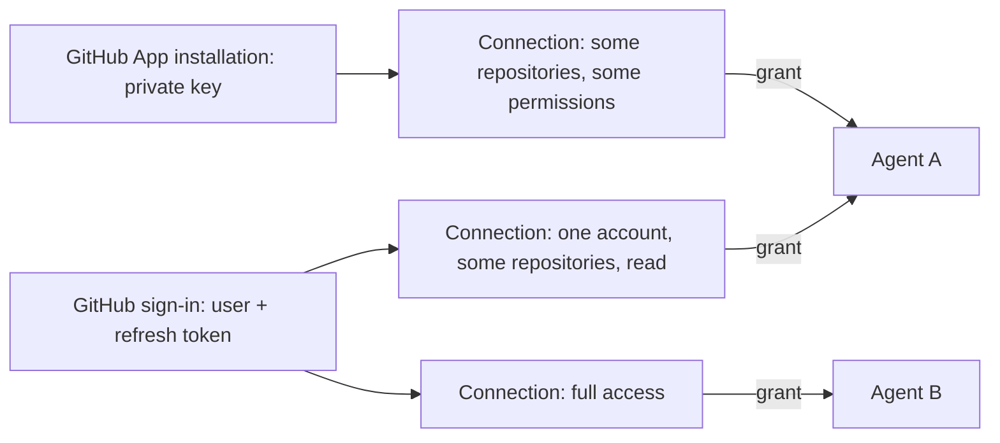

# GitHub Connections

Last verified: 2026-10-29

## Overview

GitHub reaches an Agent through three kinds of [Connection](connections.md): a personal access token, a sign-in made through a GitHub App, and a GitHub App installation.
A token is an ordinary Connection.
A sign-in and an installation hold a credential that reaches far more than one Agent should get, so each is a *parent* that no Agent holds, and an Agent holds a Connection made from it instead, with its own scope.
This page owns those two parents, the Connections made from them, and how an Agent that holds several GitHub accounts uses them; the credential mechanics are in [security-and-credentials](security-and-credentials.md).

## Sign-ins and installations

A **GitHub App** installation is the JWT-signed counterpart of a [client-credentials](connections.md#connection) Connection: its tokens are minted and refreshed the same way, but the exchange is signed with a private key rather than paid for with a client secret.
The user supplies the app id, installation id, and a PEM private key; the platform signs a short-lived JWT, and the save proves the key by minting a token for the whole installation and revoking it again.
When GitHub refuses the mint or the installation read, the error names the input at fault — an App ID with no app behind it, a private key of another app, an installation the app does not have — from GitHub's status and message, so the user knows which value to fix.
The private key never leaves the api-server; the tokens minted with it inject on the same GitHub hosts as a personal access token.

A **GitHub sign-in** made through a GitHub App holds a user token rather than an installation token, and its refresh token.
GitHub rotates the refresh token on each use, so exactly one Connection owns it, and the new one is stored before anything is derived from the new user token.

**Connections made from a sign-in or an installation.** A GitHub sign-in and a GitHub App installation are each a *parent*: a Connection that holds the credential and that no Agent can hold, so a grant of one is refused.
An Agent holds a Connection made from it, with its own scope and its own per-Connection Secret holding only its own token, so one sign-in backs a read-only Agent and a read-write Agent side by side, and each grant says what it reaches.
Names are unique among a user's parents and among their other Connections, so a parent may share its name with its first Connection.
The scope is chosen against what the credential reaches, read back from GitHub with the parent's credential: for a sign-in, one account the app is installed on and optionally repositories and permissions there, which needs the sign-in first, since before consent there is nothing to read; for an installation, repositories and permissions.
GitHub refuses a token that names a repository the credential cannot reach, so an edit drops a chosen repository that a complete listing no longer shows; a partial listing keeps the chosen repositories it does not show.
Full access — everything the sign-in reaches through the app, or the whole installation — is a scope named on purpose, never what a Connection gets by naming nothing: one that names neither is refused, at create and on every edit.
No Connection exists after a sign-in until the user picks one, and the user may put that off; a save of an installation that names a scope or full access makes the installation and its first Connection at once, one that names neither — the user chose to make no Connection yet — makes the installation alone, and an Agent's own secret request may name only a scope.
A sign-in's Connection injects a scoped token GitHub derives from the user token, authorized by the app's client secret, or the user token itself for full access; a renewal of the sign-in, a re-consent, and an edit of the scope give the Connections a token from the current user token, under the sign-in's refresh lock, and the sign-in renews before the earliest expiry among them.
A scope GitHub refuses parks that one Connection as expired without costing the sign-in or its siblings anything, and never falls back to a wider token.
A narrowed token still never does more than the user could.
An installation's Connection mints its own installation token with the installation's key, and the refresh loop renews it like any minted token; a new key is given to the installation only, proven the same way, and every Connection made from it mints again with it.
Re-authentication and credential rotation act on the parent; removing the parent removes every Connection made from it and delivers to every Agent that held one.
Connections that predate the split each became a parent plus one Connection that kept its identity, name, grants and Secret, which it now shares with the parent; one never narrowed says full access rather than being narrowed silently, so no Agent lost access.

## Several GitHub accounts

`gh` takes a host rather than a URL and reads one `GH_TOKEN` ahead of its own config, so two GitHub Connections on one host cannot both hand the Agent that env.
When an Agent holds two or more, the platform stops contributing `GH_TOKEN` for them and writes gh's own multi-account hosts file instead: one account per Connection, named after the Connection, each under its token placeholder.
The Agent switches with `gh auth switch`, and `git` follows the active account through gh's credential helper, so both identities work from one shell.
The account active on delivery is the [default account](connections.md#addressing-a-connection) of the host's group: the grant the user marked preferred on the Agent, or the earliest.
The commit identity git uses follows that default too: the active account's name and email when it has one — an account that signed in with a token or as an App has none — and switching with gh changes which account authenticates, not whom the commits name.
Because the env is gone, the platform states gh's availability explicitly in that case, and the runtime's own GitHub client reads the active token from the same file.
The Agent learns all of this from a skill every agent image ships, `platform-github`: how to list its accounts, how to switch or act as one for a single command, and what the gateway's refusal means.
A GitHub Enterprise Server is a separate case: `gh` reads `GH_ENTERPRISE_TOKEN` for such a host and never `GH_TOKEN`, which it reserves for github.com and `ghe.com` tenants, so a Connection to an Enterprise Server hands the Agent `GH_ENTERPRISE_TOKEN` and never competes with a github.com account for one env.
