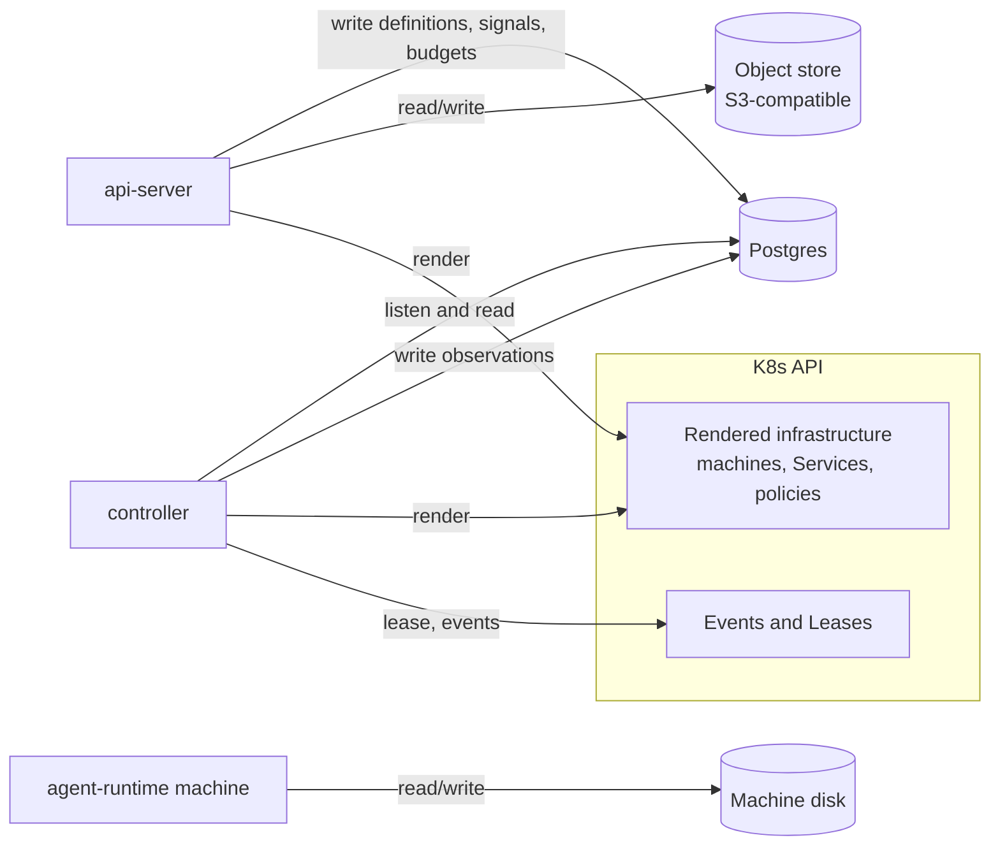

# Persistence

Last verified: 2026-10-24

## Overview

Platform persists state on four durable substrates, split cleanly between the platform and the agent:

**Platform-owned** (the agent never touches these):

- **Postgres** — the platform's own state, and from the release that moves them, its record of each Agent and each user budget as well.
  The api-server owns the schema and writes definitions, lifecycle signals and budgets; the controller reaches only what it reconciles, through its own login and grants that name each column, and writes nothing else.
  Holds anything that has to be queryable when no agent is running (channel bindings, identity links, allow-listed users, schedules), the per-Agent record the controller renders from, plus any other api-server-only domain resource.
  Session metadata is *not* here — it is agent-owned, save for the one dimension the spend read path cannot lose to hibernation or agent deletion (see the session directory below).
  The bundled instance runs under four login roles — one NOSUPERUSER owner per service (`platform_apiserver`, `platform_keycloak`), the controller's own login `platform_controller` that owns nothing, plus the bootstrap superuser `platform`, kept as a separate statement-logged role for DBA work — so the api-server's connection credential cannot reach Keycloak's database or escalate, and the controller's cannot read a definition column it does not render.
  Admin sessions carry a per-role `log_statement` default that puts every statement they issue into the pod log for the cluster collector; the server-wide default logs DDL only, so routine application DML stays out of the audit trail while every role and grant change is captured whoever issues it.
  A group role beside them, `usage_readers`, carries no credential and cannot log in: it is the group an operator grants membership in to give a read-only login access to the usage source passthrough views, owned by [usage-tracking](usage-tracking.md#source-passthrough-views).
- **Object store** — bulk binary blobs behind an S3-compatible API; consumers: artifact-library content and the published read-only snapshots of shared knowledge bases.
  The api-server is its sole standing authority: it holds the only credentials and mints short-lived, single-object links that let an agent upload or download (through its paired gateway) or a browser download directly, after ownership checks — each link signed for the authority its audience dials, since it is only valid on that one — an agent has no access to the store beyond a link the platform issued.
  The chart bundles a single-node SeaweedFS by default so dev and local clusters work without an external account; operators point production installs at their own S3-compatible endpoint instead.
  An install with no object store cannot store artifact content — the feature fails closed.
- **Custom resources** — on their way out.
  The two kinds the platform kept there, `Agent` and `UserBudget`, become rows in Postgres; until that switch the resources remain the authority and the tables stay empty, and from it they are a frozen copy kept only for the rollback window.
  `Runs`, named here until the container backend went, are gone.

**Agent-owned**:

- **Machine disks** — each Agent's one disk on its owner's runner claim, holding its workspace and `$HOME`, which [vm storage](vm-storage.md) owns.
  The agent process reads and writes here freely; it has no direct access to Postgres or to the custom resources that describe it.
  Persists across hibernation; reclaimed when the Agent is deleted.

Alongside the durable substrates, the platform runs a **Redis** the api-server cannot boot without — a bundled single-replica instance by default, or an external endpoint chosen at deploy time.
It holds only coordination and ephemeral state (job queues, presence keys, handoff flows, pending [connection secret requests](connections.md#connection), and the pending sign-ins, share sessions and render grants for [restricted artifacts](artifact-library.md)).
Losing this state signs restricted viewers out, interrupts pending sign-ins and invalidates outstanding render grants; viewers must sign in again or reload the share page.
No artifact content or viewer allowlist is lost; Postgres stays the source of truth for anything durable, and the scheduled sweeps re-assert their registrations so a dataset loss cannot silently stop them ([platform-topology](platform-topology.md)).

**Choosing between Postgres and the K8s API.** Platform state belongs in Postgres.
The Kubernetes API holds what is rendered from it — the machines, their Services, credentials and policies, and one anchor ConfigMap per Agent whose reference owns those children so a deletion still cascades — and what the cluster itself owns: Events, Leases, and the infrastructure an operator installs.
One rule replaced the earlier "a resource belongs on a CRD iff the controller reconciles it", which was right while the state lived there: a resource the controller reconciles is now a database row the controller observes, and putting platform state in the API server is using a shared, cluster-scoped object as a general store — the CRD is one kind for every install in the cluster, so nothing in it separates one install's records from another's.
It is the same reasoning that keeps api-server-only state off the Kubernetes API, carried the rest of the way.
This is why schedules live in Postgres, templates never became a CRD, and Agents and budgets are moving there too.

The split between writers is per column and table, not per subresource: definitions, lifecycle signals and budgets are the api-server's, observations are the controller's, and one shared row is split by grant.
What makes it structural on the controller's side is its database login, which is granted nothing else; on the api-server's side it is the schema's ownership plus a check that its code never writes an observation table.
The agent's only durable surface is its machine disk; everything the platform knows *about* the agent is written to Postgres by the api-server or the controller, not by the agent itself.

The optional agent-telemetry backend adds a fifth durable substrate, outside this split — see [observability](observability.md).
It is operator-managed and self-contained: neither the agent nor the controller touches it, and it exists only when that subsystem is enabled.

## Diagram

Until the move's switch, the two custom resources sit where the diagram has Postgres: the api-server writes their specs and the controller their status, and the `control` tables stay empty.

## Substrates

### Postgres

Postgres carries application state the api-server owns end-to-end — anything that has to be queryable when no agent is running, plus any domain resource the controller does not reconcile.

- **channel routing** — bindings between external chat surfaces and the Agent/session they map to.
  Owned by [channels](channels.md).
  A Slack binding is one row per bound conversation, its identity the (Agent, workspace, conversation) triple — the conversation id being a channel, group DM or 1:1 DM, undifferentiated — so an Agent cannot connect to one conversation twice, while several Agents may share it.
  Every binding names its workspace by Slack's team id.
  Bindings made before the platform could connect a second workspace named none; they are rewritten to name their workspace when the install's Helm bot token is imported ([channels](channels.md)).
  A second, narrower index admits at most one row per conversation marked default — at most, never exactly one, so having no default is a state the schema permits and the routing handles.
  Each binding carries its own ambient and default flags (absent = off).
  `slack_ignored_apps` holds each conversation's ignored apps, keyed by bot id.
  `slack_loop_guard_drops` holds, per conversation, the bot and app posts the loop guard dropped: a count, the last drop's time and the newest five.
  `public_image_urls` holds the public URL of each image uploaded to the image host for Slack agent icons, keyed by a hash of the image.
  `avatar_images` holds each uploaded [agent avatar](agent-avatars.md#custom-avatars) as a PNG, keyed by its hash.
  `telegram_conversations` records the chat→Agent binding for Telegram, one row per chat, plus its ambient flag and its owner's sub: different shapes by design, since Slack has a workspace and Telegram does not.
  `identity_links` maps a messenger user to a Keycloak sub, keyed by provider, so it serves any future workspace channel; a second workspace leaves it untouched, since inside one enterprise organization a user id already identifies one person and re-keying it would make anyone who linked in one workspace link again in the next.
  `slack_installs` is one row per workspace that completed the install handshake or whose Helm bot token was imported, holding the workspace's name, who connected it, and whether its credential still works — the bot token itself lives in a Kubernetes Secret the row points at, so no credential is stored here ([channels](channels.md)).
  That Secret is platform-owned rather than per-Agent: the api-server reads it, and no agent gateway is ever handed it, so it sits outside the per-`(owner, connection)` credential classes on [security-and-credentials](security-and-credentials.md).
- **identity and auth** — links between channel-side identities and platform users, the auth allow-list, and API keys for headless CLI use.
  Owned by [security-and-credentials](security-and-credentials.md).
- **skills catalog** — connected sources, per-Agent install records, publish history, and the per-user named skill selections a user carries between agents.
  Owned by [skills](skills.md).
- **activity log + agent mirror** — append-only event log (`activity_events`), per-sub role flags (`actor_roles`), and the K8s↔Postgres agent ownership mirror (`agents`).
  Pseudonymized `actor_sub` and `owner_sub` columns at the write boundary.
  Owned by [usage-tracking](usage-tracking.md).
- **session directory** — the kind of each Session, reported by its agent.
  A deliberate copy of agent-owned state, kept only so spend can still be attributed to how the work was started once the agent hibernates or is deleted; it is not a Session store and no Session is read from it.
  Owned by [metrics](metrics.md#session-directory).
- **schedules** — RRULE, quiet hours, task payload, session mode, the optional Precheck, and firing bookkeeping (`schedules`) — the last of which separates runs from declined occurrences and from a Precheck that broke.
  The api-server's schedule loop fires them; the controller plays no part.
  Owned by [schedules](schedules.md).
- **starter kit catalog** — the resolved kits of every configured catalog (`starter_kit_catalog_entries`): catalog and kit id, the commit each entry resolved to, the kit file as read there, and its bundled skills.
  A rebuildable cache, not a source of truth: the refresh job rewrites it from the catalogs, replacing a catalog's rows only from a complete read.
  Owned by [starter-kits](starter-kits.md).
- **onboarding checklist** — what an agent reported it still needs from its owner, on the agent mirror row (`agents.onboarding_checklist`).
  Written by the agent itself over its own tools rather than by any UI, and read back to render the checklist.
  Unlike the catalog above it is not rebuildable: nothing else records what the agent asked for.
  Owned by [starter-kits](starter-kits.md).
- **public agent profiles** — a projection of each channel-bound Agent's name and owner (`agent_public_profiles`), serving the one unauthenticated read surface.
  It satisfies the rule above on every count: the controller does not reconcile it, only the api-server reads and writes it, and it must answer with no agent running.
  What is unusual is *why* it duplicates state the Agent custom resource already holds — that copy is authoritative but unreachable here, because serving an anonymous request from the K8s API would let unauthenticated traffic drive control-plane reads.
  Owned by [public-agent-page](public-agent-page.md).
- **attention record** — the per-owner account of which sessions have asked for a user's attention, plus that user's own dismissal watermarks.
  A snapshot of agent-owned state, written by a lease-elected watcher so Home, and a sleeping Agent's session list, can answer for it; it never decides which sessions exist, and unlike the session directory it may be discarded — a fresh capture refills it.
  Owned by [home-feed](home-feed.md).
- **knowledge-base shares** — one row per shared knowledge base (`kb_shares`): the durable share secret, owner-controlled public name, the published-snapshot pointer and stats, and the publish/auto-refresh lifecycle bookkeeping.
  The snapshot bytes live in the object store; this row is the queryable index and access record, and answering a consumer's request must not require the owning agent to be running.
  Owned by [knowledge-bases](knowledge-bases.md#sharing).
- **delegation records** — one row per Invocation, kept for its root driver's lifetime ([invocations](invocations.md#the-delegation-record)).
- **spend** — the Metered Spend by day and by call, not rebuildable, as costs are fixed when priced; its measuring start; the owner's daily limits; and each user's Spend Ceiling that a platform operator set, with who set it and when.
  Redis caches the day totals.
  Owned by [spend-limits](spend-limits.md#ledger).

Several of those rows carry an owner's Keycloak sub, and they carry it **differently on purpose**: the usage mirror hashes it, because pseudonymized identifiers are that subsystem's whole premise, while the public agent profile and the attention record store the real sub, as channel bindings already do.
The difference is the requirement, not an oversight — a public page names its Agent's owner and a feed names a person's own sessions back to them, and a hash cannot be resolved back to a person.
Neither table can stand in for the other, and the pseudonymized one must not be extended to serve the page.

The api-server is the sole writer for all of it, and for the per-Agent record below.

- **the Agent store** — one schema of its own (`control`), separate from the rest because its writers are separate and because the pseudonymized usage mirror in this one must keep its name and its readers.
  A definition row per Agent carries what the controller renders: image, harness, resource limits as the quantity text an operator wrote, the idle timeout, the nested-virtualization and connection-address flags, the L7 hosts, and the compatibility values a machine still falls back on.
  A signals row carries what changes without a spec write: last activity with the token that changes with it, the pins that keep a machine awake, a stop request, a disable, the restart revision, and the reclaim mark the controller writes.
  Observation tables carry what the controller sees — conditions with their original transition times, machine restarts and the OOM attribution that goes with them — and it is their only writer.
  A budget row per owner subject overrides the chart's pool field by field; a budget with no override does not exist, and a row written outside the platform carries no invented audit time.
  A store row records where an install is in the move, and the snapshot table holds the archive the rollback window depends on.
  The definition's generation advances on exactly the columns the controller renders, and a host or grant change still advances it, as both were spec fields.
  Grants are the boundary: the controller's login writes only its own observation tables and the two reclaim columns of the signals row.
  It reads the definition columns it renders, the signals row, the L7 hosts, the budgets, the connection-grant projection and the store row's progress columns — and no column it does not render, no other schema, and no other install's database.
  A change feed carries every write that matters, and after the switch it is what both components' caches of the fleet read instead of watching the API server; a component that has not heard from it lately makes no hibernation, reclaim or collection decision.

The authoritative schema and migrations live in [`packages/db/`](../../packages/db/): migrations run automatically on api-server startup, serialized across replicas on a Postgres advisory lock so concurrent boots queue behind one migrator instead of racing the same DDL — table/index/enum changes generated from the schema, the reporting views hand-written — with the original history squashed to a baseline that fresh installs run and existing deployments skip, and a no-database guard asserting every schema change was generated (workflow in [`packages/db/README.md`](../../packages/db/README.md)).
Two non-schema steps follow the migrations in the same startup sequence: a privilege reconcile for the usage source passthrough views, owned by [usage-tracking](usage-tracking.md#source-passthrough-views), and one for the controller's grants, which re-issues them on every start because the role may be created before or after this build's migrations — by the chart on the bundled database, by an operator on an external one.

Before any of that, a component reads one marker ConfigMap — `<release>-agent-store` in the agent namespace — and refuses to start when it names a store the build cannot serve.
The marker is written by the switch, so a build on the custom resources stops as soon as the authority has moved, and a build on Postgres starts only once the switch has absorbed them.

### Object store

The object store carries bulk binary blobs that would be wrong as database rows — data whose size, not queryability, is the point.
Its consumers are artifact-library content ([artifact-library](artifact-library.md)), the published read-only snapshots of shared knowledge bases ([knowledge-bases](knowledge-bases.md#sharing)), and the stdout and stderr a script sub-agent leaves for its driver ([invocations](invocations.md#script-runs)).

Ownership is api-server-centric: it holds the only standing credentials, the controller never touches the store, and bulk bytes move **directly** between producer/consumer and the store under platform-minted authorization — the api-server issues short-lived links scoped to a single object and operation, each signed for the authority its audience dials and valid on no other (upload links to agents after attributing the caller, download links to an agent through its gateway or to a browser directly, after owner checks), and the store rejects anything else.
An agent's traffic still exits only through its paired gateway; what changes with the store present is that the gateway forwards store-bound requests without a per-request human decision, the link itself being the authorization ([security-and-credentials](security-and-credentials.md)).
Blobs are addressed by an opaque reference held in Postgres; the store itself holds no queryable state.

The store is any S3-compatible endpoint, chosen at deploy time via Helm: the chart bundles a single-node SeaweedFS by default (dev and local clusters work with no external account; Apache-2.0, so bundling carries no copyleft obligations), or the operator points the platform at an external store — a cloud bucket or an on-prem installation.
The api-server provisions its bucket at startup when missing and fails boot fast when the store is unreachable.
An install with no object store fails closed: bulk-blob features are unavailable until one is configured.

### Custom resources

The two kinds the platform keeps in the Kubernetes API, `Agent` and `UserBudget` under `agent-platform.ai/v1`, are being replaced by rows in the Agent store above.
Until the move's switch they carry the whole record: the api-server writes a `spec` the API server validates at admission and the controller writes a `status` through the subresource, with conditions as the source of truth (`Ready`, `AgentPodReady`, `GatewayPodReady`, `Reconciled`) and `Ready` as the api-server's routing signal.
Out-of-band signals ride annotations there: the last-activity stamp, the session and invocation pins, a stop request, the disable and reclaim marks, the restart revision, and the starter-kit and image-update bookkeeping — each of which becomes a column when the rows take over.
From the switch they are frozen: nothing writes them, they hold what the snapshot archive holds, and they exist only so a rollback within its window has a state to restore.
They are deleted per install, and the kinds themselves only after every install is past its rollback window, by an operator action rather than by any install's release.

Two domain resources are deliberately not custom resources:

- **Templates** are ConfigMaps — chart-rendered, read-only blueprints copied into an Agent at create time, never reconciled, loaded by the api-server at boot.
- **Schedules** live in Postgres — only the api-server reads and writes them (see the Postgres/K8s rule above).

### The machine disk

Each Agent's machine keeps its workspace and `$HOME` on one disk on its owner's runner claim; [vm storage](vm-storage.md) owns the disk, what survives a stop and the claim under it.
The machine's boot seeds `HOME` once from what the image ships there, so image content lands exactly once and files the user later edits are never overwritten by a restarted or upgraded image; the Agent CR's `spec.init` field (and a Template's `init`) is retained but no longer read.
Image-shipped skills are the one carve-out from this once-per-disk rule: they are seeded, updated, and retired per skill by [image-skill reconciliation](agent-skills.md#image-skill-lifecycle), so a skill added to an image reaches existing disks too, while everything else in the workspace keeps the one-shot semantics.

The home holds:

- the **workspace** itself — git checkouts, tool caches (`node_modules`, `.venv`, mise), and any artifacts the agent has produced.
- **`$HOME`** — agent memory, skills, MCP server caches, and the harness's on-disk session store.
  The session store is what a cold re-attach reads after a restart, whichever verb the harness advertises for it ([sessions](sessions.md#session-inside-the-machine)).
  The agent-runtime's `.platform/` directory lives here too, holding the **session-metadata state file** — the platform's source of truth for per-session mode, type, `scheduleId`, `threadTs`, a title the platform set, a flag for a session the harness has not stored yet, the session's own reference and the session a one-time run reports to, `createdAt`, the time of the session's last genuine message, and run accounting for scheduled fires (how many the session has served, their summed duration — timed only for machine-driven turns so a human reply never counts — and the start time of each fire, kept as a bounded newest-wins list), surfaced over ACP `_meta.platform` and (for mode and type alone) mirrored into the session directory above — those stamps and the totals are durable, but the marker for the fire currently in flight is not: it cannot outlive the process that set it, so the totals under-count a fire a restart interrupted — alongside the trigger-binding, runtime-channel and [processes](agent-processes.md) state files; its Startup Items are in `~/.config/rc`.
  The same directory holds the **undelivered-prompts document**: the whole content of user prompts that never reached the harness, and of a prompt the harness took for a session it has not stored yet when the harness exits before it answers (inline images capped, file attachments by name), written only when a prompt is recorded, sent again, or deleted — never on a routine turn — and deliberately separate from session metadata so a corrupt metadata write cannot take user text with it.
  A record outlives session teardown and restarts; it goes when the user resends or deletes it, with its Session, or — the document is byte-capped — when another session's write needs the room, evicting whole sessions oldest-first ([agent-lifecycle](agent-lifecycle.md) owns the delivery contract).
  A third document, **active-turns**, marks each session while a turn runs and clears it on every turn end agent-runtime observes; a marker still present at the next boot names a turn whose end it never saw — the process went down mid-turn, SIGKILLed (an OOM group-kill) or shut down by SIGTERM (a Sleep, an eviction; that shutdown marks the marker *stopped*) — which agent-lifecycle's recovery consumes to resume that session automatically — only markers inherited from the previous process, since a turn the new process began before recovery runs is live work and resuming it would answer it twice — its own document again so a corrupt write cannot take run accounting or user text with it.
  The marker of a session the harness has not stored yet also keeps the turn's prompt, the only copy that survives the process.
  The directory also holds the **run-results document**: for each `cli_run` Session and each Session a one-time run reports from, the newest finished run's outcome — prompt identity, stop reason, accumulated assistant text (size-capped per run, marked when cut) — written when the run ends so a detached headless caller can read the result after the in-memory session log is reaped.
  One record per Session, newest turn wins; it goes with its Session or, under a byte cap of its own with the same evict-oldest rule, when another write needs the room ([cli](cli.md#headless-runs) owns the concept).
- **`.import-staging-*/`** — transient extraction directories used by the bundled file-import path before entries are merged into `<homeDir>/work`.
  Orphaned staging dirs from crashed imports are reclaimed by an agent-runtime boot sweeper; see [platform-topology](platform-topology.md).

The disk survives hibernation — a stopped machine keeps it — and goes with the Agent on delete.
What does not survive is the root outside `HOME` once an image of another root generation replaces it, OS-level changes and packages installed at runtime with it ([vm storage](vm-storage.md)).
`$HOME/.cache` is deliberately kept off the home: the base-image entrypoint redirects it to `/tmp/agent-cache` so churn-heavy tool caches don't load the disk, npm's cache with it.
The redirect is best-effort: a failed swap costs speed, not the boot.

**Caches outlive their tools.** A cache of a tool the image dropped stays on the disk until the home is full.
A full home keeps agent-runtime up, unsaved state in memory; the chat says so.
The entrypoint discards at boot the caches no shipped tool reads — Go's module cache, pnpm store layouts the shipped pnpm does not name (aube names its own), npm's once redirected — moved aside and deleted in the background.
Toolchains the agent installed for itself are never touched.

### The machine image cache

A machine may reach only its gateway, so its image is fetched for it and unpacked once into a tree every machine of that image mounts read-only, on a node directory the install's runners share, never on the runner's claim; [vm-image-cache](vm-image-cache.md) owns it.

## Lifetime

| Event                     | Postgres                                        | Object store                                                                                                                                                         | Agent CR (spec/status) | Machine disk          |
| ------------------------- | ----------------------------------------------- | -------------------------------------------------------------------------------------------------------------------------------------------------------------------- | ---------------------- | --------------------- |
| Machine restart           | survives                                        | survives                                                                                                                                                             | survives               | survives              |
| Hibernate (machine stops) | survives                                        | survives                                                                                                                                                             | survives               | survives              |
| Wake (machine starts)     | survives                                        | survives                                                                                                                                                             | survives               | survives              |
| api-server restart        | survives                                        | survives                                                                                                                                                             | survives               | survives              |
| Controller restart        | survives                                        | survives                                                                                                                                                             | survives               | survives              |
| Agent delete              | Agent-scoped rows removed or closed out (below) | artifacts survive (owned by the library, not the Agent); the Agent's knowledge-base share snapshots and, for a root driver, its script sub-agents' output are purged | CR removed             | removed by controller |
| Schedule delete           | schedule row removed                            | n/a                                                                                                                                                                  | n/a                    | n/a                   |
| Satellite delete          | satellite row, grants and jobs removed          | n/a                                                                                                                                                                  | n/a                    | n/a                   |

**Agent-scoped rows follow the Agent.** Most Postgres tables hold an Agent's id without a foreign key, because they outlive it or predate the store: the api-server owns that cleanup, one list of record kinds, and a periodic sweep that reaps a kind whose Agent no longer exists.
The Agent store's own tables are the exception — they cascade from the definition row, so deleting an Agent deletes its signals, observations and bookkeeping with it.
An API delete runs one cleanup per agent-scoped record kind, from a single list declared in the code; most delete the rows.
Some do more: they cancel queued schedule fires, revoke knowledge-base shares and purge their snapshots, purge the script output a root driver's sub-agents left, mark the usage mirror deleted, retire the public profile, and fail running Invocations the Agent drove.
A periodic orphan sweep backstops that list: it diffs every kind's agent ids against the live custom resources and re-runs every cleanup for each id that no longer resolves.
The deletion event carries no cleanup; both paths emit it only to notify runtime reactions — the UI hint and the Slack worker registration.
The sweep names the owner on it only when a surviving channel, schedule or share row still records one; the UI hint is the one consumer that needs it, and the agent watch already delivers that hint when the custom resource disappears.
It re-reads the candidate's CR right before reaping, so a row written after its Agent existed is never reaped from a live one.
The sweep is what makes a deletion done directly in the cluster, or one the api-server crashed halfway through, end in the same state as an API delete.
The attention record is trimmed on age as well as on delete: a periodic job removes rows past 90 days, so feed cost tracks recent activity rather than an Agent's whole history.
Kept on purpose: the usage row (soft-deleted, its runtime and config snapshots cleared so a later Agent under the same name starts clean), library artifacts, the activity log, the session directory (kept so spend stays attributable), and the spend ledger.
Sessions are agent-owned files on the machine disk, not Postgres rows — they follow the disk column, not this one.

An Agent created on a private custom image carries an agent-scoped image-pull Secret that follows the Agent itself: the api-server writes it at create and removes it on delete (a delete-time cleanup hook, with a label-scoped orphan sweep as backstop).
This is the opposite of the owner-scoped credential Secrets the gateway injects for egress, which are reusable across an owner's Agents and outlive any single one.
The mechanism and trust boundary live on [security-and-credentials](security-and-credentials.md#image-pull-credentials).

## Security boundary

The machine disk is a **shared mutable surface across every session, trigger, and channel-driven prompt that runs on the same Agent.** Anything written into the workspace by one turn — model output saved to disk, tool output, files fetched from upstream, and the documents people attach in a bound channel — is plain context for the next turn.
That last writer is not the Agent's owner: a channel binding admits whoever the messenger admits, so a passer-by can put bytes on the disk a later session reads.
Treat workspace contents as adversarial input.
A scheduled job can plant a file that prompt-injects a later user-driven session; a Slack-driven prompt can leak its instructions through residue left on disk.

The platform does not sandbox writes within the workspace.
Mitigations live elsewhere: the machine's egress allowlist and the runner's NetworkPolicy restrict which upstreams the agent can reach (the machine can only reach its gateway, never an upstream directly), and the gateway gates credentialed egress.
The threat model and credential isolation are detailed on [security-and-credentials](security-and-credentials.md).
