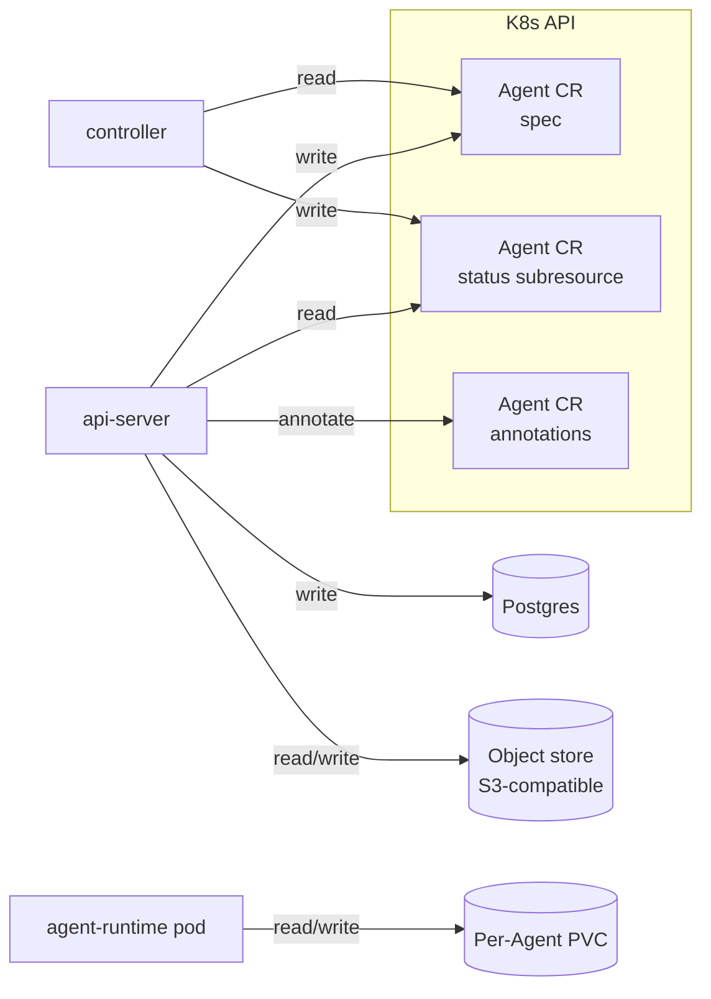

# Persistence

Last verified: 2026-10-20

## Overview

Platform persists state on four durable substrates, split cleanly between the platform and the agent:

**Platform-owned** (the agent never touches these):

- **Postgres** — application state the api-server owns end-to-end.
  Sole writer: api-server; the controller never reads from or writes to Postgres.
  Holds anything that has to be queryable when no agent pod is running (channel bindings, identity links, allow-listed users, schedules) plus any other api-server-only domain resource.
  Session metadata is *not* here — it is agent-owned, save for the one dimension the spend read path cannot lose to hibernation or agent deletion (see the session directory below).
  The bundled instance runs under three login roles — one NOSUPERUSER owner per service (`platform_apiserver`, `platform_keycloak`) plus the bootstrap superuser `platform`, kept as a separate statement-logged role for DBA work — so the api-server's connection credential cannot reach Keycloak's database or escalate.
  Admin sessions carry a per-role `log_statement` default that puts every statement they issue into the pod log for the cluster collector; the server-wide default logs DDL only, so routine application DML stays out of the audit trail while every role and grant change is captured whoever issues it.
  A fourth role, `usage_readers`, carries no credential and cannot log in: it is the group an operator grants membership in to give a read-only login access to the usage source passthrough views, owned by [usage-tracking](usage-tracking.md#source-passthrough-views).
- **Object store** — bulk binary blobs behind an S3-compatible API; consumers: artifact-library content and the published read-only snapshots of shared knowledge bases.
  The api-server is its sole standing authority: it holds the only credentials and mints short-lived, single-object links that let an agent upload or download (through its paired gateway) or a browser download directly, after ownership checks — each link signed for the authority its audience dials, since it is only valid on that one — an agent has no access to the store beyond a link the platform issued.
  The chart bundles a single-node SeaweedFS by default so dev and local clusters work without an external account; operators point production installs at their own S3-compatible endpoint instead.
  An install with no object store cannot store artifact content — the feature fails closed.
- **Custom resources** — resource state the controller reconciles into running infrastructure (Agents, Runs), as CRDs with a `spec` / `status` ownership split enforced by the status subresource.
  Sole writer of `spec`: api-server.
  Sole writer of `status`: controller.

**Agent-owned**:

- **Per-Agent PVCs** — the workspace and `$HOME` mounted into the agent pod.
  The agent process reads and writes here freely; it has no direct access to Postgres or to the custom resources that describe it.
  Persists across hibernation; reclaimed when the Agent is deleted.

Alongside the durable substrates, the platform runs a **Redis** the api-server cannot boot without — a bundled single-replica instance by default, or an external endpoint chosen at deploy time.
It holds only coordination and ephemeral state (job queues, presence keys, handoff flows, and the pending sign-ins, share sessions and render grants for [restricted artifacts](artifact-library.md)).
Losing this state signs restricted viewers out, interrupts pending sign-ins and invalidates outstanding render grants; viewers must sign in again or reload the share page.
No artifact content or viewer allowlist is lost; Postgres stays the source of truth for anything durable, and the scheduled sweeps re-assert their registrations so a dataset loss cannot silently stop them ([platform-topology](platform-topology.md)).

**Choosing between Postgres and the K8s API.** A new resource belongs on a CRD iff the controller reconciles it.
If only the api-server reads and writes it, it belongs in Postgres.
The spec/status single-writer split exists to coordinate api-server and controller; without a controller reader, it has no purpose, and putting api-server-only state on the K8s API is using it as a generic key-value store.
An earlier "K8s is the database" framing predates Postgres landing in the platform — the rule above is the refinement that replaced it, carried forward unchanged through the CRD migration.
This is why schedules live in Postgres and templates never became a CRD.

The controller and api-server never write the same surface — the status subresource makes the split structural, not conventional.
The agent's only durable surface is the PVC; everything the platform knows *about* the agent is mirrored onto Postgres or the Agent CR by the api-server or controller, not by the agent itself.

The optional agent-telemetry backend adds a fifth durable substrate, outside this split — see [observability](observability.md).
It is operator-managed and self-contained: neither the agent nor the controller touches it, and it exists only when that subsystem is enabled.

## Diagram

## Substrates

### Postgres

Postgres carries application state the api-server owns end-to-end — anything that has to be queryable when no agent pod is running, plus any domain resource the controller does not reconcile.

- **channel routing** — bindings between external chat surfaces and the Agent/session they map to.
  Owned by [channels](channels.md).
  A Slack binding is one row per bound conversation, its identity the (Agent, workspace, conversation) triple — the conversation id being a channel, group DM or 1:1 DM, undifferentiated — so an Agent cannot connect to one conversation twice, while several Agents may share it.
  Every binding names its workspace by Slack's team id.
  Bindings made before the platform could connect a second workspace named none; they are rewritten to name their workspace when the install's Helm bot token is imported ([channels](channels.md)).
  A second, narrower index admits at most one row per conversation marked default — at most, never exactly one, so having no default is a state the schema permits and the routing handles.
  Each binding carries its own ambient and default flags (absent = off).
  `slack_ignored_apps` holds each conversation's ignored apps, keyed by bot id.
  `public_image_urls` holds the public URL of each image uploaded to the image host for Slack agent icons, keyed by a hash of the image.
  `avatar_images` holds each uploaded [agent avatar](agent-avatars.md#custom-avatars) as a PNG, keyed by its hash.
  `telegram_conversations` records the chat→Agent binding for Telegram, one row per chat, plus its ambient flag and its owner's sub: different shapes by design, since Slack has a workspace and Telegram does not.
  `identity_links` maps a messenger user to a Keycloak sub, keyed by provider, so it serves any future workspace channel; a second workspace leaves it untouched, since inside one enterprise organization a user id already identifies one person and re-keying it would make anyone who linked in one workspace link again in the next.
  `slack_installs` is one row per workspace that completed the install handshake or whose Helm bot token was imported, holding the workspace's name, who connected it, and whether its credential still works — the bot token itself lives in a Kubernetes Secret the row points at, so no credential is stored here ([channels](channels.md)).
  That Secret is platform-owned rather than per-Agent: the api-server reads it, and no agent gateway is ever handed it, so it sits outside the per-`(owner, connection)` credential classes on [security-and-credentials](security-and-credentials.md).
- **identity and auth** — links between channel-side identities and platform users, the auth allow-list, and API keys for headless CLI use.
  Owned by [security-and-credentials](security-and-credentials.md).
- **skills catalog** — connected sources, per-Agent install records, publish history, and the per-user named skill selections a user carries between agents.
  Owned by [skills](skills.md).
- **activity log + agent mirror** — append-only event log (`activity_events`), per-sub role flags (`actor_roles`), and the K8s↔Postgres agent ownership mirror (`agents`).
  Pseudonymized `actor_sub` and `owner_sub` columns at the write boundary.
  Owned by [usage-tracking](usage-tracking.md).
- **session directory** — the kind of each Session, reported by its agent.
  A deliberate copy of agent-owned state, kept only so spend can still be attributed to how the work was started once the agent hibernates or is deleted; it is not a Session store and no Session is read from it.
  Owned by [metrics](metrics.md#session-directory).
- **schedules** — RRULE, quiet hours, task payload, session mode, the optional Precheck, and firing bookkeeping (`schedules`) — the last of which separates runs from declined occurrences and from a Precheck that broke.
  The api-server's schedule loop fires them; the controller plays no part.
  Owned by [schedules](schedules.md).
- **starter kit catalog** — the resolved kits of every configured catalog (`starter_kit_catalog_entries`): catalog and kit id, the commit each entry resolved to, the kit file as read there, and its bundled skills.
  A rebuildable cache, not a source of truth: the refresh job rewrites it from the catalogs, replacing a catalog's rows only from a complete read.
  Owned by [starter-kits](starter-kits.md).
- **onboarding checklist** — what an agent reported it still needs from its owner, on the agent mirror row (`agents.onboarding_checklist`).
  Written by the agent itself over its own tools rather than by any UI, and read back to render the checklist.
  Unlike the catalog above it is not rebuildable: nothing else records what the agent asked for.
  Owned by [starter-kits](starter-kits.md).
- **public agent profiles** — a projection of each channel-bound Agent's name and owner (`agent_public_profiles`), serving the one unauthenticated read surface.
  It satisfies the rule above on every count: the controller does not reconcile it, only the api-server reads and writes it, and it must answer with no agent pod running.
  What is unusual is *why* it duplicates state the Agent custom resource already holds — that copy is authoritative but unreachable here, because serving an anonymous request from the K8s API would let unauthenticated traffic drive control-plane reads.
  Owned by [public-agent-page](public-agent-page.md).
- **attention record** — the per-owner account of which sessions have asked for a user's attention, plus that user's own dismissal watermarks.
  A snapshot of agent-owned state, written by a lease-elected watcher so Home, and a sleeping Agent's session list, can answer for it; it never decides which sessions exist, and unlike the session directory it may be discarded — a fresh capture refills it.
  Owned by [home-feed](home-feed.md).
- **knowledge-base shares** — one row per shared knowledge base (`kb_shares`): the durable share secret, owner-controlled public name, the published-snapshot pointer and stats, and the publish/auto-refresh lifecycle bookkeeping.
  The snapshot bytes live in the object store; this row is the queryable index and access record, and answering a consumer's request must not require the owning agent to be running.
  Owned by [knowledge-bases](knowledge-bases.md#sharing).
- **delegation records** — one row per Invocation, kept for its root driver's lifetime ([invocations](invocations.md#the-delegation-record)).
- **spend** — the Metered Spend by day and by call, not rebuildable, as costs are fixed when priced; its measuring start; and the owner's daily limits.
  Redis caches the day totals.
  Owned by [spend-limits](spend-limits.md#ledger).

Several of those rows carry an owner's Keycloak sub, and they carry it **differently on purpose**: the usage mirror hashes it, because pseudonymized identifiers are that subsystem's whole premise, while the public agent profile and the attention record store the real sub, as channel bindings already do.
The difference is the requirement, not an oversight — a public page names its Agent's owner and a feed names a person's own sessions back to them, and a hash cannot be resolved back to a person.
Neither table can stand in for the other, and the pseudonymized one must not be extended to serve the page.

The api-server is the sole writer for all of it.
The controller does not touch Postgres — its bookkeeping lives on the `status` subresource of the custom resources it owns.
The authoritative schema and migrations live in [`packages/db/`](../../packages/db/): migrations run automatically on api-server startup, serialized across replicas on a Postgres advisory lock so concurrent boots queue behind one migrator instead of racing the same DDL — table/index/enum changes generated from the schema, the reporting views hand-written — with the original history squashed to a baseline that fresh installs run and existing deployments skip, and a no-database guard asserting every schema change was generated (workflow in [`packages/db/README.md`](../../packages/db/README.md)).
One non-schema step follows the migrations in the same startup sequence: a privilege reconcile for the usage source passthrough views, owned by [usage-tracking](usage-tracking.md#source-passthrough-views).

### Object store

The object store carries bulk binary blobs that would be wrong as database rows — data whose size, not queryability, is the point.
Its consumers are artifact-library content ([artifact-library](artifact-library.md)) and the published read-only snapshots of shared knowledge bases ([knowledge-bases](knowledge-bases.md#sharing)).

Ownership is api-server-centric: it holds the only standing credentials, the controller never touches the store, and bulk bytes move **directly** between producer/consumer and the store under platform-minted authorization — the api-server issues short-lived links scoped to a single object and operation, each signed for the authority its audience dials and valid on no other (upload links to agents after attributing the caller, download links to an agent through its gateway or to a browser directly, after owner checks), and the store rejects anything else.
An agent's traffic still exits only through its paired gateway; what changes with the store present is that the gateway forwards store-bound requests without a per-request human decision, the link itself being the authorization ([security-and-credentials](security-and-credentials.md)).
Blobs are addressed by an opaque reference held in Postgres; the store itself holds no queryable state.

The store is any S3-compatible endpoint, chosen at deploy time via Helm: the chart bundles a single-node SeaweedFS by default (dev and local clusters work with no external account; Apache-2.0, so bundling carries no copyleft obligations), or the operator points the platform at an external store — a cloud bucket or an on-prem installation.
The api-server provisions its bucket at startup when missing and fails boot fast when the store is unreachable.
An install with no object store fails closed: bulk-blob features are unavailable until one is configured.

### Custom resources

Resources the controller reconciles are Kubernetes CRDs under the `agent-platform.ai/v1` API group, each with a status subresource:

| Kind    | What it declares                                                                                                                                                                                                                 | `spec` writer | `status` writer |
| ------- | -------------------------------------------------------------------------------------------------------------------------------------------------------------------------------------------------------------------------------- | ------------- | --------------- |
| `Agent` | Agent definition and runtime state: image, mount declarations, env, secret refs, image-pull secret ref, granted secret and connection IDs. The sole resource per Agent — the former template/instance pair was collapsed into it | api-server    | controller      |

Each CR carries strict single-writer ownership, made structural by the status subresource rather than held by convention:

- **`spec`** — user intent.
  Written exclusively by the api-server and validated by the K8s API server at admission against the CRD schema; the controller consumes typed objects without re-validating shape.
  Cross-field and referential rules stay application logic.
- **`status`** — observed state, written exclusively by the controller through the status subresource.
  Conditions are the source of truth (`Ready`, `AgentPodReady`, `GatewayPodReady`, `Reconciled`); `Ready` is the agent-and-gateway pod intersection and the api-server's sole routing signal.

There is no stored desired state — the former `desiredState` latch is eliminated.
Wake is a one-off activity poke, the controller hibernates on idleness, and running-vs-hibernated is recorded as observed status; see [agent-lifecycle](agent-lifecycle.md).

High-frequency, out-of-band signals live on **annotations** rather than `status`, so they are independently patchable without a spec or status write: the last-activity timestamp and active-session marker that drive hibernation, and the roll trigger the api-server bumps to force a rolling restart of the pair.
Connection and secret grants are intent and moved from annotations into `spec`.
(Credential `env` rides the runtime channel; see [runtime delivery](runtime-delivery.md).)

Two domain resources are deliberately not CRDs:

- **Templates** stay ConfigMaps — chart-rendered, read-only blueprints copied into an Agent at create time, never reconciled, loaded by the api-server at boot.
- **Schedules** live in Postgres — only the api-server reads and writes them (see the Postgres/K8s rule above).

### Per-Agent PVCs

Each `agent` reconciles into a StatefulSet whose `volumeClaimTemplates` are derived from the Agent's declared mounts.
A mount marked `persist: true` becomes a PVC; a non-persisted mount becomes an `emptyDir` that dies with the pod.
PVCs are `ReadWriteOnce` on ordinary single-writer storage, which no install needs a shared filesystem class for.
`ReadWriteOnce` binds a volume to one *node*, not one pod — any number of pods on that node could mount it — so what keeps a workspace single-writer is that the platform runs exactly one writer for it, not the access mode.
A second writer on another node would not be refused at admission; its pod would schedule and then hang on attach.
(Workspaces created before the RWO cutover sit on `ReadWriteMany` volumes until the storage migration below drains them.)
An Agent may **pin its storage class** in its spec: a pinned Agent's workspace volumes provision on that class, while unpinned Agents use the install-wide class.
The pin is also honored by the warm pool and the storage migration below.

A home volume mounts empty and shadows whatever the image bakes at that path, so the image's boot seeds it on the volume's first boot from the staged workspace: a no-clobber copy behind a sentinel file, run once per volume, so image content lands exactly once and files the user later edits are never overwritten by a restarted or upgraded image.
The seed lives in the image's own boot sequence — the container entrypoint, replayed by the VM boot — with no separate init container, and the Agent CR's `spec.init` field (and a Template's `init`) is retained but no longer read.
Image-shipped skills are the one carve-out from this once-per-volume rule: they are seeded, updated, and retired per skill by [image-skill reconciliation](agent-skills.md#image-skill-lifecycle), so a skill added to an image reaches existing volumes too, while everything else in the workspace keeps the one-shot semantics.

The default Claude Code template persists the workspace and `$HOME`.
Together these hold:

- the **workspace** itself — git checkouts, tool caches (`node_modules`, `.venv`, mise), and any artifacts the agent has produced.
- **`$HOME`** — agent memory, skills, MCP server caches, and the harness's on-disk session store.
  The session store is what a cold re-attach reads after a pod restart, whichever verb the harness advertises for it ([sessions](sessions.md#session-inside-the-pod)).
  The agent-runtime's `.platform/` directory lives here too, holding the **session-metadata state file** — the platform's source of truth for per-session mode, type, `scheduleId`, `threadTs`, a title the platform set, a flag for a session the harness has not stored yet, the session's own reference and the session a one-time run reports to, `createdAt`, the time of the session's last genuine message, and run accounting for scheduled fires (how many the session has served, their summed duration — timed only for machine-driven turns so a human reply never counts — and the start time of each fire, kept as a bounded newest-wins list so a reader can see where each run in view began), surfaced over ACP `_meta.platform` and (for mode and type alone) mirrored into the session directory above — those stamps and the totals are durable, but the marker for the fire currently in flight is not: it cannot outlive the process that set it, so the totals under-count a fire the pod restart interrupted — alongside the trigger-binding, runtime-channel and [processes](agent-processes.md) state files.
  The same directory holds the **undelivered-prompts document**: the whole content of user prompts that never reached the harness, and of a prompt the harness took for a session it has not stored yet when the harness exits before it answers (inline images capped, file attachments by name), written only when a prompt is recorded, sent again, or deleted — never on a routine turn — and deliberately separate from session metadata so a corrupt metadata write cannot take user text with it.
  A record outlives session teardown and pod restarts; it goes when the user resends or deletes it, with its Session, or — the document is byte-capped — when another session's write needs the room, evicting whole sessions oldest-first ([agent-lifecycle](agent-lifecycle.md) owns the delivery contract).
  A third document, **active-turns**, marks each session while a turn runs — an [Autonomous Turn](sessions.md#session-inside-the-pod) included, until the harness reports it idle — and clears it on every turn end agent-runtime observes; a marker still present at the next boot names a turn whose end it never saw — the process went down mid-turn, SIGKILLed (an OOM group-kill) or shut down by SIGTERM (a Sleep, an eviction; that shutdown marks the marker *stopped*) — which agent-lifecycle's recovery consumes to resume that session automatically — only markers inherited from the previous process, since a turn the new process began before recovery runs is live work and resuming it would answer it twice — its own document again so a corrupt write cannot take run accounting or user text with it.
  The marker of a session the harness has not stored yet also keeps the turn's prompt, the only copy that survives the process.
  The directory also holds the **run-results document**: for each `cli_run` Session and each Session a one-time run reports from, the newest finished run's outcome — prompt identity, stop reason, accumulated assistant text (size-capped per run, marked when cut) — written when the run ends, its prompt answered and the harness idle, so a detached headless caller can read the result after the in-memory session log is reaped.
  One record per Session, newest turn wins; it goes with its Session or, under a byte cap of its own with the same evict-oldest rule, when another write needs the room ([cli](cli.md#headless-runs) owns the concept).
- **`.import-staging-*/`** — transient extraction directories used by the bundled file-import path before entries are merged into `<homeDir>/work`.
  Orphaned staging dirs from crashed imports are reclaimed by an agent-runtime boot sweeper; see [platform-topology](platform-topology.md).

PVCs survive hibernation — when a StatefulSet scales to zero replicas, the volume detaches but is retained.
The controller explicitly deletes PVCs on Agent deletion (the standard StatefulSet behavior is to retain them to prevent data loss; Platform opts back into reclamation because Agent deletion is intentional).
The volumes a [runtime migration](vm-runtime-migration.md) copied from are the one kind kept past their use: they lose the agent and mount labels, so nothing that lists an agent's volumes counts or mounts them, and are deleted when their retention window passes or the Agent is deleted.

What does **not** survive hibernation: anything written to the container's ephemeral filesystem outside the persisted mounts — OS-level changes, packages installed at runtime, files in `/tmp`.
`$HOME/.cache` is deliberately in this category: the base-image entrypoint redirects it to node-local disk (`/tmp/agent-cache`) so churn-heavy tool caches don't load the persistent volume, npm's cache with it.
The redirect is best-effort: a failed swap costs speed, not the boot.

**Caches outlive their tools.** A cache of a tool the image dropped stays on the volume until the home is full.
A full home keeps agent-runtime up, unsaved state in memory; the chat says so.
The entrypoint discards at boot the caches no shipped tool reads — Go's module cache, pnpm store layouts the shipped pnpm does not name (aube names its own), npm's once redirected — moved aside and deleted in the background.
Toolchains the agent installed for itself are never touched; on the vm Backend only the discards apply.

**The `vm` Backend has no PVCs, and one disk.** A pod attaches a volume per path, so a mount there is a size and a placement at once.
A machine has a single disk, and it has no size of its own: it is sparse and may grow to the owner's whole storage pool — their [UserBudget](budgets.md#the-ceiling)'s `storage`, else the install's value — so what the owner's disks take is what they write, and an Agent's `storageSize`, a mount's size and a starter kit's storage size only containers.
A new machine is created at the pool, since every runner release creates a disk at the size it is asked for.
An existing machine is sent the pool only once its runner has reported the machine's disk, since an older runner would restart a running machine to grow it; until then it keeps the size the Agent's spec gives.
The path the disk holds apart from the root is `HOME`.
That is not a field an Agent sets: `HOME` is fixed on both backends, and it is already the only path every template and starter kit in the chart persists.
The disk sits on the owner's [VM runner](vm-runner.md) volume, grows with its size at the machine's next start and never shrinks, survives hibernation, restarts and a new image, and goes with the Agent on delete.
It is per owner rather than per Agent, so the storage-class pin and the warm pool do not apply and the storage migration never sees it.
An Agent whose mounts ask to persist a path outside `HOME` is refused rather than reconciled, because a machine cannot keep it and silently dropping it is how an agent comes to look healthy while discarding its work.

**The whole machine persists, per root generation.** Everything outside `HOME` is the image's root: an overlay platform-init lays over the image, its upper layer on the disk, kept across stops, restarts and new images of one generation.
A generation is a string key an image declares in its env and compares whole, never parsed or ordered: the default image's names it, such as `default-1`, and an image the platform builds on it appends its own segment, such as `default-1/gepa-1`, so a key names the image's lineage.
An image built from the default one elsewhere inherits the default's key unless it declares its own, and so keeps a root the default image wrote.
An image's build changes its key only on a change that breaks an older root; an image declaring none is its own generation.
The runner names it in the share at every start, and any other key, an extending image's included, or none named, boots onto an empty upper: what must outlast that belongs under `HOME`.
**Nothing the platform writes at boot lands in the kept root.** A file a boot rewrote there would hide every later image's copy of it, so the boot builds the CA bundle under `/run`, a fresh tmpfs on every boot.
The entry that maps `agent` to uid 0 for SSH logins is in a layer platform-init builds in memory at every boot, between the image and the upper: the image's `/etc/passwd` with that entry at its end.
It is an ordinary file of the root, so `useradd` replaces it as on any root, and only then does the upper hold a copy, as with any file the agent writes.
The agent runs as root there, and a tool that takes its home from the user database rather than `HOME`, as OpenSSH does for keys and known hosts, would write to `/root` on that root, so the image's build gives uid 0's entry the agent's `HOME`.
The old upper is renamed aside with the record of its image and deleted in the background, so a root of millions of files does not hold up the boot; one a stop cut short is deleted on the next boot.
smolvm keeps a root of its own and binds the whole disk into it; platform-init leaves both behind, and fails the boot rather than run on them.
Temporary folders are the exception: `/tmp` and `/var/tmp` are directories of that root that start empty on every boot, whatever the image ships there, and `HOME`'s `.cache` and `.npm` are ordinary directories of the home.
`/var/cache` stays part of the root, because an image ships its font, package and linker caches there, and an empty folder over them had every boot rebuild them.
They share the disk with the agent's work, so when it runs short, or the runner marks the owner's claim under it short, platform-init deletes their least recently used entries, never anything outside them, and never through a link or a mount: a folder that is a link, such as a `~/.cache` an agent pointed at its work, or a mount it was not at boot, is skipped, an entry holding a mount stays whole, and no delete goes into a mount.
An entry is one name directly in such a folder, such as `~/.cache/go-build` or `/tmp/pr-body.md`, and it goes whole or not at all, because a tool that keeps part of its cache takes it for complete and fails on it.
Use is the newest modification or change time anywhere in the entry, since the disk is mounted `relatime` and a read often leaves access times alone.
An entry used in the last ten minutes stays, and so does one that is or holds a file a process has locked, by any kind of lock, the way `systemd-tmpfiles` leaves a locked entry.
A short claim is mostly the agents' homes, which no eviction touches, so it does not bring that ten-minute rule on: each request the runner sends is served once, by one pass that keeps whatever was used in the last hour and stops at the bytes the runner asked of that machine.
A cache tagged with `CACHEDIR.TAG` goes before an untagged entry of the same age, since its tool can rebuild it and an untagged one may be the agent's work in progress.
Each eviction, and a disk still short once nothing is left to evict, is a line on the machine's console, which the runner reads.
An agent that exits with its home nearly out of space or inodes is reported as a full home.
A boot that finds the disk with no space or inode left first deletes what earlier boots set aside and the last boot's temporary folders, which it would empty anyway, and tries again.
A boot that still has no room stops, and its console line says the home is full, so the runner reports a full home and its fix: more storage, since a grown disk has more of both.
btrfs discards what it frees on its own (`discard=async`, the kernel's default on a disk that supports discard), so whatever the agent frees, by deleting or by rewriting a file, goes back to the runner's volume and stops counting against the owner's storage.
Once the image runs, the disk is reachable only through what platform-init mounted from it.

Mounting the disk is the platform's job rather than the image's.
The runner hands every machine a read-only share holding the MITM CA and **platform-init** (and, for a migrated machine until its migration completes, the copied home), and runs platform-init as the machine's entrypoint; it claims the disk, refuses to boot when the disk did not attach, moves the image onto its fresh root, seeds `HOME` once from whatever the image ships there — or, on a machine a [runtime migration](vm-runtime-migration.md) made, from the copy of the old volume the runner holds for it — bind-mounts it, and starts the image's own entrypoint, which it then supervises ([vm-runner](vm-runner.md)).
Any image therefore keeps its agent's home, even one that has never heard of this platform: platform-init is linked statically and needs nothing from the image.
An image that ships `HOME` as a symlink is seeded from what the link points at, and the link is replaced by a directory before the bind, so the home is on the disk and never on the root an image update discards; a disk an older platform-init gave a linked home is seeded again from what that home holds.
The storage model is a constant; what varies is a migration's copy, whose entries the guest refuses when they would land outside `HOME`.
**Nothing from `HOME` is ever run.** The home is the agent's to write, so every step platform-init takes as root comes from the share or from platform-init itself: neither an image that drops to an unprivileged user nor an old volume carried across can plant one, and a `.platform/boot.d` an older home carries is ignored.
Beside the agent's home, in a namespace of its own so a `log` directory in that home cannot collide with it, the disk holds the platform state a machine's root cannot keep: the guest's boot log, where an agent's output goes since the harness never writes to the console, kept one boot deep so a machine that died still explains itself on the boot after, and bounded while it is written so an agent that logs without pause cannot fill its disk; an image's boot may keep its extracted trust store in a directory of its root rather than rebuilding it, which the platform's own images, whose rebuild is quick, leave unused.
The log is rebuilt or resumed by the next boot rather than being state an Agent can lose.

**A disk that holds a filesystem is never formatted at boot.** platform-init, the guest's init, mounts the storage disk itself and never formats it: a disk it cannot mount, or cannot read, fails the boot with the reason on the machine's console and stays as it was, for the next start to mount once the cause passes.
smolvm's guest agent, which it replaces, formatted a disk it could not repair, which erased a home that only a passing I/O error, a killed repair or a kernel that lacks one of its features kept from mounting.
A btrfs disk that does not mount fails the boot and stays as it is, since btrfs has no repair a boot may run unattended.
A Mac host runner runs the same agent, taken from the runner image.

**A disk that has lost its home fails the boot.** A disk that was formatted anyway looks exactly like one never seeded.
So the runner records in the machine's share, the first time its guest answers — which it does only once platform-init has put the home on the disk, from the image or from a migration's copy — that the disk holds a home, and keeps the record for as long as the machine exists.
A boot that finds the record but no home stops, with the reason on the machine's console, rather than seeding a fresh home that would look healthy.
A migrated machine is held to its copy the same way: while a seed is expected, its home comes from exactly that seed or the boot fails, never from the image, and the record names the seed ([vm-runtime-migration](vm-runtime-migration.md)).
The record is learned from the answer rather than read off the disk, because the host does not parse a filesystem a guest has had root on.
The runner makes every new disk itself, btrfs at its full size, before any guest has touched it ([vm-runner](vm-runner.md)).
A disk from before that, ext4 or btrfs in the old directory layout, fails its boot and is kept as it is ([vm-runner](vm-runner.md)).
On a Mac host runner the loss is refused, not prevented.

**The claim those disks sit on is the owner's pool.** One claim per owner holds every machine disk they have, their bookkeeping, and a [runtime migration](vm-runtime-migration.md)'s seed while it waits, and every disk may grow to the pool, so the claim is created at the pool; the image trees are on the node, not the claim.
It grows in place when the pool rises and is never shrunk, so a lowered pool only stops its growth.
A refused growth is reported and reconciliation continues: the runner still serves every agent at the size it has.

**The runner guards the claim by its use.** The disks are sparse, so they can add up to more than the claim holds, and a guest sees its own disk as free while the claim under it fills; once the claim has no block left, a guest's write into its disk has nowhere to go.
So the runner measures the claim itself: past 75% used it asks every machine's guest, through its share, to give back scratch: each running one its even part of what would bring use back under 70%.
It asks again only once the claim has filled five points further, and clears the request once use is back under 70%, so a claim the homes keep full does not have every guest delete its scratch again every minute.
A guest is held to the claim's room too: each look grants each machine that is neither asleep nor absent an even part of what is left below 95% of the claim, and a sleeping or absent one nothing, so a wake never boots on the room its share held; a start looks again first, and platform-init sizes a preallocated file on the disk so the guest can write only what is left of its grant.
A claim the runner cannot measure grants nothing at all, so no guest is held to it, and it says so in its log each time it loses the measure and each time it gets it back.
A guest held below 256 MiB may still write 256 MiB in all, once, until a grant with room comes, so with N agents running the claim can pass 95% by at most N times that.
The agent that used it up gets room again once the claim has room, through a grant that holds the floor: when another agent is deleted or frees files, or the storage grows, as the full-home message says; a sleep and wake also gives it the floor again, for one more way in to free its own files.
A write past it fails inside the guest with "no space left on device", which the agent handles and the runner reports as a full home, and the claim stays writable for the owner's other agents.
The file's blocks are only marked in the guest's filesystem and never written, so it takes nothing from the claim; it has no name, so the filesystem frees it whenever the guest stops, and an older platform-init never finds it.
A clean stop empties it first, so the next boot does not start with its blocks taken.
btrfs reports free space late, and as an estimate that can pass the disk's size, so the guard reads its own size from the file, syncs before it moves, moves past a margin once per commit at most, and grows only as far as the disk takes.
Eviction does not count it as used, so a guest held to the claim does not read its own disk as short.
The guard counts what the guest's filesystem reports as used, so it does not see all that the claim gives a disk: metadata blocks are holes until first written, and blocks a guest frees take room on the claim until btrfs discards them; the next look's grant accounts for them, and the 5% above 95% absorbs them between looks.
Past 90% it creates no machine and takes no seed, and a machine it starts boots at the disk size it has; past 95%, where guests' writes start to fail, it starts and restarts no machine either, so between the two an owner whose agents are all asleep can still get into one to clean it up.
It reports each refusal as `MachineStorageFull` with how full the storage is and how to free it, and never stops a running machine, which would free nothing and lose what the guest holds in memory.
An out-of-space error the runner meets anywhere on the claim is reported the same way, and so is a boot that fails while the claim is that full, since a guest whose writes fail fails its boot with nothing typed in the error.
A storage refusal does not park the Agent the way a memory refusal does: parking would halt a machine, and nothing an idle agent holds in memory frees disk.
The api-server says the same before an Agent is written: it reads the owner's runner through its read-only usage capability, and refuses a new vm agent — a create, a kit applied, a spawn — once the claim is 90% used, with the figures and the same three ways out.
A move onto the vm backend meets a stricter read of the same figures: it is refused up front unless the claim would stay under that 90% with twice the home's size added ([runtime migration](vm-runtime-migration.md)).
Usage it cannot read refuses nothing, since the runner refuses the machine anyway.
The same read names, beside each machine's disk, what the seeds of migrations not yet ended take of the claim, so a user whose storage is short is shown what fills it ([budgets](budgets.md)).
Past 90%, and again past 95% when writes start failing, the owner also gets a Slack direct message with the same figures and ways out ([resource alerts](budgets.md#resource-alerts)).

**A write the claim has no room for waits instead of failing.** virtio-blk can report a failed write to the guest only as an I/O error, and on that error the guest drops the data in its page cache that a write had accepted, and btrfs aborts its transaction and turns the filesystem read-only.
So the runner's libkrun holds a guest write that the claim refuses with no space, and tries it again every second until it fits, as QEMU does by default.
The guest's I/O waits meanwhile, and continues with nothing lost once the claim has room: through another guest's discards, a deleted agent or a larger storage.
A stop of the machine ends the wait: the write fails as before, or a kill ends the machine as a power cut would, which btrfs's copy-on-write recovers from without errors.
A flush is never tried again: after a failed fsync the host can have dropped the data, and a second fsync would report it written.

### The machine image cache

A machine may reach only its gateway, so its image is fetched for it and unpacked once into a tree every machine of that image mounts read-only, on a node directory the install's runners share, never on the runner's claim; [vm-image-cache](vm-image-cache.md) owns it.

### Warm PVC pool

First-start provisioning of a workspace PVC is slow on production storage — tens of seconds to minutes — because the volume is allocated on demand when the first pod mounts it.
To hide that latency the controller can keep a **warm pool**: a background buffer of pre-provisioned, already-bound spare PVCs, organized into per-workspace-size pools, that a newly created Agent claims instantly instead of waiting.
The buffer refills in the background and is operator-tunable; it is disabled by default.

A spare only helps if it holds real storage while idle, so pool PVCs use an **immediate-binding** StorageClass — the agents' own class defers allocation until mount, which would leave a pre-created spare empty.
At create time, for each persisted mount whose size matches a configured pool, the controller claims one spare and mounts it by name rather than through the StatefulSet's `volumeClaimTemplate`; a mount with no matching pool, or an exhausted pool, falls back to on-demand provisioning so Agent creation never blocks.
An Agent pinned to a storage class other than the pool's bypasses the pool entirely — a spare on the wrong backend is worse than a slow first start.

Claimed-versus-spare is tracked entirely by labels: an unclaimed spare carries a pool label but **no owning-agent label**, so the orphan-PVC sweep — which acts only on agent-labeled PVCs — leaves it untouched.
On claim the controller stamps the agent label and removes the available marker in one atomic update; from that point the volume is an ordinary per-Agent PVC, reclaimed on Agent deletion and reattached on wake.
The claim decision is made once at create and reconstructed from the live StatefulSet on every later reconcile, so it survives hibernate/wake without ever re-rendering the pod's volumes — even if the claimed volume is deleted out-of-band, the agent keeps referencing it by name rather than degrading to a mount with no backing volume.

### Storage migration (transitional)

Workspace volumes created before the ReadWriteOnce cutover live on shared-writable (`ReadWriteMany`) storage — historically required so a second pod (the since-removed Slack per-person fork and `dam-run` executor) could write into a live agent's workspace.
Both writers are gone, and an access mode cannot change in place, so the controller runs a one-time, interrupt-safe **storage migration**: for each agent still on an RWX volume it forces the pair down (a sleep-strength gate — in-flight work is interrupted by design), copies the quiesced volume onto a fresh RWO PVC in a Job, verifies the copy by checksum, re-points the agent at the new volume through the same by-name claim mechanism the warm pool uses, deletes the old volume, and restores the agent's prior run state; an Agent the runtime migration takes over instead has its gate released and that copy abandoned.
Every step is derived from cluster state, so a controller restart resumes where it left off, and an agent can never wake against a half-copied volume.
Throttled fleet-wide, skipping an Agent mid-way through a [runtime migration](vm-runtime-migration.md); a no-op once no RWX workspace volume remains.
The same machinery also drains workspaces whose class is not the configured destination, and an Agent's storage-class pin overrides that destination for its own volumes — pinning the class a workspace already sits on exempts that Agent from the drain, which is how part of a fleet stays on a faster class while the rest moves.
Operators keep the old shared filesystem available until the last RWX volume drains, then decommission it.

## Lifetime

| Event                    | Postgres                                        | Object store                                                                                                   | Agent CR (spec/status) | PVC                        |
| ------------------------ | ----------------------------------------------- | -------------------------------------------------------------------------------------------------------------- | ---------------------- | -------------------------- |
| Pod restart              | survives                                        | survives                                                                                                       | survives               | survives                   |
| Hibernate (replicas → 0) | survives                                        | survives                                                                                                       | survives               | survives                   |
| Wake (replicas → 1)      | survives                                        | survives                                                                                                       | survives               | survives                   |
| api-server restart       | survives                                        | survives                                                                                                       | survives               | survives                   |
| Controller restart       | survives                                        | survives                                                                                                       | survives               | survives                   |
| Agent delete             | Agent-scoped rows removed or closed out (below) | artifacts survive (owned by the library, not the Agent); the Agent's knowledge-base share snapshots are purged | CR removed             | PVCs removed by controller |
| Schedule delete          | schedule row removed                            | n/a                                                                                                            | n/a                    | n/a                        |
| Satellite delete         | satellite row, grants and jobs removed          | n/a                                                                                                            | n/a                    | n/a                        |

**Agent-scoped rows follow the Agent.** No Postgres table references an Agent by foreign key — the custom resource is the authoritative record, so the database cannot cascade on its own and the api-server owns the cleanup.
An API delete runs one cleanup per agent-scoped record kind, from a single list declared in the code; most delete the rows.
Some do more: they cancel queued schedule fires, revoke knowledge-base shares and purge their snapshots, mark the usage mirror deleted, retire the public profile, and fail running Invocations the Agent drove.
A periodic orphan sweep backstops that list: it diffs every kind's agent ids against the live custom resources and re-runs every cleanup for each id that no longer resolves.
The deletion event carries no cleanup; both paths emit it only to notify runtime reactions — the UI hint and the Slack worker registration.
The sweep names the owner on it only when a surviving channel, schedule or share row still records one; the UI hint is the one consumer that needs it, and the agent watch already delivers that hint when the custom resource disappears.
It re-reads the candidate's CR right before reaping, so a row written after its Agent existed is never reaped from a live one.
The sweep is what makes a deletion done directly in the cluster, or one the api-server crashed halfway through, end in the same state as an API delete.
The attention record is trimmed on age as well as on delete: a periodic job removes rows past 90 days, so feed cost tracks recent activity rather than an Agent's whole history.
Kept on purpose: the usage row (soft-deleted, its runtime and config snapshots cleared so a later Agent under the same name starts clean), library artifacts, the activity log, the session directory (kept so spend stays attributable), and the spend ledger.
Sessions are agent-owned files on the PVC, not Postgres rows — they follow the PVC column, not this one.

Unclaimed warm-pool spares are not tied to any Agent and so are absent from this table — the pool manager reclaims them when it trims a pool below its inventory or when their size pool is removed, never via Agent deletion.
Once claimed, a spare follows the PVC column above.

An Agent created on a private custom image carries an agent-scoped image-pull Secret that follows the Agent itself: the api-server writes it at create and removes it on delete (a delete-time cleanup hook, with a label-scoped orphan sweep as backstop).
This is the opposite of the owner-scoped credential Secrets the gateway injects for egress, which are reusable across an owner's Agents and outlive any single one.
The mechanism and trust boundary live on [security-and-credentials](security-and-credentials.md#image-pull-credentials).

## Security boundary

The PVC is a **shared mutable surface across every session, trigger, and channel-driven prompt that runs on the same Agent.** Anything written into the workspace by one turn — model output saved to disk, tool output, files fetched from upstream, and the documents people attach in a bound channel — is plain context for the next turn.
That last writer is not the Agent's owner: a channel binding admits whoever the messenger admits, so a passer-by can put bytes on the disk a later session reads.
Treat workspace contents as adversarial input.
A scheduled job can plant a file that prompt-injects a later user-driven session; a Slack-driven prompt can leak its instructions through residue left on disk.

The platform does not sandbox writes within the workspace.
Mitigations live elsewhere: NetworkPolicy restricts which upstreams the agent can reach (the agent pod can only dial its paired gateway pod, never an upstream directly), and the gateway pod gates credentialed egress.
The threat model and credential isolation are detailed on [security-and-credentials](security-and-credentials.md).
