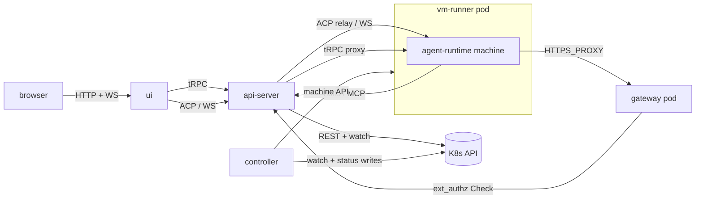

# Platform topology

Last verified: 2026-10-24

## Overview

Platform runs as four long-lived subsystems on Kubernetes: a Go **controller** that reconciles the Agent custom resource, a TypeScript **api-server** that brokers user requests and relays agent traffic, per-owner **VM runner** pods whose microVM machines host each agent's **agent-runtime**, paired with a per-agent **gateway** pod as its egress proxy, and a React **ui** served by the api-server.
A machine keeps its durable state on its own disk on the owner's claim, which is what makes the hibernate/wake cycle (stop the machine and scale its gateway to zero, start both back up) safe.
The controller and api-server never talk to each other directly — they coordinate through the K8s API, using the `spec` / `status` subresource split on each custom resource so that writes never contend.

## Diagram

## Components

### controller

A stateless Go reconciler built on client-go.
It is change-driven — it watches the `Agent` custom resource (`agent-platform.ai/v1`) plus agent-labelled pods, backed by periodic re-checks; after the store's switch it reads the Agent rows and is woken by the store's change feed instead ([persistence](persistence.md#postgres)).
Each of its eight workers reconciles the agents of the owners hashed to it, one at a time, and takes what a person waits on first, so one owner's hung VM runner delays only the owners on its worker, except while a runner roll holds its install-wide lock ([budgets](budgets.md#enforcement), [#4939](https://github.com/dam-agents/dam/issues/4939)).
It reconciles each agent's machine on its owner's [VM runner](#vm-runner), its gateway StatefulSet, Services, NetworkPolicies and per-agent Secret, computes agent readiness from the machine and the gateway onto the Agent status, hibernates idle agents by stopping the machine and scaling the gateway to zero, and deletes gateway pods stranded NotReady on a configuration it has already superseded (the one case where it evicts a pod outside hibernation — see [security-and-credentials](security-and-credentials.md) and [agent-lifecycle](agent-lifecycle.md)).
The schedule loop lives in the api-server, not here (see [schedules](schedules.md)).
The controller writes only the `status` subresource on the resources it owns; it never writes `spec`, and once the rows own the definition it writes only the tables it observes plus the store row's two progress columns ([persistence](persistence.md#postgres)).
It opens its store before it campaigns for the Lease and exits when it cannot, so no leader holds the election with an unread fleet behind it.
Its readiness probe says the replica leads and has listed its fleet, and its liveness probe restarts a leader whose store has not answered for two minutes — a leader that is wedged on a database is replaced rather than left renewing the Lease in silence.
See [`packages/controller/`](../../packages/controller/).

### api-server

A TypeScript server that hosts the user-facing surface and the ACP relay.
It runs two listeners:

- **Public port** — user-authenticated tRPC, REST (OAuth callbacks, health, version), and the ACP relay WebSocket.
  The tRPC surface is reachable over two transports on the same router: HTTP (used by the CLI) and a WebSocket endpoint that authenticates on its first frame rather than a URL token, and answers a refused connection's first request with the denial code before closing it, provided that request arrives within a one-second grace window.
  Terms acceptance is enforced per procedure inside the router — everything except the terms procedures refuses until the caller has accepted the current terms — so either transport alone suffices for the full app, first-run acceptance included; the HTTP door additionally rejects gated calls with 412 before they reach the router, which is what the CLI's terms prompt keys off.
  Terms versions ship with deploys (a new version implies a server restart) and acceptance is irrevocable, so per-process acceptance caching can only be stale in the safe direction.
  The WebSocket is the UI's transport for everything else: queries, mutations, and the live-events subscription multiplex one authenticated connection, bounded by credential lifetime — the server nudges a reconnect shortly before the credential expires and the client re-authenticates with a fresh token.
  The client renews a token that is close to expiry before it hands it to a new connection, because a background tab can miss its scheduled renewal; and a connection admitted with less than the nudge lead left is never nudged, only closed at expiry, so a near-expiry token cannot drive a reconnect loop.
  Two REST reads on this port are deliberately unauthenticated: `version`, powering the CLI's compatibility-floor check ([cli.md](cli.md)), and a single public-agent read behind its own `/api/public` prefix — a whole prefix rather than a hole punched in an authenticated one, so the carve-out stays one reviewable boundary ([public-agent-page](public-agent-page.md)).
  The same prefix serves the browser panel's stream page, the static files of Selkies' web client, which carry no data; the socket that page opens passes the usual admission ([browser-panel](browser-panel.md)).
  Failures leave the router as tRPC error codes: what the caller caused (a malformed identifier, a duplicate, a resource it does not own) is a client error with its message intact, except the media-type rejection, whose message would echo the request header; everything else is an internal error whose message and stack are redacted on the wire and logged server-side with the cause.
- **Harness port** — an internal-only endpoint consumed by agents for trigger handoff and MCP tool calls.
  Not exposed outside the cluster and carries no user authentication.
  A failure the caller caused leaves it as a client error code, as on the public port: a Postgres rejection of a malformed identifier or of a duplicate row becomes a bad request or a conflict rather than an internal error.

Channel-relayed turns (Slack, Telegram) are watched for **liveness, not duration** — a turn is never failed for taking long, and on Slack's addressed turns an answer the relay lost is recovered after the fact ([channel-turns](channel-turns.md)).

The api-server proxies all ACP traffic to agents; clients never dial an agent directly.
It also wakes hibernated agents on demand before forwarding the first message of a session.
Every relay and proxy verifies the caller — either a Keycloak JWT or an API key, dispatched by token prefix, taken from the `Authorization: Bearer` slot on HTTP and from a query parameter on a WebSocket upgrade, where a browser cannot set headers — and checks ownership, the operate scope and any key-to-agent binding at the public port.
The caller's credential is then **stripped**, not translated: nothing is forwarded in its place, and agent-runtime authenticates nobody.
It serves unauthenticated on the assumption that the runner's NetworkPolicy, admitting a machine's published ports only from api-server and controller pods, is the auth boundary, which is where that guarantee actually lives.
See [security-and-credentials](security-and-credentials.md) and [`packages/api-server/`](../../packages/api-server/).

The public port also accepts streamed bundled file imports per agent and proxies them to the target agent-runtime without buffering — ownership-checked and size-capped at the proxy boundary.

Recurring background reconciliation (expiry sweeps and similar) runs as scheduled jobs on per-job queues backed by the platform Redis — one execution per period across the api-server replicas, with each tick idempotent.
Subsystem pages describe their own jobs (e.g. [artifact-library](artifact-library.md)); all recurring sweeps (runtime outbox, approvals delivery, OAuth refresh, activity retention, agent and invocation reapers) run this way, and each replica re-asserts its scheduler registrations periodically so a Redis dataset loss cannot silently stop the sweeps.
Other cross-replica state also lives in shared stores: session-presence pins, OAuth/bind handoff flows, artifact share sign-ins, share sessions and render grants, Environment hand-off codes, sign-in chains and sessions, and terminal-supersede signals in Redis, per-owner resize serialization and OAuth refresh backoff in Postgres.
The per-agent MCP endpoint is **stateless** — it mints no streamable-HTTP session id and builds a server and transport per request — so any replica serves any harness call and nothing has to pin a gateway to a replica.
Affinity was tried first and does not work here: a Service `sessionAffinity` is bypassed on a waypoint-fronted Service, and a consistent-hash `DestinationRule` on source IP leaves the waypoint's route without a hash policy, which degrades ring hash to per-request random.
Since every harness call still traverses the waypoint, it is itself replicated with its own disruption budget when the api-server runs more than one replica.
One thing is pinned rather than shared, because it is in-process by nature: the channel workers need a single holder install-wide, since their transports admit one consumer each; a Kubernetes Lease in the agent namespace elects it — the primitive the controller already elects on, so leadership survives a Redis restart — and other replicas marshal outbound channel calls to the holder over the Redis bus ([channels](channels.md)).
That Lease is the install's only api-server election: every role that admits one holder rides it, so leadership is one answer rather than a set that can disagree.
The roles start and stop together, all or none: a replica that cannot bring up everything the Lease stands for rolls back what did start, releases the Lease and backs off, so it cannot squat on the election while unable to serve.
The one thing that keeps a Lease is a role this replica could not prove it stopped, which must never be handed to another.

**Domain events and live updates.** Services announce every state change by emitting a domain event in-process after the write commits.
Events are non-durable and advisory by contract — nothing may depend on one arriving; every domain whose events matter carries a reconciliation bounding the loss.
Their only consumers are sagas running in the emitting process: the audit trail, usage rollups, the public-profile projection and Slack worker registration, and two that reach across replicas by forwarding a *signal* over the shared Redis bus — never the event itself.
One wakes egress-approval holds parked on other replicas; the other projects events into thin per-owner invalidation hints (a topic plus ids, never entity state) feeding each browser tab's single live-events subscription.
A hint means "re-read this over the query path"; every (re)subscribed stream opens with a *sync* hint meaning "re-read everything", so reconnects heal by refetch rather than replay.
A reconnect or a tab return re-reads the mutable families no stream carries, and a reconnect also marks every other query stale, so its next reader re-reads it; a Session Transcript is re-read by its chat over its own ACP path, not by a mounted query.
State the platform cannot observe from a write site or the cluster API — the session list, the workspace directories a client has open, the file it has open, a provider's refreshed model list — is hinted by the agent that owns it instead, over the agent's own tRPC surface.
A client-scoped watch exists only while a subscriber is attached: a tab viewing one agent watches that agent.
Session lists are watched by one lease-elected watcher across every awake agent, which records what it reads for [home-feed](home-feed.md); browsers hold no session subscription of their own.
An idle watch still emits nothing, and a client-scoped watch with no subscriber anywhere does not exist at all; watches coalesce under load, and how an agent detects change is private to it.
Agent lifecycle hints come from a K8s watch on the Agent resources rather than from write sites — the watch also sees controller- and agent-driven transitions — and fingerprints each resource's meaningful content so reconcile bookkeeping doesn't fan out to browsers.
A burst of changes to one Agent is hinted at its start and once more when a short window closes, except a change of its Ready condition, which is hinted at once because it is what a reader waiting on a wake is waiting for; like the channel workers, it runs on a single lease-elected replica so each transition is projected once, not once per replica.
The one exception is deletion, which the deleting replica also hints from its write site, so the tab that asked for it sees the row go without waiting on the leader's watch.
A reconnecting watch replays the full list, and a sweep a few seconds later hints and forgets every agent that replay did not mention, so a deletion that happened while the watch was down still reaches the tabs instead of leaving a row that never goes away.
A second Agent watch is deliberately unleased: every replica keeps one to serve its own Agent reads from cache, which projects nothing and so needs no election — watch count there tracks replica count.
Anything crossing the process boundary is schema-parsed on receipt and dropped on mismatch, so replicas on different versions cannot poison each other's streams.

A session's mode is agent-owned metadata: the client switching modes persists it over ACP (`session/resume` carrying `_meta.platform.mode`), and other clients follow it live — the write lands in the agent's metadata store, whose session-watch notice makes them re-read.
There is no server-side mode-change side effect, and the notice carries no payload — it means re-read, never the new mode; mode stays a hint about which surface to render, and the running harness is unaffected.
The UI's session *list*, though, is no longer an ACP read: agent-runtime composes it on its own tRPC surface, unioning what the harness reports with its own metadata store — so a session it has recorded but the harness has not yet persisted is listed with no title, rather than being invisible until its first turn lands.
A title the platform stores — from a [schedule](schedules.md#session-continuity), the user, or the agent renaming its own session — wins over the harness's until cleared, and the harness is never told.
A harness that mints its own id for a terminal session's conversation (Codex, Bob) pins that id in a directory its runtime manifest names (`terminalSessionPins`), one file per terminal session; the union lists the pinned conversation once, under the terminal session's id and with the harness's title, so opening it resumes the conversation rather than starting an empty terminal under the harness's id.
The list read never starts a harness, and a terminal session sends no prompt the platform could take a title from, so when its terminal detaches or exits the runtime asks that session's harness for its listing once (a `session/list` naming the harness in `_meta.platform`) and keeps the first line of the harness's title as the session's own, unless a title is already kept or set.
The read is paged, newest activity first: a client asks for one page, optionally narrowed to session categories, one schedule or a single session, and follows a cursor for older ones; the runtime filters before it cuts, so a narrowed page is full of matches.
Behind it the runtime gathers the harness's whole listing and reuses it until a session change or short expiry drops it.
A read waits briefly for a starting harness, then answers from the platform's records, marked incomplete so no reader takes a missing session as gone.
The same read carries each session's live turn status: whether a turn is in flight, or for terminal sessions (which have no turn) whether the PTY has produced output recently.
A watch on that surface reports when any of it changes, and clients refresh from the notice instead of a timer.
The ACP `session/list` intercept still serves the readers that hold ACP connections anyway — channel workers matching a thread, and the CLI.
Neither the read nor the watch wakes a hibernated agent.
Deferring hibernation splits by who holds the watch: a client-held watch keeps the activity stamp fresh while its view is open, while the watcher's own watches refresh nothing.
Session read state rides the same metadata: agent-runtime stamps when a session was last seen by a viewer (machine-driven channels like the trigger driver don't count), so clients can render unread — activity newer than the stamp — consistently across devices.
Home renders it from the attention record ([home-feed](home-feed.md)).
Read state is per-session, not per-user: agents currently have a single driving user, and shared-agent work must revisit this.
A schedule's run time rides the same metadata: agent-runtime times each fire it serves — only machine-driven turns on a session belonging to a schedule, so a person replying in that session never counts — and reports the accumulated total with the number of fires behind it.
A continuous schedule reuses one session across every fire, so that total spans them all rather than naming the last one.

### agent-runtime

The per-agent process, inside the agent's machine, that runs the ACP WebSocket server and spawns the underlying agent binary via the harness-script contract.
Its responsibilities are:

- Accept ACP WebSocket connections (relayed from the api-server) — several at once, from any mix of clients — and speak JSON-RPC 2.0 to the agent process.
  Chat-mode sessions spawn `/usr/local/bin/harness-chat` as the ACP subprocess.
- Accept terminal-mode WebSocket connections on `/api/terminal` (relayed from the api-server).
  Each session gets a PTY running `/usr/local/bin/harness-terminal`; agent-runtime relays a binary input/output/resize frame protocol both ways and serializes scrollback so reattaching replays the screen.
  A detached PTY survives while the harness keeps producing output and is reaped once it has been quiet for five minutes (30 s detach grace for tab refreshes).
  A harness that starts a new session inside a running PTY (Claude Code's `/clear`) reports the new id from a hook; the PTY moves to that session id and the viewer gets a session frame and follows it, so the old session stays listed with its own transcript and the new one is the one the terminal shows.
- Accept SSH WebSocket connections on `/api/ssh` (relayed from the api-server).
  Each connection spawns a per-connection OpenSSH `sshd -i` (inetd mode) as the agent user; agent-runtime relays raw bytes verbatim between the socket and the child's stdio.
  The SSH wire is opaque here — this is `dam ssh`'s transport.
  Available only on images that ship `sshd`.
- Run the browser panel's display stack and its browser: the `browser` tRPC procedures keep agent-browser's browser running and run the panel's toolbar and tab bar, and the stream socket relayed from the api-server on `/api/browser/display` it hands to the display's stream server ([browser-panel](browser-panel.md)).
- Hold the agent side of the runtime channel: call the api-server's `hello` on boot and on wake, accept `applyState` deliveries over its tRPC surface, apply declarative state contributions under the agent's HOME, and dispatch runtime events (schedule triggers, workspace seeding) to in-pod handlers.
  See [runtime delivery](runtime-delivery.md).
- On a shared knowledge base, own share freshness: watch the share roots, persist a dirty marker on the agent's disk, and after a quiet period initiate the publish handshake against the api-server — plan locally, upload to presigned URLs, report completion.
  A scheduled or running flush reports the agent busy so hibernation waits ([knowledge bases](knowledge-bases.md)).
- Expose a scoped tRPC router — file operations in the agent, the composed session list, and the watch subscriptions behind the live panels — over HTTP and WebSocket: the UI reaches it through the api-server's WebSocket relay, non-browser callers through the HTTP proxy, and a channel worker dials the agent directly to place an inbound attachment in the workspace ([channel-turns](channel-turns.md)).
- Relay Artifact API requests from interactive pages (api-server is the only caller) to the server the Agent runs on the loopback Artifact API Port, with a fixed host, a timeout and a response size cap ([artifact-library](artifact-library.md#interactive-pages)).
  The relay rides the existing harness port: no port was added to the machine, the Service or the VM runner, so nothing outside the agent can reach the Agent's server directly.
- On an [Environment](environments.md), relay HTTP and WebSocket from `/api/environment/forward/<port>/` to that port on its own loopback, only for an endpoint port the api-server names on the request, and never one of the runtime's own ports.
- Accept bundled file imports on the harness port — extract the tarball to a staging directory on the agent's disk, then merge each entry into `<homeDir>/work` recursively: files are added or replaced, folders are merged so existing files not in the bundle are kept.
  A bundle file colliding with an existing directory rejects the import before workspace changes, naming the paths.
  Merging is not transactional against concurrent workspace writes or I/O failures.
  One import per agent at a time; a boot sweeper reclaims staging dirs orphaned by crashes (see [persistence](persistence.md)).
- Answer its health check (what makes the Agent Ready) once its channels are composed; the pod service, the default harness, image-skill reconcile, sshd and [display stack](browser-panel.md#the-display) start after it or on first use.
- Keep the agent alive under memory pressure and recover from it: near the machine's own memory, SIGKILL the largest tool process under the harness, sparing the harness and any conversation process its manifest names, so the agent is not OOM-killed whole; when the harness stays up but answers that it lost a session, as after its conversation process died, load the session back into the harness on its next prompt; and mark each running turn on the agent's disk so the next boot resumes a turn an out-of-memory kill or eviction cut short.
  See [agent-lifecycle](agent-lifecycle.md).

The machine holds zero credential Secrets and has no route but its gateway: its egress allowlist is exactly that gateway's ClusterIP, and the runner's NetworkPolicy admits nothing else ([vm-runner](vm-runner.md)).
Its proxy settings name the gateway, but they are decorative — no other route exists.
See [`packages/agent-runtime/`](../../packages/agent-runtime/) and [`packages/agent-runtime-api/`](../../packages/agent-runtime-api/).

### VM runner

The pods every agent runs on: **one runner per owner**, a single-replica Deployment in the agent namespace running smolvm and the platform's **vm-runner** agent, created and removed by the controller; a local cluster on a Mac runs one [host runner](vm-host-runner.md) outside the cluster instead.
Each Agent is a persistent machine on its owner's runner, published through the agent's Service so the api-server dials it as it would a pod; the runner is the agents' trust boundary, per owner rather than per Agent.
A change to the runner pod reboots that owner's machines, so the controller rolls it across owners a few at a time, and a new runner release can be handed the machines inside the pod instead, unless it declares another reboot key than the pod runs, which rolls the pod to reboot them (a pod whose own release declares no key takes it in place).
[vm-runner](vm-runner.md) owns the runner in depth: its gates, machine API, image cache and guest; [upgrades](vm-runner-upgrades.md) owns its rolls and hand-offs.

### gateway

A per-agent Envoy pod paired with the agent's machine.
Mounts the owner's credential Secrets, the cert-manager-issued leaf TLS material, and the rendered Envoy bootstrap ConfigMap.
Terminates the agent's egress TLS, injects credentials on the wire, and gates each credentialed request through the api-server's ext_authz handler.
A per-agent NetworkPolicy admits ingress to its proxy port and the machine's resolver only from the owner's VM runner ([vm-runner](vm-runner.md)).
With `virtualization.gateway.perOwner` on, Agents share one gateway pod per owner instead, a Deployment beside the owner's runner with one listener per agent behind each agent's own gateway Service ([credential-gateway](credential-gateway.md#owner-gateway)).
See [security-and-credentials](security-and-credentials.md).

### ui

A React + Vite single-page app served by the api-server.
It uses tRPC over a single authenticated WebSocket for resource management, permission flows, and live updates — server-pushed invalidation hints replace list polling, and agent-sourced state follows the agent the same way, so the remaining polls are runtime metrics (a telemetry-store aggregation, not agent-sourced), the agent's background-work report (30 s, only while the agent is awake), skill-install state, Home's approval reads, and a compatibility poll for agents whose runtime predates live updates — those fall back to the HTTP proxy and the passive ACP list, flagged in the session panel with an update action when a newer image exists, until their image is updated — and ACP WebSockets for bidirectional agent communication.
A tab holds several ACP channels per Agent at once: the live channel for the session on screen, short-lived ones for history replay, and — while a brand-new session's first prompt is on its way — a channel of its own, which either becomes the live one or carries that turn to completion after the user has moved on.
Permission prompts, tool calls, and streaming output all flow over the live ACP connection.
See [`packages/ui/`](../../packages/ui/).

The URL addresses what the user is looking at — an Agent's chat, and the session open inside it — so a session is linkable from outside the UI and re-opens itself on a reload or a back step.
A channel reply carries such a link back to the conversation it answered ([channel-turns](channel-turns.md)).
Following one is owner-scoped like every other read: a Session belongs to its Agent's owner, and an Agent that isn't the viewer's simply isn't there — indistinguishable from one that never existed.
Since the follower is usually *not* the owner (anyone in the conversation may click), that refusal is presented as its own screen naming the reason, not as an empty or perpetually-loading chat.
There is no shared-session concept; the messenger conversation remains the shared surface.

An unsent message is client state too: the composer's text is kept per session in the browser's `localStorage`, so a draft survives a reload or a browser close.
It belongs to the session it was written for rather than to the composer, and it lives exactly as long as that session does — sending it, or losing the session by any route, takes the draft with it.
Because the store is the browser's, every tab of that browser sees the same drafts; a tab only ever rewrites the draft it is editing, so no tab can revive one another tab has already sent, and the composer a person is typing in is never overwritten from elsewhere.
That store belongs to the person who wrote into it — signing out empties it, and signing in as someone else empties it too, so an unsent message never waits for whoever logs in next.
Staged attachments live only for the tab — a restored draft names the files it lost.
The same storage surface briefly holds a different thing with a different lifetime: a sent message the agent never confirmed.
Where a draft lives as long as its session, such an undelivered send is only in transit — held per session alongside the drafts, shown marked on the conversation, and handed to the runtime's own undelivered record ([agent-lifecycle](agent-lifecycle.md)) the next time a session load reaches it, leaving the browser copy deleted only once the runtime acknowledges.
A copy also goes, and is never handed over, once the runtime shows it received the message after all: a late acceptance of the send, or the message's echo in a session load's replay.
A slow network can deliver a message after the browser gave up waiting, and handing that copy over would mark a message the agent answered as undelivered for good.
The ownership rule covers these copies too: signing out, or in as someone else, sweeps them with the drafts.

Continuing such a conversation here makes a session outlive the surface it started on, and the agent has to be told which one it is answering.
A messenger frames every turn it relays with a contract naming the thread and the tools that reach it, and that text stays in the session — so a turn typed here, unframed, is answered under the messenger's instructions: the reply goes to the thread and the person typing gets a tool call instead of an answer.
Each surface therefore states its own provenance on the prompt, and a turn typed here into a session that also lives in a messenger thread is framed as what it is — answered in place, in plain text, reaching the messenger only if the person asks.
The framing joins the person's own text rather than riding beside it, so a framed turn reaches the harness in the same shape as an unframed one and nothing a harness does by a message's shape tells the two apart.
The one exception is a turn with attachments and no text: there is nothing to join, so the framing is sent as a block of its own.
Provenance is **stated, not enforced**: outbound stays reachable from every session ([channel-turns](channel-turns.md)), so the same turn can still post to a messenger on request, and the surfaces a turn can arrive from stay open-ended — a prompt naming no surface is framed by nothing and falls back to what the messenger's own contract says about a message that arrives without it.

The session view shows a framed turn as the person would read it, which makes the frame a contract between the messenger and the view.
Frame instructions are hidden by name, so a tag the view does not know stays visible rather than taking real text with it.
Conversation history handed to the agent is shown collapsed, together with the note that explains it.
Messages steered into a running turn show as one user message each: the view finds them by their speaker lines and treats everything before the first one as instructions for the agent.
An agent's reply is cleaned the same way when the agent echoes a frame tag, and a `<thinking>` passage the agent wrote as text shows as a thought; chat forms are keyed by the cleaned reply, so a form keeps its state wherever the reply is split.
Changing the frame's shape therefore changes what the session view renders.

The view places an agent's output by the turn it belongs to, which the runtime stamps on every frame it relays: the running prompt's turn, or — for work the harness does unprompted, such as resuming when a background task finishes — a turn the runtime opens for it and ends at the harness's next usage report or after a quiet minute, and that a prompt starting meanwhile ends first.
Each turn's end names it.
Output joins its turn's open reply only while nothing but waiting prompts came after it; otherwise it starts a new reply at the end.
So a reply never lands above a newer message, unprompted work shows as the latest message, and Stop leaves the reply open until its turn ends, so the last words the harness flushes join it rather than starting another.

## Protocols

| Edge                                                                                        | Protocol                           | Purpose                                                                                                                                                                                                                                                                                                                                                                                                         |
| ------------------------------------------------------------------------------------------- | ---------------------------------- | --------------------------------------------------------------------------------------------------------------------------------------------------------------------------------------------------------------------------------------------------------------------------------------------------------------------------------------------------------------------------------------------------------------- |
| ui → api-server (`<rel>-apiserver`)                                                         | tRPC over WebSocket                | Resource CRUD, permission flows, terms acceptance, and the live-events subscription (server-pushed cache invalidation)                                                                                                                                                                                                                                                                                          |
| ui → api-server                                                                             | WebSocket (ACP, JSON-RPC 2.0)      | Live chat session, permission prompts, streaming output; also carries session list/create/delete and mode changes, all over ACP (sessions are agent-owned)                                                                                                                                                                                                                                                      |
| ui → api-server                                                                             | WebSocket (binary terminal frames) | Live terminal session — input / output / resize / exit / session moved                                                                                                                                                                                                                                                                                                                                          |
| cli → api-server                                                                            | tRPC over HTTP                     | Agent resolution, auth (same tRPC surface the UI uses). Session CRUD is removed — sessions are agent-owned over ACP                                                                                                                                                                                                                                                                                             |
| cli → api-server                                                                            | WebSocket (binary terminal frames) | `dam chat` terminal attach — same frame protocol as the UI terminal path                                                                                                                                                                                                                                                                                                                                        |
| api-server → agent-runtime                                                                  | WebSocket (ACP, JSON-RPC 2.0)      | Chat-mode relay target — one hop, no fan-out                                                                                                                                                                                                                                                                                                                                                                    |
| api-server → agent-runtime                                                                  | WebSocket (binary terminal frames) | Terminal-mode relay target — one hop, single client per session                                                                                                                                                                                                                                                                                                                                                 |
| ui → api-server → agent-runtime                                                             | WebSocket (tRPC relay)             | The runtime's own tRPC surface — file operations in the agent, the session list, and the watches behind all three live panels. Admitted per upgrade on ownership, the operate scope and the key's agent binding; relayed opaquely, so the api-server never parses tRPC and only answers keep-alives during a wake                                                                                               |
| api-server → agent-runtime                                                                  | HTTP (tRPC proxy)                  | The same runtime surface over HTTP, gated per request. No UI caller remains; kept as a non-browser door. For about a second after an agent turns Ready the route to it may not be up yet, so a connection that fails before any answer is tried again for up to 2 s: any refused one (a body up to 1 MiB is buffered to replay it), and a reset one only for a query (GET), since a reset mutation may have run |
| api-server → agent-runtime                                                                  | HTTP (tRPC, direct)                | A channel worker writing an inbound attachment into the workspace. Not the proxy: no bearer, so the runner's NetworkPolicy is the whole gate, and a woken agent becomes a precondition for building that turn's prompt                                                                                                                                                                                          |
| api-server → agent-runtime                                                                  | HTTP (status read)                 | Passive read of the runtime's status surface for session-reported background work; never wakes an agent or defers hibernation                                                                                                                                                                                                                                                                                   |
| ui → api-server → agent-runtime, cli → api-server → agent-runtime                           | HTTP (multipart, streamed)         | Bundled file import (UI bulk, CLI `dam import`)                                                                                                                                                                                                                                                                                                                                                                 |
| agent-runtime → api-server (`<rel>-apiserver-harness`, via paired gateway → Istio waypoint) | HTTP                               | MCP tool access, runtime-channel `hello`, and the knowledge-base publish handshake — the runtime requests a publish (work order out) and reports completion                                                                                                                                                                                                                                                     |
| agent-runtime → object store (via paired gateway)                                           | HTTPS (presigned PUT)              | Knowledge-base snapshot uploads. The agent holds no object-store credential: it can only write the specific keys the api-server signed for it, and only until those links expire                                                                                                                                                                                                                                |
| gateway → api-server (`<rel>-extauthz-<id>`)                                                | gRPC                               | HITL ext_authz Check; per-agent Service pinned by AuthorizationPolicy to the gateway's SA principal                                                                                                                                                                                                                                                                                                             |
| gateway → api-server (`<rel>-extauthz-<id>`)                                                | gRPC (access log stream)           | The spend meter's record of each model call, on the same pinned Service ([spend-limits](spend-limits.md))                                                                                                                                                                                                                                                                                                       |
| controller → K8s API                                                                        | watch / list / write               | Resource reconciliation and status writes                                                                                                                                                                                                                                                                                                                                                                       |
| api-server → K8s API                                                                        | REST + watch                       | Resource CRUD, spec writes, agent wake; a watch per replica keeps the Agent read cache current ([agent-lifecycle](agent-lifecycle.md))                                                                                                                                                                                                                                                                          |
| api-server → agent-runtime                                                                  | HTTP (tRPC)                        | Runtime-channel `applyState` delivery from the outbox worker; knowledge-base share config sync (roots, limits, flush nudge)                                                                                                                                                                                                                                                                                     |

ACP frames are JSON-RPC 2.0, one logical message per WebSocket frame.

## K8s resource model

The controller-reconciled domain resources are CRDs under the `agent-platform.ai/v1` API group, each with a status subresource:

- `spec` — user intent.
  Owned exclusively by the api-server; validated by the K8s API server at admission.

- `status` — observed state.
  Owned exclusively by the controller, written through the status subresource.
  Conditions (`Ready`, `AgentPodReady`, `GatewayPodReady`, `Reconciled`) are the source of truth; the api-server routes on `Ready` and **never inspects pods itself**; the one shortcut is an agent relay waiting out a wake from hibernation, which also opens once the agent answers its health check through its Service while `GatewayPodReady` holds ([agent-lifecycle](agent-lifecycle.md#wake)).
  The user-facing state projection additionally reads the machine and gateway conditions so a gateway-only roll (a credential or L7-chain change) is not presented as an agent restart.

  That invariant is load-bearing rather than incidental — the api-server holds no pod read permission at all — so anything a consumer needs to know about an Agent's machine and gateway is the controller's job to observe and publish.
  Beyond readiness, status therefore carries the machine's **observed restart count** and the classified cause behind it.
  Restarts are published because they are otherwise unrecoverable after the fact: a guest that stops answering and is revived reports ready again, leaving a consumer unable to distinguish it from one that never faltered.
  A one-shot workload cannot survive that — its trigger has already fired and is recorded as delivered in the runtime's persisted state, so the turn never resumes — which is what lets the Invocation liveness sweep end such a target promptly instead of waiting out its deadline.
  It is also how a user with the UI open learns of a crash they did not watch happen: a refresh rarely lands in the short window where the termination cause is visible, so the UI announces a *rise* in the count between two refreshes, once, naming memory when that was the cause; a crash from before the page loaded is not announced.
  A rise is only trustworthy if the count moves on an observed machine, so a runner that does not answer leaves the published count and cause as they were.
  It is cleared on hibernation, so a sleeping Agent never reads as crashed.
  It counts the times the runner has revived a guest that stopped answering its health check since the controller last asked the machine stopped, published with the cause `GuestStoppedAnswering` — readiness comes from that check rather than a pod event, so the controller polls for it — closely while the machine is on its way up, since that wait is the last of a wake a user feels, and loosely once that window has passed, because a machine unready long after it was asked is not about to become ready.
  A guest that answers is ready even while the runtime's start call runs on, and a guest that has answered stays ready through one missed probe — a probe is bounded to two seconds, which a guest under nested virtualization or on a busy node can take, and a readiness that flapped on each such miss would fail the deliveries riding on it — reading unready on the second consecutive miss, and revived only once quiet far longer than that.
  An Agent's restart verb and template-driven env and image changes reach the machine as a restart.

| Kind    | Purpose                                                                                                                                                                                                                                                         |
| ------- | --------------------------------------------------------------------------------------------------------------------------------------------------------------------------------------------------------------------------------------------------------------- |
| `Agent` | Agent definition and runtime state: image, mounts, env, secret refs, granted secret and connection IDs. The sole resource per Agent — there is no separate instance resource and no `desiredState` — running-vs-hibernated is derived from activity annotations |

Two domain resources are deliberately not CRDs: **Templates** are chart-rendered ConfigMaps loaded by the api-server at boot (read-only, never reconciled), and **Schedules** are Postgres rows owned by the api-server — see [persistence](persistence.md).

For each `Agent`, the controller reconciles a **machine** on its owner's [VM runner](#vm-runner) (stopped when hibernated), a **gateway StatefulSet** (at replicas 0 when hibernated and 1 when running), **two per-agent Services** (the agent's, which selects the runner and maps the agent port onto the one its machine publishes there, and the gateway's `<agent>-gateway` proxy DNS), a **per-agent ServiceAccount** (in the agent ns), a **per-agent ext-authz Service** (`<release>-extauthz-<id>`, in the release ns), **two per-agent Istio AuthorizationPolicies** (harness path-prefix at the waypoint, ext-authz Service principal), the gateway's ingress and egress NetworkPolicies, and a per-agent Envoy bootstrap ConfigMap + leaf-TLS Certificate; with the owner gateway on, the owner's one gateway Deployment takes the gateway StatefulSet's place ([credential-gateway](credential-gateway.md#owner-gateway)).
Installing the CRDs requires cluster-admin at install time — moving to CRDs deliberately gave up the namespace-scoped install the earlier ConfigMap model allowed; the controller also needs write access to ServiceAccounts and Istio AuthorizationPolicies.
See [`helm/`](../../helm/) for the install layout.

## Invariants

- **Spec/status ownership.** Controller never writes `spec`; api-server never writes `status`.
  The status subresource makes the split structural — write contention between the two is impossible.
- **Relay-only ACP.** All ACP traffic is proxied through the api-server.
  Agents do not accept ACP connections from outside the cluster and the UI never dials an agent directly.
- **Two-port api-server.** The public port is user-authenticated; the harness port is cluster-internal and has no user authentication.
  They do not share routes.
- **Bounded input arrays.** Every array in a request from outside the api-server — a user or agent tRPC call, the e2e test API, an MCP message on either MCP endpoint, an agent request body — holds at most 100 000 items.
  The api-server checks the raw input before any schema parses it, so no schema parses the elements of an oversized array, and the e2e API refuses it before its access check.
  The limit lives outside the input schemas, so no published JSON schema or MCP tool description shows it.
  The request that carries the input has a byte limit too, checked before anything buffers or parses the body: 32 MiB on the user tRPC HTTP endpoint and for one tRPC WebSocket message, 128 MiB on every agent endpoint of the harness listener.
  An HTTP body over the limit gets 413; a WebSocket message over it closes the connection with code 1009.
  Each limit sits well above the largest legitimate input: a `skills.createLocal` call for users, a 20 000-file kb-publish plan for agents.
  The MCP SDK also holds each MCP endpoint to 4 MiB and 100 messages per JSON-RPC batch.
  A tRPC HTTP batch, user or agent, holds at most 1 000 calls; a tRPC WebSocket batch is bounded only by the message byte limit, because the WebSocket adapter has no batch limit.
- **Credential isolation.** Agents never hold real upstream credentials.
  The gateway intercepts agent TLS using a per-agent leaf cert and injects the credential header from a K8s Secret mounted only on the gateway — the machine has no path anywhere except through its gateway.
  See [security-and-credentials](security-and-credentials.md).
- **SPIFFE identity per hop.** Three hops, the latter two gated by per-agent Istio AuthorizationPolicies: (1) machine → gateway on the proxy port, through the owner's runner (admitted by NetworkPolicy — the runner sits outside the ambient mesh), (2) gateway → harness via the waypoint (all agent egress traverses the gateway's Envoy, including the harness call), (3) gateway → ext-authz on the per-agent ext-authz Service.
  The waypoint-fronted harness Service enforces principal == URL `:id`; per-agent ext-authz Services enforce principal == matching SA.
  The gateway runs as the per-agent SA, so the hops after it carry the agent's identity.
  No app-layer header *admits* any of these hops: the gateway does stamp a trusted attribution header onto the agent traffic it forwards, but that names the producing agent for [observability](observability.md) and is never read as an admission decision.
  A local no-mesh cluster renders these policies but enforces none ([security](security-and-credentials.md#dev-cluster)).
- **Durable triggers.** Schedule fires are Postgres rows in the runtime outbox, delivered over the runtime channel only when the agent is Ready; an undelivered fire survives agent and api-server restarts until it settles or expires (see [runtime delivery](runtime-delivery.md)).
