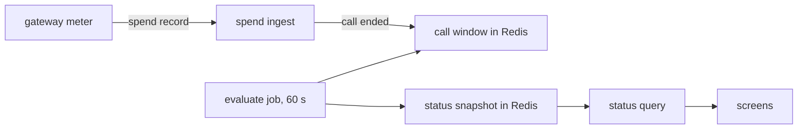

# Provider status

Last verified: 2026-10-19

## Overview

When a model provider fails, a user cannot tell the outage from a fault in DAM or in their own setup.
Provider Status is the platform's view of whether each model provider answers, per Connection template: healthy, degraded, or a fault on the platform's side.
The api-server computes it from the model calls that the agents' gateways see, and the screens read it to name an outage where a user meets it.

## The gateway signal

Every model call goes through the agent's gateway, and the [meter](spend-limits.md#meter) sends a final record for each call.
The record names the Connection template of the call, its payer, the status of the reply, and whether the gate refused the call.
The meter sets these facts on the request, so a call whose upstream connection fails still sends a record.
For each final record, the spend ingest emits a domain event before it measures the call, so a failed call without usage also counts here.

Provider Status keeps a window of the last five minutes per template in Redis, in one-minute buckets: the calls, the failed calls, the agents with calls, and the agents with failed calls.
Every replica writes into the same window, because each replica receives the records of its own gateway streams.

A failed call is a final record with a status that a provider gives when it is down or overloaded: 500, 502, 503, 504 or 529.
These records do not count: a periodic record, a call that the gate refused, a call with no status because the harness closed it, and a call whose record names more than one template.
An agent here is the payer, so the sub-agents of one root driver count as one agent.

## Detection

A template is degraded when, in the window, at least three calls failed, at least half of its calls failed, and at least two agents had failed calls or every agent that called it had failed calls.
So the broken setup of one agent does not blame a provider that other agents use without problems.

When at least two templates had calls and every one of them is degraded, the fault is on the platform's side, and no provider is blamed.
A degraded template keeps its start time until it is no longer degraded, also while the fault is on the platform's side.
The status is per template, not per model: a provider with one broken model shows as degraded when most calls use that model.
The thresholds are constants in the code.

## The snapshot and the job

A periodic job runs every 60 seconds in one replica.
It reads the window, computes the state of each template with its start time, and writes one snapshot to Redis that expires after three minutes.
When the job stops, the snapshot expires and the status becomes unknown.
A new outage shows after up to about two minutes: the one-minute bucket, the job, and the poll of the screen.

## The query

The status query reads only the snapshot, so a request never calls a provider.
It returns the outages with their start times, the fault on the platform's side with its start time, and the time of the last check.
A template that the query does not list is healthy or unknown.
Every signed-in user reads the same status, because an outage belongs to the provider and not to a user.
