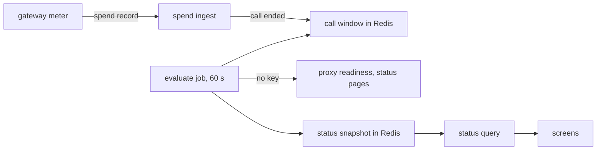

# Provider status

Last verified: 2026-10-26

## Overview

When a model provider fails, a user cannot tell the outage from a fault in DAM or in their own setup.
Provider Status is the platform's view of whether each model provider answers, per Connection template: healthy, degraded, or a fault on the platform's side.
The api-server computes it from the model calls that the agents' gateways see, and from public status sources that need no key; the screens read it to name an outage where a user meets it.

## The gateway signal

Every model call goes through the agent's gateway, and the [meter](spend-limits.md#meter) sends a final record for each call.
The record names the Connection template of the call, its payer, the status of the reply, and whether the gate refused the call.
The meter sets these facts on the request, so a call whose upstream connection fails still sends a record.
For each final record, the spend ingest emits a domain event before it measures the call, so a failed call without usage also counts here.

Provider Status keeps a window of the last five minutes per template in Redis, in one-minute buckets: the calls, the failed calls, the agents with calls, and the agents with failed calls.
Every replica writes into the same window, because each replica receives the records of its own gateway streams.

A failed call is a final record with a status that a provider gives when it is down or overloaded: 500, 502, 503, 504 or 529.
These records do not count: a periodic record, a call that the gate refused, a call with no status because the harness closed it, and a call whose record names more than one template.
An agent here is the payer, so the sub-agents of one root driver count as one agent.

## Detection

A template is degraded when, in the window, at least three calls failed, at least half of its calls failed, and at least two agents had failed calls or every agent that called it had failed calls.
So the broken setup of one agent does not blame a provider that other agents use without problems.

When at least two templates had calls, every one of them is degraded, and at least two agents had failed calls, the fault is on the platform's side, and no provider is blamed.
So one agent whose own gateway fails does not tell every user that the platform is down.
A degraded template keeps its start time until it is no longer degraded, also while the fault is on the platform's side.
The status is per template, not per model: a provider with one broken model shows as degraded when most calls use that model.
The thresholds are constants in the code.

## Public sources

The gateway signal needs traffic: a provider that nobody called in the last five minutes has no window.
So the job also reads public sources that need no key, as a second signal.
It reads only the sources of templates that have a Connection in the install.
When it cannot read the install's Connections, it reads every source, so a failed read does not end an outage or reset its count of failed runs.

| Templates                          | Source                      | Degraded when                                                                                     |
| ---------------------------------- | --------------------------- | ------------------------------------------------------------------------------------------------- |
| Curve Bender, IBM LiteLLM          | the proxy's readiness check | in two runs in a row, it does not answer within five seconds or does not say healthy: unreachable |
| Anthropic key, Claude subscription | Anthropic's status page     | the Claude API component, or for the subscription also Claude Code, has a partial or major outage |
| OpenAI                             | OpenAI's status page        | the Chat Completions or the Responses component has a partial or major outage                     |
| Bob                                | Bob's status API            | the chat completion check of Bob's region is not operational                                      |

A proxy's readiness shows only that the proxy and its database run, not that its models answer, so it can say "unreachable" but never "healthy models".
The api-server reaches a proxy by another path than the agents' gateways, so an unreachable proxy counts only while no agent's call to it succeeds in the window.
One failed check does not count, because a single slow or reset check would tell every user that the provider is down; the outage starts at the first failed run of the two.
The job keeps the count of failed runs in the snapshot, so it holds whichever replica runs the job.
A degraded component, and the overall indicator of a status page, do not count: OpenAI's overall indicator also counts products that DAM does not use.
A status page or Bob's API that does not answer, or answers in an unknown shape, gives no signal, so it never makes a provider degraded.
Bob's API is not documented, so DAM matches its check by name and by the region in its name.
When the gateway and a public source both report a template, the gateway's reason wins, and a public source never makes the fault on the platform's side.
The job warns in the log when a source fails three runs in a row.

## The snapshot and the job

A periodic job runs every 60 seconds in one replica.
It reads the window, computes the state of each template with its start time, and writes one snapshot to Redis that expires after three minutes.
When the job stops, the snapshot expires and the status becomes unknown.
A new outage shows after up to about two minutes: the one-minute bucket, the job, and the poll of the screen.
After each run, the job hands the evaluated state to the [outage alerts](#outage-alerts): every degraded template, and the evidence that a template answers again.

## The query

The status query reads only the snapshot, so a request never calls a provider.
It returns the outages with their start times and, for Anthropic, OpenAI and Bob, the link to the provider's status page; the fault on the platform's side with its start time; and the time of the last check.
While the fault is on the platform's side, only the outages that a public source reports stay listed.
A template that the query does not list is healthy or unknown.
Every signed-in user reads the same status, because an outage belongs to the provider and not to a user.

## Screens

The screens read the status query every 60 seconds, when the window gets focus or the connection to the server comes back, and at once after a turn fails.
A failed turn's card also reads it when it shows, so a turn that this tab did not send also gets a fresh status.

**The failed turn.** When a model call fails with a status or a message that says the provider is down or overloaded, the chat shows a red card in the agent's column, also when the agent wrote no reply text.
Other errors keep their own look.
The card names the provider of the session:

- no outage is known: the provider did not respond, the message was saved, and the user can retry in a few minutes or switch the agent to another provider;
- the provider is degraded: it has had problems since the start of the outage, in the viewer's local time, and the user's setup is not the cause;
- the fault is on the platform's side: the platform cannot reach model providers, and neither the provider nor the setup is the cause;
- the card saw an outage that has ended: the provider works again, and the user can retry now.

The card's actions are Retry, where the message can be sent again; Switch provider, which opens the agent's Providers section; the provider's own status page, while the provider is degraded and has one; and Raw error, which shows the original error text.
Claude Code writes its own copy of the error as reply text before the turn fails; a reply that holds nothing but that copy is the failure itself, so the chat shows the card in its place and the copy only under Raw error.
Retry then sends the same prompt again as a new message, and the failed exchange stays above it.
A reply that streamed other text before it failed keeps its text, and its card says that the response was interrupted and has no Retry.
Pi and Codex write nothing into the reply while they retry, and fail the turn with the error, so their card shows alone, with Retry.
The card lives only in the open chat: a reload or a reconnect rebuilds the chat from the transcript, which holds the harness's text and no card.

**Slack and Telegram.** An addressed turn in Slack or Telegram whose error says that the provider is down or overloaded gets a reply that names the cause, by the same rule as the card ([channel turns](channel-turns.md)):

- the provider is degraded: it has had an outage since the start time, in the reader's local time, with its status page where it has one;
- the fault is on the platform's side: the platform cannot reach model providers;
- no outage is known: the provider did not respond, and the owner can switch the agent to another provider if it keeps failing.

The provider is the one of the agent's channel default.
A thread whose model someone picked by hand can run on another provider, and the reply then names the default's provider.
When the provider or the status cannot be read, the reply says that the model provider did not respond.
An ambient turn that fails posts nothing.

**The status line.** While the provider of the open session is degraded, a line at the end of the chat, above the message box, says so: while a turn runs, that the provider is not responding and the agent keeps trying; otherwise, since when the provider has had problems and that messages may fail.
While the fault is on the platform's side, the line says that the platform cannot reach model providers, also when the session's provider is not known.
The line also shows before a turn fails, so a user who waits on a turn that the harness retries learns the cause early.
The session's provider is the one the session names, else the agent's default pair, else the template that all of the agent's provider Connections use.

**The Providers badge.** In Settings › Providers, one pill on each row says whether the provider is configured, and, once it is, what its key is doing: verifying, connected, rejected, or unverified.
The pill reads "Configured · Degraded" instead of "Configured · Connected" while that Connection's template has an outage, or while the fault is on the platform's side.
A key that the provider refused at its last check still reads as refused, because a new key is the fix for it whether or not the provider is down.

**The banner.** At the top of the main area, on every page but the chat, a banner tells a user about outages of the providers that the user has a Connection to.
The chat leaves it out, because the status line there covers the session's provider.
One outage names its provider and since when most calls to it fail; several outages name each provider and the earliest start.
While the fault is on the platform's side, a danger banner says that the platform cannot reach model providers, to every user with a provider Connection, and blames no provider.
For a provider outage, its actions open Settings › Providers and each provider's own status page, where one exists; the banner on the platform's side has only its close button.
Closing it hides each shown outage, by its template and its start time, in that browser only, so a new outage, or the fault on the platform's side, shows the banner again.
The banner hides while the app has lost its connection to the server, because the status is then unknown.
On a narrow screen it shows only its lead and the close button.

## Outage alerts

A user who meets an outage in the chat, or in a Slack or Telegram reply, learns the cause there ([screens](#screens)).
A schedule runs an agent while nobody watches, so an outage alert tells the owner when such work failed in an outage that lasts longer than a delay, and again when the provider works again.
The delay is one platform setting, 15 minutes by default; an outage that ends earlier sends nothing, and a failure from the start of the outage counts once the delay has passed.
An outage that failed no unattended work sends nothing, whatever schedules and channels the agents have.

Failed unattended work is a scheduled run that made a failed call to the template since the outage started.
The gateway's call record names the calling agent and the Session that the agent stamped on the call ([spend limits](spend-limits.md)), and the call failed by the rule of [the gateway signal](#the-gateway-signal).
The api-server does not learn the outcome of a scheduled run, because the run's event settles once its prompt is submitted, so the gateway's failed call is the evidence.
Each replica records the failed calls with a Session that it sees, per template in Redis, for a day.
Once an outage has lasted the delay, the job looks up their Sessions in the [Session directory](metrics.md#session-directory) and keeps the scheduled ones: a failed call in a chat or a channel Session does not count.
A run that retried and then succeeded still counts, and a Session that the directory cannot read counts at a later run.
A disabled or deleted agent is left out.

The alerts react to the state of each run on the replica that ran the job, so each run is the delay's clock, and a lost run changes nothing, because the next one repeats the whole state.
Each owner has one alert per template, told or recovered, written with a compare-and-set before the message goes out: two runs never send the same message twice, and a send that fails is lost, not repeated.
An owner who was told gets no new message until the alert recovers, also when the start time changes because the snapshot expired.
When more of their agents fail in the same outage, the stored alert names them too, without a message, so the card and the recovery message list every agent to check.
While the fault is on the platform's side, an outage that only failed calls show sends no new message, because the provider can be innocent; that fault is the operator's to fix.

A told alert recovers only on evidence that the template answers again: a call in the window that did not fail, or, for an outage that a public source reported, that source answering again without reporting it.
A proxy's readiness does not say that its models answer, so it never ends an outage that failed calls showed.
Provider Status drops a template that nobody calls, and that alone does not end an alert: when no agent calls the provider again, the alert stays told and no recovery message goes out.
One outage sends one message and one recovery message, with no reminders.
Each message goes to the owner's Slack direct message ([channels](channels.md)); only when it reaches nobody in Slack does it go to each private Telegram chat that the owner bound to one of their own agents, with times in UTC, and never to a group or a business chat.
Every owner also sees the alert as a card in the Approvals panel ([home-feed](home-feed.md#outage-alerts)).
