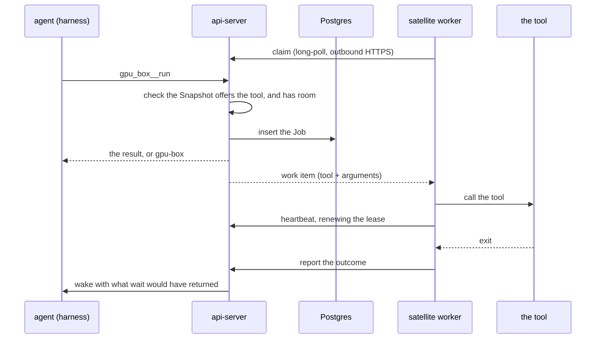

# Satellites

Last verified: 2026-11-04

## Overview

A **Satellite** is an MCP server on a machine outside the cluster, reached through a queue the machine polls.
It lets an Agent call tools on a host it has no other access to — a capable machine in a higher-security zone, whose firewall admits nothing inbound.

The machine polls; nothing is pushed to it.
The worker runs beside the tools, claims work over ordinary outbound HTTPS, calls them and reports back.
The Agent sees each granted Satellite's tools on the platform MCP server it already has, scoped by Satellite name.

Three verbs start a worker, and **nothing above it can tell them apart**:

- `dam satellite mcp --name build-farm -- npx -y @acme/build-mcp` — any MCP server, whose tools are offered as they come, bar a name the contract refuses.
  The worker either starts it over stdio or, with `--url localhost:8080`, reaches one already listening and forwards each call to it: Streamable HTTP first, then SSE, with any `--header` the server wants.
  A bare `host:port` means `http://host:port/mcp`.
  Either way the worker is the server's only client, so the platform still reaches nothing but the queue.
  Without `--name` it is named after the server it starts — the first word past a package runner such as `npx` or `uvx`, less scope, version and path — or the host it forwards to.
- `dam satellite shell "…"` — a **Command Surface**: permitted command shapes, one usage line each, which becomes a one-tool MCP server whose single `run` tool takes the command to run.
  Without `--name` it is named after the one command every pattern permits, or called `user@hostname` when they differ; either is folded into the name contract.
- `dam satellite files --root <dir>` — one directory on the machine, offered as a `download` tool, and with `--upload` an `upload` tool beside it (see [Files](#files-between-the-machine-and-the-agent)).
  Without `--name` it is named after the directory.

Separate verbs rather than one flag because each is a different thing to set up, not another way of saying the same thing, and an explicit verb cannot be misread the way a selector flag can.

Making the Command Surface a degenerate MCP server rather than a parallel concept is what keeps the platform out of the business of understanding commands.
It forwards a tool call and stores an outcome; the machine alone reads the arguments.

The Command Surface is **text the user passes, not a file the worker reads**.
It comes as one argument or on stdin, which is what a heredoc wants:

```
dam satellite shell --name gpu-box --cwd /srv --timeout 6h <<'EOF'
./process.sh (sales.db|events.db) [-n ^[1-9][0-9]{0,3}$]  # Process a database
./train.sh ./data/**/*.db    # Train      [max=1 timeout=2h]
EOF
```

A `#` opens a description, and only where a shell would see one — at the start of a line or after whitespace — so an anchored regex may hold a bare `#` without escaping.
A trailing `[…]` group inside the description carries the few per-command settings: `max=N`, `timeout=D`, `cwd=PATH`.
An option the parser does not know is refused rather than ignored — a setting that silently did nothing is the one mistake this format must not make.

Having no file is the point.
Nothing can drift between what the user wrote and what the machine enforces, there is no path to get wrong, and the surface is visible in the shell history that started the worker.
It costs the ability to reload: changing what may run means restarting the worker, which drains first.



Three properties follow from the queue, and each replaced a worse alternative:

- **No replica pinning.** Affinity was tried for the harness path and abandoned ([platform-topology](platform-topology.md)).
  A held socket would land a Satellite on one replica while the Agent's call lands on a random one; a queue in the shared store lets any replica serve either side.
- **Outcomes outlive both ends.** A Job survives the worker dying, the Satellite going offline and the Agent hibernating.
- **It traverses corporate proxies.** The egress proxies fronting these zones routinely forbid WebSocket upgrades.
  Plain HTTPS gets through, with the same outbound-only direction.

MCP is the *contract* between Platform and a Satellite, but not the *transport*: the worker speaks a small private RPC — claim, heartbeat, report — carrying MCP tool calls and results.
A Satellite is therefore unreachable except through Platform, which is the point, while what it offers is described in the one vocabulary every harness already speaks.

## Concepts

- **Satellite** — a named, owner-scoped tool surface, identified by `(owner, name)`.
  Durable: the record outlives any connection, and its tools stay listable while the machine is offline.
  Per-owner by design — two people wanting the same machine run one worker each, so every call stays attributable to a real person's key.
  Platform's sharing model lends *Agents*, never resources ([multi-player](../strategy/multi-player.md)).
- **Command Surface** — the text declaring a Satellite's Command Patterns and their settings, passed to `dam satellite shell`.
  Read only by the worker; the platform never sees it.
  An MCP-server Satellite has none.
- **Snapshot** — the server's copy of the Satellite's **tool list**, replaced on each connect, and what the Agent's tools are built from.
  It is a *claim by the Satellite*, not a platform guarantee: identity is the name, so a worker reconnecting from a different checkout serves the same name backed by different tools.
- **Job** — one tool call, identified by `(satellite, sequence)` and rendered `gpu-box#7`.
  The sequence is minted server-side, since the id must return before any worker has seen the Job.
- **Command Pattern** — one permitted command shape (below).
  A Command Surface concept only, enforced entirely on the machine.
- **Satellite Grant** — the per-Agent permission to reach a Satellite.
  The granted set decides whether the tools are registered at all.

## Command Patterns

These apply to a Command Surface, and live entirely on the machine: the platform stores a tool, not a grammar, and never parses an argument.
A pattern is a usage line, and the grammar is the security boundary.
Seven forms, no sub-syntax: literals, `(a|b)` for a closed set, `[…]` optional, `(…)...` repeating, `*` for one filename-like argument or part of one, `**` for a path-like one, and `^…$` for a regex covering a **whole** argument.

The **first token must be a literal**.
A pattern that lets the caller choose the program is a shell, not an allowlist, and that is the one thing the parser refuses outright.

There are deliberately no named slots: names were read by nothing, and saying what to pass is the command's description.
A regex covers a whole argument rather than part of one, which reads like a restriction and is not — the argument *is* the whole thing, so `^--limit=[1-9][0-9]?$` constrains a flag's value, and a regex is equally the way to write a literal `*`, `(` or `[`, which are structural everywhere else.

Two rules constrain what a match may carry, and both are about the value rather than how the pattern is written:

- **A matched argument may not begin with `-`** where the caller chose its first character, unless it follows a literal `--`.
  `--limit=*` pins that dash itself, and a whole-argument regex has named every character the argument may hold, so neither is second-guessed.
  This protects only as far as the target script honors `--`, which the platform cannot verify.
- **No matched argument may carry a `..` segment**, whatever matched it and with no normalization.
  A regex may widen what an argument *says*; it can never widen where it *points*.

A user-authored regex meeting model-supplied input is a ReDoS, so per-argument length and argv count are capped before matching starts.
Because matching now happens only on the machine, that cost falls where the pattern was written rather than on a shared api-server thread — which is what let the server-side regex worker, its deadline, its one-at-a-time queue and the manifest token budget all be deleted.
A pattern that backtracks slows its own machine and nobody else's.

## Admission

A Job is accepted only when a worker will pick it up within a poll interval.
There is **no backlog**: non-terminal Jobs may never exceed the Satellite's declared concurrency limit, and a call that would exceed it is refused with a reason rather than queued.
That is what makes the *running* a call reports true in every case rather than the common one.

The count and the insert share one transaction, so two calls arriving together cannot both read a count under the limit and both land.
A per-tool limit works the same way, for the tool that must not run beside itself.

Admission decides only what the platform can know from the Snapshot: that the Satellite is **online** and not **draining**, that it offers the named tool, and that there is room.
It does not read the arguments — a call whose arguments the machine will refuse is admitted, dispatched and refused there, one round trip later.
That is the price of the platform not understanding what its Satellites do, and it is paid in a wasted poll rather than in a wrong answer.
A per-command limit inside a Command Surface is counted on the machine for the same reason: the platform sees one `run` tool and cannot tell two commands apart.

`--max-concurrent` is clamped to an operator ceiling.
Everywhere else the machine's own declaration governs and wins; here the queue is Platform's storage, so a Satellite may ask for less than the ceiling and never for more.

A machine past the offline window is refused as offline, whether or not it was draining when it left.
Draining is set by `drain` and cleared by a **claim**, and by nothing else: a draining worker stops claiming, so a claim is the machine saying it serves again, while a heartbeat and a Snapshot push both say nothing about readiness.
A heartbeat that cleared it would let a shutting-down machine un-shut itself on its own next beat.

## Jobs

| State       | Meaning                                                                                                                                  |
| ----------- | ---------------------------------------------------------------------------------------------------------------------------------------- |
| queued      | accepted; no worker has claimed it yet                                                                                                   |
| running     | claimed, under a lease the worker renews                                                                                                 |
| done        | terminal: the tool's result, and its exit code where the tool has one; a call the machine refused is a done Job whose result is an error |
| interrupted | the worker stopped renewing, or it was killed — the outcome is unknowable                                                                |
| cancelled   | terminal after a cancellation or the Satellite's removal                                                                                 |

**Interruption is detected by lease expiry, not reported.** A worker that dies cannot file a report about itself, so a Job whose lease lapses is swept into *interrupted*.
A worker that knows it is dying reports directly, which is faster and says why.

**Cancellation is cooperative and travels on the poll.** How a machine stops its own work is its business; the platform asks and records what comes back.
A Job still queued settles server-side with no worker involved.

**Jobs are never retried.** A tool call is not assumed idempotent and nothing can judge one safe to repeat.

**Removing a Satellite takes its Jobs with it.** A Job is keyed by the Satellite and its sequence, and that sequence restarts for a Satellite registered under the same name again, so rows left behind would collide with its successor's first Jobs.
The record goes with the machine, which is what removing it asks for.
A worker still serving it stops claiming, lets its running jobs finish and exits, rather than registering the Satellite again — and a worker that reconnects after the removal is refused, since it can only name the registration that is gone.

An outcome the Agent has not been told about is **never retired by the TTL** — dropping it would drop the one turn it is owed.
The hourly wake retry is what eventually clears it.
**A stop wins over the wake**: an Agent its user [stopped](agent-lifecycle.md#hibernate) is not woken for an outcome — its turn waits in the outbox for the next deliberate wake, and the retry leaves it alone.
A Job that reached its TTL without ever starting — queued with nobody claiming — is **settled and told**, not deleted: it holds a place against the Satellite's concurrency until something ends it.

Output is captured with stdout and stderr merged in terminal order.
Under a few KB it comes back inline; over that the tool returns a path and the full log is written into the Agent's own sandbox, so a large log costs the model a line rather than a context window.
The file is written **at read time** — when an outcome arrives the Agent may be hibernating, but an Agent asking for it is up by definition.

An MCP tool's images are not output: each one reaches the Agent as the image content block the tool returned, so the harness shows its model a picture instead of base64 the model would have to decode.
The machine is not trusted to send a picture, so an image is forwarded only when it is base64 and of a format a harness shows — PNG, JPEG, GIF or WebP — which is also what makes its length a byte count.
A Job that carries an image holds the text and the images together under a single ceiling, counted on the JSON the platform stores and hands back rather than on the bytes the tool printed, because text the JSON must escape grows sixfold.
It carries at most a handful of them, because an image cannot be spilled to a file the way a log can.
A report that carries no image keeps the character cap it has always had, since a worker of an older version sends one.
Within that ceiling an image takes its bytes first: a long log reaches the Agent as a file it can read, and a picture has nowhere else to go.
An image over any of those bounds is named in the output as not passed on, rather than vanishing from a result that then looks empty.
An image that does pass leaves a marker of its own in the text, so a harness that renders no image blocks still shows that a picture came back; a tool result whose text was spilled names its images itself, since the marker went to the file.
Audio and embedded resources stay placeholders: no harness hands either to its model.
A turn the platform starts carries no images, so it says the picture exists and names the job tool that shows it.

## Staying connected

A worker is meant to run for weeks on a machine nobody watches: a laptop that sleeps, a network that drops, a platform that redeploys.
Everything it does about that follows from the direction it is reached from: outward only.

**It retries forever, and never in step with the other machines.** A failed connect or claim is retried after a wait that doubles from a second to half a minute and carries jitter, so the machines that come back when a platform returns spread out instead of arriving together.
Nothing ends the loop; the process stops when it is told to stop.

**A reconnect is a registration, not a second Satellite.** The name is what identifies a Satellite, so connecting again replaces the Snapshot of the one the machine already serves and keeps its Grants, its Jobs and its Job sequence.
An Agent sees the same tools before and after a drop, and never two of anything.

A Satellite's row is nevertheless a **registration** of that name, and each registration has an identity of its own.
A worker names the registration it serves on every call it makes — registering, claiming, renewing a lease, cancelling, reporting — and the platform puts that identity inside the statements that act rather than in a read before them, because a name can be registered again between the two.
A removal, or a registration replaced while a worker was away, is therefore refused: the worker that names a registration the platform no longer holds, or holds under another identity, is told there is no such Satellite before it runs anything, and stops ([Jobs](#jobs)).
A **fresh** worker that names nothing is not refused one: connecting under a name another machine is serving takes that name over — the row keeps its identity and its Jobs, and both workers then claim from the same registration.
Identity belongs to the registration, not to the process, so a second machine is never turned away on its own account; exporting one name from two machines at once is the case to avoid.
Removing a Satellite takes its row first, in one transaction, and admission binds its insert to the registration it admitted against, so a call arriving beside a removal is either deleted with it or refused — never left for the next machine of that name to claim.
That is what keeps a stale worker from undoing the owner's decision to remove one, from claiming jobs queued for a machine that is not this one, and from settling another machine's `#1` with its own.
A worker from before the identity existed names nothing and is served as it always was: it cannot be fenced, which is the cost of the rollout, not a promise the platform makes.

**The machine's own server is restarted, but only when it exited.** Reconnecting must not kill work that is in progress, so a server that is still up keeps serving.
One that did exit is started again, and the tool list it comes back with is **registered before any more work is claimed**, because a Snapshot is that machine's claim about what it offers now; a server that keeps exiting seconds after it starts is restarted on its own backoff rather than as fast as work arrives.

**A result survives a short drop.** An outcome that could not be reported is kept and sent again before more work is taken, and once the platform answers again, which covers any outage shorter than the Job's lease.
It is replayed only to the **registration it was claimed under**: a name registered again starts its Job sequence over, so an old machine's `#1` is not the new machine's `#1`, and the platform settles a report that names the wrong registration as nothing at all.
A rollout moves the two ends apart for a while, so a missing identity is read as *unknown* rather than as *different*, and the worker keeps the registration it last learned.
A result claimed before the platform could name a registration is never replayed, though: the worker cannot tell it from the same number of a machine registered since, so it says so and lets the lease settle that Job as interrupted.
Nor is one sent to a server that cannot enforce a registration: every call a worker makes once it knows its registration — resuming, claiming, renewing a lease, reporting, draining — goes to a procedure of its own that requires it, and an older server refuses such a call by name instead of reading it and ignoring the field.
A rolling deployment can answer one call from a newer replica and the next from an older one, so the fence has to travel on the call that writes rather than on a promise from an earlier one.
A worker that meets such a refusal waits for a platform that enforces registrations; it never takes the unfenced path with a registration in hand.
Beyond the lease, the sweep settles the Job as interrupted and the Agent is told its outcome is unknown, so a call in flight during a drop ends in a sentence rather than a wait.
A call made while the Satellite is offline never starts at all: admission refuses it and says since when the machine has been gone ([Admission](#admission)).

**Credentials refresh themselves.** A worker signed in through the browser re-mints its access token before each call, and one started as a service holds a serve key in `DAM_TOKEN` instead, which needs no refresh.
Either way, a worker that cannot authenticate retries like any other failure but says what ends it: signing in again, or a new key.
||||||| parent of d3272c8ee (feat(satellite): download and upload one file between a machine and an agent)
## Files between the machine and the Agent

A Job's result carries one string of at most 1 MiB beside a handful of images, which is the wrong channel for a file: a tool that returned contents would spend the Agent's context on bytes, and a large file would not fit at all.
So a file travels on **its own request, in the direction the queue cannot go** — the machine makes it, over the same outbound HTTPS the worker already uses, streamed both ways and never through a Job's arguments or its result.

`dam satellite files --root <dir>` exposes one directory on the machine as a **transfer surface**:

- `download` copies one file **into the Agent's workspace**, and the Agent is told only the path the file landed at, its size and its sha256.
  It reads the file with its own tools, never through the model's context.
- `upload`, offered only when the worker was started with `--upload`, copies one file **from the Agent's workspace onto the machine**.
  It is the same request in reverse, and it never replaces a file that is already there unless the call says to.

Each tool declares which way it moves files, in the tool list the Satellite registers, and that declaration is what the platform checks a request against: a Job whose tool does not move files, or moves them the other way, authorises nothing.

**A transfer belongs to the claim that is running the Job.** Claiming a Job issues that worker a transfer token, stored on the Job row as a hash, and a file request must present it; the token is spent by the transfer it authorises, in the same statement that checks the Job is still running.
So a transfer happens once, for one Job, and only while that Job runs: bytes that arrive after it settled land nowhere, and a second transfer on the same Job is refused.
This is the one thing the serve key does *not* buy: two keys of one owner are indistinguishable to the queue, and the token is what tells the claimant from any other worker of that owner.

**The platform takes the direction and both paths from the Job's own arguments** — the Agent's call — so a machine cannot ask for a file its Agent did not ask for, and cannot choose where a received file lands.
A download lands in a directory the platform derives from the Job and its claim, so two transfers never collide even when a Satellite is removed and its sequences start again; the file's name is the last segment of the path the Agent asked for.
An upload reads the workspace path the Agent asked for, and no other.

The directory is the whole allowlist on the machine, and every path is opened without trusting a component:

- The root is resolved once at startup and re-resolved on every call, so a root replaced afterwards stops being a root.
  `/` and the home directory are refused as roots.
- Each directory on the way must be a real one, and the file is opened without following a link, without blocking on a FIFO, and then compared with the path it was opened by — same device and inode, a regular file, one link.
  A `..`, an absolute path, a link at any point, a hard link out and a special file are all refused.
- Read-only unless the user passed `--upload`.
  A write is staged beside its destination under an exclusive name, verified before a byte is written, and published by replacing its own directory entry: it never writes through a link, and it never replaces a file with more than one link.
- The surface is POSIX only; on Windows the verb refuses to start rather than promise a confinement it cannot keep.

The Agent's own workspace is treated as untrusted in exactly the same way, because the Agent owns everything inside it.
The platform's writes are staged in the workspace and published by a second request, so the publish happens only after the bytes arrived and the token was spent; and both directions walk the workspace components and open without following a link, refusing a hard link and a special file.

**One transfer carries at most 50 MB**, counted while the bytes move in both directions, and a file that grows after it was measured or a response that never ends is cut off at the limit rather than read whole.
Nothing passes through the api-server's memory: it relays the stream, the runtime owns the workspace end.
Every transfer leaves one audit line — the direction, the Job, the Agent, the path, the byte count and the outcome — and file contents never enter a log, an error message or a tool result.

## Trust boundary

**The machine decides what may run on it, and nothing else does.** The api-server checks that the Satellite offers the tool and has room; it never reads an argument, because a Satellite may be any MCP server and only that server knows what its arguments mean.
The worker matches every call against the Command Surface it was started with before spawning.
Execution takes the pattern's own literals, the surface's working directory, and no caller-supplied value beyond a matched argument.
It is never a shell, so nothing in an argument is expanded or interpreted.
The command — or the MCP server — inherits the **worker's own environment**, so whatever the user exported when they started the worker is what it sees, which is worth knowing when deciding what to start it from.

This is a narrower promise than matching in both places, and deliberately so: a check the platform cannot perform for every Satellite is a check it should not appear to perform for any.
What Platform still guarantees is the record — every call, verdict and outcome is stored on the Job row whether or not the machine reports honestly about itself.

A **file transfer crosses in the other direction**, so the platform is the side that writes what it is given.
It trusts none of it: the machine names no path at all, the direction and both paths come from the Job's own arguments, the claim's token is spent atomically so nothing lands or leaves after the Job ended, and the workspace end walks every component without following a link.
What the machine reads is bounded on the machine, by its root.

Anything an Agent can call is callable by a **prompt-injected** Agent.
That is the whole exposure surface, and it is why a tool call is bounded before it is stored — arguments are capped, and the concurrency limit is enforced in the same transaction that inserts.
Connecting an arbitrary MCP server widens that surface to whatever the server exposes, which is the user's call to make and the reason grants stay deliberate.
Every call, verdict and outcome is recorded on the Job row itself — the tool, its arguments and the result — and because Platform stores that rather than the Satellite, the record does not depend on a machine reporting honestly about itself.
The rows are the whole of it: they are purged with the retention sweep a week after the Job started, so a longer-lived trail would have to be added on purpose.

A worker authenticates with an API key carrying the **serve scope**, which covers only what serving needs: registering a tool surface, claiming the work approved for it, heartbeating, reporting what came back, and declaring itself draining.
It confers no scope over Agents or credentials, but it is not agent-scoped either, and the difference matters: a Satellite serves every Agent granted to it, so a worker claims work queued by any of them and the text it reports becomes that Agent's next turn.
Narrowing the key to one Agent would therefore be a promise the surface cannot keep, so a serve key must be an unrestricted principal and an agent-bound one is refused outright.
Read that as the cost of the surface: a serve key is trusted by every Agent granted to any Satellite of that owner, which is the reason to mint one per machine and to keep the grants deliberate.
Nothing stops an owner minting a key that holds *more* than that scope — the platform cannot tell which key a machine will be given — so the guidance is the narrow key, and what the platform guarantees is only that the scope itself buys nothing else.
That is what keeps the long-lived key a machine outside the cluster must hold from being worth more than the machine.

Revoking a grant, deleting a Satellite and deleting an Agent share one rule, and share the code that applies it so the three cannot drift: **revocation stops dispatch and stops reads, never execution.** The command is already running on a machine Platform cannot reach, so queued Jobs are cancelled and running ones run on.
What survives differs by which authority went away.
After a revoked grant or a deleted Agent the Satellite is still there, so a running Job's outcome is still reported and recorded and only the Agent's access is gone.
Deleting a Satellite takes its Job rows with it: the command runs on with nothing listening, no cancellation can reach it because the worker reads cancellations from the rows that were just deleted, and no record of it is kept.
Stopping the command itself is the job of whoever is at the machine.

## Surfaces

Satellites are a pre-release surface.
The tools appear only for an Agent that holds a grant, which is deliberate to give.

The UI shows Satellites **only once one has connected**.
Running a worker is the opt-in: a second switch in the UI would be one more place to enable the same experiment.
Until then nothing about Satellites appears.
After it, the Connections page lists each Satellite with whether it is online, its tools and its host, and removes one.
An Agent's Connections section lists the Satellites granted to it.
Its **+ New** catalog lists them under MCP servers, which is where a grant is given, so the path is ⵗ → Configure agent → Connections → + New → MCP servers → the machine → Add to agent.
A Satellite is an MCP server to the agent, so the catalog has no tab of its own for it; the form that adds a remote MCP server points at `dam satellite` for one that runs on the user's own machine.
The Connections page and the catalog poll while open, so a machine that has just connected, or just gone offline, shows without a reload.

For deployment operations, the CLI is at parity plus `dam satellite mcp`, `dam satellite shell` and `dam satellite files`, whose **log is the interface**.
The parsed Command Patterns print at startup.
Right after connecting, the worker prints where in the UI to add the machine to an Agent, since until someone does, no Agent can reach it.
Every request is one line naming the Agent that sent it and what it asked for.
The api-server resolves the Agent's name when the worker claims the call, and falls back to its id.
Every outcome is one line too, and each way a call ends reads differently: `DONE` with its exit code, `FAILED` for a command that ran and failed or a tool that returned an error, `BLOCKED` for a call the machine refused without running, which names the pattern it came closest to, and `CANCELLED` and `INTERRUPTED`.
A parse error names the line it is on, since the text the user just typed is the whole allowlist.
Shutdown stops claiming on the first interrupt — a claim already open hands nothing back that is then started — and lets what is running report.
After a bounded grace it stops waiting on the platform, so a supervisor's stop timeout gets an exit rather than a kill, and it closes the MCP server it started before it exits, waiting for the child to stop within its own deadline.
A Satellite found removed by a reconnect drains what is running just as a removed claim does, rather than closing the machine's MCP server on top of it.
The second interrupt forces.
There is no reload: neither form reads a file, so changing what a machine offers means restarting it.
Keeping one worker running unattended is [running a satellite as a service](../notes/satellite-service.md), which holds the systemd unit and the launchd plist.

`dam satellite` marks itself **experimental** in its description and help text, which is how a pre-release surface is disclosed where there is no feature flag to read.

A running harness lists tools once at spawn, so a new grant or a newly added tool is invisible until it restarts — the same lag every MCP entry has.
Enforcement never lags: admission reads the live Snapshot, so a removed tool is refused at once, and the machine matches against the surface it was started with.

Each Satellite's tools are registered **scoped by its name** — `gpu_box__run`, `gpu_box__wait`, `gpu_box__get`, `gpu_box__cancel`.
Any character of the name other than a letter or digit becomes `_`, so `jan@lab.local` registers `jan_lab_local__run`.
A tool needs no `satellite` argument the model could get wrong.
Two machines can still render one registered name — a tool name may hold the separator — and the second is dropped rather than registered twice, which would fail the whole session.
A proxied call blocks briefly and returns the outcome if it is quick, and a job reference otherwise, so the common short call costs one tool call rather than two.

## Where the code lives

- Contract and router: [`packages/api-server-api/src/modules/satellites/`](../../packages/api-server-api/src/modules/satellites/)
- Implementation: [`packages/api-server/src/modules/satellites/`](../../packages/api-server/src/modules/satellites/)
- Worker and CLI: [`packages/cli/src/modules/satellite/`](../../packages/cli/src/modules/satellite/)
- UI: [`packages/ui/src/modules/satellites/`](../../packages/ui/src/modules/satellites/)
