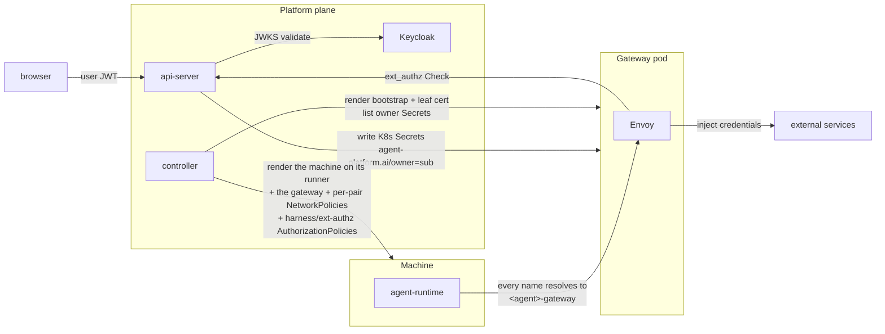

# Security and credentials

Last verified: 2026-10-24

## Overview

Three rules carry the security model:

1. **Agents never hold upstream credentials.** Real upstream tokens (GitHub, Anthropic, Slack, internal gateways) live in K8s Secrets labelled with the owner's `sub`.
   The Envoy proxy in the Agent's gateway pod — a pod of its own by default, its owner's single one where the install turns that on ([owner gateway identity](#owner-gateway-identity)) — injects them into outbound traffic on the wire; nothing is ever mounted into the machine.
2. **Identity flows from Keycloak.** Browser users authenticate against Keycloak; the api-server validates the JWT and stamps `agent-platform.ai/owner` on every resource the user creates.
   Per-user credential isolation is the `agent-platform.ai/owner` label on the K8s Secret — the controller's selector refuses to mount any other owner's Secret into a given owner's gateway pod.
   An Agent's `secretRef`, whose keys become its environment, is honoured only for a Secret with its owner's label that the platform does not manage.
3. **Two boundaries, layered.** The machine → gateway hop is held at the *kernel*: the machine's egress allowlist is exactly its gateway's ClusterIP, and the runner pod it boots on may dial that gateway and nothing else; the gateway → api-server hops (harness and ext-authz) are gated at the *mesh* by per-Agent Istio AuthorizationPolicies on the gateway pod's SPIFFE principal (not on no-mesh dev clusters).
   A machine is a guest, not a pod: it has no mesh identity and no service account token, so what it reaches is decided by an allowlist and by the runner's policy, and a destination it names is never what decides.
   The gateway pod stays in ambient; istiod stamps it with a SPIFFE workload cert whose SA name equals the Agent name.
   Two per-Agent AuthorizationPolicies enforce the gateway-originated boundary cryptographically: the api-server's harness waypoint ALLOWs the gateway principal to `/api/agents/<id>/*`; the per-Agent ext-authz Service ALLOWs only the matching SA.

Workspace contents are explicitly outside the trust boundary — see the security note on [persistence](persistence.md).

## Diagram

The credential boundary is the gateway pod: K8s Secrets are mounted there alone, and the machine has no route to a host of its own choosing other than through its gateway.
Enforcement is layered:

- **The machine's egress allowlist**, enforced by smolvm inside the network the guest itself owns, names its gateway's ClusterIP and nothing else — no node, no sibling machine, no cloud metadata endpoint.
  Every name the guest resolves is answered with that address by the gateway's resolver, so host choice is what the gateway then judges, never where the bytes went.
- **Runner NetworkPolicies** are the kernel gate behind that allowlist: the [runner](vm-runner.md) reaches its owner's gateways on the proxy and resolver ports and nothing else, and resolves nothing, so no DNS port is admitted anywhere.
  The node [image cache](vm-image-cache.md) service that fetches every image has a policy of its own: the public internet minus every range the cluster owns, the cluster DNS pods, and the pods or ranges an install names for an in-cluster registry or a mirror outside the cluster.
- **Gateway ingress NetworkPolicy** admits the proxy port and the machine resolver port only from the owner's runner, which is the one caller a machine's traffic can arrive as.
- **Machine ingress** admits the runner's machine API and the range it publishes machines on only from the api-server (ACP/tRPC relay) and the controller (idle-checker busy-probe).
  agent-runtime serves unauthenticated on the assumption that this kernel gate is the auth boundary.
- **Gateway Envoy ext_authz** gates everything the gateway forwards on behalf of the agent — external upstreams via the HITL rule model, while platform-internal upstreams pass without a per-request human decision: the harness path (control-plane traffic to the api-server) and the artifact object store, where each request already carries a platform-minted authorization — a short-lived link scoped to a single object and operation, issued by the api-server after ownership checks and validated by the store itself ([artifact-library](artifact-library.md)).
  This is the destination-side egress gate; no NetworkPolicies on Postgres / Redis / Keycloak / the harness or ext-authz Services are needed because the agent has no admitted route to any of them.
- **Mesh AuthorizationPolicy** gates the gateway-originated hops by the gateway pod's SPIFFE principal: harness via the api-server's waypoint, ext-authz on the per-Agent Service.
  The agent has no SPIFFE identity in this model.

The machine holds no service account token and no Kubernetes identity at all, and nothing of the platform's shares its network or process namespace: the guest boots under the runner's own kernel, and that pod's policy is what stands between the two.

## Identity

**Keycloak** is the only identity authority.
It runs in-cluster as a Helm subchart and is the OIDC provider for every authenticated surface.

Keycloak's branded login page ships two presentation variants selected per deployment: password-first (the default — username/password form, with any identity-provider buttons offered below it) and SSO-first (identity-provider CTAs only, for deployments where corporate SSO is the expected sign-in path; the page falls back to the password form when the realm has no identity provider configured).
The chart's `keycloak.login` values ([`helm/values.yaml`](../../helm/values.yaml)) select the variant; they reach the theme as container environment variables resolved through the theme's `theme.properties` placeholders, so switching variants is a values change and a pod roll — no theme rebuild, no realm change.
The same page also knows which client started the sign-in: when it is the artifact share host's client, the heading and lead paragraph tell the visitor they need to sign in to view a shared artifact instead of the general product pitch.
Above its heading the page shows what the brand name stands for: the install's brand values hold a list of meanings, which reach the theme the same way, and the page swaps the one on screen for another at random every few seconds, never the same one twice in a row.
An install with no meanings shows only the heading.
Upstream identity providers themselves (e.g. w3id, IBMid) and the rule for who they admit are realm configuration managed outside the chart.
The page knows the IBM sign-in providers, w3id and IBMid, by their alias on the realm and shows the IBM logo on their buttons, so a realm can offer both while sign-in moves from one to the other.

Anyone the realm lets sign in can start: there is no approval step, and a first sign-in goes through the Terms-of-Use gate straight to the agent list.
The chart's `signUps` value is the kill switch for growth the install cannot absorb.
Set to `closed`, the api-server refuses the Terms acceptance of a user who has never accepted any Terms version, and the Terms page shows that sign-ups are closed.
"New user" means exactly that — no acceptance on record — because the Terms gate already stands before every authenticated route, so a user who never accepted holds nothing to lose.
Every user who accepted before keeps working, including through the re-accept a Terms version bump asks for.

The user agent flow:

1. Browser authenticates against Keycloak and obtains a JWT with audience `platform-api`.
2. UI sends the JWT to the api-server on every tRPC and ACP call.
   The api-server validates it against Keycloak's JWKS.
3. The api-server's `sub` claim becomes `agent-platform.ai/owner=` on every resource the user creates (Agent CR, K8s credential Secret, etc.).

The realm holds a **dedicated public client** for the artifact share host ([artifact-library](artifact-library.md#the-share-host--trust-boundary)): PKCE-only, redirect pinned to that host's sign-in callback, and no `platform-api` audience, so its tokens are rejected by the api-server.
An install with a [backchannel](environments.md#an-install-inside-an-environment) has two address sets: there the share client also allows the backchannel share host's callback, Keycloak names each token after the address its sign-in started on, and the api-server accepts tokens from both Keycloak addresses.
Keycloak then takes its address from the forwarded host, which only the ingress in front of it sets.
A restricted-link viewer thus gets an identity on the share origin without the app's tokens ever being valid there.
The share host is also the front door of [Environments](environments.md#addresses): it signs their visitors in with the same client and session, and hands each address a one-time code, bound to the visitor's browser, for a session of its own that lasts while the share session does.

Two interstitials can take the browser off the page the user asked for: the login redirect above, and the Terms-of-Use gate.
Both park that destination and resume it once cleared, so a deep link survives them — an in-chat bind link ([channels](channels.md)) is single-use, so losing its target would cost the user a fresh bind command rather than a retry.

If the key set itself cannot be retrieved (Keycloak unreachable, fetch timeout, non-200 response), verification fails closed with **503** and reason `jwks-unavailable` — never 401: a transient infrastructure failure is signalled as retryable, not as a credential rejection.
Every token-validity failure (expired, bad signature, unknown `kid`, wrong audience) remains 401.
The api-server also warms the JWKS at boot and gates its readiness probe on the first successful fetch, so a rolling update keeps the previous pod serving until the new pod can verify tokens.
The warm-up gives up after a bounded window (so a prolonged Keycloak outage cannot wedge a rollout indefinitely): past that, the pod reports ready and serves 503s on authenticated routes until Keycloak is reachable again.

There is no token exchange — credential storage is K8s-native and label- scoped, so the api-server enforces ownership directly when reading and writing.

Headless / CI use: the CLI accepts a long-lived **API key** in the same `Authorization: Bearer` slot, marked by a `pk_` prefix.
A key carries the owner's `sub`, a subset of permission scopes, and an optional agent allowlist; deleting an Agent drops it from every key, so a later same-named Agent is not covered.
The bearer middleware dispatches by prefix and yields the same principal shape — sub, scopes, agent binding, optional key id.
Keys cannot mint or revoke other keys: the management surface rejects any request authenticated via a key, so a leaked key cannot escalate.

A key is checked when a request or connection opens, so every long-lived stream it opens — an HTTP subscription, the tRPC WebSocket, an agent relay — re-checks the key every few seconds and ends once the key is revoked or expired.
The re-check is a poll rather than a reaction to the revoke, because revoke can land on another replica; the poll interval is the bound on how long a revoked key keeps a stream.

**Platform operators** run the install for all its users.
The realm role `keycloak.operatorRole` (`platform-operator` by default) marks an operator, and the chart creates an `operators` group that grants it.
The api-server reads the role from the token's realm roles, so only an interactive sign-in acts as an operator; an API key never does.
Every operator action checks the role on each call, and a client asks the api-server whether the caller is an operator before it shows such an action.
An install with no operator role has no operators, and every operator action is refused.
Operators set each user's Spend Ceiling ([spend-limits](spend-limits.md#spend-ceiling)) and compute Budget ([budgets](budgets.md#the-pool)).

## Keycloak event logging

Keycloak is also an audit event source.
It emits login and admin events to pod stdout via its built-in `jboss-logging` event listener, so they ride the same cluster log pipeline as every other pod log out to the external log service.
Successes surface at `info`, errors at `warn`, as structured JSON in production.

Persistence is split by event class:

- **Login events** (LOGIN, LOGOUT, LOGIN_ERROR, token refresh, account changes, …) are *not* written to the Keycloak database.
  The listener fires independently of DB-store gating, so the events still reach stdout; the external log service is the source of truth for the authentication audit trail, and Postgres is spared the high-volume write.
- **Admin events** (any change made through the admin REST API or console) fire on the same listener, so their metadata — who acted, on which resource, from where — reaches stdout and the external log service alongside login events.
  That metadata is also recorded to Postgres (low volume), but the full request body is *not* (`adminEventsDetailsEnabled` is off): stored bodies would otherwise capture sensitive payloads — plaintext credentials on user-create / user-update flows — and Keycloak retains admin events indefinitely with no built-in expiration.
  The log line never carries the request body, so the external log pipeline, not the Keycloak database, is the audit source of truth.

The event knobs, log format, and realm import live in the Keycloak Helm values under [`helm/`](../../helm/).

## Resource ownership

Multi-tenancy is **soft** — a single Kubernetes namespace, with a `agent-platform.ai/owner` label on every owned resource carrying the authenticated user's `sub`.
The api-server is the sole writer of resource spec and stamps the label on create; every list and get filters by it.
There is no namespace-per-user.
An owner can name [Agent Editors](agent-editors.md), matched by verified email, who may see an Agent they do not own and change its set-up through named Agent Permissions.
An editor's change runs in a context made for the owner and bound to that one Agent; the owner's connections, credential injection switch and Channel Bindings stay owner-only.

The controller picks credentials per-Agent by listing K8s Secrets labelled `agent-platform.ai/owner=,agent-platform.ai/managed-by=api-server` in the agent namespace, then mounting the matching set into the paired gateway pod.
Cross- owner leakage is structurally prevented by the label selector — a missing `agent-platform.ai/owner` label is treated as no owner and never mounted.

## Credential storage

Each connected service produces one K8s Secret per `(owner, connection)`:

- **OAuth-issued tokens** (GitHub, MCP servers, Generic OAuth apps) — the api-server's `/api/oauth/callback` writes the access + refresh token pair plus a structured **host list** describing every wire position the token should be injected on.
  The refresh-token loop re-mints access tokens before expiry; the agent never sees the refresh token.
  A narrowed GitHub sign-in keeps this pair at rest and injects a scoped token made from it ([connections](connections.md)).
  Re-running login and consent against an existing connection replaces its tokens in place, keeping the connection's identity and grants.
  When the connection stores the OAuth app's *client* secret itself (rather than inheriting the deployment's), that secret is replaceable in place too — the api-server immediately tries the stored refresh token with it, so a rotation upstream usually revives the connection with no user consent at all, and where it can't, re-authentication is unblocked by it.
  A client secret supplied by the operator is deploy config and is rotated there.

- **User-supplied secrets** (Anthropic API keys, generic API tokens) — the Connections subsystem writes them as a **header Connection** per credential, built from its template and stored with the same labels and annotations: one per-Connection Secret carrying the credential value plus the placeholder SDS the gateway reads.

- **Client-credentials grants** (machine-to-machine OAuth) — the per-Connection Secret stores the long-lived client secret, and the api-server exchanges it at the provider's token endpoint (discovered from the issuer's OAuth metadata at connect time) for short-lived access tokens: once synchronously at connect time (bad credentials fail the create), then again before each expiry via the same refresh loop that renews OAuth tokens.
  Only the minted access token reaches the gateway's injection path; the client secret stays at rest and is never sent to the connection's hosts.
  The stored client secret is replaceable in place when it rotates upstream — the api-server mints with the new one before writing it, so a wrong secret is rejected rather than stored.

- **GitHub personal access tokens** — a PAT is one **`github-pat` Connection** whose template re-bakes, from the bare PAT, every GitHub host injection it needs into a single per-Connection Secret — `Bearer` on the API and raw-content hosts, `Basic`-encoded on the git host for `git clone` over HTTPS — plus a `GH_TOKEN` env contribution for the `gh` CLI.
  (This is the multi-host-injection shape described next, with the `Basic`-encoded half generated by the template rather than typed by the user.)
  The `github-enterprise-pat` variant bakes the same shape from the user's enterprise host, plus a `GH_HOST` env contribution.

- **GitHub App installation tokens** — a `github-app` Connection stores the app's PEM private key and mints short-lived installation tokens (`ghs_…`) from it, the JWT-signed counterpart of the client-credentials grant above: the api-server signs a short-lived app JWT, exchanges it at GitHub's installation-token endpoint (once at connect, then before each expiry via the same refresh loop), and re-bakes the same three GitHub host injections as the PAT template.
  The private key stays at rest and is never sent to any host; only the installation token reaches the gateway's injection path.
  Like the client secret above, a rotated private key is pasted in place and proven by minting before it is stored.

  A Connection may additionally **narrow the authority of the token it mints**, below what the app installation itself holds — to a chosen set of repositories, to a chosen set of permissions, or both.
  An installation is an organization-wide grant, and narrowing is how one broadly-installed app backs many least-privilege Connections without a second app per task.
  GitHub is the arbiter: it refuses any request exceeding the installation, so the narrowing can only ever reduce authority, never claim it.
  The chosen subset is **part of the credential's stored identity, not a one-time argument** — every renewal and every key rotation re-mints against the same subset, so a Connection cannot silently widen back to the whole installation between renewals.
  Narrowing is opt-in: a Connection that names no subset carries the installation's full authority.
  Once a subset stops being covered — the organization drops a repository from the installation, or revokes a permission — renewal is *rejected* rather than merely failing, so the Connection reads expired and waits for someone to widen the installation or narrow the Connection, instead of retrying a request that cannot succeed.

  The subset is chosen against **what the installation actually grants, read back from GitHub** before the Connection is created, so narrowing is a selection rather than a guess — and a permission can be taken at a *lower* level than the installation holds it, which is what the read-only agent on a read-write installation needs.
  Repositories are remembered by GitHub's identifier, so renaming one does not turn a working Connection into a rejected renewal.

  The subset is **editable in place**, the one part of a Connection's configuration that is: what an agent should be allowed to do changes as its work does, and rebuilding the Connection would mean re-pasting the key and re-granting it to every agent.
  Editing re-reads the installation with the Connection's own stored key and re-mints at once, so the narrower token replaces the live one; a subset the installation cannot cover fails the edit rather than parking the Connection at its next renewal.
  Nothing else moves, and because the token is read gateway-side the change needs no pod roll.

- **HMAC key pairs** (S3-compatible storage) — the per-Connection Secret stores the access key ID and secret access key, plus a credentials file baked from them that the gateway's signing step reads.
  S3 authenticates by signing each request with the secret key, so there is no value to inject: the agent holds a placeholder key ID that names the Connection, and the gateway re-signs its requests with the real pair ([credential-gateway](credential-gateway.md#request-signing)).
  The pair is proven against the endpoint before it is stored and again at every rotation, and never reaches the machine: only the api-server, which proves it, and the gateway, which signs with it, ever hold it.

**Multi-host connections.** A single OAuth connection can inject the same token on more than one host with **different auth schemes per host**, all from one K8s Secret.
The Secret carries an annotated list of per-host injection descriptors; the controller fans it into one Envoy filter chain per host, stacking entries that share a host, and mounts the Secret once.
The same list drives the egress allowlist, one rule per host and connection, so there is no second source of truth.

GitHub.com is the motivating case: the same OAuth token must reach the API host as a bearer token, the git host as basic auth carrying the token as a password (so `git clone` of private repos works without a credential helper), and the raw-content host as a bearer token again.

The Secret also carries the SDS documents Envoy reads, one per injection step — or, for a storage Connection, the credentials file its signing step reads.

## Image pull credentials

Pulling the agent's container image from a private registry uses a **structurally separate** credential class from the egress credentials above.
It does not ride the Envoy path at all:

- **The runner consumes it, not Envoy.**
  It is a `kubernetes.io/dockerconfigjson` Secret the [runner](vm-runner.md) hands, in order, to the node image cache, for that fetch alone, never storing them; a shared cache checks a private entry per boot, not per read ([vm image cache](vm-image-cache.md)).
  The agent never holds the bytes — because of *where* the Secret is consumed, not Envoy injection.
- **Scope is the Agent, not the owner.** Egress credentials are owner-scoped and reusable across every Agent that owner runs; a pull credential is agent-scoped — one Secret per Agent (still carrying the creator's `agent-platform.ai/owner` for tenancy), created with the Agent and torn down with it.
- **Per-agent precedence over the install-wide default.** An operator may configure a default pull secret for every agent.
  An Agent's own pull-secret ref is listed *first*, ahead of that default, which is kept as a fallback — override, not replace.
- **A Template may carry one of its own.** An install whose Template image sits in a private registry declares that registry's credential on the Template, and the install writes it as a Secret in the agent namespace, which every Agent created from that Template names ahead of the install-wide default; a registry credential the user brings at create replaces it.
  The name is stamped on the Agent at create and does not follow the Template afterwards: a Template that stops declaring the credential, or stops being rendered at all, leaves its Agents naming a Secret nothing writes any more, and their machines fetch without it and fail.
  Keeping it available for as long as any Agent names it is therefore the operator's obligation: the install writes that Secret only while its Template is rendered and declares the credential.

The api-server builds the Secret from structured registry input and writes it before the Agent record, rolling it back if that create fails; its teardown lives on [persistence](persistence.md).
The credential is validated only at pull time — a bad credential surfaces as an image-pull failure (an Agent's image reads unavailable), not a create-time error.

Scope is long-lived static credentials (registry PAT, robot account, basic auth, a GCP Artifact Registry JSON key as the password).
Short-lived or dynamically-minted registry tokens (e.g. ECR) are out of scope.

## Platform database roles

The credentials above are *upstream* secrets the platform injects on behalf of agents.
The platform's own backing store has a separate credential boundary: the bundled Postgres splits application connection identities from DBA authority.
Four login roles, not one:

- **`platform_apiserver`** / **`platform_keycloak`** — `NOSUPERUSER` owners of the `platform` and `keycloak` databases respectively, each the only role its service connects as.
  `CONNECT` is revoked from `PUBLIC` and granted back only to that owner, plus the credential-less `usage_readers` group on `platform` ([usage-tracking](usage-tracking.md#source-passthrough-views)), so a leaked api-server credential can neither read Keycloak's database nor escalate (no `CREATE ROLE`, no `ALTER SYSTEM`, no RLS bypass) — it can only do DDL/DML within the `platform` database it already owns.
- **`platform_controller`** — the controller's identity once Agents and user budgets live in Postgres: `NOSUPERUSER`, owning nothing.
  The api-server, as the owner of the tables that hold them, grants it what it reconciles: writes on its own observation tables and on two reclaim columns of one shared row, and reads on the definition columns it renders, the signals row, the L7 hosts, the budgets, the connection-grant projection and the store row's progress columns.
  It re-issues those grants on every start, so a role created before or after a migration converges.
  It still reads and writes the Kubernetes API; what its login cannot do is reach a column it does not render, another schema, or another install's database ([persistence](persistence.md)).
- **`platform`** — the lone `SUPERUSER`, used only for DBA work.
  It is the image's bootstrap superuser, because Postgres forbids demoting that role and so it must be the role that is *allowed* to keep SUPERUSER, not an app role.
  An existing single-role cluster already bootstrapped under this name, so it is kept in place rather than renamed — Postgres forbids renaming the role you are connected as.
  A per-role `log_statement` default puts every admin-session statement into the audit trail, and every role and grant change is audited whoever issues it ([persistence](persistence.md)).

A fifth role, `usage_readers`, is not a connection identity: it cannot log in, holds no password, and carries `SELECT` on the usage source passthrough views for whichever login an operator adds to it ([usage-tracking](usage-tracking.md#source-passthrough-views)).

The admin credential lives in the same `platform-postgres-secrets` Secret and must be treated as high-value.
The statement audit is best-effort, not enforced — a superuser session can `SET log_statement` mid-session.
Operational details are in the [runbook](../notes/postgres-role-operations.md).

## Envoy credential injection

Upstream credentials exist only gateway-side: the controller mounts the owner's Secrets into the paired gateway pod, and Envoy there adds each credential to the agent's outbound requests on the wire — injected into a header or query parameter, or, for S3-compatible storage, by re-signing the request with keys the agent never holds — so the machine holds placeholders and never Secret bytes.
A credentialed host is pinned to its upstream, so a request cannot carry a credential to a destination of the agent's choosing — the route-confusion exfiltration path is structurally closed.
The mechanics — L7 promotion, per-host chains, injection steps, request signing, path rewriting, addressing between Connections, and how a bad Secret degrades rather than wedges the gateway — live on [credential-gateway](credential-gateway.md).

## HITL ext_authz

Each credentialed request goes through an ext_authz Check call against the api-server.
Identity is the **per-Agent ext-authz Service** the gateway pod's Envoy was configured to dial (`<release>-extauthz-<id>`); the AuthorizationPolicy on each Service ALLOWs only the matching SA principal, so by the time a Check arrives the calling Agent is already proven cryptographically.
The handler parses the Agent ID from the gRPC `:authority`, looks up the matching egress rule, and either allows the request, denies it, or holds it open while the user makes a verdict on Home.
An invocation sub-agent's request is decided by its driver's rules, and an [Environment](environments.md#network-access)'s by its Owning Agent's; its approval is filed as the Owning Agent's and names the Environment.

A held request is one pending approval, and identical requests — same host, port, method and path, as a retrying client sends — join it rather than filing their own.
Each one that joins raises the approval's in-session prompt again, to every session attached at that moment, and records its own hold in the security log: the session that saw the first prompt may be long gone, and a request waiting on a prompt nobody can see would stall the agent silently for the whole hold window.

That re-published prompt is for attached ACP clients such as the CLI.
The web chat does not read it: a held request belongs to the agent, not to a session, so every open conversation of the agent shows the agent's waiting network approvals from the approvals list, with their verdict controls.
The list is the api-server's own state, refreshed by the approvals live hint, so a conversation opened after the hold — or a retry that joined it — still shows the prompt, and a verdict given in one place clears it from every conversation, from Home and from its toast.
Requests that arrive together, as a browser's parallel connections to one host do, can each file their own approval before any of them is there to join, so the UI shows an Agent's waiting approvals for the same host, port, method and path as one approval with a count, and a verdict on it answers every one of them.

An Agent can also **propose** a rule before it needs one (the `egress_proposal` tool on its platform MCP server): a host, optionally a port, a method and a path, and one sentence of reason.
A held request waits only as long as the hold, so a job that runs while nobody watches would fail on a host its owner never saw; a proposal waits seven days instead.
It is an approval of its own type that holds no request: the owner sees the rule and the Agent's reason where waiting network approvals show, and allows it, allows the whole host, or declines.
Only the owner's verdict writes a rule, the same rule a verdict on a held request writes; the Agent never writes one.
One rule shape is one proposal, so asking again joins the open one; a rule for every host is not proposed, a request a rule already allows files nothing, and an Agent holds at most twenty proposals open.
The Agent reads back the verdict of its own proposals only.

At most three rules speak for a host — itself, its `*.parent` wildcard, and the bare `*` — most specific first; a wildcard covers the one label its SNI chain and SAN do.
Host names compare in any letter case, as DNS does: the agent writes the Host header and SNI, and a deny for `api.github.com` must also stop `API.GitHub.com`, which the gateway would resolve and forward all the same.
`failure_mode_allow: false` — a blocked Check fails closed: agent gets 403, no approval prompt.
A request a deny rule refuses on a TLS-terminated chain gets a 403 whose body names the rule and says the egress gateway refused it, not the upstream, so a harness shows the cause instead of a bare 403; the SNI-only catch-all can only close the connection.

**Model provider hosts.** A model provider Connection granted to the Agent passes the gate on its own hosts, ports and paths even where a rule denies them, logged with basis *provider*.
A provider Connection that sets Claude Code's env also passes `api.anthropic.com`, which Claude Code calls for its settings, policy limits and bootstrap whatever host serves its model calls.
A model call refused at the gate ends the session, and a deny written while another provider was attached — for the host a harness also calls for its own settings — would otherwise break the provider attached later.
A rule that allows the request decides first, so the override is read only when no rule allows it.

**Spend limits.** On a metered model call, the gate also checks the payer's spend limits, after identity and before the rules ([spend-limits](spend-limits.md#limits)).
At a limit it refuses at once, with a response shaped for the call's API path instead of the bare 403, and files a spend-limit question instead of an egress approval; it never holds such a call.

The HTTP filter on TLS-terminated chains sees method/path; the network filter on the catch-all chain sees SNI only.

**Paths.** A rule's path pattern matches the path as the agent sent it, query included, and the gateway forwards that path unchanged.
An upstream may resolve `.` and `..` segments before it serves the path — the GitHub Contents API does, also for `%2e` and for `..;` — so an allowed prefix would reach any file through them; the gate denies a path with such a segment before any rule and without a hold.
GitHub's hosts resolve owner and repository in any letter case, so there a deny rule matches the path in any case; an allow keeps exact case, because file paths are case-sensitive and a case-blind allow for one directory would open its namesakes in other cases.

**Ports.** The gateway dials whatever port a request names, so the Check carries the requested port and whether the request is TLS (a CONNECT or SNI) or plain HTTP.
The port comes from the Host or CONNECT authority, or is the scheme's default when absent; the SNI-only catch-all always dials 443.
A rule with a port speaks only for that port; a rule without one speaks only for the default port — 443 over TLS, 80 over plain HTTP — so a host-wide allow never opens the host's other services.
A hold on a non-default port records it, and the rule a verdict writes carries it.
The platform's object store passes on its own authority, port included.

**Gateway egress NetworkPolicy.** ext_authz decides on the name; Envoy then resolves it and dials the answer, so an approved name resolving to a private address (an owner's DNS record, or rebinding after approval) would otherwise reach the cluster, the node or the cloud metadata endpoint.
A controller-rendered per-pair egress policy (per owner, for an [owner gateway](#owner-gateway-identity)) closes that at the kernel, whatever a name resolves to: the gateway reaches the public internet minus the private, loopback, link-local, CGNAT and this-network ranges; inside the network only the cluster DNS pods and the platform pods its own clusters dial (api-server ext-authz and harness, the harness waypoint, object store, telemetry collector), each on its port and on HBONE.
An install may open further private ranges for enterprise services (`controller.gatewayEgress` in [`helm/values.yaml`](../../helm/values.yaml)); the metadata endpoints stay excepted inside them.
It may also open in-cluster peers, such as a self-hosted model server: each peer (namespace, non-empty pod labels, TCP ports) becomes one rule on every gateway's policy, on its ports.
A peer marked as in the ambient mesh also gets HBONE (15008), and over HBONE ztunnel carries any inner port, so the port list binds only a peer outside the mesh.
A connection to a private upstream (an in-house API, a cluster's API server) needs its range listed there.

**Unattended requests are refused, not held.** Holding is only worth doing where a verdict can be made.
A turn driven from a messenger ([channels](channels.md)) cannot produce one — the owner is not necessarily present, and the conversation's other members are not the owner — so a hold raised by such a turn would occupy the entire window and deny anyway, with the turn silent throughout.
So when the gate sees a channel turn open on the agent and no interactive session attached to answer for it, it records the request and denies at once.
The record is the point: it stays actionable on Home, a permanent verdict there writes the rule the agent's next attempt consumes, and retries reuse that one row instead of filing a copy each time.
No in-session prompt is published on this path — the only consumers are the relay clients whose absence defines it.
Both signals are read across api-server replicas (the replica relaying a turn is rarely the one a Check lands on) and fail toward *attended*, so losing them degrades to the ordinary hold rather than to silent denial.
An attached browser or CLI session means someone can decide, so a channel turn running alongside one holds as usual; and an agent whose rules allow everything never reaches this path, because nothing it requests is unmatched.

**Egress Aliasing.** An Invocation target has no egress identity of its own: before any decision, the gate resolves the calling agent to its driver — recursively for chained Invocations, up to the root non-target agent — and runs rule match, hold, and approval against the driver.
The provider-host check alone reads the calling agent's own grants, because the target's gateway injects the target's own provider credentials: a target's model calls pass over the driver's deny rules for the hosts of the provider the target holds.
The link is live: rules are matched per request, so tightening or loosening the driver applies to its running targets immediately.
Approval prompts raised by target traffic surface as the driver's, stamped with the originating target, and approving permanently updates the driver's rules.
The aliasing is application-layer only — the target's gateway still mounts and injects credentials for the target's own (attenuated) connection grants, so the target gains the driver's network *reach*, never its credential set.
Deleting a driver cascades: its running Invocations are failed and their targets eagerly reaped (transitively for chains), and a target that slips past the cascade fails closed at the gate because its driver no longer resolves.

## Channel turns

Binding a conversation surface — a Slack channel/DM or a Telegram chat — lends the Agent, credentials included, to everyone the messenger admits there ([channels](channels.md)).
Every channel turn relays to the main agent ([channel-turns](channel-turns.md)) and runs under the Agent's own credential set, gated by the owner's egress rules like any other turn; no per-speaker credential selection happens.
Such a turn can also place a file in the Agent's workspace: an attachment sent in the conversation is written there for the agent to open, so a speaker with no platform identity is a writer to persistent state ([persistence](persistence.md)).
What such a turn cannot do is raise a *hold* — the decision has nowhere to be made from a messenger, so an unmatched request is refused rather than waited on (above).
The binding owner's Terms-of-Use acceptance gates each turn — the terms bind the party whose credentials run it — and the security log attributes the allow to the messenger-native sender id with basis *place*.

## `dam-run`

The `dam-run` CLI is a compatibility shim that runs its command as a regular local process on the machine (see [agent-lifecycle](agent-lifecycle.md#dam-run--local-exec-shim)).
It adds no privilege: the command runs inside the agent's existing sandbox, with the agent's existing egress boundary.

## Intra-cluster identity and admission

The machine and the gateway are gated by different mechanisms — they live on opposite sides of the credential boundary, so the threat models differ:

- **VM runner ServiceAccount** in the agent namespace — the identity of the owner's [runner](vm-runner.md) pod, with no API roles and no mounted token, so it cannot act against the API, and no mesh identity.
  The api-server reads that runner without its token: the controller writes a per-runner usage Secret holding the runner's URL, its CA and a usage capability derived from the token, which the runner accepts on its read-only usage route alone ([vm storage](vm-storage.md#the-owners-claim)).
- **Image cache ServiceAccount** — no token, no Role: it mounts the default pull secrets it preloads with ([persistence](vm-image-cache.md)).
- **Per-Agent ServiceAccount** in the agent namespace, name == Agent ID.
  The gateway pod runs as this SA and is a mesh participant — istiod stamps it with a SPIFFE workload cert; the machine has no Kubernetes identity to carry one.
  `automountServiceAccountToken` stays false; the gateway's SPIFFE cert is independent of SA-token mounts.
- **Machine → its gateway** is the only hop the machine has.
  Its egress allowlist names the paired gateway's ClusterIP, and every name its resolver is asked for is answered with that address, so the connection leaves for the gateway whatever host the guest meant.
  The gateway injects credentials for any caller, so `<id>-gateway-ingress` admits the proxy port and the machine resolver port only from the owner's runner pod, the one caller such traffic can arrive as.
  HBONE 15008 is not admitted; the machine has no ztunnel and never speaks HBONE.
  Pair pinning is structural — the policy's pod-selector is the gateway pod itself and the machine's whole egress is that pod's Service, so a compromised guest has no address and port combination that reaches anything else in the cluster.
- **api-server / controller → machine** is gated at the kernel by the runner's ingress NetworkPolicy.
  The machine API and the range the runner publishes machines on admit ingress only from api-server pods (ACP/tRPC relay — the api-server has verified the user JWT and agent ownership before forwarding) and controller pods (idle-checker busy-probe).
  Everything else, gateway pods included, is dropped; the agent's Service selects the runner, so the api-server dials a machine exactly as it dials any other agent.
- **Gateway → api-server harness.** All agent egress (including the harness call) flows through the paired gateway pod's Envoy, so what reaches the mesh is gateway → harness.
  The harness Service is `<rel>-apiserver-harness`, carrying `istio.io/use-waypoint`; Istio synthesises a waypoint Gateway pod in front of it.
  A per-Agent AuthorizationPolicy on the waypoint ALLOWs the gateway's SA principal to `/api/agents/<id>/*`; handlers can treat URL `:id` as authenticated.
- **Gateway → api-server ext-authz** routes through a per-Agent Service `<rel>-extauthz-<id>` rendered by the controller alongside each Agent.
  The AuthorizationPolicy on each Service ALLOWs only the matching SA principal.
  The destination Service is cryptographically pinned to the calling Agent; the api-server derives Agent ID from the gRPC `:authority`.
- **Pod-level DENY AuthorizationPolicy** on the api-server pod rejects anything that isn't either the waypoint's SA (harness) or a per-Agent SA from the agent namespace (ext-authz), closing the direct pod-IP bypass.

The egress allowlist and the runner's NetworkPolicy are the security boundary for the machine's egress; mesh AuthorizationPolicy is the security boundary for the gateway's egress to api-server endpoints.
Each gate matches its threat model: the machine runs untrusted code and is held at the guest's own network and at the runner's kernel; the gateway is platform-controlled and its identity flows through the mesh.

### Owner gateway identity

With `virtualization.gateway.perOwner` on, an Agent egresses through its owner's one gateway pod instead of a pod of its own ([credential-gateway](credential-gateway.md#owner-gateway)); the default install keeps the pairing above.
What changes in the boundaries:

- **Agent identity is a Service port, not a pod.** Each agent keeps its own gateway Service and ClusterIP, the only destination its machine may reach, and that Service declares only the ports that map onto the agent's own listener.
  A ClusterIP carries nothing on an undeclared port, measured on OVN-Kubernetes and k3s, so a guest that has not escaped reaches no sibling's listener.
  SNI, Host, headers and source address are never identity: every machine's traffic arrives from the runner.
- **Kernel gates are per owner.** One ingress policy admits the owner's runner on the agent port range and the controller there for readiness; one egress policy, with the per-agent content above, replaces the per-agent ones; the runner's egress names the owner gateway on that range.
- **Mesh identity is the owner's.** The owner gateway runs as a ServiceAccount of its own, and each agent's harness and ext-authz policies admit that principal.
  Because that principal is shared, each agent's listener guards harness paths to the agent's own and stamps the agent's name in a header no other route lets through, and the harness policy admits the owner principal only with that header naming the agent.
  The harness boundary between one owner's agents therefore rests on the rendered gateway configuration, not on the mesh alone.
- **Blast radius.** One owner gateway process holds every credential granted to any of the owner's Agents, where a per-agent gateway holds one agent's.
  An escaped guest, which owns the runner pod's network namespace, already reaches every gateway of its owner by pod address through the runner's egress (measured on dam-cl), and another owner's not at all, so the owner gateway does not widen what an escape reaches.

## Dev cluster

Dev-cluster constraints, not architectural properties; production gets none of these knobs.
Recovery lives in the [`cluster-ops`](../../.agents/skills/cluster-ops/SKILL.md) skill.

- **SVID rotation.** A lima VM sleeping with its host can outlast the mesh's certificate rotation and stall every mesh hop.
  The local install lengthens workload certificates and runs a watchdog that rolls stalled workloads.
- **No mesh, local only.** A kernel without conntrack marks and zones cannot run the ambient dataplane.
  The local install's no-mesh mode installs Istio's CRDs but no dataplane: every AuthorizationPolicy exists, none is enforced, and any pod can call the harness as any agent.
  The chart refuses this unless the cluster carries a marker only that mode writes, and the mode refuses CI.
