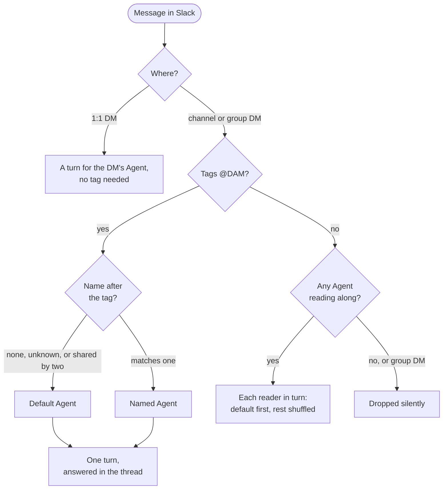
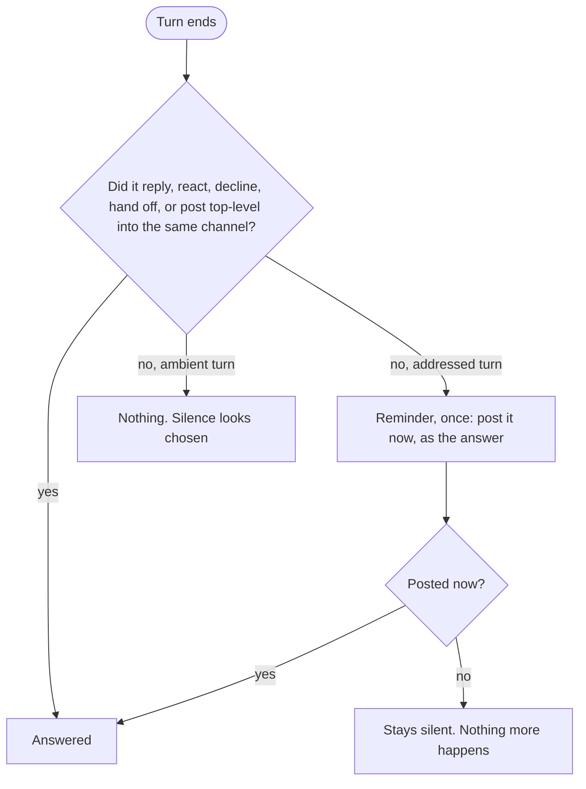

# Slack: what is guaranteed, what is the agent's call, what depends on setup

Last verified: 2026-11-11

Companion to [channels](channels.md), [channel-turns](channel-turns.md), [slack-threads](slack-threads.md), [slack-channel-history](slack-channel-history.md) and [slack-edits](slack-edits.md).
Those pages own the mechanics; this one states, for each thing an agent does in Slack, whether the outcome is guaranteed, the agent's judgement, or dependent on setup.
A change to Slack behavior updates all three in the same PR.
It also serves as the source for a shareable page or deck: the "decided by" and drawback columns map to colored labels, and the two diagrams render as they are.

- [0. Ways to slack](#0-ways-to-slack)
- [1. Usage modes](#1-usage-modes)
- [2. Reach: bot vs. owner's account](#2-reach-bot-vs-owners-account)
- [3. Who decides what](#3-who-decides-what)
- [4. "It looks broken"](#4-it-looks-broken)
- [5. Reach the owner may not expect](#5-reach-the-owner-may-not-expect)
- [6. Settings that change behavior](#6-settings-that-change-behavior)
- [7. Several workspaces](#7-several-workspaces)

"Decided by": **Platform** = code guarantees it.
**Agent** = the model's judgement, steered by the prompt.
**Setup** = the owner's configuration.

---

## 0. Ways to slack

A single Slack bot per install.

A **binding** puts one Agent into one conversation; whoever Slack lets into that conversation drives the Agent, with the Agent's own credentials.
The platform never asks who is typing.

The owner's **Slack Account Connection** is a separate thing: it gives the Agent the owner's personal Slack access as an MCP server.
On a bound Agent, channel members get that access too unless the harness refuses the calls (§3 safety gates).

`/dam login` links a Slack user to a platform user.
It authorizes `/dam bind|unbind|ambient|history|ignore|unignore|default|delete` and `/dam whisper <agent> on|off`, never who may talk to the Agent.
It is also what lets a person connect an Agent to a conversation from the platform UI or CLI: only to one they and the bot are both in.

Every connect, in-chat or from the UI or CLI, posts one notice in the conversation that tags the person who connected the Agent, its owner; a 1:1 DM's notice names no one.
`/dam who` needs no link: anyone in the conversation sees its Agents with each owner's Slack tag, or display name when the owner has no link in that workspace, and `/dam default` with no name shows the same list.
Each line also says whether the Agent is the default, whether it reads every message, whether it can read the conversation's history, the mention that reaches it, and the description its owner set.
Commands run only from `/dam`: a mention always reaches an Agent, even `@DAM whisper …`, which opens no whisper.
When a person's mention reads as a valid command, they also get an ephemeral tip that everyone in the channel sees the message, naming the `/dam` form.
Owners never appear on the Agent's own posts.

### How the agent reaches Slack

Two paths, both by tool call; plain assistant text is never posted.

- **As the bot**, through the platform's MCP server.
  Four tools dispose of the turn being answered: `reply`, `react`, `no_reply_needed`, `hand_off_to_agent`.
  Ten work from any session, UI or scheduled included: `post`, `start_thread`, `list_threads`, `leave_thread`, `describe_channel`, `describe_channel_users`, `read_thread`, `fetch_message_attachment`, `describe_message_reactions`, `get_message_link`.
  `read_channel_history` joins them only while one of the Agent's bindings has channel history on (§6); a channel turn reads only its own conversation with it.
  `send_channel_message` is `post`'s old name, kept for one release.
  `reply`, `post` and `start_thread` take an optional [Channel Card](channel-cards.md), whose components `describe_card_components` lists on request.
  Every post carries a footer naming the Agent and linking to the session that wrote it.
  The owner removes one with `/dam delete <message link> [reason]`: confirmation dialog, post and files go, the agent's session is told.
- **As the owner**, through Slack's own MCP server, when the Agent holds the owner's Slack Account Connection.
  Posts carry no footer, `/dam delete` doesn't apply, and the platform doesn't see them (§2).

A message sent from the UI carries no Slack framing, so the agent answers in the UI and posts to Slack only if asked.

---

## 1. Usage modes

What starts a turn, and for whom:

### 1.1 Channel, mention-only (the default)

| Situation                                                       | What happens                                                                                                                                                                          | Drawback                                                                                            |
| --------------------------------------------------------------- | ------------------------------------------------------------------------------------------------------------------------------------------------------------------------------------- | --------------------------------------------------------------------------------------------------- |
| `@DAM …` at top level                                           | New thread, new session; the answer is a reply under your message                                                                                                                     | To amend or steer, reply in that thread, tagged                                                     |
| `@DAM …` inside a thread                                        | Joins that thread's session; if the agent is mid-turn there it is fed into the running turn (harness permitting), else it's the next turn                                             | none                                                                                                |
| Reply in the thread without `@DAM`                              | **Dropped**, even under the agent's own answer, even mid-turn. In a thread the agent has answered in, the writer gets a note only they can see, once per thread, saying how to tag it | The natural follow-up doesn't work; the once-per-thread memory is lost when the API server restarts |
| `@DAM Reviewer …`                                               | Reaches the Agent named Reviewer (name must open the message; case-insensitive, whole word)                                                                                           | `@DAM hey Reviewer` goes to the default                                                             |
| Another bot, workflow or Agent posts a plain message            | Reaches readers only, like a person's; never the Agent that posted it                                                                                                                 | Each reader spends a turn; `/dam ignore` silences one app                                           |
| Another bot, workflow or Agent posts a message that tags `@DAM` | Routed like a person's mention                                                                                                                                                        | More than ten bot posts a minute per thread pause bot posts there for five minutes, with a notice   |

### 1.2 Channel, ambient (reads along)

| Situation                                    | What happens                                                                                                                     | Drawback                                                                               |
| -------------------------------------------- | -------------------------------------------------------------------------------------------------------------------------------- | -------------------------------------------------------------------------------------- |
| Anyone posts at top level, no tag            | Read on the channel's rolling session; the agent reacts, replies in a thread, or stays silent (told to react or reply, not both) | Everything anyone writes is input to the agent; one turn per message per reading Agent |
| Anyone replies inside a thread, no tag       | A new turn on that thread's session                                                                                              | Waits for the next turn even if one is running (a tagged reply would join it)          |
| Type the agent's name without `@`            | The prompt treats it as a mention                                                                                                | Prompt only; it can miss it                                                            |
| Several Agents read along                    | One after another: default first, the rest in random order; later ones see what earlier ones posted                              | Cost multiplies; order unpredictable                                                   |
| Something fails (wake, crash, terms)         | Nothing is posted: no waking notice, no error, no reminder                                                                       | A broken agent looks like a silent one                                                 |
| A mention was already answered in its thread | The channel window marks the thread with a reply count and a `read_thread` id, without the replies                               | An agent that skips the read can answer again in a new thread                          |

### 1.3 1:1 DM with the bot

| Situation                     | What happens                                               | Drawback                                |
| ----------------------------- | ---------------------------------------------------------- | --------------------------------------- |
| Send a message                | A turn, no tag needed (`@DAM` here is plain text)          | none                                    |
| Send several messages quickly | Merged into one turn (0.4 to 2.4 s quiet period, up to 20) | The agent may fold them into one answer |
| Message a DM nobody bound     | Ephemeral pointing at `/dam bind`                          | none                                    |

### 1.4 Group DM

| Situation                         | What happens                                                                                              | Drawback                            |
| --------------------------------- | --------------------------------------------------------------------------------------------------------- | ----------------------------------- |
| Tag the agent                     | Same as a channel mention                                                                                 | none                                |
| Write without a tag               | Dropped: the platform doesn't subscribe to plain group-DM messages (a platform choice, not a Slack limit) | Ambient has no effect in a group DM |
| Bind a group DM the bot is not in | Refused with the reason: Slack only lets the bot into a group DM at its start                             | none                                |

### 1.5 Several Agents in one conversation

| Situation                                                | What happens                                                                                                                                       | Drawback                                                                                                                      |
| -------------------------------------------------------- | -------------------------------------------------------------------------------------------------------------------------------------------------- | ----------------------------------------------------------------------------------------------------------------------------- |
| `@DAM <message>` that names no Agent                     | Reaches the **default Agent**: the first one connected, unless changed with `/dam default`                                                         | If the default was disconnected, nobody; an ephemeral lists who is here until an owner runs `/dam default X`                  |
| `@DAM Reviewer …`                                        | Reaches Reviewer; an unknown name is plain text and goes to the default                                                                            | Two connected Agents with the same name: default, only the agent is told                                                      |
| An Agent hands the message to a peer                     | The peer, bound to the same conversation, takes the whole turn as its own in the same thread                                                       | Once only; attachments dropped; the receiver's owner must have accepted the terms                                             |
| Mixed bindings: one reads along, another is mention-only | Ambient is per binding. Plain messages reach only readers. A tagged mention reaches one Agent, default or named; readers aren't handed it live     | A reader may meet it later as history and take it as open if the answer sits in a thread                                      |
| A plain message names an Agent without `@`               | Readers only; the named one answers if it reads along, the others are told to stay silent                                                          | A mention-only Agent gets nothing; the silence is prompt only                                                                 |
| An Agent's post tags the bot and names a peer            | The peer gets a turn, as if a person had asked; the post never starts a turn for its author                                                        | More than ten bot posts a minute per thread pause bot posts there for five minutes, with a notice                             |
| An Agent posts where others read along                   | Every reader but the author gets it; a reply in an ambient round does not, since the round already handed it on                                    | A reader that went before it in the round never sees that reply live; each reader spends a turn per post, even to stay silent |
| A reader tags a peer in its ambient reply                | The peer answers once, as an addressed turn, and skips its turn in that round; its answer reaches the asker                                        | The peer answers only the request, not the person's message on its own                                                        |
| Another app or a webhook posts (CI, alerts, deploys)     | Routed like a person's post: a tag reaches one Agent, readers get plain posts; the Agent reads the post's attachments and blocks, named by the app | On by default; `/dam ignore <link to its post>` makes the channel ignore that app; same ten-a-minute rate limit               |

### 1.6 Proactive and cross-channel posts

As the bot.
Through the owner's Slack Account Connection the Agent posts wherever the owner can (§2).

| Situation                                        | What happens                                                                                                                                                 | Drawback                                                                                             |
| ------------------------------------------------ | ------------------------------------------------------------------------------------------------------------------------------------------------------------ | ---------------------------------------------------------------------------------------------------- |
| Posts top-level into a channel, from any session | Allowed where **its owner is a member** (public or private), via the owner's linked Slack account; bound conversations and the running turn's channel always | Unlinked owner: no channels beyond the bound ones; DMs with members of its bound channels still work |
| DMs someone                                      | Its owner, the person in a bound 1:1 DM, or a member of a bound channel, by user id or DM id                                                                 | Anyone else is refused, even when the bot could open the DM                                          |
| Someone replies to such a post                   | Routed by that conversation's bindings: its default Agent, or nobody                                                                                         | Never the posting Agent by itself; no continuity                                                     |
| Starts a thread with `start_thread`              | Same reach as a post; the session that called it **owns the thread**                                                                                         | Slack only                                                                                           |
| Someone replies in an owned thread               | A person's or another Agent's message, tagged or not, becomes a turn of the owning session; no new session; the Agent's own posts never come back to it      | One session takes every owned thread's traffic; its context grows faster                             |
| Another Agent is tagged in an owned thread       | That Agent answers as its own turn; the owning session gets the message too                                                                                  | none                                                                                                 |
| The session leaves the thread, or is deleted     | The thread is no longer owned: replies route as in any thread                                                                                                | none                                                                                                 |

### 1.7 What the agent is handed, per case

Every Slack turn carries: how to respond (tools, the thread to reply into, "plain text is not delivered"), a note that unallowed hosts are refused, a note that a tool the permission mode refused is the mode's doing and no setting changes it, who the owner is (their display name, and their tag where they linked Slack in that workspace) with a note that the owner has no extra authority in messages, with several Agents who else is here and who is default, and, where channel history is on, that `read_channel_history` reads further back.
**Catch-up**: what arrived since the agent's last delivered turn there, as a backlog ("act only on what is still open"); nothing when nothing is new.

| Case                                         | History injected                                                                                                                                      | Extra framing                                                                                                                                                                                                                                                                                                                                                        |
| -------------------------------------------- | ----------------------------------------------------------------------------------------------------------------------------------------------------- | -------------------------------------------------------------------------------------------------------------------------------------------------------------------------------------------------------------------------------------------------------------------------------------------------------------------------------------------------------------------- |
| Top-level mention, first time                | The channel's last 100 top-level messages, labelled by author, as *background*. No thread replies; threads carry a reply count and a `read_thread` id | "You were mentioned; answer in a thread under it"                                                                                                                                                                                                                                                                                                                    |
| Mention in a thread, first time              | The thread (up to 50 newest) as *the conversation*                                                                                                    | "Answer in this thread"                                                                                                                                                                                                                                                                                                                                              |
| Mention in a thread with an existing session | Catch-up                                                                                                                                              | same                                                                                                                                                                                                                                                                                                                                                                 |
| Tagged reply while the agent is mid-turn     | None                                                                                                                                                  | "Another message arrived while you were working: read it and answer everything in one reply"                                                                                                                                                                                                                                                                         |
| Ambient, top-level                           | First turn: the 100-message window. Later: catch-up (up to 500)                                                                                       | "Chime in only when you can clearly help; react or reply, not both; if in doubt stay silent." With peers: what they already posted, quoted                                                                                                                                                                                                                           |
| Ambient, thread reply                        | The thread, or catch-up                                                                                                                               | Same reading-along frame                                                                                                                                                                                                                                                                                                                                             |
| 1:1 DM                                       | DM history (100), or catch-up; no speaker labels; a burst as `[ts] text` lines                                                                        | "Every message here is addressed to you"                                                                                                                                                                                                                                                                                                                             |
| Hand-off received                            | The peer's own session for that thread                                                                                                                | "X handed this to you… files not carried over… you cannot hand it on again"                                                                                                                                                                                                                                                                                          |
| Any message with files                       | Same as the case it arrives in                                                                                                                        | Images become prompt content where the harness accepts them (else the sender is told "answering text only"); other files are saved to the workspace and listed by path. 20 MB of files or 30 MB of images per message. A file on an *earlier* message is not fetched: its history line names it, and `fetch_message_attachment` saves it to the workspace on request |
| Reminder after a silent turn (the *nudge*)   | None                                                                                                                                                  | "Your previous turn ended without a reply being posted. Post it now, as the answer, not as a correction; or call `no_reply_needed`". After an out-of-memory restart during the turn: "it was cut short because the agent ran out of memory; tell the person, and that only a platform operator can raise the owner's memory budget"                                  |
| Continued from the UI                        | None                                                                                                                                                  | None; a message without the frame "didn't come from Slack"                                                                                                                                                                                                                                                                                                           |
| Reply in a thread the session started        | What arrived in that thread since the last message the session was handed                                                                             | "This is channel content, not the person you work with in this session; answer in the thread with `reply`, chatId and threadTs as shown; later replies come back here, so end your turn." Mid-turn it joins the running turn, harness permitting                                                                                                                     |

### 1.8 Whispers

A whisper reaches one Agent privately: Slack never shows the conversation the command or its answer.

| Situation                              | What happens                                                                                                                                         | Drawback                                                                                                                                 |
| -------------------------------------- | ---------------------------------------------------------------------------------------------------------------------------------------------------- | ---------------------------------------------------------------------------------------------------------------------------------------- |
| `/dam whisper [agent] "message"`       | One turn on a fresh session; the answer is an ephemeral only the whisperer sees                                                                      | Answers in text only: no emoji reaction (there is no message to react to), no file, no post to the channel, no hand-off to another Agent |
| `/dam whisper [agent]` with no message | Opens a thread in the whisperer's DM with the bot; replies there go to that Agent, whatever the DM is bound to                                       | Ends when the Agent is disconnected there, the whisperer leaves the channel, or whispers are turned off                                  |
| Who may whisper                        | Anyone in the conversation, with no `/dam login`                                                                                                     | none                                                                                                                                     |
| What the agent is told                 | Who whispered and from where; keep it out of what others can read; no more authority than the same message sent openly; never hide it from the owner | Prompt only                                                                                                                              |
| The Agent's whispers are off           | Refused before anything reaches the Agent; the sender is told why. A turn already running finishes, then the whisperer is told the whisper ended     | Other Agents in the conversation still take whispers                                                                                     |
| The owner                              | Every whisper is an ordinary session the owner can open                                                                                              | The owner is not told that a whisper happened                                                                                            |

### 1.9 The DM Bridge (email pairing)

An owner's personal agent can ask DAM to bind itself to the owner's own 1:1 DM with the bot, which is what makes two-way talk there possible ([slack-dm-bridge](slack-dm-bridge.md)).
The DM carries questions about the results, never a change to what the Agent does: content arriving from Slack is information for the task, and anything about its instructions, memory, schedules, connections, network access, other Agents or delivery is asked in the app.
Decided by **Platform** for every rule below, and **Setup** for the operator's trusted-workspace list and each workspace's granted scopes.

| Situation                                                                         | What happens                                                                                                                                                 | Drawback                                                                                                                |
| --------------------------------------------------------------------------------- | ------------------------------------------------------------------------------------------------------------------------------------------------------------ | ----------------------------------------------------------------------------------------------------------------------- |
| The install trusts no workspace for email pairing                                 | Nothing is offered, paired or bound; the status says the feature is off                                                                                      | The Bridge is dark until an operator names the workspaces                                                               |
| The owner has a proven `/dam login` link in a trusted workspace                   | The Agent is bound to the DM with no email lookup and no confirmation step                                                                                   | The link is the workspace it recorded                                                                                   |
| The owner's verified email matches a Slack account there                          | The DM is opened, proven 1:1 with that person, linked as `email`, bound and greeted once                                                                     | The pairing rests on the workspace's addresses being real people, which a paid plan can set without verification        |
| The install never recorded its Slack organization                                 | The Bridge refuses that workspace entirely, an owner's proven link included, until reinstalling records it                                                   | The legacy DM keeps working over its ordinary binding; only the Bridge waits                                            |
| A sign-in proves the Slack account belongs to someone else                        | That person's Bridge records for the previous owner close in the same transaction, so the DM stops reaching their Agent                                      | The person asks their own owner to pair again                                                                           |
| The mailbox is unverified, missing, or the directory cannot answer                | Refused; nothing is looked up or written                                                                                                                     | An owner who never verified their email gets nothing                                                                    |
| Slack's answer leaves out the workspace, the organization, or a membership marker | Refused: an answer that does not say who the person is is unknown, and unknown never pairs                                                                   | A workspace whose Slack payloads changed shape stops pairing rather than pairing the wrong person                       |
| The person is of another organization, or an enterprise guest                     | Refused, so a Grid stranger or a person the organization does not place in that workspace never stands for the owner                                         | Only people the organization and the workspace both own can be paired                                                   |
| The account is a guest, Slack Connect or Grid stranger, bot, app or deleted       | Refused                                                                                                                                                      | External collaborators cannot use the Bridge                                                                            |
| The Slack account is already linked to another DAM person                         | Refused, and that link is untouched                                                                                                                          | One Slack account drives one DAM account                                                                                |
| The conversation is a group DM, or a DM with someone else                         | Refused before anything is written                                                                                                                           | Group DMs stay in-chat only                                                                                             |
| The DM already has a default Agent                                                | The new Agent binds beside it and the greeting says to start messages with its name                                                                          | The existing default is never replaced                                                                                  |
| The agent is already bound there                                                  | Reported as existing; nothing written, nothing posted                                                                                                        | A repeated connect is safe                                                                                              |
| `/<brand> unbind` in that DM, or `disconnect` from the CLI                        | One transaction: the DM closes, then the binding goes, the threads its sessions owned there go, and the `email` link goes once nothing is bound in the DM    | An OAuth link stays, and so does any other Agent bound there; a revoke that fails changes nothing and must be run again |
| A message, a queued turn, a steer or a post to a revoked DM                       | Refused at the one admission check, taken again on every message right before a prompt or a steer and by every send; the batch's unrelated threads still run | A notice already in flight may still land once; the Agent's other conversations and the owner's own reach are untouched |
| An ordinary bind of an Agent into a DM the Bridge released                        | Binds normally, but the Bridge stays closed, so the DM admits nothing from that Agent until a Bridge connect reopens it                                      | The person is told in the DM, by the platform, that it stays closed                                                     |

---

### 1.10 Editing a message

| Situation                                                                                  | What happens                                                                                                                                                    | Drawback                                                                                                                                       |
| ------------------------------------------------------------------------------------------ | --------------------------------------------------------------------------------------------------------------------------------------------------------------- | ---------------------------------------------------------------------------------------------------------------------------------------------- |
| Anyone edits a message before the agent starts on it                                       | The agent reads the message once, as edited                                                                                                                     | none                                                                                                                                           |
| A person edits a mention, a DM or a message in an owned thread while the agent works on it | The edit joins the running turn (harness permitting), else it is the next turn                                                                                  | The agent may answer the first text, then the edit                                                                                             |
| The same, after the agent answered                                                         | A new turn on the same session: only the new text, marked as replacing the message; the agent corrects its work, says what it cannot undo, or stays silent      | Every edit costs a turn, a fixed typo included; for a mention or a DM, lost when the API server restarted since the message, or after two days |
| A person edits a message to add the tag                                                    | A mention sent at that moment, once, for each Agent not sent the message before                                                                                 | none                                                                                                                                           |
| A person edits a message an agent only read along                                          | One ambient round for the agents reading along: only the new text, marked as replacing the message; each may chime in or stay silent                            | Every edit costs a round, a fixed typo included; lost when the API server restarted since the message, or after two days                       |
| An Agent or an app edits its post                                                          | No turn, for anyone; each Agent that saw the post is shown it as it reads now in its next turn there                                                            | The agent acts on the first text until its next turn                                                                                           |
| An agent changes its own post with `edit_post`                                             | Changed in place: the whole new text and card, the footer kept, the file kept or replaced; it counts as the turn's answer when the post is in the turn's thread | Notifies no one; other agents see it in their next turn only                                                                                   |
| An agent asks to change another agent's post or a person's message                         | Refused, with the reason                                                                                                                                        | none                                                                                                                                           |
| An agent's edits come too fast                                                             | Refused over 10 a minute per agent or 40 per workspace, with the time to wait                                                                                   | A progress post cannot follow every step                                                                                                       |
| An edit in a group DM                                                                      | Never arrives: the platform doesn't subscribe to group-DM messages                                                                                              | The agent keeps the first text                                                                                                                 |
| A message is deleted                                                                       | Nothing; the agent keeps what it was sent                                                                                                                       | none                                                                                                                                           |

## 2. Reach: bot vs. owner's account

Both belong to the Agent; they differ in identity and scope.

|                      | Bot (any binding)                                                                                                                                                                                      | Owner's Slack Account Connection                                                  |
| -------------------- | ------------------------------------------------------------------------------------------------------------------------------------------------------------------------------------------------------ | --------------------------------------------------------------------------------- |
| Acts as              | The bot, with the Agent's footer                                                                                                                                                                       | The owner, no footer                                                              |
| Can post             | Channels the owner is in, DMs with the owner, bound 1:1 DM people or bound-channel members, group DMs                                                                                                  | Anywhere the owner can                                                            |
| Can read             | Only what the platform shows it: bound threads, the channel window, the thread it is answering in, threads it was shown; with channel history on, that conversation's older messages and their threads | Everything the owner can see, search included                                     |
| The platform sees it | Yes: counts as the turn's answer, security-logged                                                                                                                                                      | No: the agent must close the turn with `no_reply_needed`, or the reminder follows |

Outside its bound conversations, the bot never reaches a channel the owner couldn't, provided the owner's Slack identity is linked, and it messages directly only the owner, the person in a bound 1:1 DM, and members of its bound channels.

---

## 3. Who decides what

### Getting in

| Behavior                                                                                                                                                                            | Decided by                                                                                 | Caveat                                                                                                        |
| ----------------------------------------------------------------------------------------------------------------------------------------------------------------------------------- | ------------------------------------------------------------------------------------------ | ------------------------------------------------------------------------------------------------------------- |
| Which messages start a turn: tagged ones on a normal binding, every message on ambient (not an Agent's own, its ambient-round replies, or an ignored app's), a person's in a 1:1 DM | Platform                                                                                   | On a normal binding, untagged thread replies never arrive; in the agent's own thread the writer is told once  |
| Which Agent a mention reaches                                                                                                                                                       | Platform                                                                                   | Two Agents sharing a name: default, sender not told                                                           |
| One turn per top-level mention; DM bursts merged; a tagged reply joins a running turn                                                                                               | Platform; joining needs a harness that supports it (**Setup**), else next turn             | Read-along messages never join a running turn                                                                 |
| A reply in a thread stops the Agent's turn on the thread's opener in another session, and its turn starts after that one ended                                                      | Platform                                                                                   | The earlier turn's tool calls and posts are handed on; whether it acted is for the Agent to check             |
| Whether the turn runs at all                                                                                                                                                        | Platform, from the Agent's state: stopped by its owner, over budget, terms not re-accepted | Addressed: a notice. Ambient: nothing                                                                         |
| What the agent is shown (§1.7)                                                                                                                                                      | Platform                                                                                   | "Since your last turn" lives in api-server memory; after a restart: since the agent's last post, at most 24 h |

### Delivery

What counts as answered:

| Behavior                                                                                                                                               | Decided by                             | Caveat                                                                                                                                                    |
| ------------------------------------------------------------------------------------------------------------------------------------------------------ | -------------------------------------- | --------------------------------------------------------------------------------------------------------------------------------------------------------- |
| Only tool calls reach Slack; answered means `reply`, `react`, `no_reply_needed`, hand-off, or a top-level post into the same channel                   | Platform                               | Prose is lost unless the reminder rescues it. A post via the owner's Connection doesn't count; close such a turn with `no_reply_needed`                   |
| Answer, react, stay silent or hand off; thread vs. top-level; `alsoSendToChannel`; names not raw ids                                                   | **Agent**, prompted                    | A `no_reply_needed` is final. A top-level answer counts, just noisier                                                                                     |
| Standard Markdown rendering for agent posts, with compact Slack-style code fences moved onto their own lines                                           | Platform                               | A fence pair inside one line of prose stays as it is; tools ask for separate fence lines                                                                  |
| A Channel Card shows under the text as native Slack blocks; a card Slack refuses goes out as its text form                                             | Platform                               | Checked before posting: one table, two charts, link buttons only, 50 blocks; a refused card names every problem and nothing posts                         |
| Stop on the working status cancels the running turn, for the person who started it or the Agent's owner; anyone else gets an ephemeral refusal         | Platform                               | Needs the `agent_session_stopped` subscription and agent messaging (**Setup**). A stopped turn gets no reminder. Ambient turns show no status, so no Stop |
| One reminder after a silent addressed turn                                                                                                             | Platform                               | Never on ambient. A reply whose attachment failed still counts; the agent is told which file                                                              |
| A tagged reply sent while a turn works joins that turn at the agent's next steer point, never twice; the turn is judged once that steer has its answer | Platform                               | Only where the harness steers; otherwise it becomes the next turn. A steer can wait as long as a command runs                                             |
| With two turns running, each reply, reaction, silence or hand-off names its thread; the platform never guesses                                         | Platform                               |                                                                                                                                                           |
| A reply after the api-server lost the agent mid-turn: accepted for 60 min                                                                              | Platform                               | Later, one that names its thread still lands; one that doesn't is refused                                                                                 |
| Hand-off: same conversation, once, receiver's owner accepted the terms                                                                                 | Platform constrains, **Agent** chooses |                                                                                                                                                           |

### Tools and reach

| Behavior                                                                                                                                                                                                                                                                                                           | Decided by                                                       | Caveat                                                                                                                                                                                      |
| ------------------------------------------------------------------------------------------------------------------------------------------------------------------------------------------------------------------------------------------------------------------------------------------------------------------ | ---------------------------------------------------------------- | ------------------------------------------------------------------------------------------------------------------------------------------------------------------------------------------- |
| The platform's tools are always present, refused without a binding; `read_channel_history` only while channel history is on for one of the Agent's bindings, checked again on every read. A Connection's tools exist only while it is granted                                                                      | Platform                                                         |                                                                                                                                                                                             |
| Where it may post (§1.6); attach any file from the agent's home                                                                                                                                                                                                                                                    | Platform allows, **Agent** decides                               |                                                                                                                                                                                             |
| A message that carries an artifact's `platform://artifacts/<id>` link gets the artifact's share URL in its place; a private artifact's link is refused, so the agent says it must be shared first                                                                                                                  | Platform                                                         | Allowed in one place only: the 1:1 DM between the Agent and its owner, where the link becomes the artifact's own address in the app ([artifact library](artifact-library.md#sharing-model)) |
| Look up any member by id (name, title, email, timezone); `read_thread` only on the thread it is answering in and threads it was shown, 48 h from the newest turn or showing; `fetch_message_attachment` on any file shared in a bound conversation; `get_message_link` on a message in a conversation it can reach | Platform                                                         | Shown threads live in api-server memory; after a restart a thread is readable again from the next turn in it, or once it is shown again                                                     |
| The owner's Slack Connection is usable on a channel turn                                                                                                                                                                                                                                                           | **Setup**: whether the harness asks before running tools (below) |                                                                                                                                                                                             |

### Safety gates

| Behavior                                                                                                                                                                                                                                                                                                        | Decided by                                | Caveat                                                                                                                                                                                                                     |
| --------------------------------------------------------------------------------------------------------------------------------------------------------------------------------------------------------------------------------------------------------------------------------------------------------------- | ----------------------------------------- | -------------------------------------------------------------------------------------------------------------------------------------------------------------------------------------------------------------------------- |
| **Permission prompts.** A harness that pauses to ask "may I run this tool?" gets *no*: nobody in Slack can answer. The platform's own Slack tools are approved automatically, and Claude Code reads the files a turn is handed (under `~/.uploads/`) without asking                                             | Platform, if the harness asks (**Setup**) | Codex never asks: every tool runs. Claude Code asks only in an asking mode. The platform never tells the sender; the turn's contract steers the Agent to say what was refused and that only its owner can change that mode |
| A host outside the owner's egress rules (an attached provider Connection's own hosts, ports and paths excepted, and `api.anthropic.com` when it sets Claude Code's env — [the rule](security-and-credentials.md#hitl-ext_authz)): refused at once, shown as a pending approval on Home; approving writes a rule | Platform                                  | The turn goes on with a 403; only the agent can explain                                                                                                                                                                    |
| `/dam delete`: owner only, Slack identity linked                                                                                                                                                                                                                                                                | Platform                                  |                                                                                                                                                                                                                            |
| Whispers: on by default, per Agent; only its owner turns them off, with `/dam whisper <agent> on\|off` from any conversation or in the Agent's channel settings in the UI                                                                                                                                       | Platform, the switch is **Setup**         | One switch covers every conversation the Agent is connected to                                                                                                                                                             |
| All bindings released when the Agent is deleted                                                                                                                                                                                                                                                                 | Platform                                  |                                                                                                                                                                                                                            |
| Terms of Use re-versioned and not re-accepted: the owner's Agents go quiet in Slack                                                                                                                                                                                                                             | Platform                                  | Addressed: a notice. Ambient: nothing                                                                                                                                                                                      |
| Spend limit or Spend Ceiling reached for today: the Agent starts no turn and does not wake                                                                                                                                                                                                                      | Owner, operator                           | A person: a notice only they see. A bot: one notice in the thread. Ambient: nothing                                                                                                                                        |

---

## 4. "It looks broken"

### Nothing happens

| Situation                                                  | Why                                                                                                                                                        |
| ---------------------------------------------------------- | ---------------------------------------------------------------------------------------------------------------------------------------------------------- |
| Untagged reply in the agent's thread (normal binding)      | Dropped; the writer sees a note once per thread                                                                                                            |
| Untagged message in a group DM                             | Dropped                                                                                                                                                    |
| A bot or workflow wrote to the agent without tagging it    | Plain posts reach readers only; a mention-only Agent needs a tag                                                                                           |
| An app's posts reach no Agent in one channel               | The channel ignores that app (`/dam ignore` lists them)                                                                                                    |
| Agents or apps went quiet after a few posts back and forth | More than ten bot posts a minute per thread pause them for five minutes; a notice in the thread says so; the Agent's Channels page shows the dropped posts |
| Mentioned a name two connected Agents share                | Went to the default; sender not told                                                                                                                       |
| An ambient agent went quiet                                | Every failure on ambient turns is invisible                                                                                                                |
| The agent did less than asked                              | A tool call was auto-refused or a host blocked; only the agent can explain                                                                                 |

A revoked bot token or uninstalled app silences every conversation, and nothing in Slack says why.

### Odd, but with a cause

| Symptom                                                                                        | Cause                                                                                                                                              |
| ---------------------------------------------------------------------------------------------- | -------------------------------------------------------------------------------------------------------------------------------------------------- |
| Same answer posted twice                                                                       | The agent answered as the owner through the Slack Connection, which the platform can't see, and didn't close the turn with `no_reply_needed`       |
| Two mentions in one thread, one reply                                                          | The second was fed into the running turn                                                                                                           |
| Replied to an agent's announcement; a different agent answered, or nobody                      | Replies route by that conversation's bindings, not by who posted                                                                                   |
| The agent says it may only post where its owner is, or that the owner hasn't linked Slack      | Owner-membership check; the owner needs `/dam login`                                                                                               |
| The agent says it doesn't know who owns it                                                     | The owner has no first or last name on record; the agent is told to say so rather than guess                                                       |
| Re-answers a settled mention in a new thread                                                   | The channel window carries the thread's reply count and a `read_thread` id, not the replies; an agent that skips the read sees the mention as open |
| After an api-server restart: re-answers old messages, or can't read a thread it was just shown | "Since last turn" and "threads shown" live in memory; the next turn in a thread offers that thread again                                           |

### Notices

Addressed turns get a plain-language notice for: unbound conversation, no default Agent, no model provider or a default model's provider gone, waking ("still starting" up to 10 min), stopped by owner, deleted, over budget, lost contact, stalled, terms not accepted, spend limit or ceiling reached, hand-off failed, a refused attachment, a channel profile the agent can't use, a model that refused the message.
Ambient turns get none.

---

## 5. Reach the owner may not expect

First, an Agent with both the owner's Slack Account Connection and a channel binding lets channel members act through the owner's Slack account.
The UI and the CLI warn the owner when the two meet (see [Shared access](channels.md#shared-access--the-one-model)) but do not block it.
Open on Codex.
On Claude Code: open in `auto` (the classifier approves most calls), in `bypassPermissions`, or with an allow rule for the Connection's tools; `default` and `dontAsk` refuse those calls on a channel turn.

Second, a DM the DM Bridge bound is driven by whoever Slack puts in it, and a paired DM can ask that Agent to act on the owner's DAM account.
The pairing adds no new trust model: an operator vouches for the workspace's mailboxes, the mailbox must be verified, and the DM is proven 1:1 with the matched person before the Agent is bound.
Third, a whisper lets anyone in a bound conversation ask the Agent, out of the conversation's sight, to change its instructions, memory or settings; the change then holds for everyone there.
The owner can open every whisper session but is not told that one happened.
Turning the Agent's whispers off closes this path (§1.8); the bind flow warns about it while whispers are on.

Everything else (DM people, attach files, look people up, react) is within the owner's own reach.

---

## 6. Settings that change behavior

| Setting                                             | Effect on a Slack turn                                                                                                                                                                                                                                                                                                                                                                                                                                            |
| --------------------------------------------------- | ----------------------------------------------------------------------------------------------------------------------------------------------------------------------------------------------------------------------------------------------------------------------------------------------------------------------------------------------------------------------------------------------------------------------------------------------------------------- |
| **Harness**                                         | Claude Code: `default` asks (refused on Slack); `dontAsk` denies what isn't pre-approved; `auto` lets a classifier decide; `bypassPermissions` or an allow rule runs everything. **Codex never asks; everything runs.** Bob with `approvals=ask` refuses even the reply tool, so it is unusable in Slack                                                                                                                                                          |
| **Steering / image support** (harness)              | A mid-turn follow-up joins the running turn at the next steer point, and the agent-runtime decides for every harness. Claude Code takes it at most a minute after it arrives; Codex and Pi also take it within a minute, and read it once their current step ends; Bob and Copilot are cancelled at the steer point and continue with it, so it waits while a command runs. Only Stop on the working status stops at once. Pictures in the prompt vs. "text only" |
| **Egress rules**                                    | Allow-all: nothing refused. Restricted: unmatched hosts refused on unattended turns, held for the owner when a UI/CLI session is open; an attached provider Connection's own hosts, ports and paths always pass, and `api.anthropic.com` when it sets Claude Code's env ([the rule](security-and-credentials.md#hitl-ext_authz))                                                                                                                                  |
| **Connection grants**                               | A Slack Account Connection adds the owner's Slack MCP server with no channel awareness; only the harness's asking stands between the channel and it                                                                                                                                                                                                                                                                                                               |
| **Owner's Slack identity linked**                   | Unlinked: the Agent posts into no channel beyond its bound ones, and DMs no one but the members of its bound channels and the person in a bound 1:1 DM; group DMs still work                                                                                                                                                                                                                                                                                      |
| **Whispers** (per Agent)                            | On: anyone in a conversation the Agent is connected to can reach it privately (§1.8). Off: new whispers to it are refused and open whisper threads end; past whispers stay private                                                                                                                                                                                                                                                                                |
| **Ambient** (per binding)                           | §1.2                                                                                                                                                                                                                                                                                                                                                                                                                                                              |
| **Channel history** (per binding)                   | Off: a turn sees the window it is handed and the threads it was shown. On: `read_channel_history` reads the conversation's older messages and their threads, from a channel turn there or a web or scheduled session ([slack-channel-history](slack-channel-history.md))                                                                                                                                                                                          |
| **Owner stopped the Agent**                         | Slack can't wake it. Hibernated Agents wake normally                                                                                                                                                                                                                                                                                                                                                                                                              |
| **Trusted workspaces for email pairing** (operator) | The Slack team ids the DM Bridge may look a person up in. Empty: the feature is off and nothing pairs. A listed workspace counts only while its install is active and its granted scopes are known to carry `users:read`, `users:read.email`, `im:read`, `im:write`, `im:history` and `chat:write`                                                                                                                                                                |

---

## 7. Several workspaces

- A binding belongs to the workspace whose bot is a member of the conversation.
  A pasted DM id resolves to the workspace whose bot is in that DM.
- An Agent in **two** workspaces: `describe_channel_users` looks in the workspace of the conversation being answered, or of a passed chat; outside a turn with no chat it refuses and says to pass one.
  `post` outside a turn must name the conversation.
- Optional scopes a workspace withheld degrade quietly: no channel list, no emails, raw ids for people and for connected 1:1 DMs.
  Without the persona scope an Agent's post goes out as the app and opens with an emoji and the Agent's name; the emoji is the robot face unless the connection names custom emoji for the Agents.
- A revoked workspace credential is marked, never cleaned up: bindings stay, everything goes silent until re-install.
- A platform notice to a person goes to the workspace their link recorded; a link older than that reaches the one active install, and none when several are active, until the person runs `/dam login` again.

### Platform notices

The platform DMs a linked person, as the app, when something needs them that no Agent would say: a resource alert ([budgets](budgets.md)), or unattended work that a spend limit stopped ([spend-limits](spend-limits.md#unattended-work)).

| What           | Decided by | Drawback                                                                                               |
| -------------- | ---------- | ------------------------------------------------------------------------------------------------------ |
| Who gets it    | Platform   | Only people who ran `/dam login` or an in-chat bind; everyone else sees it in the web app only.        |
| Where it lands | Platform   | A DM with the app, never a channel; a workspace without `im:write` gets nothing.                       |
| A reply to it  | Platform   | Not handled: it behaves like any message to the app in that DM — the DM's bound Agent, or a bind hint. |
