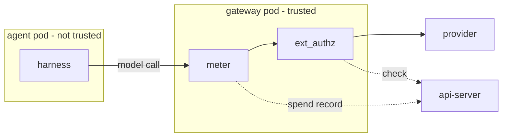

# Spend limits

Last verified: 2026-10-14

## Overview

DAM measures the spend of each model call in the agent's own gateway, for every harness and every provider dialect.
This number is Metered Spend: the agent cannot change it, because the meter runs only in parts that the agent does not control.
The spend that a harness reports through telemetry ([metrics](metrics.md)) stays for display only.

The parts:

- **The meter**, in the agent's paired gateway pod ([credential-gateway](credential-gateway.md)), reads the usage in each provider reply and sends one spend record per call to the api-server.
- **The api-server** receives the records on the same per-agent port that answers the gateway's ext_authz checks, so a record is tied to its agent the same way a check is ([security-and-credentials](security-and-credentials.md#hitl-ext_authz)).

The api-server prices each record when it arrives ([Prices](#prices)) and keeps the daily ledger ([Ledger](#ledger)).
Before a metered call goes out, the ext_authz check refuses it when a spend limit or the user's Spend Ceiling is reached ([Limits](#limits), [Spend ceiling](#spend-ceiling), [Refusal](#refusal)), and at a limit the owner can continue ([Continue](#continue)).



## Meter

**Which chains.** A host chain carries the meter when one of its credentials comes from a model-provider Connection.
The gateway knows this from the Connection's provider template, which the api-server writes on the Connection's Secret.
A chain for any other Connection, and an allow-only chain, has no meter.

**On the request.** Before the ext_authz check, the meter gives the call an id that the agent cannot set, and it names the call's Connection and that Connection's provider.
The Connection is the one that the request named, else the chain's only model-provider Connection.
An address that names no Connection of the chain counts as no address, so a false address cannot hide a call.
When the chain has several model-provider Connections and the request names none, the meter names all their providers and no Connection.
The meter keeps these facts in the call's gateway metadata, out of the agent's reach, and the gateway hands them to the ext_authz check, so the gate and the ledger see the same call.
The meter also removes the request's compression offer, because a compressed reply cannot be read as it passes.
It notes the path without the query and without a Connection address prefix, the API dialect of the path, and whether the path is billable.
Billable paths are the model calls: Anthropic Messages, OpenAI Chat Completions, legacy Completions, Responses and Embeddings, and the Bedrock invoke and converse calls, streamed or not.
Model lists, token counting and account paths are free, and the gateway sends no record for them.
Other paid paths, such as batch jobs and the later read of a background Responses result, are not metered, so a spend limit does not see their spend.

**On the reply.** The meter reads the reply as it passes, chunk by chunk, and does not buffer or change it.
It chooses the format by the reply's content type, because a streamed request can get a JSON reply: an event stream, a JSON body, or the Bedrock binary event stream with its encoded payloads.
It reads counts only inside usage objects in the structure of the reply.
It takes the reply's model and service tier only from the highest level of the reply where they occur, because a reply can repeat request fields at a lower level, such as Responses metadata, and the agent sets those.
Text from the model sits inside JSON strings, where quotes are escaped, so model text cannot form a usage object.
For each count the highest value wins, so a repeated or forged object can only raise a count, never lower it.
A reply that reports the passes of one call apart, such as a compaction pass and an answer pass, counts the sum of the passes, because the provider bills each pass.
It keeps the raw counts with the dialect and leaves their meaning to pricing: input, output, cache reads, cache writes and their five-minute and one-hour parts, cached tokens, web searches, Bob credits, the service tier, the speed, the inference geography and the reply's model.

**The record.** The gateway sends spend records over a gRPC access log to the agent's ext-authz Service, the address that only this agent's gateway can reach.
A record names the payer, which is the root driver for an Invocation target, and the Connection and providers that the meter named on the request.
It carries the reply size, the proxy's own cost figure when the reply has one, and whether the reply ended with its format's end event.
A reply that stops early keeps the counts read so far and is not marked complete.

**Periodic records.** While a call runs, the gateway also sends a periodic record of the same call every 2 seconds, with the counts so far.
So a long call that a gateway restart cuts off still leaves its partial counts.
The gateway's telemetry logs leave periodic records out, so they show one entry per call as before.

## Prices

**Where a price comes from.** The meter counts tokens, and a limit is in money, so the api-server turns each call's counts into a cost.
Only Bob's replies carry their own price, in Bobcoins.
The other providers send tokens only, and IBM LiteLLM's own cost figure is real only on replies that are not streamed.
The api-server looks up a price by the call's provider and model, and the first match wins:

- **An operator price** from the chart.
  The chart ships IBM LiteLLM's own prices, which differ from every public price list and differ per model and per kind of token.
  An operator reads them from IBM's price list with a temporary management key and revokes the key afterwards; an agent never gets such a key, because the gateway adds a Connection's key to every call to its host.
- **A provider rule.**
  RITS models and Curve Bender cost nothing.
  Bob uses the Bobcoins in each reply.
  The Claude subscription is valued at Anthropic's list prices, as a value and not a bill.
- **The Anthropic table:** Anthropic's list prices, copied from a pinned version of LiteLLM's public price list.
  It prices own Anthropic keys and the subscription value.
- **An estimate** for a model with no price: the highest price of its model family among the provider's prices, else the provider's highest price, marked "estimated", so DAM never counts low.

A reply can name its model differently from the request, for example without a routing prefix or with a release date, so the lookup also matches on the model's own name.
OpenAI and Bedrock have no public prices in DAM yet: without an operator price, their calls keep their tokens and cost nothing, so a spend limit does not stop them.

**How a cost is computed.** The rules follow LiteLLM's own cost rules, so DAM's cost equals LiteLLM's for the same counts.
A price sets input, output, cache reads, five-minute and one-hour cache writes, and web searches.
Above a prompt-size threshold, which counts cached tokens too, all token prices change.
When a reply names the flex or priority tier, that tier's prices apply.
A missing cache price falls back to the input price, never to nothing, and a cache write without its five-minute and one-hour split counts at the one-hour price.
On the Anthropic API, fast mode and US-only inference multiply the token prices by the factors of the model's price.
Costs are whole micro-units of the Connection's unit, rounded up.

**When a cost is fixed.** DAM prices a call when its record arrives and stores that cost, so a later price change alters neither the history nor a limit.
When a reply carries a proxy cost figure above zero, DAM compares it with its own cost and logs a large difference, which shows an operator price that is wrong or old.

**Updating prices.** The Anthropic table changes only through a reviewed update to a newer pinned version of LiteLLM's list, which the regular dependency update proposes.
The update stops when a copied price lacks one of its token prices, so a broken upstream list never reaches DAM.
Operator prices change through the chart.

## Ledger

**Receiving.** The api-server ties a stream of records to its agent by the Service address, as it ties a check.
It drops the record of a call that the gate refused, because the gate counts its own refusals.
It prices each record at once, in the unit of the call's provider: dollars for paid providers, list-price dollars for the Claude subscription, Bobcoins for Bob, and nothing for free providers.
When the meter named several providers, the call counts at the provider whose unit is real dollars, marked estimated.
A call without a Connection keeps its cost under an unknown Connection, so it still counts for the agent and the owner.

**Who pays.** A call counts for its payer and the payer's owner, on the UTC day the call started.
So a sub-agent's calls count for its root driver.

**Daily rollup.** Postgres keeps one row per day, payer, Connection and model: the cost, the token counts, the web searches, the counts of calls, estimated calls and refused calls, and the most expensive single call.
A row outlives its agent, so the spend of a deleted agent still counts for its owner.

**Day counters.** Redis keeps the day's totals per payer and unit, per owner and unit, and per payer and Connection, so the limit check reads no database.
A missing counter, for example after a Redis restart, is rebuilt from the rollup, and a counter that fails to update is dropped so that the next read rebuilds it.

**One call, many records.** Each periodic record and the final record carry the call's counts so far, not increments.
The api-server keeps the amounts it last applied for each call and adds only the difference, in one atomic step, so two replicas never count the same part twice and a call counts once.
A periodic record that arrives after the final one changes nothing.

## Estimates

DAM counts high and marks a call estimated when its usage is missing or unsure:

- **A stream that stopped early** keeps the counts read so far, and its output is estimated from the reply size when that gives more.
- **A successful reply without usage** counts as the payer's most expensive call on that Connection that day, else in the last seven days, because the reply does not show its input.
  A failed reply without usage counts nothing, because the provider does not bill it.
- **A call cut before any reply arrived**, by a timeout, an interrupt or a gateway restart, counts the same way as a successful reply without usage, because the provider may still bill it.
- **A Bob reply without Bobcoins** counts as the payer's most expensive call on that Connection that day, else in the last seven days.
  Bob Shell cancels one call in each prompt before Bob sends its Bobcoins, so Bob totals run higher than Bob's own figure.
- **A call whose record never arrived.**
  The gate notes each metered call when it starts.
  Sixty minutes later, a periodic sweep finishes a call that has only periodic records from its last counts, and counts a call with no record as the payer's most expensive call on that Connection that day, else in the last seven days, else at nothing with a warning.
  A real record that arrives later corrects the estimate.

**Shutdown.** A stopping api-server takes no new streams, ends every open record stream with a success status so that each gateway reconnects to another replica and loses no record, and gives the open calls twenty seconds before it closes the port.

## Limits

The owner sets three kinds of daily limit.
Each one counts the spend of the current UTC day.
Only the owner sets or removes a limit, from an unrestricted login: an agent, and an API key bound to an agent, cannot change or continue it.
A limit of zero refuses every call that it counts.

**Agent limit.** A dollar limit for one agent.
It counts the agent's metered dollar spend on paid providers, sub-agents included, because their calls count for their root driver.

**Own limit.** One dollar limit for all agents of the owner together.
It counts the same spend as the agent limit, summed over every agent of the owner.

**Connection limits.** A limit for the calls of one agent on one of its Connections, in that Connection's unit:

| Connection                         | Unit               | Counts in the agent limit, own limit and ceiling |
| ---------------------------------- | ------------------ | ------------------------------------------------ |
| An Anthropic key, IBM LiteLLM      | dollars            | yes                                              |
| The Claude subscription            | list-price dollars | no                                               |
| Bob                                | Bobcoins           | no                                               |
| Curve Bender                       | free               | no limit applies                                 |
| OpenAI, Bedrock                    | dollars, unpriced  | only with an operator price; no Connection limit |
| Any Connection that is not metered | —                  | no limit applies                                 |

So the Claude subscription and Bob are limited only by their Connection limits.
A Connection limit needs a Connection that is granted to the agent.
OpenAI and Bedrock calls take no Connection limit yet, because DAM does not price them.

**Soft.** At a limit, the gate refuses the call and asks the owner whether to continue; it never holds the call.
At 80% of a limit, its state changes to a warning, and nothing else happens.
An agent's limits are deleted with the agent.

**The check.** On each metered call, the gate reads the limits that count the call and today's extensions from the database, and today's spend from the day counters.
A missing counter is rebuilt from the rollup first, and when the day counters cannot be read, the gate reads today's spend from the rollup.
The gate checks every limit that counts the call, and any reached one refuses it, so the first limit reached stops the work.
A call that already streams continues to its end, so the spend can pass a limit by the calls that were running.

## Spend ceiling

The operator sets the Spend Ceiling: a hard daily dollar maximum for each user.
It counts the same spend as the own limit: the user's metered dollar spend on paid providers, on all agents.
At the ceiling, the gate refuses the call and asks nothing, because "continue" cannot lift it.
When the ceiling and a soft limit are both reached, the ceiling's refusal applies.

A user's ceiling comes from their UserSpendLimit object, else from the chart's default ceiling, which is off at first.
A UserSpendLimit works like a UserBudget ([budgets](budgets.md)):

```yaml
apiVersion: agent-platform.ai/v1
kind: UserSpendLimit
metadata:
  name: spend-limit-<keycloak-sub>   # pinned to spec.owner at admission (CEL)
  namespace: <agents-namespace>      # the chart's agent namespace (default platform-agents)
spec:
  owner: "<keycloak-sub>"            # exact plaintext sub, as on the agent owner label
  dailyUsd: "50"                     # dollars per UTC day, at most two decimals
```

Operators manage these objects; a user cannot change one.
A user can still set an own limit below the ceiling, and the lower of the two stops the work first.
The gate reads the user's object by its name and keeps the value for one minute, so a change applies within a minute.
When a read fails, the gate keeps the last value it read; with no value read yet, the check fails and the gate refuses the call.

## Refusal

The shape follows the API path of each call, never the agent's harness, because one agent can run several harnesses.

- **Anthropic Messages and Bedrock paths:** a "too many requests" status that tells the client not to retry, and when to try again: the next UTC midnight, at least 61 seconds away.
  Claude Code then stops at once; a plain retryable answer makes it retry for minutes, and a "bad request" answer makes it retry and turn off features for the session.
- **OpenAI Chat, Responses and embeddings paths, Bob included:** a "bad request" status.
  Codex and Pi stop at once and show the text; to a "too many requests" answer, Codex shows its own text instead.

The body is plain text: "Spend quota exceeded for today.", then what to do next: at a limit, that the owner can approve more in the product, with its name; at the ceiling, to ask the platform operator for a higher ceiling.
It has no digits, because Pi retries when the text names a retryable status code and stops when it says "quota exceeded"; a product name with digits is left out.
A call on a Bob Connection gets the same text inside a JSON error object, because Bob reads only the message of a JSON error and otherwise shows just "Bad Request"; Pi shows a JSON error raw, so every other provider keeps plain text.
Paths that are not metered, such as model lists and token counting, are never refused.
Every refusal carries the `x-platform-refusal` header, so the [Model Router](harness-config.md#the-model-router) passes it to the harness unchanged and does not explain it as a provider error.

**Recorded refusal.** Codex and Pi end a refused turn like a normal one, so the platform cannot see the refusal in the turn.
So the gate counts each refusal in the day's rollup, under an unknown model, because the gate does not read the request body.

## Continue

At a refusal by a limit, the gate asks the owner on Home with a spend-limit approval, one for each reached limit, on the agent whose call was refused.
A refusal by the ceiling asks nothing.
There is one question per limit, day and extension count, so further refusals at the same level add no question.
"Continue" is any allow verdict on it: it adds one extension for that day, so the effective limit is the amount times one plus the extensions, and the gate asks again at the new level.
A deny stops the agent for the day: the limit stays reached, and the gate does not ask again that day.
A question expires at the next UTC midnight, when the limit starts again, and no verdict on it writes an egress rule.
