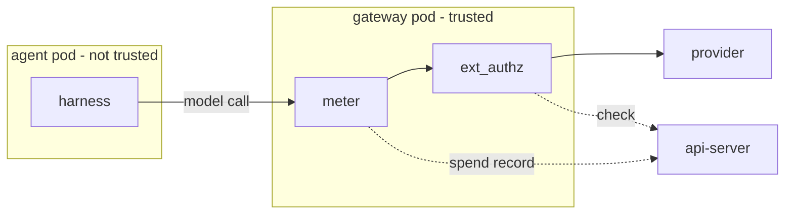

# Spend limits

Last verified: 2026-10-13

## Overview

DAM measures the spend of each model call in the agent's own gateway, for every harness and every provider dialect.
This number is Metered Spend: the agent cannot change it, because the meter runs only in parts that the agent does not control.
The spend that a harness reports through telemetry ([metrics](metrics.md)) stays for display only.

The parts:

- **The meter**, in the agent's paired gateway pod ([credential-gateway](credential-gateway.md)), reads the usage in each provider reply and sends one spend record per call to the api-server.
- **The api-server** receives the records on the same per-agent port that answers the gateway's ext_authz checks, so a record is tied to its agent the same way a check is ([security-and-credentials](security-and-credentials.md#hitl-ext_authz)).

The api-server does not accept spend records yet, so the gateway drops them.
Pricing, the ledger and the limits are not built yet.

## Meter

**Which chains.** A host chain carries the meter when one of its credentials comes from a model-provider Connection.
The gateway knows this from the Connection's provider template, which the api-server writes on the Connection's Secret.
A chain for any other Connection, and an allow-only chain, has no meter.

**On the request.** Before the ext_authz check, the meter gives the call an id that the agent cannot set: it replaces any value the agent sent.
The gate sees the id, and the gateway removes it before the provider.
The meter also removes the request's compression offer, because a compressed reply cannot be read as it passes.
It notes the path without the query and without a Connection address prefix, the API dialect of the path, and whether the path is billable.
Billable paths are the model calls: Anthropic Messages, OpenAI Chat Completions, legacy Completions, Responses and Embeddings, and the Bedrock invoke and converse calls, streamed or not.
Model lists, token counting and account paths are free, and the gateway sends no record for them.
Other paid paths, such as batch jobs and the later read of a background Responses result, are not metered, so a spend limit does not see their spend.

**On the reply.** The meter reads the reply as it passes, chunk by chunk, and does not buffer or change it.
It chooses the format by the reply's content type, because a streamed request can get a JSON reply: an event stream, a JSON body, or the Bedrock binary event stream with its encoded payloads.
It reads counts only inside usage objects in the structure of the reply.
It takes the reply's model and service tier only from the highest level of the reply where they occur, because a reply can repeat request fields at a lower level, such as Responses metadata, and the agent sets those.
Text from the model sits inside JSON strings, where quotes are escaped, so model text cannot form a usage object.
For each count the highest value wins, so a repeated or forged object can only raise a count, never lower it.
It keeps the raw counts with the dialect and leaves their meaning to pricing: input, output, cache reads, cache writes and their five-minute and one-hour parts, cached tokens, web searches, Bob credits, the service tier and the reply's model.

**The record.** The gateway sends spend records over a gRPC access log to the agent's ext-authz Service, the address that only this agent's gateway can reach.
A record names the payer, which is the root driver for an Invocation target, and the Connection when the request addressed one of the chain's model-provider Connections.
It carries the reply size, the proxy's own cost figure when the reply has one, and whether the reply ended with its format's end event.
A reply that stops early keeps the counts read so far and is not marked complete.

**Periodic records.** While a call runs, the gateway also sends a periodic record of the same call every 2 seconds, with the counts so far.
So a long call that a gateway restart cuts off still leaves its partial counts.
The gateway's telemetry logs leave periodic records out, so they show one entry per call as before.
