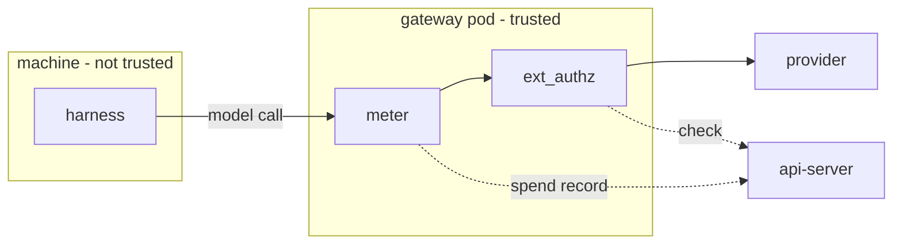

# Spend limits

Last verified: 2026-11-23

## Overview

DAM measures the spend of each model call in the agent's own gateway, for every harness and every provider dialect.
This number is Metered Spend: the agent cannot change it, because the meter runs only in parts that the agent does not control.
Every spend figure on the screens and in an agent's own cost report reads it; the spend that a harness reports through telemetry ([metrics](metrics.md)) serves only the earlier estimates.

The parts:

- **The meter**, in the agent's paired gateway pod, or in its own listener on an [owner gateway](credential-gateway.md#owner-gateway), reads the usage in each provider reply and sends one spend record per call to the api-server.
- **The api-server** receives the records on the same per-agent port that answers the gateway's ext_authz checks, so a record is tied to its agent the same way a check is ([security-and-credentials](security-and-credentials.md#hitl-ext_authz)).

The api-server prices each record when it arrives ([Prices](#prices)) and keeps the daily ledger ([Ledger](#ledger)).
Before a metered call goes out, the ext_authz check refuses it when a spend limit or the user's Spend Ceiling is reached ([Limits](#limits), [Spend ceiling](#spend-ceiling), [Refusal](#refusal)), and at a limit the owner can continue ([Continue](#continue)).
Work that nobody watches is held before it starts ([Unattended work](#unattended-work)).

## Meter

**Which chains.** A host chain carries the meter when one of its credentials comes from a model-provider Connection.
The gateway knows this from the Connection's provider template, which the api-server writes on the Connection's Secret.
A chain for any other Connection, and an allow-only chain, has no meter.

**On the request.** Before the ext_authz check, the meter gives the call an id that the agent cannot set, and it names the call's Connection and that Connection's provider.
The Connection is the one that the request named, else the chain's only model-provider Connection.
An address that names no Connection of the chain counts as no address, so a false address cannot hide a call.
When the chain has several model-provider Connections and the request names none, the meter names all their providers and no Connection.
The meter keeps these facts in the call's gateway metadata, out of the agent's reach, and the gateway hands them to the ext_authz check, so the gate and the ledger see the same call.
The meter also copies the session, the harness and the call id that the [Model Router](harness-config.md#the-model-router) stamps on the call, when each is at most 128 characters of printable ASCII.
The stamp comes from the machine, so it serves display only; the gateway removes it before the provider, on every chain.
The meter also removes the request's compression offer, because a compressed reply cannot be read as it passes.
It notes the path without the query and without a Connection address prefix, the API dialect of the path, and whether the path is billable.
Billable paths are the model calls: Anthropic Messages, OpenAI Chat Completions, legacy Completions, Responses and Embeddings, and the Bedrock invoke and converse calls, streamed or not.
Model lists, token counting and account paths are free, and the gateway sends no record for them.
Other paid paths, such as batch jobs and the later read of a background Responses result, are not metered, so a spend limit does not see their spend.

**On the reply.** The meter reads the reply as it passes, chunk by chunk, and does not buffer or change it.
It chooses the format by the reply's content type, because a streamed request can get a JSON reply: an event stream, a JSON body, or the Bedrock binary event stream with its encoded payloads.
It reads counts only inside usage objects in the structure of the reply.
It takes the reply's model and service tier only from the highest level of the reply where they occur, because a reply can repeat request fields at a lower level, such as Responses metadata, and the agent sets those.
In a stream, text and tool input from the model sit inside JSON strings, where quotes are escaped, so the model cannot form an event or a usage object there.
In a JSON reply, tool input is JSON structure that the model writes, so the model can form a usage object there.
For each count the highest value wins, so a repeated or forged object can only raise a count.
The one exception is a Messages stream, which is an Anthropic event stream or a Bedrock invoke stream: each count that the top-level `usage` of its `message_delta` event sends as a number replaces the count so far, also with a lower value.
The reason: some upstreams put the whole prompt as uncached input in `message_start`, and give the real split only in `message_delta`.
A count that `message_delta` leaves out or sends as `null` keeps its value, and a stream that stops before `message_delta` keeps the counts of `message_start`.
The meter knows the event of a `usage` only when the event's `type` comes first, as Anthropic, LiteLLM and Bedrock send it; otherwise the highest value wins.
A reply that reports the passes of one call apart, such as a compaction pass and an answer pass, counts the sum of the passes, because the provider bills each pass.
It keeps the raw counts with the dialect and leaves their meaning to pricing: input, output, cache reads, cache writes and their five-minute and one-hour parts, cached tokens, web searches, Bob credits, the service tier, the speed, the inference geography and the reply's model.
The cache writes include the writes that a Chat Completions reply reports in its prompt details.
The meter also keeps LiteLLM's own cost of the call when the usage carries it, as in the last chunk of a chat stream.

**The record.** The gateway sends spend records over a gRPC access log to the agent's ext-authz Service, the address the controller gives only this agent's gateway.
A record names the payer, which is the root driver for an Invocation target, and the Connection and providers that the meter named on the request.
It carries the session and the harness of the stamp, the call's duration, the reply size, the proxy's own cost figures when the reply has them, and whether the reply ended with its format's end event.
From LiteLLM's reply headers, it also carries the model group that served the call and whether LiteLLM served the reply from its response cache.
A reply that stops early keeps the counts read so far and is not marked complete.
Every final record also goes to [Provider Status](provider-status.md), which counts the failed calls of each provider.

**Periodic records.** While a call runs, the gateway also sends a periodic record of the same call every 2 seconds, with the counts so far.
So a long call that a gateway restart cuts off still leaves its partial counts.
The gateway's telemetry logs leave periodic records out, so they show one entry per call as before.

## Prices

**Where a price comes from.** The meter counts tokens, and a limit is in money, so the api-server turns each call's counts into a cost.
Only Bob's replies carry their own price, in Bobcoins.
The other providers send tokens only, and IBM LiteLLM sends its own cost only on replies that are not streamed and on chat streams that report their usage.
A reply that LiteLLM served from its response cache costs nothing and is not estimated, because LiteLLM does not bill it.

An IBM LiteLLM call is priced in this order, and the first match wins:

- **An operator price** from the chart, which an operator sets only to correct a price.
  The chart ships no IBM prices.
- **The RITS rule:** RITS models cost nothing.
- **The IBM list:** IBM's own prices, read from LiteLLM's model info ([Reading prices](#prices)).
  The lookup names the reply's model group first, because a reply can drop the provider prefix from its model, for example `gpt-5.5` for `azure/gpt-5.5`.
- **LiteLLM's cost in the reply**, when the list has no price for the model.
  A listed model with a free search quota also takes the reply's cost on a call with web searches, because only LiteLLM knows how much of the quota is left.
- **Awaiting price:** a call that none of these prices costs nothing and is marked estimated until its price arrives ([Estimates](#estimates)).

Any other provider's call is priced in this order, and the first match wins:

- **An operator price** from the chart.
- **A provider rule.**
  Curve Bender costs nothing.
  Bob uses the Bobcoins in each reply.
  The Claude subscription is valued at Anthropic's list prices, as a value and not a bill.
- **The Anthropic table:** Anthropic's list prices, the Anthropic part of the pinned copy of LiteLLM's public price list that the model catalogs also read.
  It prices own Anthropic keys and the subscription value.
- **Awaiting price:** a call to a model that none of these prices, on a provider that has the Anthropic table or operator prices, costs nothing and is marked estimated until a deploy brings its price ([Estimates](#estimates)).

A reply can name its model differently from the request, for example without a routing prefix or with a release date, so each lookup also matches on the model's own name.
OpenAI and Bedrock have no public prices in DAM yet: without an operator price, their calls keep their tokens and cost nothing, so a spend limit does not stop them.
No call takes an estimate from a similar model, so no call counts many times its price, and no call costs nothing because a free model has a similar name.

**How a cost is computed.** The rules follow LiteLLM's own cost rules, so DAM's cost equals LiteLLM's for the same counts.
A price sets input, output, cache reads, five-minute and one-hour cache writes, and web searches.
A price can change at several prompt sizes, and a prompt size counts cached tokens too.
Each kind of token takes its price from the highest prompt size that the prompt passes and that sets a price for it, else from the base price.
When a reply names the flex or priority tier, that tier's prices apply, and at each prompt size the tier's price comes before the plain price.
A missing cache price falls back to the input price, never to nothing.
A cache write without its five-minute and one-hour split counts at the five-minute price, as in LiteLLM, and the call row shows it as a five-minute write.
On the Anthropic API, fast mode and US-only inference multiply the token prices by the factors of the model's price.
Costs are whole micro-units of the Connection's unit, rounded up.

**When a cost is fixed.** DAM prices a call when its record arrives and stores that cost, so a later price change alters neither the history nor a limit.
Some calls inside the 30 days of call rows are priced again from their stored token counts, at the standard tier, because a call row keeps no tier:

- **A call that waited for its price** is priced again as soon as its model has a price.
  An IBM LiteLLM call is priced again after each read that brings a price for its model.
  A call on a provider priced by the Anthropic table or by operator prices is priced again at each api-server start, because these prices change only with a deploy.
  It stays an estimate only when another reason remains, such as a cut stream.
- **An IBM LiteLLM estimate written before calls recorded where their price came from** is priced again after each full read when it has input tokens and names a model with a price.
  It stays marked as an estimate, because its row does not say why it was estimated.
- **A guess written before DAM stopped guessing**, a call priced by the highest prices of its model's family, is priced again at each api-server start, on a provider priced by the Anthropic table or by operator prices, when it has input tokens.
  It takes its cost from the list when its model has a price now, and else costs nothing and waits for its price.
  An estimate from before calls recorded where their price came from may be a guess or a real price, for example a cut stream priced from the Anthropic table in fast mode.
  It keeps its cost when its model's price, with or without the price's fast-mode and region factors, gives that cost, because a guess never had a factor and no Anthropic price changed while such rows were written; else it is a guess.
  It stays marked as an estimate until it waits for a price and then gets one.

A call that had a real price never changes.
A call without input tokens never changes either, because its cost came from the payer's most expensive call or from nothing, not from a price.
Each re-priced batch writes one `spend.repriced` log line with the number of calls, the total difference and its kind, and the counter `platform.spend.repriced` counts the calls by provider and kind.
DAM compares its cost with the proxy's own cost on every completed dollar call whose reply carries that cost, cache reads and writes included, except a response-cache replay.
The proxy's cost is IBM LiteLLM's response cost when it is above zero, else its original cost less the discount plus the margin, the order in which LiteLLM applies them.
It is rounded up to a whole micro-dollar, as DAM rounds its own cost, so rounding alone is never a difference.
When these headers give no cost, as on a chat stream, the proxy's cost is the cost in the reply's usage.
A call that DAM priced with LiteLLM's own cost is not compared.
A difference above 5% writes a `spend.proxy_cost_mismatch` log line, which shows a price or a cost rule that is wrong or old.
Two counters, `platform.spend.proxy_cost.compared` and `platform.spend.proxy_cost.differs`, count the compared calls and the differences in ClickHouse.
They carry only the provider and the model, which is the reply's model group when the reply names one, so they name no user, agent or Connection.

**Updating prices.** The Anthropic table changes only through a reviewed update to a newer pinned version of LiteLLM's list, which the regular dependency update proposes.
One update writes the model catalogs' part and the Anthropic part from one LiteLLM version, so spend and the catalogs know the same models.
It stops before it writes anything when a model that DAM prices would lose any of its prices, a prompt-size price, a fast-mode or region factor and the web-search price included, so a broken upstream list never reaches DAM.
A price that Anthropic really removed passes only after a reviewer deletes it from DAM's copy.
A new model without every token price is left out of the Anthropic part, so its calls wait for their price, while the catalogs still get it.
Operator prices change through the chart.

**Reading prices.** The api-server reads IBM LiteLLM's own prices from its model info (`/v1/model/info`) with the key of each IBM LiteLLM Connection.
It reads every hour, once at start when it keeps no IBM price yet, and at once when a Connection is created or its key is replaced.
An ordinary key may read the model info, which lists every model that the key may use, embeddings included, with IBM's price of each kind of token.
The api-server keeps only the price fields of each model, never its deployment settings, and it never logs a key.
Postgres keeps one IBM list by model group, filled from the reads of all Connections, because every IBM key reaches the same proxy and a price belongs to the proxy, not to the key.
An hourly read replaces each model that it lists.
When two keys give one model different prices, the higher price wins and `spend.price_conflict` is logged.
A read of a new or changed Connection only adds the models that the list lacks.
A model that no read lists keeps its last price.
A refusal or an error removes no price: it only writes the Connection's status row, which keeps the last good read, the last refusal and the number of models.
A model without an input or an output price, such as a RITS model, is left out of the list.
The web-search price is the price per query, else the price for a medium search context.
Each model also records whether its price has a free search quota, and which price fields change LiteLLM's cost but are not applied by DAM: a reasoning-token price unlike the output price, a regional uplift, web-search prices that differ by context size, and a free search quota.
Each read logs such fields as `spend.price_incomplete`.
After each hourly read, an operator price that differs from the list logs `spend.operator_price_differs`.
The counters `platform.spend.price_reads`, by provider and outcome, and `platform.spend.operator_price_differs`, by provider and model, count the reads and the differences.
Each replica keeps a copy of the list in memory and reloads it from Postgres every 60 seconds and right after its own reads write to it, so the meter prices each record from memory.

## Ledger

**Receiving.** The api-server ties a stream of records to its agent by the Service address, as it ties a check.
It drops the record of a call that the gate refused, because the gate counts its own refusals.
It prices each record at once, in the unit of the call's provider: dollars for paid providers, list-price dollars for the Claude subscription, Bobcoins for Bob, and nothing for free providers.
When the meter named several providers, the call counts at the provider whose unit is real dollars, marked estimated.
A call without a Connection keeps its cost under an unknown Connection, so it still counts for the agent and the owner.

**Who pays.** A call counts for its payer and the payer's owner, on the UTC day the call started.
So a sub-agent's calls count for its root driver.

**Daily rollup.** Postgres keeps one row per day, payer, Connection, model, Session and calling agent: the cost, the token counts, the web searches, the model time, the counts of calls, estimated calls and refused calls, and the most expensive finished call.
The calling agent is the agent whose gateway sent the record, so a sub-agent's calls count for its root driver and still show as its own.
A row outlives its agent, so the spend of a deleted agent still counts for its owner.
The api-server also keeps the last name of each Agent that goes, from its Agent watch, which sees every way that an Agent is deleted.
It skips a temporary agent, because its Invocation record names its rows.
A delete that no api-server replica sees leaves the agent with no name.

**Session check.** The Session comes from the stamp in the machine, so it serves display only, and no total and no limit depends on it.
A call's Session counts only when the calling agent reported that Session to the [Session directory](metrics.md#session-directory); a Session that the agent never reported, or a failed check, counts as no Session.
The totals and the limits of such a call stay correct, because they do not read the Session.
The agent's own machine writes the directory, so the check stops stray and wrong ids, not a deliberate agent: such rows stay under that agent's own spend.
The check keeps a Session that it found for ten minutes and never keeps a miss, because a new Session's report can arrive after its first call.
A new Session's first prompt waits for that report, at most two seconds ([metrics](metrics.md#session-directory)).
A call that still counted as no Session keeps its stamp, and a job every five minutes moves such calls of the last two days to their Session once the directory knows it.

**Call rows.** Postgres also keeps one row per call: the calling agent, the Session, its stamp when it counted as no Session, the Model Router's call id, the start time, the Connection, the model, the unit, the cost, the token counts, the web searches, the model time and whether the cost is estimated.
It also keeps where the price came from (an operator price, the IBM list, the Anthropic table, a provider rule, LiteLLM's cost in the reply, a replay, awaiting price or an estimate), the model name that the lookup used, and the reasons for an estimate.
The ingest writes it once, when the call is settled by its final record or by an estimate, and a real record that arrives later overwrites the estimate.
It serves the cost of each turn, in the chat and in `dam telemetry`, which sums the calls of a Session that start inside the turn, the cost of each call in the turn timeline, `get_metrics` and `dam metrics`, found by the router call id within the owner's rows, the reads in hours, and the first and last call time of a Session; no limit reads it.
A periodic job deletes rows older than 30 days, the window from which the chat and `dam telemetry` read turns.

**Measuring start.** Postgres keeps one moment, T: the start of the measured spend on this deployment.
A migration sets it once and never changes it.
When the rollup already has rows, T is 00:00 UTC of the first day in it; else T is the time of the upgrade.
The screens read T to say since when the spend is measured, to mark the days before T as not measured, and to show the notice about the change for 30 days after T.
The api-server reads T once and keeps it.

**Grouped read.** The screens read the rollup grouped by day, payer, Connection, model, Session, calling agent and unit, for at most 366 days.
A read with an exact window, from `get_metrics` hours and `dam metrics --since`, sums the call rows that start inside it in the same groups; a window that starts more than 30 days ago, or before the first call row with a model, widens to its UTC days, and the result names the window it read.
The api-server folds the rows into totals per unit, the model time, and spend by day, agent, model, Connection, session type and calling agent.
A call whose calling agent is not its payer counts as a sub-agent's; other calls take their Session's kind from the directory.
The read for one agent counts the calls that it pays for, so a driver's figures include its sub-agents; for a sub-agent, it counts the calls that the sub-agent made.
The api-server names each agent row.
A sub-agent takes the label of its spawn, else the first line of its task, from its Invocation record ([invocations](invocations.md#the-delegation-record)), so a running sub-agent and a finished one have the same name.
Any other agent takes its live name.
An agent that is gone takes the last name that the api-server kept for it ([Ledger](#ledger)).
In the read for a driver, the api-server keeps the driver and the five sub-agents with the most dollars (paid plus subscription value), then Bobcoins, then calls, and sums the rest, so the response and its name lookups stay small however many sub-agents ran.
A second read lists the driver's sub-agents in the same order, up to a limit that the screen raises by 50 at a time, so the longer list always comes from one ranking.
A sub-agent row carries the first 1,000 characters of its task for the hover text.

**Spend per Session.** For one agent, the api-server sums the calls that the agent made per Session, newest first, and adds to each Session the calls of the sub-agents spawned from it at any depth, also as a part of its own.
A sub-agent whose spawn recorded no Session ([invocations](invocations.md)) adds its spend to no Session.

**Day counters.** Redis keeps the day's totals per payer and unit, per owner and unit, per payer and Connection, and per owner and Connection, so the limit check reads no database.
A missing counter, for example after a Redis restart, is rebuilt from the rollup, and a counter that fails to update is dropped so that the next read rebuilds it.

**One call, many records.** Each periodic record and the final record carry the call's counts so far, not increments.
The api-server keeps the amounts it last applied for each call and adds only the difference, in one atomic step, so two replicas never count the same part twice and a call counts once.
A periodic record that arrives after the final one changes nothing.

**Re-pricing.** A re-priced call moves its call row and its rollup row by the same difference, in one transaction, and the rollup row's most expensive call is computed again from its call rows.
Today's day counters then move by that difference too, and the call's kept state in Redis takes the new cost, so a late record of the same call adds nothing twice.
A call row changes only while its price source is still the one that was read, so two replicas never re-price one call twice.

**Open calls per agent.** Redis also keeps, per calling agent, the calls still in flight and when a record of each was last heard, so the [Invocation reaper](invocations.md#outcomes) can wait until a reported sub-agent's model calls have ended.

## Estimates

DAM marks a call estimated when its usage or its price is missing or unsure.
It counts high, except for a call that got no answer and a call that waits for its price:

- **A stream that stopped early** keeps the counts read so far, and its output is estimated from the reply size when that gives more.
- **A successful reply without usage** counts as the payer's most expensive call on that Connection that day, else in the last seven days, because the reply does not show its input.
  A failed reply without usage counts nothing, because the provider does not bill it.
- **A call that got no answer**, with no HTTP status and no reply byte, counts nothing and is marked estimated.
  The client closed it before the provider answered, by an interrupt, a timeout or a gateway restart, and LiteLLM bills nothing for a stream cut before its first chunk.
  A call that is not streamed can still be billed for its prompt, and DAM does not see that cost.
- **A Bob reply without Bobcoins** counts as the payer's most expensive call on that Connection that day, else in the last seven days.
  Bob Shell cancels one call in each prompt before Bob sends its Bobcoins, so Bob totals run higher than Bob's own figure.
- **A call whose record never arrived.**
  The gate notes each metered call when it starts.
  Sixty minutes later, a periodic sweep finishes a call that has only periodic records from its last counts, and counts a call with no record as the payer's most expensive call on that Connection that day, else in the last seven days, else at nothing with a warning.
  A call whose last counts waited for a price keeps waiting for it.
  A real record that arrives later corrects the estimate.
- **A call that waits for its price** counts nothing and is marked estimated with the reason `awaiting-price`.
  Its model has no price yet in its provider's price sources: the IBM list, the Anthropic table or operator prices ([Prices](#prices)).
  Only a call with usage waits; a call without usage follows the rules above, whatever its model.
  It writes one `spend.call_awaiting_price` log line with the call, the Connection and the model, and the counter `platform.spend.awaiting_price` counts it by provider and model.
  Until the price arrives, a spend limit does not see the call; when it arrives, DAM prices the call again ([When a cost is fixed](#prices)).
  A call that still waits after 30 days keeps costing nothing, and the screens stop counting it as waiting.
  For an IBM LiteLLM call, the api-server reads the call's Connection at once, without making the call wait, one read at a time and at most once in five minutes per Connection, so the price normally arrives within seconds.
  For the Anthropic table and operator prices, the price arrives with the next deploy that has it.
  An operator price in the chart prices a new model at once, and the restart prices its waiting calls again.

An estimated call keeps the Session and the calling agent of its stamp, and the gate's own row for a refused call keeps them too.
Each estimate writes one `spend.call_estimated` log line with its reasons, whether the payer's most expensive call priced it, the calling agent and whether it is a sub-agent, the Connection, the model, the cost, the reply size and the duration, so the share of spend that estimates add can be measured.

**Shutdown.** A stopping api-server takes no new streams, ends every open record stream with a success status so that each gateway reconnects to another replica and loses no record, and gives the open calls twenty seconds before it closes the port.

## Limits

The owner sets four kinds of daily limit.
Each one counts the spend of the current UTC day.
Only the owner sets or removes a limit, from an unrestricted login: an agent, and an API key bound to an agent, cannot change or continue it.
A sub-agent takes no agent limit and no Connection limit of its own, because its calls count for its root driver: the api-server refuses to set one.
A limit of zero refuses every call that it counts.

**Agent limit.** A dollar limit for one agent.
It counts the agent's metered dollar spend on paid providers, sub-agents included, because their calls count for their root driver.

**Own limit.** One dollar limit for all agents of the owner together.
It counts the same spend as the agent limit, summed over every agent of the owner.

**Connection limits.** A limit for the calls of one agent on one of its Connections, in that Connection's unit.

**Connection limits for all agents.** A limit for the calls of all agents of the owner on one of the owner's Connections, in that Connection's unit.
It counts every call on that Connection that the owner pays for, so sub-agents count, and so do agents deleted that day, because their rollup rows stay.
An agent that the owner creates later falls under it at once.
It applies to every Connection that takes a Connection limit, dollar Connections included: a user with two dollar Connections on separate budgets caps each one, which the own limit cannot do.
When an agent has a Connection limit too, the first one reached stops the agent's calls on that Connection.
It is deleted with its Connection, with every agent's Connection limit on it.

Both kinds of Connection limit use the Connection's unit:

| Connection                         | Unit               | Counts in the agent limit, own limit and ceiling |
| ---------------------------------- | ------------------ | ------------------------------------------------ |
| An Anthropic key, IBM LiteLLM      | dollars            | yes                                              |
| The Claude subscription            | list-price dollars | no                                               |
| Bob                                | Bobcoins           | no                                               |
| Curve Bender                       | free               | no limit applies                                 |
| OpenAI, Bedrock                    | dollars, unpriced  | only with an operator price; no Connection limit |
| Any Connection that is not metered | —                  | no limit applies                                 |

So the Claude subscription and Bob are limited only by their Connection limits, for one agent or for all agents.
An agent's Connection limit needs a Connection that is granted to the agent; a limit for all agents needs a Connection that the owner holds.
OpenAI and Bedrock calls take no Connection limit yet, because DAM does not price them.

**Soft.** At a limit, the gate refuses the call and asks the owner whether to continue; it never holds the call.
At 80% of a limit, its state changes to a warning, and nothing else happens.
An agent's limits are deleted with the agent.

**The check.** On each metered call, the gate reads the limits that count the call and today's extensions from the database, and today's spend from the day counters.
A missing counter is rebuilt from the rollup first, and when the day counters cannot be read, the gate reads today's spend from the rollup.
The gate checks every limit that counts the call, and any reached one refuses it, so the first limit reached stops the work.
A call that already streams continues to its end, so the spend can pass a limit by the calls that were running.

## Spend ceiling

The operator sets the Spend Ceiling: a hard daily dollar maximum for each user.
It counts the same spend as the own limit: the user's metered dollar spend on paid providers, on all agents.
At the ceiling, the gate refuses the call and asks nothing, because "continue" cannot lift it.
When the ceiling and a soft limit are both reached, the ceiling's refusal applies.

A platform operator ([security-and-credentials](security-and-credentials.md#identity)) sets a user's own ceiling with `dam spend ceiling` or in the Operator tab of Settings, and names the user by email.
A ceiling that exists can also be changed or removed by the user's id, so a user without an email stays manageable; a new ceiling always needs the email.
The api-server looks the email up in Keycloak, and keeps one row per user in Postgres: the amount, the operator who set it last, and when.
It logs every set, change and removal with the operator and the amounts before and after, so a removed ceiling also leaves a trace.
An amount is whole cents, up to $9,999,999.99, the same rule as the chart's default.
A user without a row gets the chart's default ceiling, which is off at first.
A user cannot change their ceiling.
They can still set an own limit below it, and the lower of the two stops the work first.
The gate reads the user's row on each check, so a change applies at the next call.
When the read fails, the check fails and the gate refuses the call.

## Refusal

The shape follows the API path of each call, never the agent's harness, because one agent can run several harnesses.

- **Anthropic Messages and Bedrock paths:** a "too many requests" status that tells the client not to retry, and when to try again: the next UTC midnight, at least 61 seconds away.
  Claude Code then stops at once; a plain retryable answer makes it retry for minutes, and a "bad request" answer makes it retry and turn off features for the session.
- **OpenAI Chat, Responses and embeddings paths, Bob included:** a "bad request" status.
  Codex and Pi stop at once and show the text; to a "too many requests" answer, Codex shows its own text instead.

The body is plain text: "Spend quota exceeded for today.", then what to do next: at a limit, that the owner can approve more in the product, with its name; at the ceiling, to ask the platform operator for a higher ceiling.
It has no digits, because Pi retries when the text names a retryable status code and stops when it says "quota exceeded"; a product name with digits is left out.
A call on a Bob Connection gets the same text inside a JSON error object, because Bob reads only the message of a JSON error and otherwise shows just "Bad Request"; Pi shows a JSON error raw, so every other provider keeps plain text.
Paths that are not metered, such as model lists and token counting, are never refused.
Every refusal carries the `x-platform-refusal` header, so the [Model Router](harness-config.md#the-model-router) passes it to the harness unchanged and does not explain it as a provider error.

**Recorded refusal.** The gate counts each refusal in the day's rollup itself, because it sees every refused call, whatever harness or turn made it.
It counts the refusal under an unknown model, because the gate does not read the request body.

## Continue

At a refusal by a limit, the gate asks the owner on Home with a spend-limit approval, one for each reached limit, on the agent whose call was refused.
A hold of unattended work asks in the same way ([Unattended work](#unattended-work)).
A refusal by the ceiling asks nothing.
There is one question per limit, amount, day and extension count, so further refusals at the same level add no question, and a limit that the owner changed asks again once it is reached.
"Continue" is any allow verdict on it: it adds one extension for that day, so the effective limit is the amount times one plus the extensions, and the gate asks again at the new level.
A question cannot be denied, because a deny would change nothing: the limit stays reached until the owner continues it, changes it, or the day ends.
A limit that counts all agents, the own limit or a Connection limit for all agents, asks once for all of them, on the agent whose call reached it first, and says so: a continue lets every agent go on.
Its card and its toast name "All your agents" instead of that agent, with no avatar.
A question expires at the next UTC midnight, when the limit starts again, and continuing it writes no egress rule.
Setting or removing a limit closes its pending question, so a new refusal asks again, and so does removing the Connection of a Connection limit.
**Stopped agents.** A limit stops an agent while a call of its sessions was refused today and a limit that counts that call is still reached.
The web UI reads the owner's stopped agents, and the limit that stopped each, in one query.

## Unattended work

At a limit or the ceiling, work that nobody watches does not start either, because each of its model calls would only be refused.
A hold makes the gate's check for the work's payer, its root driver, before the work starts, on the Connection the work would run on: a schedule fire's and a spawn's own, and for a channel turn the agent's default session pair's.
A channel thread whose session runs on another pair is still checked against the default pair; the gateway stops that session's calls at its own limits.

- **Schedules:** a recurring fire is held, and its next occurrence runs as usual.
  A one-time fire has no next occurrence, so it waits inside its delivery window: until the next UTC midnight, or until the owner sets or continues a limit ([schedules](schedules.md#one-time-schedules)).
  An on-demand run is refused.
- **Sub-agents:** a spawn is refused before anything is created ([invocations](invocations.md#spawning)).
- **Channels:** a turn does not start, and the agent does not wake.
  Whoever waits for an answer is told why none comes: a person gets a notice that only they see in Slack, or a chat post in Telegram; an app or another agent that mentioned the agent gets one notice in the thread; an agent that hands a turn over gets the reason as an error.
  A notice names the time when the agent answers again, and Slack and Telegram show that time in each reader's own time zone.
  Ambient reading waits for nobody, so it skips the agent with no notice in the channel ([channels](channels.md)); the owner hears of it ([Telling the owner](#unattended-work)).
- **Interactive artifacts:** a viewer's prompt, or an owner's that asks for a Session of its own, does not start a turn or wake the agent, and the page tells the viewer the agent reached its spend limit ([artifact library](artifact-library.md#viewers-of-a-shared-page)).

At a soft limit, a hold also asks the owner whether to continue, so the owner is asked even when the call that reached the limit was the last one of its turn.
The ceiling asks nothing.

**Telling the owner.** Only the owner can lift a limit, and the owner rarely sees work stop outside the web app, so the owner gets a message about it at once.
It is sent when a scheduled fire, an ambient turn, or a mention or handoff in Slack or Telegram is held, and when the gate refuses a call of a Session that a schedule or a channel started, because that turn stops partway.
A held mention still gives whoever mentioned the agent its own notice, the owner included; the message comes beside it.
A web chat sends nothing, because the owner sees its refusal there.
Each level of each limit counts on its own: a limit at its amount and today's extension count, or the ceiling at its amount.
The first stop at a level sends one message, and more stops at the same level send nothing, whichever agent or work they hold.
Continue, a changed limit or a changed ceiling makes a new level, so the next stop sends again; the reset at midnight sends nothing.
So one agent stopped by its LiteLLM limit and then by its Bob limit gets two messages, and a limit for all agents gets one for all of them.
When several limits are reached, the message is about the one highest up: the ceiling, then the own limit, then the Connection limit for all agents, then the agent limit, then the agent's Connection limit.
It stops the work whatever happens below it; a lower limit gets its own message once the owner lifts the higher one and work stops again.
The message names the limit with its amount, what stops, and the time the day resets; it names an agent only when the limit is that agent's own, and never the work that was held, because everything the limit counts stops.
It links to the page that sets the limit: the agent's Usage section for the agent limit, its Providers section for its Connection limit, Settings › Providers for a Connection limit for all agents, and Settings › Usage for the own limit and the ceiling.
The spend-limit question with its "Continue" waits behind the Approvals bell on every page, so the message needs no link to it; at the ceiling it says instead that only the platform operator raises it.
A last line lists the other limits that count the work and are at 80% or more, so the owner can change several at once.
A Redis key per level, claimed before the message goes out, keeps two replicas from sending it twice; a send that fails is not repeated.
The message goes to the owner's Slack direct message, and to the owner's private Telegram chats only when Slack reaches nobody ([channels](channels.md)).

**The agent's view.** Through a platform tool, an agent reads the limits that count its calls, today's spend, what is left, the state of each limit, and when the day resets.
It has no tool to set, clear or continue a limit.

**Which limit stops first.** Several limits can count one call, and the first one reached stops it.
For an agent, the api-server works out which one that is, so every surface says the same: the agent's screens, `dam spend status <agent>` and the agent's own tool.
It answers per Connection that the agent holds, and once more for the agent's dollar spend across Connections.
A dollar Connection is counted by its own limits, the agent limit, the own limit and the ceiling; a subscription or Bob Connection only by its own limits, because the others count dollars alone.
The limit with the least left today stops first; on a tie, the one set closest to the agent: the agent's Connection limit, then the agent limit, then the Connection limit for all agents, then the own limit, then the ceiling.

## Screens

The owner sets each limit where the work happens.
The agent limit and the own limit each show in a "Daily spend limit" card.
A help tip on its title tells which calls the limit counts.
A button opens a small dialog to set the limit or remove it: "Set a limit" when no limit is set, else "Change".
Without a limit, the card gives today's paid spend and "No limit".
With a limit, it gives the spend against the limit, and a meter with the share of the limit used beside it.
A line under the meter shows only when it matters: when the spend is close to the limit, when the limit is reached and until when paid calls stop, and how often the owner continued today.
The last line gives the local time at which the day resets.
A Connection limit uses the same parts in the Connection's unit: a title with a help tip, the button, the spend against the limit or "No limit", the meter and state line, and the reset time.
Every place that shows a limit follows one pattern.
It shows the limit that the place owns, which the user sets there, and under it the other limits that count the same calls, as a list or one "Also counted by" line.
Each limit has its own icon on every screen: the provider's for an agent's Connection limit, the same with a people badge for a Connection limit for all agents, the agent's avatar for the agent limit, a sum sign for the own limit (the total daily limit) and a lock for the spend ceiling.
Closed, the line shows each other limit's icon and share used; open, it lists them muted, each with its meter, its spend against the limit and where it is set.
The limit with the least left today, when it is not the place's own, is marked "stops first", closed and open.
The spend ceiling shows only when the operator has set one.
The screens:

- **The agent's settings:** the Usage section starts with the card for the agent limit, which counts the paid calls of the agent and its sub-agents.
  The card also gives today's spend in the other units, how many calls are estimates and how many have no price yet.
  Below it, the card always lists the other limits that count the agent: the total daily limit, the limits for all agents on its Connections, its own Connection limits, then the ceiling, each with its icon, name, meter and spend against the limit.
  An agent with only the Claude subscription or Bob gets no button: its card gives today's spend in that unit and points to its Providers section.
  The agent's summary shows today's spend in each unit and the limit.
  Below the card, the section shows the same measured view as the Settings tab, for the spend that the agent pays, so the spend of the sub-agents that it started is included.
  A sub-agent's card shows only the note about its root driver.
- **The agent's Providers section:** each provider is one line, and a granted Connection that takes a limit shows the agent's spend on it today, and opens below the line to the agent's limit there and the limit for all agents.
  The limit dialog says, while the user types, whether the new amount is already reached and which limit would stop the agent first.
  A Connection that takes no limit shows no spend.
- **Settings, Providers tab:** each connected Connection that takes a limit shows all agents' spend on it today, and opens to its limit for all agents.
  The attach dialog that lists the same Connections shows no limit.
- **Settings, Usage tab:** the card for the own limit comes first, under the metering notice.
  Its "Also counted by" line holds the spend ceiling, when the operator has set one.
  When the user has Connection limits for all agents, the card lists them below, read only: each with its icon, a thin meter, the share used and the spend against the limit, and one link to Settings › Providers to change them.
  Below the card, a period picker keeps its period in the URL.
  Below it are the paid Metered Spend with the same date range as on Home, the spend by day (by week above 62 days), the counts of calls and tokens, the sum of call times, and the spend by agent, model and provider.
  Under the total, a line gives the subscription value when the checkbox is on, and a line tells when the subscriptions covered more than the user paid.
  Bobcoins get their own line, which says that they are not in the total.
  A provider without a price shows "Not priced", and a free provider shows "No cost".
  Under the counts, a line says how many calls are estimates and how many have no price yet; a row with nothing else to show but waiting calls shows "No price yet".
  For 30 days after T, and only when the telemetry store is on, a link opens the earlier estimates: the old view of the spend that each agent reported about itself.
- **Settings, Operator tab:** only platform operators see this tab.
  Its Spend ceilings section gives the default ceiling, then each user with a ceiling of their own: the amount, the operator who set it last, and when.
  An operator sets a ceiling by the user's email, changes one, or removes one after a confirmation.
  An email that no user has shows its error in the dialog.
  The Compute budgets section below it is the same screen for compute Budgets ([budgets](budgets.md#the-pool)).
- **Home:** the spend card shows the paid Metered Spend in dollars for Today, This month or Last month, in UTC days.
  Its help text gives the local time at which a day starts.
  The date range under the total starts at T when the period starts before T.
  While the period runs, the range ends at today and says "so far".
  A period wholly before T shows no total.
  The checkbox "Show what subscriptions cover" is on Home only while the user has subscription-covered calls in any of the card's three periods; the card reads them as one daily range, so the checkbox does not move between the periods.
  When it is on, this line gives the subscription value at API prices.
  When the checkbox is off, this line tells when the subscriptions covered more than the user paid.
  The checkbox also adds the subscription value to the bars of the top agents, never to the total.
  The browser keeps the choice for Home and for the Usage pages.
  The card shows no own limit and no Bobcoins; Settings › Usage shows both.
  "Usage details" opens Settings › Usage with the same period.
  The card does not need the telemetry store.
- **The metering notice:** for 30 days after T, a user who had an agent before T sees a notice about the change.
  It shows above the cards on Home and at the top of Settings › Usage.
  When the user hides it, it goes from both places, in that browser only.
  The tooltip of its close button says so, and says that the earlier estimates stay on Settings › Usage while they are open.

A limit's meter is the foreground colour on a light tint of it at every level; words, not colour, say when a limit is close or reached, and the resource meters on Home use the same fill.
A sub-agent's settings set no limit: its spend counts for its root driver, so its Usage section names the root driver instead.
A spend-limit question shows on Home with "Continue" only; "Dismiss" hides it from Home and leaves it open, and Home's "Deny all" leaves it out.
The surfaces name five limits: the agent spend limit, the user's spend limit for all agents, a Connection's spend limit, the user's spend limit for all agents on a Connection ("Your ‹Connection› spend limit (all agents)"), and the spend ceiling that the operator sets.
Every surface calls the ceiling the spend ceiling; its help tip says that the operator sets it.
The Claude subscription's unit shows in dollars as "covered", for example "covered by subscriptions today" in a Connection limit; the help tips call it the subscription value at API prices.
In the chat, a refused call shows as "Spend limit reached" or "Spend ceiling reached" with what to do and the local reset time; the owner gets links to the agent's limits, others the harness's error.
Every text that a person reads gives the reset in that person's own time, on the screens, in the CLI and in the channel notices; texts for agents give it in UTC.
In the sidebar, an agent that a limit stopped has a red dot that names the limit.
**Per Session and per turn.** Each Session in the sidebar shows its Metered Spend: paid dollars, else the plan use as "covered", else Bobcoins.
The figure includes the sub-agents spawned from that Session, and its tooltip names their part.
The Usage pages also show the sum of call times and the spend by session type, with a "Sub-agents" row for the calls of sub-agents and a "No session" row for calls with no Session.
A driver's Usage section lists the driver and each sub-agent that spent in the period, and a sub-agent's own Usage section shows the calls that it made.
Its sub-agents sit indented under the driver's own row: the five that cost the most, each named as its delegation card names it and with its task on hover, then one "N more" row with the sum of the rest.
"Show all" lists every sub-agent, 50 at a time.
Settings › Usage and Home show one row per paying agent, with the spend of its sub-agents in it.
A deleted agent keeps its last name beside a greyed avatar, and an agent with no recorded name shows as "Deleted agent".
The line under each chat turn shows the measured cost of the calls that started in that turn, from the call rows.
Its tooltip tells that the agent reports the time, calls and tokens without cached tokens, and that DAM measures the cost with cached tokens and without sub-agents.
