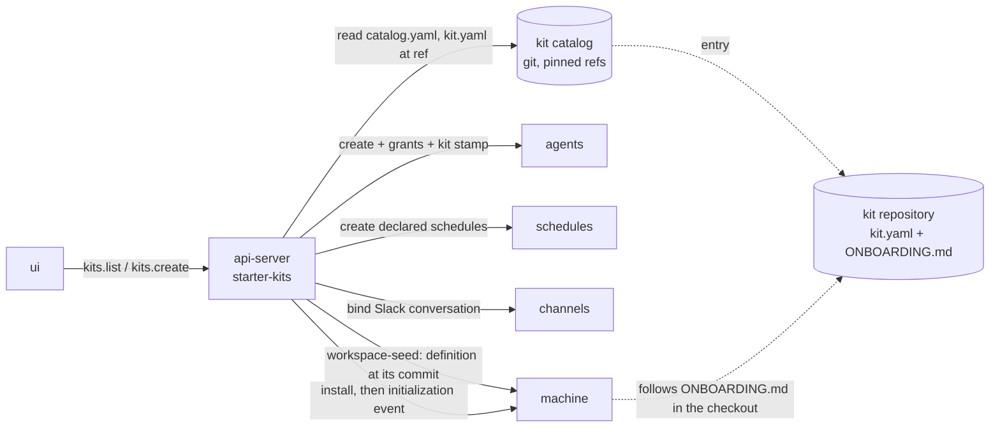

# Starter Kits

Last verified: 2026-10-29

## Overview

A **Starter Kit** is a proven way of working applied to a *new* Agent: the connections, channels and schedules a job needs, optionally its own agent image, and an onboarding step that asks only for what the user alone can supply.
It is not an Agent and not a Template ([ubiquitous language](../ubiquitous-language.md#starter-kits-bounded-context--in-design-3576-3638)).
Templates are the platform's **harness catalog** — the images the platform itself delivers — and a kit is self-sufficient: it either runs on the default Template, whose sessions each pick a harness from that catalog, or brings its own image.

Kits are **files in git, never rows in the cluster**.
A kit is a `kit.yaml` at the root of the repository that holds it — for an agent definition such as Code Guardian, the definition repository *is* the kit.
The platform reads **several named Kit Catalogs** through one reader, in a fixed order: the **built-in catalog** (`platform`), whose files ship inside the chart under `helm/starter-kits/` and are mounted into the api-server as a directory, so it is versioned with the release and, for the kits it carries as files, needs no network; and any number of external catalogs, each a git repository on a readable host holding a `catalog.yaml` index of kits pinned to refs.
A kit is addressed as `<catalog>/<kit>`, so two catalogs may ship a kit of the same id without one hiding the other.
The api-server keeps only a **resolved snapshot** of each catalog in Postgres (`starter_kit_catalog_entries`), rewritten by the refresh job and rebuildable from the catalogs at any time; an Agent remembers only `<catalog>/<kit>@<version>`.

An Agent is a snapshot of its kit at create, plus a user-started **Kit Update** that brings a newer definition into it ([below](#kit-update)).
There is no backup and no automatic update; a read-only definition and work-dir backups remain later increments, each additive to this page.

## Concepts

- **Catalog refresh** — external catalogs are **moving**: adding a kit to one must not require redeploying the platform.
  A BullMQ periodic job re-reads every catalog on an interval, resolves each entry that names no ref (and each that names a branch or tag) to a **commit sha**, scans the definition for bundled skills, and **writes the resolved set to Postgres**.
  That job is the only thing that touches the network; every api-server serves kits by reading the table.
  The consequences are deliberate: an unpinned catalog still yields exact, immutable kits; a kit read is a local query rather than a fan-out of GitHub requests; the resolved rows carry the provenance a later Kit Pull needs to diff against; and a catalog that goes unreachable leaves the last good resolution serving rather than emptying the page.
  The same holds per entry, with one distinction: a catalog's rows are replaced only from a read in which every entry could be read; when an entry is unreadable — its ref does not resolve, its `kit.yaml` cannot be fetched, the source throws — the ones that resolved are updated and the unreadable ones keep their stored row, so a rate-limited pass never empties the list.
  An entry that was read and rejected — a `kit.yaml` the schema refuses, a path that escapes the catalog — is a withdrawal, not an outage: it leaves the resolved set like an entry the author removed, so one permanently broken kit never freezes the prune for the rest.
  The built-in catalog is refreshed by the same job: its file entries are stamped with the release rather than a sha, because chart files have no commit to resolve, while an entry naming a repository is resolved and stamped exactly like any other — so a built-in catalog carrying one does reach the network on refresh, and an air-gapped install may hold only file entries.
  What lives where follows from that: the built-in catalog holds the **workload kits**, whose images this repository builds and whose kit files are versioned with the release, and **definition kits** live in a repository of their own, listed either by a curated catalog the install points at — `curated` by default — or, when the kit must be switchable per install, by a built-in entry naming that repository.
  A workload kit may also bring no image: it runs on the default Template and its `install` command puts the tool, at the version the kit file pins, into the agent's home.
  A definition kit is not copied into that catalog either: its `kit.yaml` sits at the root of the repository holding the code it installs, and the catalog lists it by `gitUrl`.
  That is what keeps the two in step — a change to a toolkit's bootstrap and the change to the kit describing it are one commit and one review, in the repository that owns both.
  Such a kit's seed says `self: true` rather than repeating the URL, and names no ref, so the workspace is seeded from the very commit the kit was resolved at and a kit can never describe code it was not read with.
  A seed names exactly one of `url` or `self`, so "seed this repository" is something the file says outright rather than something a reader infers from an absence.
  A definition kit is mostly a pointer at a repository that moves on its own cadence, so pinning it to a chart release would only mean a redeploy every time it changed.
- **Kit Catalog** — a named index the install reads kits from.
  The chart renders the list: the built-in catalog as a mounted directory when enabled, then each external catalog as a repository URL with an optional `ref` and `dir`.
  **A version is written in one place and one way.** Wherever a repository is named — a catalog in the chart's values, an entry in a `catalog.yaml`, a kit's `seed` — it is a plain `url` and an optional `ref`, and the same three words mean the same thing at every level.
  A URL that carries a version instead, as a `#ref` fragment or a `/tree/<ref>/<dir>` path, is **refused** rather than read at the default branch: the alternative is an install that pinned a version, silently got the tip, and never finds out.
  Entries are either a path inside the catalog or an external repository plus pinned ref — including in the **built-in** one, whose `catalog.yaml` may name a repository rather than a directory.
  That is how a definition kit takes the chart's per-install switch without its `kit.yaml` being copied away from the code it describes; such an entry carries an explicit `id`, because there is no path to derive one from and the switch would otherwise match nothing and silently leave the kit on.
  The cost is stated rather than hidden: a built-in catalog holding such an entry reaches the network on refresh, so an install that enables one gives up resolving its own catalog offline, in exchange for the refresh job's usual tolerance — an unreachable entry keeps its last resolved row instead of emptying the list.
  Catalogs and the kits they list are read from the **readable hosts** below, by the refresh job alone — every other read is a query against the resolved table, so there is no reader-level cache to go stale.
  A built-in kit can be switched off per install (`starterKits.builtin.kits.<id>.enabled`), the same switch the workload Templates had: the chart then leaves the kit out of the rendered catalog, so an image the install does not build never reaches the UI.
  A kit that brings its own image can also be pointed at another ref per install (`starterKits.builtin.kits.<id>.image`, swapped into the kit's `image.ref` at render): the local cluster uses it to run the workload kits on the images this checkout builds, and its install builds and loads the image of every enabled kit that names a local `platform-*` tag, exactly as it does for the harness Templates.
  The built-in catalog's workload images carry the same `@ci-pin` marker the chart uses for its own images, rewritten to the release's source sha by the same publish step, so the versioning mechanics are unchanged — only the declaration moved from Helm values into kit files.
- **Readable Hosts** — the git hosts an install may read a catalog and its kits from.
  Public GitHub is always one, and is always read anonymously.
  An install may name **one GitHub Enterprise host** besides, so a team whose agent already lives in an enterprise repository offers it as a kit instead of rebuilding it in-platform: the repository stays the source of truth, and the refresh resolves and re-reads it exactly like any other, so what the team changes there reaches the catalog without the kit being recreated.
  That host is read with a credential **the install holds**, never a user's Connection — the refresh runs on a cadence with no user in context, and what a catalog offers is owner-managed platform state rather than something one user's grant should widen.
  The credential is bound to the single host it was issued for: a locator naming any other host resolves to nothing and is refused when the install's catalogs are read, so a typo in a URL can never hand the token to a host the operator never named.
  **Which catalog may aim it is narrower still.** An external catalog *moves* by design — whoever writes to it, not the operator, decides what it lists — so a catalog on public GitHub may only point its entries and their seeds at public GitHub, and one that names the enterprise host has that entry withdrawn rather than read.
  The enterprise host is reachable from a catalog the operator placed there and from the one the chart ships, because in both cases the operator chose the contents; otherwise an entry's author, not the install, would pick which internal repository the refresh opens with the install's credential and publishes the resolution of.
  **A host named but unusable stops the install.** A configured host whose token is missing would make every URL on it read as a host nobody named — which the refresh settles as a withdrawal and prunes — so the chart refuses to render the pair half-set and the api-server refuses to start on it, turning a silent prune of exactly the rows the setting exists to serve into an error the operator sees.
  An invalid token needs no such guard: the read answers, the entry is unreachable, and the stored rows are kept.
  The host is spelled once per install and shared with the enterprise Connection Templates ([connections](connections.md#connection-template)).
  Two consequences are worth stating.
  An agent's **own clone** of a private definition is unchanged: a `seed` rides the gateway with the `github-enterprise` connection the kit requires, so the platform's catalog credential never reaches an agent, and a private kit still declares that requirement like any other.
  And **Bundled Skills** are scanned over the public archive endpoint only, so an enterprise kit advertises none — the scan failing is tolerated the way any unreadable extra is, and the kit resolves without it.
- **Kit Schema** — the Zod schema in the contract package is the one source of truth; `kit.yaml` carries a `schemaVersion`.
  A kit that fails validation is dropped from the listing with a logged reason, never applied half-parsed.
  A duplicate id keeps the first.
- **Connection Requirement** — what a kit *accepts*: a set of Connection Templates or **connection families** (`github`, `github-enterprise`, …, the same groups the connection catalog shows as one connect page), required or suggested, plus a note.
  A family expands to every template in it, so `accepts: [github]` is satisfied by an OAuth, PAT or App connection and its Connect button opens the GitHub page with all methods; a kit that must insist on one method names the template instead.
  Families are declared on the Connection Templates themselves ([connections](connections.md#connection-template)) and carried on the template view, so the server-side check and the catalog UI read the same data.
- **Kit Schedule** — declared with the author's defaults and created by the platform at apply; a suggested one is created **disabled**.
  The apply form lists them with their cadence and the author's optional one-line `description`, keeps the task text behind a closed **Instructions** disclosure, and lets the user **skip** any before create; onboarding never asks for cadence, and the user edits the rest on the instance.
  A kit may also declare the schedule's [Precheck](schedules.md#precheck) — the shell check that decides its own fires — so a periodic check a kit ships is as cheap as one written by hand; a kit that seeds its definition declares the check its repository carries, and the apply form shows it with the rest of the schedule, to keep, replace or drop.
  Dropping travels as an explicit removal rather than an omission, because an omitted one means the kit's own command.
- **Kit Channel** — suggested only, with an optional `conversation`: `channel` (the default) or `direct`, for a kit whose agent serves one person in a DM.
  A channel never blocks apply.
  The kit modal offers every messenger the install has, not only the kit's, and marks the kit's own with its badge and note.
  For Slack it takes channels by name from the [channel picker](channels.md), which offers only channels the person and the bot are both in, so they are bound at apply, before the onboarding turn is composed and names them.
  A `direct` channel gets no picker, since the platform does not pick a DM for the person: the modal gives the in-chat bind steps instead, as it does for a DM beside a picked channel and for Telegram, whose chats the bot cannot list.
- **Provider preference** — a kit never states a provider as a Connection Requirement: it may list the provider presets its job works best on in `providers` (a kit with its own image states them on the image instead).
  The list is a preference, never a filter: any provider the kit's harness runs on can create the kit's Agent.
  The requirement list is for the connections the *job* needs; the apply form keeps a provider that a kit from an external catalog still declares under `accepts` out of the Connections section.
  The apply form asks for no provider: on the default Template a kit starts on the first harness it lists, and the platform grants one provider Connection of the creating user's that the harness runs on, one of the kit's `providers` when the user holds one, and each session picks its model from the providers the Agent holds ([agent-lifecycle](agent-lifecycle.md#create)).
- **Harnesses** — a kit without its own image may name the harness families it runs on (`harnesses: [claude-code, bob]`); the apply form says so when none is installed.
  The default Template carries every harness and its sessions choose one, so it fits any such list.
  Helm declares only harness images (`harnessTemplates`), never workloads.
- **Kit Default Model** — optional `defaultModel`: the model the kit's job needs the Agent itself to run on, named the way the model is known whatever provider serves it (`claude-opus-5` for IBM's `aws/claude-opus-5`).
  The create stamps it on the Agent, and the [conversion](harness-config.md#conversion-of-an-old-default) saves it as the Agent's chat default when the granted provider lists it, so the kit's onboarding turn runs on it; a model that provider does not list leaves the conversion to the image's preset, and the owner changes the default afterwards like any other.
  A kit that names no model gets the conversion alone.
  The value is a model id — letters, digits and `.` `_` `-` `/` `:` `[` `]`, at most 128 characters — because a kit repository is outside the platform's trust boundary and the value becomes an annotation on the Agent.
- **Avatar** — optional: the avatar an Agent created from the kit starts with ([agent avatars](agent-avatars.md)).
  `avatar` names a built-in character (`avatar: shield`), an emoji (`avatar: "emoji:🛡️"`), or an image file in the kit repository (`avatar: {path: avatar.png}`, relative to `kit.yaml`).
  The refresh reads the file at the kit's resolved commit, takes it only as a JPG or PNG of at most 2 MB, as the upload does, and stores it as an uploaded avatar; the resolved kit then carries `image:<id>`, and the hourly sweep keeps every image a resolved kit names.
  A built-in kit ships the file in the chart, which puts a PNG or JPG into the catalog ConfigMap as binary data, so it must stay small: a ConfigMap holds at most 1 MiB.
  A file the refresh cannot use leaves the kit listed with no avatar, and a log line says why; a stored `image:<id>` in `kit.yaml` is refused, because it names a row of one install only.
  The apply form starts from the kit's avatar; an emoji or image needs the `custom-avatars` feature, and without it the form starts from the generated character, as for any kit with no avatar.
  The avatar applies at create only: a Kit Update does not change the Agent's avatar.
- **Own image** — optional.
  A kit for a workload baked into a custom image (the research frameworks) names the image itself — an OCI reference, the harness family inside it, and the providers it can run on — and its sessions have no harness choice.
  The Agent is created on that image exactly as a custom-image agent is, with the install's default mounts; nothing has to be declared in Helm for a kit to work.
  A kit without an image runs on the default Template.
  The former `preconfigured` Templates are now kits in the built-in catalog: workload images belong in kits, harness images in Templates.
- **Kit Egress** — optional `egressPreset` (`none`, `trusted` or `all`, the presets an agent's egress settings offer) and `egressRules`, a list of host rules in the shape a hand-written rule takes (`host`, optional `port`, `method`, `pathPattern`, `verdict`, which defaults to `allow`).
  Apply passes the preset to the create, which seeds from it exactly as when the user picks one; a kit that names none gets the create's default (`trusted`).
  The rules are then written with source `kit`, before anything else the apply queues, so the first session already runs under them.
  A kit rule on a tuple the preset already holds takes that row over, so switching presets later never drops it; a rule whose verdict contradicts the row already there fails the apply, which then deletes the Agent, because the kit's intent would otherwise be lost without a word.
  Both are a create-time seed, not a lock: the rules are the owner's from then on and are edited like any agent's ([security-and-credentials](security-and-credentials.md)).
- **Kit Credential Injection** — optional `requireConnectionAddress`: with it on, the Agent's gateway injects a Connection's credential only into a request that names that Connection, and leaves every other request with the credential it carries ([connections](connections.md)).
  A new agent has it on by default, so a kit that names nothing gets that; `true` says so explicitly, and `false` turns it off for an agent whose tools need credentials added to requests that name no Connection.
  Agent settings show the same switch, so the owner can change it later.
- **Install Command** — optional `install.command`: shell the agent-runtime runs once in the new agent's workspace, queued as a `workspace-command` event right after create and before anything else the apply queues, so a bootstrap has run by the time the initialization session opens.
  The command runs as the kit wrote it: every harness image states the family it runs in `PLATFORM_HARNESS` (`claude-code`, `codex`, `pi`, `bob`, `copilot`, `hermes`), set as an image `ENV` so the harness, the install command and terminal shells all inherit it; a bootstrap reads that instead of being told, and detects the harness itself on an image that carries none.
  The command runs **inside the agent's own sandbox** — the same machine, grants and egress rules under which the harness already executes whatever the kit's `ONBOARDING.md` asks of it — so a kit from any catalog may declare one; what it can never do is widen the platform-enforced boundary (the invariant below).
  This is how the two wiki kits run their toolkit's bootstrap: from the checkout their `seed` brought in, pinned to the commit the catalog resolved, instead of fetching a script from the network at install.
- **Kit Writes Into the Agent's Home** — an install command, a startup item or a bootstrap script that edits the agent's own configuration (`~/.claude/settings.json` for hooks, `autoMode` rules or a theme) writes a file the platform's own writers also write, so it follows the same rule ([writing a file](runtime-delivery.md#writing-a-file)): take `~/.claude/settings.json.lock` for the whole read-modify-write, read the file again once the lock is held, stage the replacement **in `~/.claude/`** so the rename stays on one filesystem — a file staged in `/tmp` is on another one, so moving it is a copy and a reader can see half a file — and never write `{}` over a file it could not read.
  The lock is one file whose text is `<pid>:<a word of the kit's own>`, so a shell bootstrap takes it with an exclusive create (`set -o noclobber` with `printf '%s:kit' "$$"` into it) and removes it when the write is done; one left behind by a kit that died is broken once it is old.
  A kit that leaves the rule out still works until the millisecond a writer holds the lock, and then loses its own change or the platform's: no lock protects a writer that takes none, so the fix for that kit is in the kit's own repository, not here.
- **Kit Startup Item** — optional `startupItems`: the programs the agent runs at every boot, each a [Startup Item](agent-processes.md#startup-items) — a `name`, a `command` (a program on `PATH`, an absolute path, or a path in the agent's home as `~/…`; never a shell line), its `args`, a one-line `description`, and `enabled`, on at boot unless it says `false`.
  Every Agent runs openrc, so a kit that declares one needs no runtime declaration, and a name, the script's file name, is used once.
  Apply queues them as one `startup-items` event after the install command, which may be what puts the program there, and before the initialization session; the agent-runtime writes each as the agent would, a script in `~/.config/rc/init.d` with its boot link when on, and starts it.
  A script the agent already has under that name is the agent's and is left as it is.
  From then on an item is the agent's like any other: listed as a Login item, which the user stops, turns off or removes in the Processes panel, and which a Kit Update does not rewrite.
  The kit modal lists them under **Login items** with their command, and the catalog card counts them, so the owner sees what will run in the background before create.
- **Knowledge Base Kit** — optional `knowledgeBase.shareRoots`: a kit may declare that what it creates publishes a [knowledge base](knowledge-bases.md), naming the workspace paths its shares expose.
  The apply stamps those roots on the Agent and nothing else changes: the toolkit is the kit's `seed`, the bootstrap its `install` run from that checkout, the first session its `onboarding`, so a knowledge base is a regular kit that declares one capability.
  No Kind marker is stamped — an agent created this way is badged by its kit like any other, and the sharing surfaces read the roots off the agent instead of asking which template built it; an agent stamped before kits keeps the old kind and template annotations and the roots that template always had.
  The two knowledge kits (LLM Wiki, Plain Wiki) live in the toolkit repositories they install and are reached through the curated catalog, and run on the default Template.
  A knowledge base is set up by asking its owner what it is for and what to read first, so such a kit ships an `ONBOARDING.md` and names no onboarding command: the briefing then opens on that file once `install` has run, and the intake is reported as a checklist.
  A bare command cannot do that job — it is stamped onboarded at create and has nothing to report with.
- **Agent Setup** — the seed, install, env and external skills are one definition shared with spawning a sub-agent, so a target is set up exactly like a kit-created Agent ([invocations](invocations.md)).
  A new setup field lands there and works for both, or is kept kit-only on purpose.
- **Kit Disk** — optional `resources.storage`: the workspace disk a kit declares for its workload, plus a `note` saying why.
  CPU and memory are not a kit's to declare: every Agent is a machine with no CPU, memory or disk of its own, drawing on its owner's [memory](vm-memory.md) and [storage](vm-storage.md#the-owners-claim) pools, so the kit modal shows no size for any kit.
- **Seed** — optional `seed: { url, ref, into }`: the kit's definition repository.
  The catalog refresh resolves the ref to a commit and records it beside the declared ref (`seed.commit`), and apply hands both to the agent create as its workspace seed, so the `workspace-seed` event brings the repository in at that commit **on that branch**, tracking `origin/<ref>` — the same rail a plain create's `gitRepo` rides — ahead of `install` and the initialization session.
  `into` says where: `work` (the default — the toolkit-as-workspace shape the wiki kits use) or `home` (a definition that wants to be `$HOME`, with `CLAUDE.md`, `scripts/` and `docs/` beside the platform's own dotfiles and `work/` as its git-ignored data directory — Code Guardian's shape).
  A home seed is never a clone: init, fetch, hard-reset of tracked paths, checkout of the branch, so nothing the platform or harness put in `$HOME` is removed.
  The seed first lists its destination as a git `safe.directory` in the agent's gitconfig — the home directory is the disk's mount root, owned by root, and git otherwise refuses to treat it as a repository, for the seed and for every `git` the agent later runs there.
  A private definition needs the GitHub connection the kit requires: the clone rides the gateway like any `git` in the machine.
  The work directory *is* the definition afterwards, so a seeded kit's `install` runs inside that checkout.
  A seed that fails is loud, not silent: the initialization session waits behind it, the runtime reports the reason, the agent shows it with a retry ([runtime delivery](runtime-delivery.md#event)), and the briefing tells the agent that a missing checkout means the seed failed — say so and stop, never clone or delete anything itself.
  The seed marks its own completion, so an agent's own clone in the work directory is never mistaken for it.
- **Bundled Skill** — a skill that lives in the kit's own definition repository.
  `kit.yaml` declares only a **scan root** (`bundledSkills.path`); the name and description come from each `SKILL.md`'s front matter, read at the kit's resolved commit, so the catalog can never advertise a stale description.
  The scan reuses the same reader public Skill Sources use.
  It is declared for display only: the kit modal lists it so a user sees what the agent will be able to do, and the platform installs nothing — the harness discovers it as a file in the seeded definition.
  Keeping it in a separate field from `skills` is what guarantees the Skill Set apply never tries to install one.
- **Initialization Session** — the first turn is an `initialization` event on the [runtime-delivery](runtime-delivery.md#event) rail, not a chat message a browser sends — so every platform-created agent gets its first session the same way.
  Apply composes the turn once the grants, schedules and Slack binding it describes exist, inserts the event, and wakes the agent; the agent-runtime opens a **regular** chat session with it — regular, not schedule-typed, so the user finds it in the default session list and can answer what it asks.
  The session it opens is marked `initialization` in its platform metadata, so the agent's chat opens it first for as long as it is the agent's most recent session — whether or not anything is held, but not when the user asked the sidebar for a new session of that agent, which keeps that open of the chat on its new-session page — and the session list badges it **Onboarding** while the kit's onboarding is pending.
  The turn is queued before the Agent's first `hello`, so before it has a saved default, and names no model; each delivery gives it the default saved since, and holds it back while the Agent has no default model, since the runtime refuses a turn with none ([harness-config](harness-config.md#session-settings)).
  Running once is the rail's guarantee, not the kit's: the event id `initialization:<agent>:<ts>` is deduped by the runtime's per-key ledger on the agent's own volume, a failed dispatch is redelivered until it succeeds, and none of it needs a browser open.
  Kinded creates use the same rail for their install bootstrap, and events run in order, so a kit's bootstrap lands before its initialization session opens.
  **What the session opens with is the kit's `onboarding` field**: absent, the platform-composed briefing (follow `ONBOARDING.md` when the kit has a seed, ask the user what to work on otherwise); `prompt`, that text in place of the default instruction; `command`, a harness command the kit names and the platform spells for the agent's harness (`/setup`, `/prompts:setup` on Codex) — a mechanical trigger, so a kit that needs its first turn to ask the user for something declares none and ships `ONBOARDING.md`; `false`, no event and no session — the agent starts idle the way a Template-created one did.
- **Kit Onboarding State** — onboarding is a **gate composed on top of the initialization session**, not the session itself: the session is the mechanism every platform-created agent shares; the gate is the kit-only hold on schedules, the tools that report progress and completion, and the UI state that shows them.
  An Agent created from a kit is **not fully configured** until its onboarding turn says otherwise.
  The onboarding prompt tells the agent to call the `mark_onboarding_complete` platform MCP tool once the configuration is genuinely in place, and the api-server stamps the completion time as an annotation on the Agent.
  The stamp is announced on the owner's live channel as an agents hint — the one a create or a runtime hello raises — so an open UI drops the Onboarding tag at once rather than on its next incidental refresh.
  **The tools are registered only while onboarding is pending** — the same null-gating the knowledge-base tools use — so they cost an agent nothing in context for the rest of its life, and the check is free because the agent resolution that authenticates every MCP session already reads the Agent's annotations.
  They disappear at the session's next roll-over after completion, bounded by the session TTL; the mark is idempotent, so a stale session calling it changes nothing.
  The state says **the agent has not yet reported itself set up**, and is not derived from what the apply happened to create: a kit that declares no schedules — both knowledge kits — still wears the tag and still gets the tools, because what the checklist reports is the conversation with the user, which such a kit has like any other.
  The hold is what *follows* from the state for an agent that has schedules, so the briefing's release paragraph says what is true for the agent in front of it — the schedules are held, or the tag stays until it is released.
  An Agent is **stamped onboarded at create** only when no briefing opens: a kit that opted out (`onboarding: false` — every built-in workload kit, whose brief is the user's first prompt rather than an intake), or one whose onboarding is a bare harness command.
  That last one is a mechanical trigger with nothing to read, so it can never be asked for the release; leaving it pending would hold its schedules for good.
  Such an agent never wears the tag and never sees the tools.
  Re-running onboarding, when that surface exists, means clearing the annotation — which re-registers the tools on the next session.
  Until then the scheduler **holds every recurring schedule on that agent** — a one-time schedule is not held, since skipping its only occurrence would lose it ([schedules](schedules.md#one-time-schedules)): the occurrence is skipped, the next one is computed and queued as normal, and the schedule records `held: onboarding not complete` as its last result — so a half-configured agent never does the wrong work on a cadence, and the cadence itself is not lost.
  The state is an annotation rather than a status condition because the api-server writes it and the controller never reconciles on it — `status` documents the controller as its sole writer.
  **Progress is the agent's to report.** The briefing has it open with `set_onboarding_checklist` — what it needs *from the user*, one step per value only they can supply, decision only they can make or action only they can take; never the agent's own work — which it may call again to add, rename or drop steps as the conversation evolves, and tick each with `complete_onboarding_step` as the user supplies it.
  The checklist lives on the agent's row, written only through these tools; every write raises the same agent-change hint as the stamp.
  The platform verifies no step — only the completion stamp gates schedules — so the checklist has the standing of the agent's own word, the same standing `mark_onboarding_complete` has.
  The agents list shows the state as a kit-purple **Onboarding** tag on the row — **Onboarding 2/5** once the agent has set a list — and the chat carries a bar above the composer naming the kit and the fraction; hovering either opens the ticked list.
  None of this is reported by the agent's `/api/status` endpoint: that endpoint is recomputed per request from live process state and is unreachable once an agent hibernates, which is exactly when a schedule needs to know, and it would put a fact the platform trusts on disk the agent can rewrite.
- **External Skill** — a skill from another repository, declared by source and name and installed through the same additive apply Skill Sets use ([skills](skills.md#skill-set)): the source must be a Skill Source connected for the owner — a user, system or template source — and an entry it cannot apply is reported with the same closed-set verdict rather than dropped.
  A kit whose skills come from a source the install does not seed is a catalog quality-bar item, not a platform failure.
  Skills inside the kit repository are never installed by the platform: the harness discovers them as files when it loads the definition.
  They may still be *declared* as Bundled Skills, which changes nothing at apply and only makes them visible before create.

## Apply

Apply — the `create` procedure of the starter-kits router, since tRPC reserves `apply` — is **create-only** and a composition of existing rails, compensated rather than transactional:

1. Resolve the kit at the catalog's pin.
   Use the kit's own image when it brings one, otherwise the Template the caller names, else the plain create's default Template.
2. Check every required Connection Requirement against the templates of the connections the user granted; refuse before anything is created.
3. Create the Agent through the plain create — from the kit's image, else the Template the input names or the default one — with the grants, the kit's fixed env, egress preset and hibernation override, the Kit Version stamped as a create-time annotation, the declared share roots when the kit declares a knowledge base, and the kit's `seed` as the workspace seed ([agent-lifecycle](agent-lifecycle.md#create)).
   The seed is a fixed part of the kit: the kit modal shows it but offers no way to drop it, and apply takes no input that would, because the definition's instructions, scripts and `ONBOARDING.md` are what the kit exists to provide — an Agent created without them cannot run the kit's setup.
   The kit's egress rules are written next, then a kit with an `install` command queues it as a `workspace-command` event, ahead of everything below, and a kit with Startup Items queues them as a `startup-items` event behind it.
4. Create the declared schedules, toggling suggested ones off; bind each Slack channel given, under the person's own [membership check](channels.md).
   A failure here deletes the fresh Agent and surfaces the error.
5. Wake the Agent.
6. Install the declared external skills.
   This step waits for the Agent to be reachable, like every skill install, so a kit with external skills returns once the Agent is up; its verdicts ride back on the apply result, and a failure here is reported, never compensated by deleting the Agent — the requirements that justify a refusal were all checked before create.
   The apply is recorded in the security log last, once the outcome including the skill verdicts is known, and recorded once more as usage activity naming the kit it applied, so which kits people take up and what they do with the Agent afterwards are answerable from one log ([usage tracking](usage-tracking.md)).

The catalog is one view shown in two places: the **Starter kits** page at `/starter-kits`, which the sidebar's Starter kits entry opens, and the **Browse Kits modal**, which Home's browse button opens.
Its first card, **The Generalist**, is no kit: it creates a plain agent at once.
A kit pick opens the **kit modal** at the kit's own URL over Home, which shows what the kit brings and takes the only input apply needs — the agent's name and avatar (generated, editable), the required connections, the schedules to adjust or skip, and the Slack channels — then applies without a further page.
Every kit shows at one size.
Neither sits behind a flag: kits are how an agent is set up here, so the catalog is part of the product rather than something to opt into.
The widget renders nothing when the install has no catalog.

**Kit Onboarding** is the briefing the onboarding event carries — **visible** in the session where the knowledge-base bootstrap is hidden.
The chat shows it as a collapsed "Setup instructions" card at the top of the initialization session rather than as a message the user wrote: the platform composed it, and the user opens it to read what the agent was told.
That one sends a bare slash command, a mechanical trigger with nothing to read; a kit sends a briefing the user needs, because the agent's first act is to ask them for what only they can supply, and the answers only make sense against what the platform already set up.
The prompt is **platform-composed from the kit and the Agent's state, read when the turn is composed** rather than snapshotted at create: the definition repository and the commit it is checked out at, each connection requirement with whether it is required or suggested *and whether it is actually connected right now*, the Agent's real schedules and which are disabled, the bound channel — then "follow `ONBOARDING.md`", or the kit's own `onboarding.prompt` as the instruction.
What onboarding asks for is `ONBOARDING.md`'s to say; the platform declares nothing about it.
Reading live matters because the user can change any of it between create and the first turn: disable a schedule, drop a connection, or simply never grant a suggested one.
A connection the user has since deleted reads as not connected rather than failing the prompt.
Every kit ships `ONBOARDING.md` beside `kit.yaml`; the platform has seeded the definition into the work directory before the session opens, so the briefing points at the checkout rather than asking for a clone.
With the owner's [chat forms](chat-forms.md) on, it also announces that the chat renders forms.

## Linked Kit

A **Linked Kit** is one kit read straight from a link to its repository, the way a teammate shares a kit nobody added to a catalog.
Under the catalog, the Starter kits page and the Browse Kits modal take a pasted link to a public GitHub repository, and open the kit modal at `/starter-kits/link/<owner>/<repo>` — a URL that can itself be shared.
No admin is involved and no catalog changes.

- **Read like a catalog entry, never stored.** The kit is resolved by the same reader the refresh uses, as the only entry of a catalog named `link` that exists for that one read: the default branch's head is resolved to a commit, `kit.yaml` at the repository's root is validated there, its seed pinned and its bundled skills scanned.
  Nothing is written to `starter_kit_catalog_entries`, so a Linked Kit never shows up in the catalog, and the name `link` is reserved: an install configuring a catalog of that name refuses to start.
- **Public GitHub only.** The kit and its seed must both be on `github.com`.
  The install's enterprise credential reads only what an operator chose to list, so a URL a user typed never makes the api-server fetch an internal repository with it.
  A link into a branch or folder is refused, as everywhere a repository is named.
- **Reviewed by the user, at one commit.** The modal shows everything the kit sets up, as for a catalog kit, and adds what a catalog's review would otherwise cover: a notice that nobody on the platform reviewed the kit, naming the repository and the commit, and the kit's install command and environment.
  An unreviewed kit can set up nothing the user could not set up by hand on a new Agent — its image, egress, install command and schedules are all things the plain create and the agent's settings already offer the same user — so the review is the user's, and the modal gives them what they need for it.
- **Created from the commit the user saw.** Apply names the link and that commit; the server reads the kit again at the commit rather than trusting what the browser sends, and refuses when the repository now holds a different kit.
  The Agent is stamped `link/<kit>@<commit>`.
- **A refusal says why.** A repository with no `kit.yaml`, an invalid field, a missing or private repository, and one that cannot be reached right now each come back as a message the person who pasted the link can act on.
  GitHub answers an anonymous read of a missing, renamed or private repository the same way (401 or 404 on the ref advertisement), so all three read as "could not be found, or it is not public" — for the kit and for its seed.
  The catalog refresh holds on that same answer rather than withdrawing the catalog's kits, so a renamed catalog repository never empties the kit list.
  The modal shows a linked kit's install command and environment values in full, never clamped, since they are what the user is asked to check.
- **Kit Updates work as for a catalog kit**, because detection follows the Seed Stamp, not the catalog ([below](#kit-update)).
  With no catalog row to compare against, the update's briefing covers the definition only.
  A kit's avatar image is not stored for a Linked Kit, since no row would keep it from the sweep; the kit keeps the default avatar, and an avatar character still applies.

## Kit Update

An Agent created from a kit with a seed carries a **Seed Stamp** beside its Kit Version: the seed's repository, branch and commit, because the seed commit otherwise lives only in the runtime's seed event.
A seed pinned to a commit gets no stamp: it has no branch to follow.
An Agent stamped before the Seed Stamp existed derives one only for a self-seeded kit naming no ref; any other is never offered an update.

**Detection is on read, never a job.** Reading the owner's update statuses resolves each stamped branch's head through the ref advertisement the catalog refresh uses, behind a per-replica stale-while-revalidate cache.
The seed always sits on a host the install may read, so detection never wakes an agent.
An update is offered when the head differs from the stamp, not while onboarding is pending, and not for a head the owner chose to **skip** — the skip names one commit, so the offer returns with the next.
The catalog is not consulted: one that pins the kit behind the branch head still lets an Agent see the newer definition.

**What changed** is read lazily for the hover card: the definition's own `VERSION` and `CHANGELOG.md` at both ends of the range, or, for a repository without a changelog, the compare API's commit list, cached for good because two commits never change.

**Starting an update** marks it pending on the Agent with the head it targets and queues a session on the initialization session's rail.
The session runs on the harness, provider and model the owner saved as the agent's default, resolved the way a [schedule](schedules.md) fire resolves them; when no pair resolves, such as on an agent whose runtime has not yet reported its harnesses, it runs on the agent's default harness.
An agent whose saved default has no model, or names a model no provider it holds serves, cannot start an update: the request is refused and says to pick a model in a chat's picker, which saves the chat default.
Its briefing is platform-composed like Kit Onboarding: the commit range, and the kit's **current catalog entry** against the Agent's live state.
The user picks which upstream changes to take and decides every conflict; their own changes are **never committed or pushed**, and a declined change becomes one of them.
What they decide for later updates is kept inside the checkout's git directory, outside history.
The agent creates schedules and installs skills with its own tools and offers the user the connections and env it cannot set; the definition's own migration steps run after the checkout moves.
The platform applies nothing, so the invariant below holds.

**Completion is the agent's word.** While an update is pending the agent's MCP session carries a tool that reports it done for the targeted commit — moving the Seed Stamp there even when every change was declined — and one that withdraws it.
Both clear the pending mark and raise the agents hint, so the UI drops the button at once.
Nothing else reports an update, so the briefing makes the report the agent's own last act: it says the update stays pending until the agent calls the tool, and that the agent must neither ask the user for permission nor wait for the user to say the update is finished, which leaves the update pending with a user who does not know it needs their word.
The platform also reminds the agent once: when the update session's turn ends with the update still pending, it sends one notice into that same session over the session-message rail — report the update if the checkout contains the target, or say what is still needed.
A turn whose reply holds a [chat form](chat-forms.md) waits on the user's answer, so its end sends nothing: a notice would start a newer reply, which locks the form; a later turn end reminds instead.
The reminder is recorded as `nudgedAt` on the pending mark, so one update is reminded once even across a Continue, and a second turn end never repeats it.
While the update is pending, the session lists badge its session — the initialization session opened since the update started — the way an onboarding session is badged.
An abandoned update stays pending; the button then reopens its session or starts again against the current head.

## Invariants

- **Kits are catalog or link inputs, never workspace ones.** A kit reaches the platform from a catalog or from a link the user pastes; the platform never reads configuration back out of an Agent's own repository or workspace, so an agent committing to either can widen nothing the platform enforces — connections, egress, channels and the Template stay owner-managed platform state.
- **Requirements are checked before create.** A missing required connection is refused with nothing to clean up.
- **Kits are defined in git; the platform stores only their resolution.** The catalog locators are the only configuration, the resolved rows are a cache the refresh job rebuilds from the catalogs, a Linked Kit is resolved on each read and never stored, and the Kit Version is provenance, not a source the platform re-reads; the Seed Stamp is read only to detect updates.

## Where the code lives

- Contract: [`packages/api-server-api/src/modules/starter-kits/`](../../packages/api-server-api/src/modules/starter-kits/)
- Implementation: [`packages/api-server/src/modules/starter-kits/`](../../packages/api-server/src/modules/starter-kits/)
- UI: [`packages/ui/src/modules/starter-kits/`](../../packages/ui/src/modules/starter-kits/)
- Built-in catalog: [`helm/starter-kits/`](../../helm/starter-kits/)
