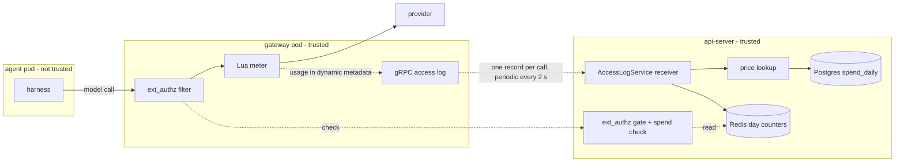
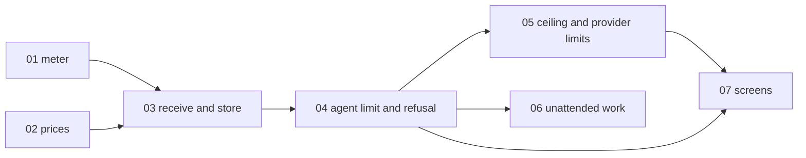

# Cost control: cap what agents and users spend

> Working plan — temporary, committed on the feature branch.
> Deleted once the feature ships.

**Issue:** [dam-agents/dam#3428](https://github.com/dam-agents/dam/issues/3428) (parent epic [#4032](https://github.com/dam-agents/dam/issues/4032), milestone "October 21")

**Research and decisions:** the research page "Agent Spend Limits", version 12 (<https://claude.ai/artifact/4k8Pvrfg2RQQn6fWj4w6hZ>).
It holds the 17 decisions (D1–D17), the test results, the IBM price list and the refusal tests.
This plan uses those results.
Do not do the research again.

## Goal

Today DAM shows spend after the fact, and only Claude Code reports a cost.
The agent can change or stop that report.
Nothing stops an agent that spends too much.

After this feature:

- DAM measures the spend of every model call in the agent's gateway, for every harness.
  The agent cannot change this number.
- The owner sets daily spend limits: for one agent, for all own agents together, and for one provider Connection of an agent.
  At a limit, the gateway refuses the next model call, and DAM asks the owner "continue?".
  "Continue" adds one more limit amount for today.
- The operator sets a spend ceiling for each user.
  At the ceiling, the gateway refuses the next model call and asks nothing.
- At a limit or the ceiling, schedules do not fire and sub-agents do not start.
  The chat send button stays, and the error text tells the user what to do.
- The screens show the metered spend next to each limit, with a colour warning at 80%.

## Approach

Read these architecture pages first: [credential-gateway](../../architecture/credential-gateway.md), [security-and-credentials](../../architecture/security-and-credentials.md) (section "HITL ext_authz"), [metrics](../../architecture/metrics.md), [budgets](../../architecture/budgets.md), [invocations](../../architecture/invocations.md), [schedules](../../architecture/schedules.md).

### Trust model

The meter and the limit check run only in parts that the agent cannot change: the agent's gateway (Envoy) and the api-server.
No part of this feature runs in the agent pod.
The spend that a harness or an in-pod component reports stays for display only.
ADR-100 (slice 01) records this decision.

### The flow of one model call

1. The harness sends a model call through the gateway, as today.
2. On a model-provider chain, a small Lua filter gives the call a call id that the agent cannot set.
   It puts the id in a request header for the gate, and the chain removes that header before the provider.
3. The ext_authz gate in the api-server checks the limits for the call (slices 04 and 05).
   If a limit is reached, the gate refuses the call with the refusal for its API path.
   If not, the gate notes that the call started (slice 03), and the call continues.
4. The gateway removes `accept-encoding`, so the provider sends a reply that is not compressed.
5. The Lua meter reads the usage in the reply.
   It does not change the reply.
   It writes the counts into the stream's dynamic metadata.
6. A gRPC access log sends one record per call to a new AccessLogService on the api-server's ext-authz port.
   While a call runs, it also sends a periodic record every 2 seconds.
7. The api-server finds the agent, the root driver, the owner and the Connection.
   It prices the call at once, and it adds the cost to the Postgres rollup and the Redis day counters.
   A final record replaces the periodic records of the same call.

### Identity

- **The agent:** the gRPC `:authority` of the access-log stream is the agent's own ext-authz Service host.
  The ext_authz server already finds the agent this way, and the mesh policy lets only that agent's gateway call it.
- **Who pays:** the root driver (D6).
  A sub-agent's spend counts for its root driver and that driver's owner.
  The gateway already knows this id as the attribution id that the controller renders.
  The meter puts it in each record, so a record that arrives after an Invocation target was deleted still has a payer.
- **The Connection:** the address header (`x-platform-conn`) when the request names one.
  Otherwise the one Connection of the agent's grants whose host matches.
  The meter copies the address header into the record, because the chain removes the header before the provider.

### Units and provider rules

Each Connection has one unit.
The unit comes from the Connection's provider template.

| Provider template                               | Unit                                                 | In the agent limit, own limit and ceiling? |
| ----------------------------------------------- | ---------------------------------------------------- | ------------------------------------------ |
| `anthropic`, `openai`, `bedrock`, `ibm-litellm` | `usd`                                                | yes                                        |
| `anthropic-oauth` (Claude subscription)         | `usd_list` (list-price dollars, a value, not a bill) | no, only in its Connection limit           |
| `bob`                                           | `bobcoin` (from `usage.credits` in each reply)       | no, only in its Connection limit           |
| `curve-bender`                                  | `free` ($0)                                          | no limit applies                           |
| `custom-header` and others                      | not metered in this feature                          | —                                          |

`rits/*` models on IBM LiteLLM cost $0 (D14).
The gate cannot see the model, because it does not read the request body.
So at a dollar limit, the gate also refuses calls to $0 models on a paid Connection.
This is a known limit.

### Price lookup (D13)

The api-server prices each call when the record arrives, and it stores that cost.
A later price change does not change the history or a limit.
The first match wins:

1. **Operator override** for the provider and model, from Helm.
   The chart ships the IBM LiteLLM prices that we read from IBM's `/model/info` on 2026-10-13 (input, output, cache read, 5-minute and 1-hour cache write).
2. **Provider rule:** RITS models and Curve Bender cost $0.
   Bob uses the Bobcoins in the reply.
   The Claude subscription uses list prices, in the unit `usd_list`.
3. **Generated table** in the api-server's code.
   A script makes it from a pinned commit of the LiteLLM price list.
   Petr reviews each table update.
4. **Unknown model:** the highest price of the model's family, marked "estimated".

The table has these prices: input, output, cache read, cache write for 5 minutes, cache write for 1 hour, the higher prices above 200k and 272k input tokens, the flex and priority tiers, and a price per web search.
For IBM, the values of the tier fields and the long-prompt prices were not recorded.
For these, the lookup uses the list price from the generated table.
This counts high, as D10 asks.

When a reply carries the proxy's cost header (`x-litellm-response-cost`), the api-server compares it with our cost.
A difference above 5% gives a warning in the log with the provider, the model and both costs.

### Missing usage (D10)

DAM counts high and marks the cost "estimated":

- **A stream that stopped early:** keep the counts that the meter has.
  Estimate the output tokens from the reply size.
- **A reply with no usage:** estimate the tokens from the reply size.
- **A call with no record at all:** the gate noted its start, but no record arrived.
  This happens when the api-server stops while calls run.
  After 60 minutes, the api-server counts it as the most expensive call of that agent on that Connection today.

### Ledger

- **Postgres `spend_daily`:** one row per UTC day, root agent, Connection and model.
  It keeps the cost in micro-units of the Connection's unit, the token counts, the web-search count, and the counts of calls, estimated calls and refused calls.
  It also keeps the most expensive single call.
  Rows have no foreign key to `agents`: the spend of a deleted agent still counts for its owner today.
- **Redis day counters:** fast totals for the gate, per agent, per owner and per agent and Connection, for today.
  When a counter is missing, for example after a Redis restart, the api-server rebuilds it from Postgres.
  Redis is required in DAM already.

### Limits (D2–D8, D15)

| Limit                                        | Set by                                                      | Unit                  | Kind                               |
| -------------------------------------------- | ----------------------------------------------------------- | --------------------- | ---------------------------------- |
| Agent limit                                  | owner                                                       | `usd`                 | soft: refuse, then ask "continue?" |
| Own daily limit (all own agents)             | owner                                                       | `usd`                 | soft                               |
| Connection limit (one agent, one Connection) | owner                                                       | the Connection's unit | soft                               |
| Spend ceiling (one user)                     | operator: Helm default (off) plus `UserSpendLimit` per user | `usd`                 | hard: refuse, no question          |

- The period is one UTC day.
- "Continue" adds one more limit amount for today: a $10 limit becomes $20, and DAM asks again at $20.
- The first limit reached stops the work.
  When the own limit is above the ceiling, the ceiling stops the work first.
  So DAM uses the lower of the two.
- At 80% of a limit, the meter on the screens changes colour.
  Nothing else happens at 80%.
- The agent can only read its limits, its spend and what is left.

### Refusal (by API path, never by harness)

One agent can run several harnesses, so the refusal shape follows the API path of each call.
The body is plain text.
It contains "Spend quota exceeded" and no digits, because Pi retries when the text contains "500" or "429".

| API path                                                                                                                  | Status | Headers                                                                                                    |
| ------------------------------------------------------------------------------------------------------------------------- | ------ | ---------------------------------------------------------------------------------------------------------- |
| Anthropic Messages (`…/v1/messages`), and Bedrock paths (not tested; Claude Code's Bedrock client reads `x-should-retry`) | 429    | `x-should-retry: false`, `retry-after: <seconds to UTC midnight, at least 61>`, `content-type: text/plain` |
| OpenAI Chat (`…/chat/completions`) and Responses (`…/responses`), Bob included                                            | 400    | `content-type: text/plain`                                                                                 |

The texts (`<brand>` is `config.brand.name`; never hardcode the brand):

- Soft limit: `Spend quota exceeded for today. The owner can approve more in <brand>.`
- Ceiling: `Spend quota exceeded for today. Ask the platform operator for a higher ceiling.`

The brand name must contain no digits.
If it does, leave the brand out of the text.

Codex and Pi end a refused turn with `end_turn`, so the platform cannot see the refusal in the stop reason.
The gate records each refusal itself: as a count in the ledger, and as a `spend_limit` approval for soft limits.

Free paths are never refused and never counted: model lists, `/v1/messages/count_tokens`, and the LiteLLM and Bob account paths.

### Relation to the Model Router (open PR #4620)

PR [#4620](https://github.com/dam-agents/dam/pull/4620) adds ADR-098: an in-pod Model Router.
Petr commented on the PR on 2026-10-13 ([comment](https://github.com/dam-agents/dam/pull/4620#issuecomment-6143304478)).
The agreed fit:

- The gateway meter gives the trusted totals for limits and for the meters on the screens.
- The router's record gives the spend per session, for display only.
- One price table, in the api-server.
- The router passes refusals through unchanged: the status, `x-should-retry`, `retry-after` and the body.
  The router code in #4620 does this already, and it does not retry.

The router sends its calls through the gateway, so the meter sees them.
If #4620 merges before slice 04, slice 04 also tests the refusal through the router.
A later ADR can move the per-session split to the gateway too.
That is not part of this feature.

### Contract (pinned for slices 04–07)

The new `spend` module in `packages/api-server-api` (`router.ts` plus browser-safe `schemas.ts`, noun-first schema names):

- `spend.status({ agentId? })`: today's state for the caller, or for one owned agent.
  - `day` (UTC date) and `resetsAt`;
  - `limits[]`: for each limit, its scope, unit, `amountMicros`, `extensions`, `effectiveMicros`, `spentMicros`, `leftMicros`, and `state` (`ok`, `warn` at 80% or more, `reached`);
  - `ceiling`: `amountMicros`, `spentMicros`, `state`, and its source (`default` or `UserSpendLimit`), or `null` when off;
  - `spent[]`: today's metered spend per unit, with the count of estimated calls.
- `spend.setLimit({ scope, amountMicros })`: set a limit, or remove it with `amountMicros: null`.
  `scope` is one of `{ kind: "agent", agentId }`, `{ kind: "owner" }`, `{ kind: "connection", agentId, connectionId }`.
  The unit follows from the scope.
  Slice 04 ships only the `agent` kind; slice 05 adds the other two.
- `spend.daily({ agentId?, from, to })`: metered spend per UTC day, payer agent and unit, with the count of estimated calls, for the meters.
  Slice 03 adds it, so that slice 03 can be verified.
- "Continue" uses the existing approvals router, so the existing UI and CLI actions work.
  Any allow action (`approveOnce`, `approvePermanent`, `approveHost`) on a `spend_limit` approval adds one extension.
  `dismiss` and `denyForever` leave the limit reached.
- New approval type `spend_limit`, with no hold.
  Its payload names the limit id, the scope, the unit, the day, the limit amount and the number of extensions when DAM asked.
  There is at most one pending question per limit, day and extension count.
  So after "continue", DAM asks again at the next level, and after "dismiss", it does not ask again that day.
  The question expires at the next UTC midnight.

Amounts are integers in micro-units of the unit, like the existing `cost_usd_micros`.

### Module shape (`/typescript-engineering`)

- A new bounded context `spend` in `packages/api-server/src/modules/spend/`: the price lookup and the limit rules in `domain/`, the ingest, status and limit services in `services/`, Postgres and Redis adapters and the `UserSpendLimit` reader in `infrastructure/`.
- Other modules reach it only through ports that `bootstrap.ts` wires, as the existing gates do:
  - the ext_authz gate (approvals module) gets a spend-check port;
  - the scheduler gets a hold gate, like `onboardingPending`;
  - Invocations spawn gets an admission check, like `targetAdmission`.
- The approvals module owns the `spend_limit` rows.
  The spend module learns about "continue" from the existing `ApprovalResolved` event, through a saga.
- The AccessLogService lives beside ext_authz in `packages/api-server/src/apps/ext-authz/`, and it calls the spend ingest service.

### Out of scope

- Hold and ask (the gateway waits for a person).
- The Usage page on the metered number (a later issue).
- Spend per session for every harness.
- The gateway reading traffic that uses the agent's own API key.
- Questions to owners in Slack.
- Limits as a share of the Claude subscription's usage window.
- An owner-wide limit per Connection, across all agents.
  The data model allows it, but no screen sets it.

### Known limits (for the docs and the PR)

- During the upgrade, each agent's gateway restarts one time.
  Replies in progress at that time stop.
- A call that already streams continues to its end after a limit.
  The worst case for one Opus 5.5 call is $6.56 at list price, or $10.56 with a 1-hour cache write of all input.
  Parallel sub-agents multiply this.
- When the api-server is down, new model calls are refused, because the gate fails closed.
  Calls that were already running can lose their final record.
  The api-server then estimates them.
- A runaway task on a $0 RITS model is not stopped by a spend limit (D14).

## Sub-issues

| #   | Title                                                                      | Scope                                                                                                                                               | Depends on |
| --- | -------------------------------------------------------------------------- | --------------------------------------------------------------------------------------------------------------------------------------------------- | ---------- |
| 01  | [Gateway meter and ADR-100](./01-gateway-meter.md)                         | Controller: model-provider chains, call id, Lua meter, `accept-encoding` removal, gRPC access log with periodic flush. ADR-100.                     | —          |
| 02  | [Price table](./02-price-table.md)                                         | Pure price lookup, generator from a pinned LiteLLM commit, Helm overrides with IBM prices, IBM `/model/info` script, cost-header check function.    | —          |
| 03  | [Receive, price and store usage](./03-receive-and-store.md)                | AccessLogService, identity, Connection, periodic-to-final deltas, pricing at ingest, `spend_daily` and Redis counters, estimates, clean shutdown.   | 01, 02     |
| 04  | [Agent limit, refusal and "continue?"](./04-agent-limit-and-refusal.md)    | Limit tables, `spend` router, gate refusal per API path, `spend_limit` approval, continue, chat error rule, CLI `dam spend`, harness refusal tests. | 03         |
| 05  | [Ceiling, own limit, provider limits](./05-ceiling-and-provider-limits.md) | `UserSpendLimit` CRD and Helm default, own daily limit, Connection limits in their units, ceiling refusal, CLI flags.                               | 04         |
| 06  | [Stop unattended work, agent read](./06-unattended-work.md)                | Schedule holds, sub-agent spawn refusal, read-only MCP tool.                                                                                        | 04         |
| 07  | [Screens](./07-screens.md)                                                 | Limit fields and meters in the agent page, Providers section, Settings and Home; approval card text.                                                | 04, 05     |

01 and 02 do not depend on each other.
Implement the slices in number order.
06 needs only 04, but it uses the blocked check of the spend module, so it also sees the limits that 05 adds.

## Conventions & glossary

**Words** (new; add them to [`docs/ubiquitous-language.md`](../../ubiquitous-language.md) in a new "Spend Limits (bounded context)" section, in the slice that ships the code):

- **Metered Spend:** the spend that the gateway meter measured and the api-server priced.
  Trusted.
  Different from Spend under Metrics, which the agent reports.
- **Spend Limit:** a daily maximum that the owner sets, for an agent, for all own agents, or for an agent's Connection.
  Soft: refuse, then ask "continue?".
- **Spend Ceiling:** the operator's daily maximum for one user.
  Hard: refuse, no question.
- **UserSpendLimit:** the Kubernetes object that sets one user's Spend Ceiling, like UserBudget.
- **Extension:** one "continue" for one limit on one day.
- **Refusal:** the gateway stops a model call because a limit is reached.

Do not use "Budget" or "Ceiling" alone: they mean CPU and memory.
Do not use "Usage" for money: it means activity analytics.
"Hard Stop" means that a user stops an agent.

**Skills to apply:**

- `/typescript-engineering` for all server-side TypeScript (api-server, contract, CLI).
- `/react-ui-engineering` for `packages/ui` (slices 04 and 07).
- `/adr` for ADR-100 (slice 01).
- `cluster-ops` for the dev cluster smoke tests.

**Repo rules:**

- Use `mise run` for every build, check, test and cluster step.
  Never call `go`, `pnpm`, `helm` or `kubectl` directly.
- Do not add new tests.
  Verify with the existing suite (`mise run check`, `mise run test`) and the manual smoke test of each slice.
  You may update existing tests that a change breaks, for example a filter-order assertion.
- Code has no prose comments.
  Follow [`docs/guidelines/comment-guidelines.md`](../../guidelines/comment-guidelines.md), and run `mise run check:comment-types`.
- Each slice updates the architecture pages that its behavior changes, in the same commit.
  Follow [`docs/guidelines/documentation-guidelines.md`](../../guidelines/documentation-guidelines.md): one sentence per line, `Last verified:` bumped, no file paths or field names, no links to ADRs.
- Never hardcode the brand in code or copy.
- The migration number: run `mise run //packages/db:generate`.
  It takes the next free number.
  On 2026-10-13 main had 0069, and open PR #4710 claims 0070.
- After a rebase, rebuild every image before a cluster test (`cluster-ops`).

**Dev cluster:** `http://localhost:4444` (http, not https).
Use `mise run cluster:kubectl`, never bare `kubectl`.
On a production cluster, never print env values, Secrets or ConfigMaps (see `AGENTS.md`).

## Whole-feature smoke test

On the dev cluster, after all slices, with images rebuilt from the branch:

1. Create or use an agent with an IBM LiteLLM Connection (Claude Code) and a second agent with Pi on the same Connection.
2. `dam spend status <agent>`: no limits, and today's metered spend.
3. Send one prompt to each agent.
   `dam spend status` shows a non-zero metered spend within a few seconds.
   It is close to the cost that Claude Code reports for the same turn (they will not be equal).
4. `dam spend limit set <agent> --usd 0.01`.
   Send a prompt.
   - Claude Code shows the soft refusal text after one try.
   - Pi on the second agent with its own limit shows the same text after one try.
   - Home shows a "continue?"
     card for each agent.
5. Click "Continue" on the card.
   The limit becomes $0.02 for today, and the next prompt works.
6. Create a schedule for a limited agent that fires in one minute.
   With the limit reached, the fire is held with the reason "spend limit".
7. From the limited agent, ask it to spawn a sub-agent.
   The spawn is refused with a clear reason.
8. Apply a `UserSpendLimit` with a ceiling below today's spend.
   The next call is refused with the ceiling text, and no card appears.
9. Ask the agent to read its spend limits with the MCP tool.
   It sees the limits, the spend and what is left, and it cannot change them.
10. In the UI: the agent page, the Providers section, Settings and Home show the metered spend, the limits, and the colour at 80% and at 100%.
11. Restart the api-server during a long Claude Code reply.
    After 60 minutes, or after a shortened threshold in a test build, the call appears as "estimated".

## Delivery

Each sub-issue is one atomic commit.
The whole feature lands as a single PR for [#3428](https://github.com/dam-agents/dam/issues/3428).
Before the PR is ready, `/implement-feature` deletes `docs/plan/3428-cost-control/` in a last commit.
