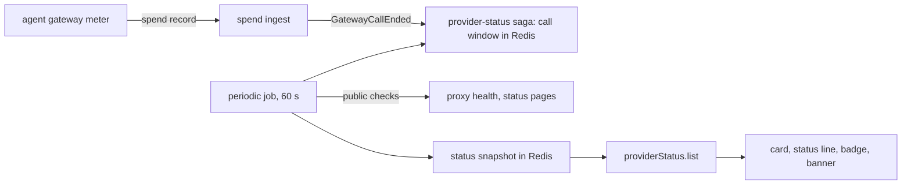

# Users see when a model provider is down

> Working plan — temporary, committed on the feature branch.
> Deleted once the feature ships.

**Issue:** [dam-agents/dam#4253](https://github.com/dam-agents/dam/issues/4253)

## Goal

When a model provider fails, users think that DAM is broken.
They check their own setup, retry, and then ask the team.
This feature tells the user, in the product, that a provider has a problem, since when, and that their setup is not the cause.

The user sees it in four places:

- **The failed turn** names the outage, with Retry, Switch provider and the raw error (the mockup in the issue comment).
- **A status line** above the message box, while the session's provider has problems, also during a running turn.
- **A "Degraded" badge** on the provider row in Settings › Providers.
- **A banner** at the top of the main area, for users who have a Connection to the failing provider.

Curve Bender and IBM LiteLLM must work.
Anthropic, OpenAI and Bob are nice to have; they get a public status source as well.
AWS Bedrock and the platform's own LLM provider get only the gateway signal.

## Decisions

Decisions that Petr made while this plan was discussed:

| #   | Decision                                                                                                                                                                                                                           |
| --- | ---------------------------------------------------------------------------------------------------------------------------------------------------------------------------------------------------------------------------------- |
| D1  | Must work: Curve Bender and IBM LiteLLM. Nice to have: Anthropic, OpenAI, Bob. Bedrock and the platform provider: gateway signal only.                                                                                             |
| D2  | Detection is automatic. No manual outage flag for the operator.                                                                                                                                                                    |
| D3  | The main signal is the failed calls that the agents' gateways see. Public status sources are a second signal.                                                                                                                      |
| D4  | No check with each user's key. An outage belongs to the provider; one check serves every user, and a test call per user adds load to a provider that already fails.                                                                |
| D5  | The UI polls the status every 60 seconds, and also on window focus and after a failed turn. No live event: the status changes at most once a minute.                                                                               |
| D6  | The banner follows the design agreed while planning (described in slice 05): the `Notice` primitive at the top of the main area, not the fixed bottom bar of `ConnectionBanner`.                                                   |
| D7  | The banner does not show in the chat view, where the status line covers the session's provider. It shows only to users with a Connection to the failing provider.                                                                  |
| D8  | The page reload gap (a failed turn without reply text shows no error after a reload) stays with #3761.                                                                                                                             |
| D9  | The plan does not edit `model-indicator.tsx` or `session-projection.ts`, because open pull requests change them (#5389, #5402, #5393).                                                                                             |
| D10 | The card follows the mockup: a provider error shows the red card in the agent's column, also when nothing streamed. Copy text and Delete move into a "⋯" menu on the card.                                                         |
| D11 | A proxy is unreachable only after its readiness check fails in two runs in a row; the outage starts at the first failed run. The count of failed runs lives in the Redis snapshot.                                                 |
| D12 | A reply that holds only the harness's copy of a provider error (Claude Code) is the failure: the chat hides the copy and shows the card as "Send failed:" with Retry; the prompt stays, and Retry sends it again as a new message. |

Decisions made alone while planning (open for review):

| #   | Decision                                                                                                                                           |
| --- | -------------------------------------------------------------------------------------------------------------------------------------------------- |
| O2  | The thresholds in [Detection](#detection) are constants in the domain, not Helm values. They can move to Helm when an operator needs to tune them. |
| O3  | The status is kept per Connection template, not per model. A provider with one broken model shows as degraded when most calls use that model.      |

## Approach

The new api-server module `provider-status` owns the status of each model provider.
Read [spend-limits](../../architecture/spend-limits.md) (the meter and its records) and [credential-gateway](../../architecture/credential-gateway.md) first.
Slice 01 writes the new architecture page `docs/architecture/provider-status.md`; later slices extend it.



### Signals

1. **Failed calls that the gateway sees (slice 01).**
   Every model call goes through the agent's gateway, and the meter sends a record for each call to the api-server ([spend-limits § The record](../../architecture/spend-limits.md)).
   The record names the Connection template of the call, the payer agent, the reply status code and whether our own ext_authz gate refused the call.
   The meter sets these facts on the request, so a call whose upstream connection fails still sends a record with its template.
   The spend ingest drops a failed call without usage, so the spend module emits a domain event for every final record before it measures the call.
2. **Public status sources (slice 02).**
   A periodic job reads, with no key: `/health/readiness` of the two LiteLLM proxies (Curve Bender, IBM LiteLLM), the Statuspage components of Anthropic and OpenAI, and Bob's own status API.
   `/health/readiness` shows only that the proxy and its database run, not that the models answer.
   So for Curve Bender and IBM LiteLLM it can say "unreachable", never "healthy models".

### Detection

The module keeps a window of the last 5 minutes per Connection template, in 1-minute buckets in Redis.

- **A failed call:** a final record with status 500, 502, 503, 504 or 529.
- **Not counted:** periodic records, records that our gate refused, records with no status (the harness closed the call), and records that name more than one template.
- **Degraded:** in the window, at least 3 failed calls, at least half of all calls failed, and at least 2 agents failed or every agent that called the provider failed.
- **DAM side:** at least 2 templates had calls in the window, every one of them is degraded by its failed calls, and at least 2 agents had failed calls.
  Then the problem is on the DAM side, and no provider is blamed.
- **Public sources (slice 02):** a proxy that is unreachable, or a status component in `partial_outage` or `major_outage`, marks the template degraded.
  A proxy that the api-server cannot reach gives no signal while the agents' calls to it succeed in the window, because their path can differ.
  `degraded_performance` and the overall page indicator do not count: OpenAI's overall indicator also counts products that DAM does not use.
  A source that does not answer gives no signal, never "degraded".
- **Since:** the time when the template first became degraded; it stays until the template is no longer degraded.

The periodic job `provider-status-evaluate` runs every 60 seconds in one replica (BullMQ).
It reads the call windows (and, from slice 02, the public sources), computes the states with their start times, and writes one snapshot to Redis with a 3-minute expiry.
`providerStatus.list` reads only the snapshot, so a request never calls a provider.

### The contract

`packages/api-server-api/src/modules/provider-status/` (browser-safe `schemas.ts`, `types.ts`, `router.ts`), mounted as `providerStatus` in the root router:

```ts
type ProviderOutageReason = "failing-calls" | "unreachable" | "provider-reported";

interface ProviderOutage {
  templateId: string; // Connection template, e.g. "curve-bender", "anthropic-oauth"
  reason: ProviderOutageReason;
  since: string; // ISO time
  statusPageUrl: string | null; // public page, slice 02
}

interface ProviderStatusView {
  damSide: { since: string } | null;
  outages: ProviderOutage[]; // only templates with a problem
  checkedAt: string | null; // null when no snapshot exists
}

// providerStatus.list: readAgentProcedure query, no input → ProviderStatusView
```

A template that is not in `outages` is healthy or unknown; the UI shows nothing for it.
The UI maps a template to its provider name with `providerTypeForTemplateId` and `PROVIDERS[type].displayName`.

### The event

`packages/api-server/src/events.ts` gets `GatewayCallEnded`:

```ts
type GatewayCallEnded = {
  type: EventType.GatewayCallEnded;
  payer: string; // root agent that pays for the call
  providers: readonly string[]; // Connection templates the meter named
  status: number | null;
  refusedByGate: boolean;
  endedAt: Date;
};
```

The spend module emits it in `spend-ingest.ts` for each final record.
The `provider-status` module subscribes in a saga.
No module imports another module's internals.

## Sub-issues

| #   | Done | Title                                                             | Scope                                                                                                          | Depends on |
| --- | ---- | ----------------------------------------------------------------- | -------------------------------------------------------------------------------------------------------------- | ---------- |
| 01  | ☑    | [Status from failed gateway calls](./01-gateway-call-outcomes.md) | Event, `provider-status` module, call window, evaluate job, snapshot, `providerStatus.list`, architecture page | —          |
| 02  | ☑    | [Public status sources](./02-public-status-sources.md)            | Proxy readiness, Statuspage components, Bob status, status page links                                          | 01         |
| 03  | ☑    | [The failed turn names the outage](./03-failed-turn-card.md)      | UI status query, provider error kind, card text and actions, refresh after a failed turn                       | 01         |
| 04  | ☑    | [Status line and Providers badge](./04-status-line-and-badge.md)  | Status line above the message box, "Degraded" badge in Settings › Providers                                    | 03         |
| 05  | ☐    | [Outage banner](./05-outage-banner.md)                            | `Notice` danger tone, banner at the top of the main area in both layouts, close per outage                     | 03         |

After 01, slice 02 and the UI slices 03–05 do not depend on each other; 04 and 05 reuse the status query of 03.

## Conventions & glossary

- **Provider Status:** the platform's view of whether a model provider answers, per Connection template: healthy (not listed), degraded, or DAM side.
  Slice 01 adds the term to `docs/ubiquitous-language.md`.
- **Outage:** one degraded period of one template, named by its template and its start time.
  The banner's close button hides one outage, not the provider.
- Server-side TS: apply `/typescript-engineering`.
  The module has `domain/` (pure rules), `infrastructure/` (Redis, HTTP), `services/`, `sagas/`, `compose.ts` and `index.ts`; other modules see only `index.ts`.
- UI: apply `/react-ui-engineering`.
  The status is server state: it lives only in the TanStack Query cache.
  The banner's closed outages are per-viewer browser state (`readPersistedFlag` / `writePersistedFlag` in `packages/ui/src/lib/persisted-prefs.ts`).
- Reuse primitives; take no new sizes or colours: `Notice`, `Callout`, `Badge`, `Disclosure`, and the look of `PermissionStatusLine`.
- Texts use `getBrand().name` for the product name; never write the brand in code.
- No new tests (Petr's rule); verification is the existing suite and the smoke tests.
- Comments follow `docs/guidelines/comment-guidelines.md`; run `mise run check:comment-types`.

## Wording

`{Provider}` is the provider's display name; `{time}` is the start time in the viewer's local time.

| Place                   | State                     | Text                                                                                                                                           |
| ----------------------- | ------------------------- | ---------------------------------------------------------------------------------------------------------------------------------------------- |
| Card, title             | provider error, status OK | Send failed: {Provider} didn't respond.                                                                                                        |
| Card, hint              | provider error, status OK | Your message was saved. Retry in a few minutes. If it keeps failing, switch this agent to a different provider.                                |
| Card, title             | degraded                  | Send failed: {Provider} has had problems since {time}.                                                                                         |
| Card, hint              | degraded                  | Your setup is not the cause. Your message was saved. Retry when it works again, or switch this agent to a different provider.                  |
| Card, title             | DAM side                  | Send failed: {brand} cannot reach model providers.                                                                                             |
| Card, hint              | DAM side                  | The problem is on {brand}'s side, not with {Provider} or your setup. Your message was saved.                                                   |
| Card, hint              | recovered (was degraded)  | {Provider} works again. Retry now.                                                                                                             |
| Card, interrupted reply | any                       | The title starts with "Response interrupted:" instead of "Send failed:".                                                                       |
| Status line             | degraded, turn running    | {Provider} is not responding — the agent keeps trying.                                                                                         |
| Status line             | degraded, idle            | {Provider} has had problems since {time} — messages may fail.                                                                                  |
| Status line             | DAM side                  | {brand} cannot reach model providers since {time}.                                                                                             |
| Providers badge         | degraded or DAM side      | Degraded                                                                                                                                       |
| Banner, lead            | one provider              | {Provider} is not responding.                                                                                                                  |
| Banner, body            | one provider              | Since {time}, most calls to it fail. Agents that use it can fail until it recovers. Your setup is not the cause.                               |
| Banner, lead            | several providers         | {n} of your providers have problems: {Provider}, {Provider}.                                                                                   |
| Banner, body            | several providers         | Since {time}. Agents that use them can fail. Your setup is not the cause.                                                                      |
| Banner, lead            | DAM side                  | {brand} cannot reach model providers.                                                                                                          |
| Banner, body            | DAM side                  | Since {time}, calls to every provider fail. The problem is on {brand}'s side, not with your providers or your setup.                           |
| Banner, actions         | any                       | "View providers" (Settings › Providers); "{Provider} status" when a status page exists; close button labelled "Hide until the status changes". |
| Card, actions           | provider error            | "Retry" (only where a resend exists), "Switch provider" (the agent's Providers section), "Raw error" (expands the original text).              |

## Known limits

- The status is per Connection template, not per model (O3).
- A new outage shows after up to about 2 minutes: the 1-minute buckets, the 60-second job and the 60-second poll.
- A public status page often reports late, and a proxy's readiness does not see its models.
- If the api-server cannot reach a public status page (network policy outside the chart), that source gives no signal.
- Slack and Telegram replies do not name the outage; that is a follow-up.

## Whole-feature smoke test

On the dev cluster, after all slices, with every image rebuilt (`cluster:build-*`) and the chart redeployed:

1. Bind two agents to IBM LiteLLM and one to the Claude subscription.
2. Turn the IBM VPN off: IBM LiteLLM calls now end with 503 at the gateway.
   Send a message to both IBM LiteLLM agents.
3. Within about 2 minutes:
   - the failed turn shows the degraded card with "since {time}", Retry, Switch provider and Raw error;
   - an open session on IBM LiteLLM shows the status line;
   - Settings › Providers shows "Degraded" on IBM LiteLLM;
   - Home shows the banner; the chat view does not.
4. Close the banner; reload; it stays hidden.
5. Turn the VPN on and send again; within about 6 minutes the badge, the status line and the banner go away, and the card shows "works again".
6. Send to the Claude subscription agent during step 3: no outage text appears for it, and the state is not "DAM side", because one provider with calls still works.
7. DAM side: send only to agents on two providers that both fail (for example IBM LiteLLM and Curve Bender with the VPN off, if Curve Bender also needs the VPN), with no other model traffic for 5 minutes.
   The state becomes "DAM side": the danger banner and the DAM-side card show, and no provider is blamed.

## Delivery

Each sub-issue is one atomic commit.
The whole feature lands as a single PR for [dam-agents/dam#4253](https://github.com/dam-agents/dam/issues/4253).
