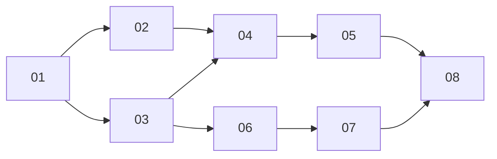

# Mid-turn messages reach the agent on every harness

> Working plan — temporary, committed on the feature branch.
> Deleted once the feature ships.

**Issue:** https://github.com/dam-agents/dam/issues/4474

## Goal

A message that a person sends while the agent works must reach the running work on every harness and on every surface.
The harnesses are Claude Code, Codex, Pi, Bob and Copilot.
The surfaces are the web UI, Slack, Telegram and messages between sessions.

Today this works only in part:

- In the web UI, only Claude Code and Codex take a message into the running turn.
  On Pi, Bob and Copilot, the message waits until the turn ends.
- In Slack and Telegram, no harness takes a message into the running turn, Claude Code included.
  Each follow-up waits and runs as its own new turn.
- The web UI never shows **Send now** on a queued message.

The last two are a regression from 2026-10-15.
The lease router now answers a client's `initialize` from the manifest, and that answer has no steering flag.
That part of the router is deliberate: no harness process starts only to answer `initialize`.
The lost flag is not deliberate: the manifest copy keeps only `agentCapabilities`, `authMethods` and `agentInfo`, and the steering flag is in the top-level `_meta`.
This plan keeps the router's `initialize` answer as it is and gives each surface the steering signal in another way.

After this feature, a correction reaches the agent at its next steer point, on every harness and every surface.

## Decisions

These answer the issue's open questions and the questions that came up while the plan was made.

- **Pi:** the platform carries the steering change in its existing pi-acp patch, with a guard that upstream PR svkozak/pi-acp#115 does not have.
- **Bob and Copilot:** the platform steers for them by **interrupt and continue**: at a steer point it cancels the harness's turn and sends the waiting messages as a new prompt, as one turn for every client.
- **Safe point:** the steer point, the moment the agent neither writes nor runs a tool.
  Interrupt and continue never cuts on a timer, because a cancel can stop a running tool.
- **What is kept:** the harness keeps its finished tool calls and their results; this was tested on Bob and Copilot.
  Bob needs a patch so that a cancel during its context compaction does not wipe its history (06).
- **Interrupt or queue:** the same on every harness.
  A message sent while the agent works joins at the next steer point.
  **Send now** sends it at once and accepts the cut.
  A queued message stays editable until it joins, which is now often seconds, not the rest of the turn.
- **What the person sees (user story 2):** the message shows inside the running work, and the reply shows no "Stopped" mark, no error and no step marked failed.
  There is no extra label; this is how Claude Code shows a steer today.
  The **Send now** tooltip says what it does on that harness.
- **Pi and Codex** read a steered message at their next model request, so one more step on the old instruction is possible.
  Only Stop stops at once.
- **Steering value:** the manifest key is the session's value, known before any harness process runs; the live `initialize` answer only gates the runtime's own native steer (decided during implementation, 2026-10-27).
- **Slack and Telegram** follow the same steering rules as the web UI, which is the user-visible goal of #4475.
  Follow-ups merge into the running turn again, as they did before 2026-10-15.

## Facts this plan rests on

Each fact was checked against the pinned versions on `main`, in code or on running agents.

| Harness     | Bridge (pin)            | Steers over ACP today?                                                                                                                    | How this plan makes it steer                                        |
| ----------- | ----------------------- | ----------------------------------------------------------------------------------------------------------------------------------------- | ------------------------------------------------------------------- |
| Claude Code | claude-agent-acp 0.94.0 | Yes. It stops the current generation and continues with the message; a running foreground tool moves to the background and keeps running. | Native.                                                             |
| Codex       | codex-acp 2.1.1         | Yes. Codex reads the message at its next model request. With no running turn it starts a hidden turn from the steer.                      | Native, plus one codex-acp patch edit against the hidden turn (02). |
| Pi          | pi-acp 0.0.34           | No. Pi 1.3.0 has a `steer` RPC that pi-acp does not expose.                                                                               | Native, through new edits in the pi-acp patch (02).                 |
| Bob         | bob 2.0.6               | No. Its ACP server refuses a second prompt during a turn.                                                                                 | Interrupt and continue (06, 07).                                    |
| Copilot     | copilot 1.0.96          | No. Its ACP server is native code with no steering method; a second prompt cancels the running turn.                                      | Interrupt and continue (08).                                        |

Tested on running agents:

- Codex: a mid-turn web UI prompt was steered at the next steer point, and the agent obeyed it in the same turn, one model step late.
- Bob and Copilot: a `session/cancel` sent right after a tool call finished ended the turn at once, with no stray output, and the next prompt still knew the finished tool's output.
- The client-visible `initialize` answer has no steering flag, on a Codex agent and on a Claude Code agent.

Read in code:

- Bob runs its automatic context compaction right after a tool batch, which is the steer point.
  A cancel during compaction makes Bob replace the whole history with an empty summary.
  Stop has the same bug today.
- Bob runs tool calls of different permission classes one after another, so the moment between two of them looks like a steer point.
- Copilot refuses a new prompt for a moment while it finishes a cancel ("the previous turn is still being cancelled").
- Copilot leaves a tool call that a cancel cut as `pending`; Bob reports it `failed`.
  The UI shows `failed` in red.
- Only Claude Code has a session history provider.
  After a cold load, Bob, Copilot, Codex and Pi rebuild the log from the harness's own replay, so the harness's view of a turn shows there.
- Both channel steer frames tell the agent "answer everything in one reply rather than replying more than once", and Slack counts a turn as answered when any message of it got a post.
  Together they let a follow-up that lands after the agent's reply go unanswered.
- The relay stamps the signed-in person as sender only on `session/prompt`, `platform/updateQueued` and `platform/rewriteFrom`.
- Boot recovery resumes a stored session with a notice only; it never sends a prompt kept in the active-turn record.

## Acceptance criteria

Copied word for word from the issue's **Done when**.
The criterion that uses Telegram is checked by hand, because the QA agent tests through the web UI, Slack and GitHub.

### AC-1 — a mid-turn message reaches the running work

Given the owner signed in, in a chat whose Harness is Codex, Pi, Bob or Copilot, where the agent runs the three-command task: three commands one at a time, waiting for each, each `sleep 30` and then printing ALPHA, BRAVO or CHARLIE, and then a list of the printed words
When the owner sends "Change of plan: run no more commands, reply only DONE" while the first command runs
Then within one minute after that command ends, the message leaves "Queued" and shows in the conversation while the agent still works

### AC-2 — the agent follows the new instruction in the same work

Given the message from AC-1
When the agent stops working
Then its last words are DONE, and no step after the message prints CHARLIE

### AC-3 — an added request keeps the original task

Given the owner signed in, in a chat whose Harness is Bob or Copilot, where the agent runs the three-command task of AC-1
When the owner sends "Also tell me today's date" while the first command runs
Then within three minutes the agent's reply has ALPHA, BRAVO, CHARLIE and today's date

### AC-4 — the interrupted work shows no failure

Given the conversation from AC-2 or AC-3 on Bob or Copilot
When the agent stops working
Then the conversation shows no "Stopped" mark, no error and no step marked failed

### AC-5 — Send now sends a queued message at once

Given the owner signed in, in a chat whose Harness is Claude, Bob or Copilot, where the agent runs `sleep 120`, and a second message that shows "Queued"
When the owner clicks "Send now" on that message
Then within ten seconds the message shows in the conversation while the agent still works

### AC-6 — a Slack follow-up joins the running work

Given an agent connected to a Slack channel, whose default Harness is Claude, Codex, Pi, Bob or Copilot, and a person who mentioned the agent there and asked it for the three-command task of AC-1
When the person replies in that thread while the first command runs, mentions the agent, and writes "Skip the other commands and reply only DONE"
Then within three minutes the agent's reply in that thread says DONE and does not contain CHARLIE

### AC-7 — a late Slack follow-up still gets an answer

Given an agent connected to a Slack channel, and a person who mentioned the agent there and asked it to post READY in the thread, then run `sleep 60`, then post nothing more
When the person replies in that thread after READY appears and while the wait runs, mentions the agent, and asks "What is 17 times 3?"
Then within five minutes the agent posts another reply in that thread that says 51

### AC-8 — a Telegram follow-up joins the running work (checked by hand)

Given an agent connected to a Telegram chat, whose default Harness is Claude, Codex, Pi, Bob or Copilot, and a person who asked it there for the three-command task of AC-1
When the person sends "Skip the other commands and reply only DONE" in that chat while the first command runs
Then within three minutes the agent's reply in that chat says DONE and does not contain CHARLIE

### AC-9 — a message from another chat joins the running work

Given the owner signed in, with chat A of an agent whose Harness is Bob running the three-command task of AC-1, and chat B of the same agent
When the owner asks the agent in chat B to send chat A the message "Change of plan: reply only DONE"
Then within two minutes chat A shows that message while the agent still works

### AC-10 — a scheduled run that the owner joins stays a success

Given the owner signed in, with a schedule of an agent whose Harness is Bob that runs the three-command task of AC-1, and its run open in the chat while it runs
When the owner sends "Also tell me today's date" while a command runs
Then after the run ends, the schedule shows the run as succeeded

## Approach

Read [sessions](../../architecture/sessions.md#prompt-delivery) and [channel turns](../../architecture/channel-turns.md) first.
They describe the steer point, the prompt scheduler, the queue, the channel queue and the delivery nudge that this plan changes.

### One place decides

The runtime's prompt scheduler is the one place that steers.
It already steers web UI prompts and messages between sessions.
This plan adds Slack and Telegram: the runtime serves a client's `_session/steering` request itself, through the same scheduler, and stops forwarding it to the harness.
So every surface follows the same rules: a steer waits for a steer point, waiting messages go as one batch, and each message reaches the agent once and in order.
The channel queue in the api-server keeps what is its own: the quiet period, the framing, reply targets, attachments, ambient rules and the delivery nudge.

### Two ways to steer

A harness's runtime manifest names its way in a new key, `steering: native | interrupt`.
The key is the session's steering value on every session result, so a client knows it before any harness process runs, as it knows `forks` from the manifest's copy of the harness's `initialize` answer.
A session result can come before the harness answers `initialize`: a load that the session-history provider fills, a hot `session/resume`, and a load served from the log do, on a waking agent and after every harness recycle.
On `native`, the runtime steers only when the harness's own `initialize` answer also says it can; a turn always starts after that answer, so this check cannot race.
A mismatch logs one warning, and **Send now** then answers that the agent cannot take a message mid-turn.
`test:harness-initialize-capabilities` checks `steering: native` against the live pinned harness, so an adapter upgrade that drops steering fails there.
Without the key, a harness steers natively when its own `initialize` answer says it can, and otherwise it does not steer; a mid-turn message then waits for the next turn, as today.

- **Native.** The runtime sends `_session/steering` to the harness, which adds the message to its running turn.
  Claude Code, Codex and Pi steer natively.
- **Interrupt and continue.** At a steer point, the runtime cancels the harness's turn.
  When the harness answers `cancelled`, the runtime sends the waiting messages as a new prompt, followed by a short `<turn-continued>` notice.
  For every client and every observer this stays one turn: the senders are answered when the last harness prompt ends, and no "Stopped" mark, no run failure and no cancelled outcome appear.
  Bob and Copilot steer this way.

On an interrupt harness, a steer point counts only when no tool call starts for a short quiet window after the last one settles, because Bob runs some tool calls one after another.

### Contract

The slices meet at these points.

- **Session results.** `session/new`, `session/load` and `session/resume` results carry `_meta.platform.steering: "native" | "interrupt"` when the session can steer, beside the existing `_meta.platform.forks`.
  The value is the manifest key; without the key, it is the harness's live `initialize` answer, when the harness has given it.
  The web UI shows **Send now** on an editable queued prompt only when the session has it, and words the tooltip by its value.
- **Router `initialize`.** The router's own `initialize` answer adds `_meta.platform.servesSteering: true`, beside `runEnded`.
  The api-server steers only against a runtime that says so; an older runtime forwards a steer raw to the harness.
- **`_session/steering`, served by the runtime.**
  The request is `{ sessionId, prompt, _meta: { steering: { idleBehavior: "promptRequired" }, platform: { promptId, targetPromptId } } }`.
  `promptId` names the steer batch and makes the request idempotent.
  `targetPromptId` names the turn that the steer may join.
  The answers are:
  - `{ outcome: "injected" }` once the batch joined the target turn and the harness took it;
  - `{ outcome: "promptRequired", reason }` when the target turn never runs, has ended, or ends before a steer point, or when the session runs on no lease (`reason`: `noRunningTurn` or `notYourTurn`);
  - JSON-RPC error `-32601` when the session runs a turn but its harness cannot steer.
    A repeated request with a `promptId` that the runtime has already answered gets the same answer again and changes nothing.
    The answer can take as long as the target turn runs.
    A steer that still waits in the queue is withdrawn when its connection closes; a steer already sent to the harness is always answered.
- **Steer-only entries** never start a turn, are never recorded as undelivered, and never get a turn's `stopReason` answer.
  Every way out of the queue other than `injected` answers them `promptRequired`.
  They show in the queue snapshot as not editable.

## Sub-issues

| #   | Title                                                                                              | Scope                                                                                                                               | Depends on | Done |
| --- | -------------------------------------------------------------------------------------------------- | ----------------------------------------------------------------------------------------------------------------------------------- | ---------- | ---- |
| 01  | [Clients see whether a session steers](01-clients-see-whether-a-session-steers.md)                 | The `steering` manifest key; `_meta.platform.steering` on session results; **Send now** per session.                                | —          | ✅   |
| 02  | [Pi steers, and Codex starts no hidden turn](02-pi-steers-codex-no-hidden-turn.md)                 | Steering edits in the pi-acp patch, with an answer that waits until Pi takes the message; one codex-acp patch edit.                 | 01         |      |
| 03  | [The runtime serves a client's steer](03-runtime-serves-a-clients-steer.md)                        | Steer-only entries with a target turn, idempotency and one disposal rule; relay stamp; router short-cut; `servesSteering`.          | 01         |      |
| 04  | [Slack and Telegram steer through the runtime](04-slack-and-telegram-steer-through-the-runtime.md) | The channel queue steers through the runtime with no deadline, never sends a steered batch again, and keeps thread supersede right. | 02, 03     |      |
| 05  | [A late follow-up gets an answer](05-a-late-follow-up-gets-an-answer.md)                           | Frame wording, the per-message answered rule, a nudge for unanswered follow-ups, Telegram logging.                                  | 04         |      |
| 06  | [Interrupt and continue, on for Bob](06-interrupt-and-continue-on-for-bob.md)                      | The interrupt steer and its restarting state; the notice; Bob's compaction patch; Bob set to `interrupt`.                           | 03         |      |
| 07  | [Send now cuts a running command](07-send-now-cuts-a-running-command.md)                           | Pending permission requests, the cut tool's look, the notice for a cut command, the process check.                                  | 06         |      |
| 08  | [Copilot steers, and the per-harness docs](08-copilot-steers-and-docs.md)                          | Copilot set to `interrupt` with its checks; the per-harness table in the docs; the whole-feature walk.                              | 05, 07     |      |

Implement the slices in number order.
02 lands before 04 so that channel steering never reaches a Codex without the hidden-turn fix.

## Conventions & glossary

- **Steer point:** the agent neither writes nor runs a tool, which is right after its tool calls finish.
  The runtime finds it from the harness's `tool_call` and output updates.
- **Native steer:** the harness adds the message to its running turn itself.
- **Interrupt and continue:** the runtime cancels the harness's turn at a steer point and sends the waiting messages as a new prompt, as one turn for every client.
- **Steer-only entry:** a queue entry from a client's `_session/steering` request.
  It joins its target turn or is declined; it never starts a turn of its own.
- **Restarting:** the turn state between the cancel and the moment the harness takes the new prompt.
  Every part of the runtime that reacts to a turn's end treats a restarting turn as running.

Apply `/typescript-engineering` to all server-side TypeScript: `agent-runtime`, `api-server`, `api-server-api`.
Apply `/react-ui-engineering` to the UI parts of 01, 06 and 07.
Follow [comment guidelines](../../guidelines/comment-guidelines.md), and run `mise run check:comment-types` after changing code.
Follow [documentation guidelines](../../guidelines/documentation-guidelines.md): one sentence per line, and update each touched architecture page's **Last verified** date.
`channel-turns.md` is near the page size cap, so keep its additions short.
Add the new terms (steer, steer point, interrupt and continue) to [`ubiquitous-language.md`](../../ubiquitous-language.md) in the slice that first uses them in code.
Never reference an ADR from code or docs.
Use `mise run` for every build, check, test and cluster step.

Do not add tests by default.
Verification is the existing suite (`mise run test`, `mise run check`) plus each slice's manual smoke test.
Change an existing test only where it encodes behaviour that a slice changes on purpose, and say so in the slice.
06 names one exception, for races that a manual smoke test cannot reach; ask Petr before you write it.

The pi-acp, codex-acp and Bob patches edit third-party bundles in memory at load time.
Each patch checks the exact pinned version and applies all its edits or none; its `check:*` task and its upstream-gap text change together.
Comment on or file upstream issues only with Petr's approval.

Manual smoke tests use the local cluster, built from this branch.
An ACP client script reaches an agent's socket at `ws://localhost:4444/api/agents/<id>/acp?token=…`, with a token from the Keycloak password grant (`dev`/`dev`, client `platform-ui`).
Run every agent in a mode in which shell commands need no permission prompt, because a pending permission is not a steer point.
Tell the agent to run commands one at a time and wait for each; otherwise a model can run independent commands in one step, and there is no steer point between them.

## Whole-feature smoke test

Run it after all eight slices, with images and the api-server built from this branch (`mise run cluster:build -- api-server ui agents`).
Use one agent per harness, an agent connected to a Slack channel and to a Telegram chat, and change its default Harness between runs.

1. **AC-1, AC-2.** In the web UI, run the three-command task on Codex, Pi, Bob and Copilot, and send the change of plan during the first command.
2. **AC-3, AC-4.** On Bob and Copilot, run the task again and send "Also tell me today's date" during the first command.
   Reload the chat after the agent stops, and check that the conversation still shows no failure and no notice text.
3. **AC-5.** On Claude, Bob and Copilot, start `sleep 120`, send a second message, and click **Send now**.
4. **AC-6, AC-8.** In the Slack thread and the Telegram chat, repeat step 1 for each harness, by changing the agent's default Harness.
5. **AC-7.** In the Slack thread, ask for READY, then `sleep 60`, then nothing more; ask "What is 17 times 3?"
   during the wait.
   Repeat on Codex and on Bob.
6. **AC-9.** Run the task in chat A on Bob, and from chat B ask the agent to send chat A the change of plan.
7. **AC-10.** Create a schedule on Bob that runs the task now, open the run, and send "Also tell me today's date" during a command.
8. **Regression checks.** On Claude in the web UI, a mid-turn message steers as before.
   A follow-up with an attachment in Slack still runs as its own turn.
   A read-along message in Slack is never steered.

## Delivery

Each sub-issue is one atomic commit.
The whole feature lands as a single PR for https://github.com/dam-agents/dam/issues/4474.
It also restores the Slack and Telegram steering and the **Send now** button that main lost on 2026-10-15.
It gives every surface the same steering rules, which is the user-visible goal of #4475; the plumbing that #4475 also names, one connection per channel steer, stays as it is.
