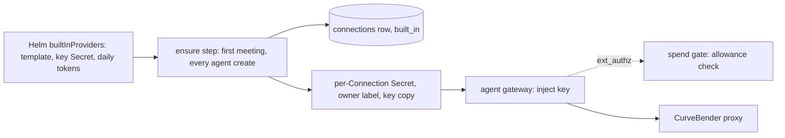
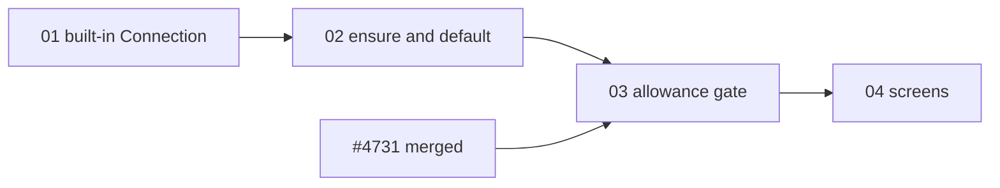

# Built-in model provider: a new agent runs with no provider setup

> Working plan — temporary, committed on the feature branch.
> Deleted once the feature ships.

**Issue:** [dam-agents/dam#5057](https://github.com/dam-agents/dam/issues/5057) (parent epic [#5055](https://github.com/dam-agents/dam/issues/5055)).
**Sibling plan:** [#5058](https://github.com/dam-agents/dam/issues/5058) (Slack onboarding), on branch `feat/5058-onboard-from-slack`.
A user who signs up from Slack gets the same built-in provider, through the same ensure step (slice 02).

**Status of this plan:** written unattended.
Every answer to an open question of the issue is a **PROPOSED** default.
They are listed in [Decisions for the user](#decisions-for-the-user); confirm or change them before `/implement-feature` starts.

## Goal

Today a new user cannot run any agent until they paste a key of their own into a provider form.
Many users have no key, or give up during setup, and leave before they see what the product does.

After this feature:

- Every user holds a **Built-in Provider Connection** from the moment the api-server first meets them, with no form.
  The first one is CurveBender (open models on RITS: GLM for work, Nemotron for Claude Code's classifier).
- A new agent runs on it at once.
- Each user has a **daily token allowance** on the built-in providers.
  The screens show how much of today's allowance is used, warn at 80%, and say what to do when it is gone.
- At the end of the allowance, the gateway refuses the next model call with a clear text, and unattended work waits for the next day.
- The user can connect their own provider at any time.
  Their own provider then becomes the default of the agents that ran only on the built-in one, and the built-in one stays as a fallback.
- The operator decides which built-in providers an install offers, with which key, and how big the allowance is.

## Approach

Read these architecture pages first: [connections](../../architecture/connections.md), [credential-gateway](../../architecture/credential-gateway.md), [harness-config](../../architecture/harness-config.md), [agent-lifecycle](../../architecture/agent-lifecycle.md#create), [getting-started](../../architecture/getting-started.md), [features](../../architecture/features.md).
Also read `docs/architecture/spend-limits.md` on the cost-control branch (PR [#4731](https://github.com/dam-agents/dam/pull/4731)); this plan builds on it.

### Hard dependency: the spend meter (PR #4731)

The allowance needs a number the agent cannot change.
PR [#4731](https://github.com/dam-agents/dam/pull/4731) (`feat/3428-cost-control`, a draft on 2026-10-15) adds the gateway meter, the `spend_daily` ledger with token counts, the Redis day counters, the ext_authz spend gate, the hard-refusal path (the Spend Ceiling) and the holds of unattended work.
Slices 01 and 02 do not need it.
Slices 03 and 04 extend its `spend` module, so they start only after #4731 is merged into `main` and this branch is rebased.
Do not copy code from the cost-control branch into this one.

### Why one Connection per user, with a copy of the operator's key

Three facts of the code decide the shape:

1. A Connection has exactly one owner, and every read is owner-filtered (`packages/api-server/src/modules/connections/infrastructure/connections-repository.ts`).
2. The controller mounts a credential Secret into an agent's gateway only when the Secret carries the agent owner's label (`packages/controller/pkg/reconciler/resources.go`, `secretRefRefused`; `envoy.go`, the owner selector).
3. Minting per-user LiteLLM virtual keys is not an option today: there is no admin key, and the IBM ETE LiteLLM proxies delete keys they consider improperly issued within minutes (seen 2026-06 as intermittent `401 token_not_found_in_db`).
   LiteLLM's own `max_budget` is in dollars, and CurveBender's RITS models cost $0 there, so it cannot express a token allowance anyway.

So the platform creates, for each user, an ordinary provider Connection of the `curve-bender` template, marked **built-in**.
Its per-Connection Secret holds a copy of the operator's service key and carries the owner's label, so nothing changes in the controller or the gateway.
The key never reaches the agent (the gateway injects it on the wire, as for every header Connection), and the user never sees it.
The allowance is enforced by the platform's own meter, not by the upstream proxy.

### The ensure step

One idempotent service call, `ensureBuiltInProviders(owner)`, in the connections module.
It creates the missing Built-in Provider Connections of the owner for every provider the chart enables, and grants each new one to the owner's agents that hold no provider (the existing `attachProviderToBareAgents` path).
It runs:

- once per replica per user, from a saga on the existing `UserAuthenticated` event (`packages/api-server/src/events.ts`), like `usage/sagas/persist-actor-roles.ts`;
- inside the agent create path, before the default provider is chosen, so a user who never opened the UI (Slack onboarding, #5058; the CLI) still gets one.

It is concurrency-safe across replicas: a partial unique index on `(owner, template_id) WHERE built_in` plus `INSERT … ON CONFLICT DO NOTHING`, as `getting-started` enrollment does.
Every user gets the Connection, existing users included, at their next sign-in or agent create.

### Built-in Connection rules

- Its name is fixed per template (the template's display name, e.g. "CurveBender"), with a numeric suffix when the user already holds a Connection of that name.
- The user cannot delete, rename, or rotate it, or set its key; the service refuses, and the UI hides those actions.
  The user can revoke its grant on any agent.
- Its key is the operator's: a boot-time sweep rewrites every built-in Secret whose key hash differs from the chart's, so a key rotation is one Helm change.
- When the operator turns a built-in provider off, the sweep marks its Connections **withdrawn** (read as expired, with its own reason), so agents and sessions see why it stopped; it does not delete them, so turning it back on restores grants and pairs.
- The default-provider rule changes from "IBM LiteLLM, else the earliest" to "the user's own IBM LiteLLM, else their own earliest, else a built-in one".
- When the user connects their own provider for the first time, each agent whose providers are all built-in also gets the new one granted, and its default pair moves to it.
  The built-in grant stays, so the session picker still offers it.

### The allowance

- One **Built-in Allowance** per user per UTC day, in tokens, counting every built-in Connection of the user together, on all their agents and sub-agents (the payer rule of #4731: a sub-agent counts for its root driver's owner).
- Tokens counted: input (uncached), cache reads, cache writes and output, as the meter records them.
  Each counts as one token.
- It is hard: at the allowance, the gate refuses the call, asks nothing, and the refusal text tells the user to connect their own provider.
  No "continue" (a soft question would let anyone lift the platform's cost).
- It reuses #4731's machinery: the built-in Connection's spend unit is `token` (a new unit), its day counter is the owner's `token` counter, and the hard check sits beside the Spend Ceiling's.
  Since only built-in Connections have the `token` unit, the owner-and-unit counter is exactly the allowance counter, and a missing counter is rebuilt from `spend_daily` as today.
- It does not count in the agent limit, own limit, or Spend Ceiling (those are dollars), and the user cannot set a Connection limit on it.
- Unattended work (schedules, sub-agent spawns, channel turns) is held at the allowance by #4731's existing hold, because the hold calls the same check.

### Contract (pinned for slices 03 and 04)

Extend the `spend` module of `packages/api-server-api` from #4731:

- `spendUnitSchema` gains `"token"`.
- `spend.status` gains `allowance`: `null` when the install offers no built-in provider, else `{ day, resetsAt, amountTokens, usedTokens, leftTokens, state: "ok" | "warn" | "reached" }`.
  `warn` is at 80% or more.
  It is the caller's own allowance, for any `agentId` the caller may read.
- The connection view (`packages/api-server-api/src/modules/connections/`) gains `builtIn: boolean`.
- No new procedure.

### Out of scope

- Per-user allowance exceptions (no new CRD; operators would otherwise need a `UserSpendLimit` schema bump, which breaks dev clusters that share CRDs).
- A paid built-in provider in dollars (the design allows it later: its unit would be `usd` and it would count in the ceiling).
- An admin UI; the chart is the admin surface, as for every install-wide setting today.
- Minting per-user upstream keys.
- The waitlist (#5056, separate).

## Sub-issues

| #   | Title                                                                      | Scope                                                                                                                                     | Depends on       |
| --- | -------------------------------------------------------------------------- | ----------------------------------------------------------------------------------------------------------------------------------------- | ---------------- |
| 01  | [Built-in Connection and its operator config](./01-built-in-connection.md) | Helm `builtInProviders`, api-server config, `built_in` column, service refusals, Connection view flag, key-sync and withdraw sweep.       | —                |
| 02  | [Ensure step and default provider](./02-ensure-and-default.md)             | `ensureBuiltInProviders` from the `UserAuthenticated` saga and the agent create path; new default rule; own provider takes over.          | 01               |
| 03  | [Token allowance in the gate](./03-allowance-gate.md)                      | `token` unit, owner token counter, hard allowance check and refusal text, holds, `spend.status.allowance`, agent's read tool, CLI.        | 02, #4731 merged |
| 04  | [Allowance on the screens](./04-allowance-screens.md)                      | Built-in badge, allowance meter on Providers and Usage, composer warning and "connect your own" call to action, error hint, empty states. | 03               |

## Conventions & glossary

**Words** (add them to [`docs/ubiquitous-language.md`](../../ubiquitous-language.md) under Connections, in the slice that ships the code):

- **Built-in Provider:** a model provider the install supplies to every user, configured by the operator.
- **Built-in Provider Connection:** the per-user Connection the platform creates for a Built-in Provider.
  The user cannot edit, rotate or delete it, only revoke its grants.
- **Built-in Allowance:** the user's daily token maximum across all their Built-in Provider Connections.
  Hard: refuse, no question.

Do not call it "free tier", "trial" or "credits" in code or copy; copy says "included with <brand>" (brand from `getBrand()` / `config.brand`, never hardcoded).
"Budget" and "Ceiling" alone mean compute; "Usage" alone means activity analytics.

**Skills to apply:** `/typescript-engineering` (server, contract, CLI), `/react-ui-engineering` (slice 04), `cluster-ops` (smoke tests).

**Repo rules:**

- Use `mise run` for every build, check, test and cluster step.
- Do not add new tests; verify with `mise run check`, `mise run test` and each slice's smoke test.
  Update existing tests a change breaks.
- Code comments follow [`docs/guidelines/comment-guidelines.md`](../../guidelines/comment-guidelines.md); run `mise run check:comment-types`.
- Each slice updates the architecture pages its behavior changes, in the same commit, per [`docs/guidelines/documentation-guidelines.md`](../../guidelines/documentation-guidelines.md); run `mise run fix:markdown`.
- Migration numbers: `mise run //packages/db:generate` takes the next free one.
- Never hardcode the brand.
- The operator key is a production secret: never print it, its Secret, or the api-server env; compare by hash only.

**Dev cluster:** `http://localhost:4444`, login `dev`/`dev`, `mise run cluster:kubectl`.
The CurveBender host is VPN-only; without VPN, a call fails with a gateway 503 "connection timeout", which still proves the injection path.
For the dev cluster, put a CurveBender service key into a local Secret the values file references; never commit it.

## Whole-feature smoke test

On the dev cluster with `builtInProviders.curveBender` enabled and a test key, after #4731 is merged and every image is rebuilt:

1. Sign in as a fresh user (`mise run cluster:kubectl` to add one in Keycloak, or reset an existing user's Connections).
   Settings → Providers lists "CurveBender", badged "Included with <brand>", with no delete, rename or rotate action.
2. Create an agent with the default form.
   Send "say hi".
   It answers on GLM.
3. `dam spend status` shows the allowance with a non-zero `usedTokens`.
   The Providers section and the composer show the same number.
4. Lower the chart's daily allowance to just above today's use and upgrade.
   Send prompts until it is reached: the composer warns at 80%, then the turn ends with the allowance text, and no approval card appears on Home.
5. Create a schedule that fires in one minute: it is held with the allowance reason.
6. Connect an own IBM LiteLLM or Anthropic Connection.
   The agent now holds both; its default pair is the own one; the next prompt works.
7. Rotate the operator key in the chart and upgrade: the built-in Connection keeps working (the sweep rewrote its Secret).
8. Turn the built-in provider off in the chart and upgrade: the Connection reads withdrawn, with that reason, and the own one keeps working.

## Delivery

Each sub-issue is one atomic commit.
The whole feature lands as a single PR for [#5057](https://github.com/dam-agents/dam/issues/5057).
Before the PR is ready, `/implement-feature` deletes `docs/plan/5057-built-in-model-provider/` in a last commit.

## Decisions for the user

All **PROPOSED** — written unattended, to confirm or change:

| #   | Question                                        | Proposed default                                                                                                                                                                                                                                                                                  |
| --- | ----------------------------------------------- | ------------------------------------------------------------------------------------------------------------------------------------------------------------------------------------------------------------------------------------------------------------------------------------------------- |
| D1  | How big is the allowance?                       | **5,000,000 tokens per user per UTC day**, all built-in providers together, input + cache + output each counting 1. Chart value `builtInProviders.dailyTokenAllowance`. Roughly a few hours of Claude Code work on GLM; tune once real use is metered.                                            |
| D2  | Does it renew?                                  | **Daily, at UTC midnight**, like every spend limit of #4731. No monthly pool, no rollover.                                                                                                                                                                                                        |
| D3  | What happens when it is gone?                   | **Hard refusal**, no "continue": the call is refused with "Included model allowance used up for today. Connect your own model provider in <brand> to keep working." Schedules, spawns and channel turns are held until midnight. Own providers keep working.                                      |
| D4  | Do admins control which providers are built in? | **Yes, operators via Helm only** (`builtInProviders.<template>: { enabled, keySecret }`); no admin UI. Off by default in the chart, on in IBM's values. Turning one off withdraws its Connections without deleting them.                                                                          |
| D5  | Abuse controls                                  | (a) one allowance per IBM login (sign-in already requires one); (b) hard daily cap; (c) the allowance counts sub-agents for their root owner; (d) operator kill switch (`enabled: false`); (e) upstream rate limits on the single service key stay CurveBender's. No per-install total cap in v1. |
| D6  | Which users get it?                             | **Every user**, existing ones included, at their next sign-in or agent create.                                                                                                                                                                                                                    |
| D7  | Can the user remove it?                         | **No** (only revoke its grant per agent), so a later "I have no provider" state cannot happen by accident.                                                                                                                                                                                        |
| D8  | When the user adds their own provider           | Agents whose providers are all built-in also get the own one, and their default pair moves to it; the built-in grant stays as a fallback.                                                                                                                                                         |
| D9  | Per-user exceptions                             | **Out of scope** in v1 (no new CRD or CRD field).                                                                                                                                                                                                                                                 |

## Blockers outside the code

- **A CurveBender service key** sanctioned by the CurveBender (IBM ETE LiteLLM) owners for shared use by the platform, with a rate limit sized for all users together, and their agreement that one key fronting many users is allowed (their cron reaps keys it considers improperly issued).
  Without it, slices 03–04 can be built and tested, but the feature cannot be switched on.
- **PR [#4731](https://github.com/dam-agents/dam/pull/4731) merged** (draft and conflicting with `main` on 2026-10-15).
- **Reachability:** the CurveBender host is VPN-only from a laptop; the production api-server and gateways must reach it (they reach the IBM LiteLLM proxy today, so this is likely fine, but confirm).
