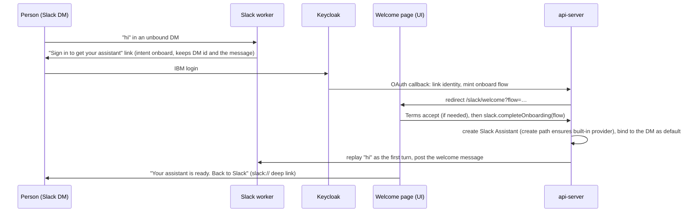
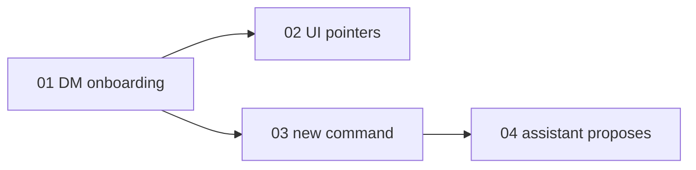

# Onboard and create agents from Slack

> Working plan — temporary, committed on the feature branch.
> Deleted once the feature ships.

**Issue:** [dam-agents/dam#5058](https://github.com/dam-agents/dam/issues/5058) (parent epic [#5055](https://github.com/dam-agents/dam/issues/5055); related [#3588](https://github.com/dam-agents/dam/issues/3588)).
**Sibling plan:** [#5057](https://github.com/dam-agents/dam/issues/5057) (built-in model provider), on branch `feat/5057-built-in-model-provider`.

**Status of this plan:** written unattended.
Every answer to an open question is a **PROPOSED** default, listed in [Decisions for the user](#decisions-for-the-user); confirm or change them before `/implement-feature` starts.

## Goal

Today a person who only wants an assistant in Slack must open the UI, create an agent, then come back and run `/<brand> bind`.
A DM to the app from someone without a bound agent only answers "This conversation isn't connected to an agent yet."

After this feature:

- **DM the app, get an assistant.** A person DMs the app.
  If the platform does not know them, the app answers with one sign-in link.
  After the IBM login (and the Terms, when not yet accepted, on the same page), the platform creates their **Slack Assistant**, binds it to that DM, and answers the message they first sent.
  They never open the agent list, the create form, or Settings.
- **Ask for an agent in a channel.** In any channel the app is in, `/<brand> new [kit]` creates an agent owned by the person and connects it to that channel.
  In the DM, the person can also ask the assistant ("make an agent for #team-x from the code-guardian kit"); the assistant proposes it and the person confirms with a button.
- **Slack points to the UI** for what Slack does not do: approvals, connections and secrets, own providers, agent settings, skills, knowledge bases.
  The welcome message, the `/<brand>` help, and every notice about a blocked turn link to the exact page.
- An agent created from Slack runs at once on the built-in provider of #5057, through the same create path, so a Slack-onboarded user gets the built-in provider exactly as a UI user does.

## Approach

Read first: [channels](../../architecture/channels.md) (Slack sections: identity linking, in-chat binding, DMs), [channel-turns](../../architecture/channel-turns.md), [slack-guarantees](../../architecture/slack-guarantees.md), [starter-kits](../../architecture/starter-kits.md), [agent-lifecycle](../../architecture/agent-lifecycle.md#create), [security-and-credentials](../../architecture/security-and-credentials.md).

### What exists and is reused

- **Transport:** Bolt in Socket Mode in the leader replica (`packages/api-server/src/modules/channels/infrastructure/bolt-slack-gateway.ts`); the worker is `infrastructure/slack.ts` (`handleInbound`, `handleDirectMessage`, `handleCommand`, `mintBindInvitation`, `notifyPerson`); other replicas reach it through the ChannelManager RPC.
- **Identity:** `identity_links` and `IdentityLinkService`; a link is made only by the Keycloak OAuth (PKCE) flow that `/<brand> login` and `/<brand> bind` start (`SlackOAuthPending.intent: "login" | "bind"`, callback in `infrastructure/slack-oauth.ts`).
  A Slack user who never signed in is unknown; no user is created without that login, and that stays so (Slack email is not a strong enough binding to adopt an account by).
- **Binding:** the callback mints a bind flow (`slack-flows.ts`, `bind-flow-store.ts`) and `agents.bindSlackChannel(agentId, flowId)` binds through `executeSlackBind`, DMs included (a 1:1 DM relays every message).
- **Create:** the agents service's create (plain) and `starterKits.apply` (kit, with `slackChannelId`), both per owner and callable server-side; both end in the one create path where #5057 slice 02 runs `ensureBuiltInProviders`.
- **Terms:** each channel turn is gated by the binding owner's Terms acceptance; the UI's terms view (`packages/ui/src/modules/terms/`) and tRPC `terms.accept`.
- **Telling a person:** `notifyPerson(keycloakSub, text)`, a DM from the app to every linked Slack identity.

So one browser hop stays: the IBM login.
This plan makes it the only one, and puts the Terms on the page that hop lands on.

### The flow of a first DM

A **linked** person whose DM is unbound gets the same result without the login: the worker creates and binds at once when their Terms are accepted, or sends the welcome-page link when not.

### The Slack Assistant

- At most one per user, marked on the agent (`assistant: "slack"` in the agent's annotations, read through the agents repository) so a second DM, a second workspace or a retry finds it instead of creating another.
  In a second workspace's DM, the same agent is bound there too (bindings are many-to-many).
- Created as a plain agent on the default Template and harness, or from the chart's onboarding kit when one is set (PROPOSED D1: none by default; see decisions).
- Name: `<brand short> assistant` from brand config, never hardcoded.
- Size: the template default; backend: whatever the create path decides.
- It is an ordinary, listed agent the user can open, rename or delete in the UI.
  When [#3588](https://github.com/dam-agents/dam/issues/3588) lands, its built-in assistant adopts the agent that carries this mark rather than creating a second one (PROPOSED D2); #3588 then decides hiding and sizing.

### Agent for a channel

- `/<brand> new [kit] [name…]` in a channel or group DM the app is in.
  Unlinked: the login flow with intent `new`, then it continues server-side (no picker).
  Plain agent without a kit; `starterKits.apply` with `slackChannelId` with one.
  The new agent becomes the conversation's default only when there is none (existing bind rule).
  A kit whose required connections the person lacks is refused with a link to that kit's page in the UI.
- `/<brand> kits` lists the kits the person can apply (id, name, one line), with a link to the catalog in the UI.
- The Slack Assistant can do the same on request, through two new platform MCP tools offered only to the agent marked `assistant: "slack"`: `list_starter_kits` and `propose_channel_agent`.
  The tool never creates anything: it DMs the owner a proposal with **Create** and **Cancel** buttons, and only the owner's click creates (a human gate against prompt injection, e.g. through a whisper).

### UI-only, and how Slack points there (PROPOSED D4)

Stays UI-only: approvals of egress holds and spend limits, connecting accounts and entering any secret or key (own providers included), agent settings (size, egress, env, harness), skills and skill sources, knowledge bases, artifacts, the agent's sessions and history.
Slack points there with deep links built from the UI base URL the api-server already uses for the bind page:

- the welcome message after onboarding;
- a "More in <brand>" block in the bare `/<brand>` help;
- a DM to the owner when a channel turn of their agent is blocked on something only the UI can resolve: a pending egress approval (today invisible from Slack), a missing provider, the built-in allowance used up (#5057 slice 03's reason).

### Contract (pinned for slices 01 and 03)

New `slack` procedures in `packages/api-server-api/src/modules/channels/` (or the existing Slack bind router file, whichever owns `peekSlackBindFlow`):

- `slack.peekOnboarding({ flowId })` → `{ termsAccepted: boolean, workspaceName: string | null, slackDeepLink: string }` or `FlowInvalid`.
- `slack.completeOnboarding({ flowId })` → `{ agentId, created: boolean }`; refuses `TermsNotAccepted`; idempotent per flow and per user.

### Out of scope

- Hiding the assistant from lists, a dedicated assistant panel, a smallest-size preset (#3588).
- Approving anything from Slack (buttons on approval notices) — a later issue; this plan only links.
- App Home tab, shortcuts, the `assistant_thread_started` surface (each needs a manifest change and a re-install in every workspace).
- Telegram.
- The waitlist (#5056); where a realm `requiredRole` still applies, the welcome page shows the existing "Access pending approval" state.

## Sub-issues

| #   | Title                                                                | Scope                                                                                                                                                                          | Depends on |
| --- | -------------------------------------------------------------------- | ------------------------------------------------------------------------------------------------------------------------------------------------------------------------------ | ---------- |
| 01  | [A first DM creates the Slack Assistant](./01-dm-onboarding.md)      | Onboard intent in the OAuth flow, welcome page with Terms, `completeOnboarding`, the assistant mark, DM bind, replay of the first message, linked-user shortcut, chart switch. | —          |
| 02  | [Slack points to the UI](./02-ui-pointers.md)                        | Welcome message, help block, owner DMs for UI-only blocks (egress approval, no provider, allowance).                                                                           | 01         |
| 03  | [`/<brand> new` and `/<brand> kits`](./03-new-command.md)            | Create a plain or kit agent bound to the current channel; login continuation with intent `new`; kit listing.                                                                   | 01         |
| 04  | [The assistant proposes a channel agent](./04-assistant-proposes.md) | `list_starter_kits` and `propose_channel_agent` MCP tools for the marked assistant, Create/Cancel buttons, owner-only click.                                                   | 03         |

Implement in number order.
None of the slices needs #5057 merged; with #5057 merged, the agents they create run on the built-in provider with no further change, because the create path ensures it.

## Conventions & glossary

**Words** (add to [`docs/ubiquitous-language.md`](../../ubiquitous-language.md), Channels, in the slice that ships the code):

- **Slack Assistant:** the one agent per user the platform creates when the user first DMs the app; marked so it is found again; the seed of #3588's built-in assistant.
- **Slack Onboarding:** the path from a first DM to a bound Slack Assistant: sign-in, Terms, create, bind.

Never write the brand or the slash command name literally in code or copy: the command is `/${brandShort}` and copy uses `config.brand`.
"Bind" in code, "connect" in user copy, as today.

**Skills to apply:** `/typescript-engineering` (server, contract), `/react-ui-engineering` (the welcome page in slice 01), `cluster-ops` (smoke tests).

**Repo rules:**

- `mise run` for every build, check, test and cluster step.
- Do not add new tests; verify with `mise run check`, `mise run test` and each slice's smoke test; update existing tests a change breaks.
- Comments per [`docs/guidelines/comment-guidelines.md`](../../guidelines/comment-guidelines.md); `mise run check:comment-types`.
- Each slice updates the pages its behavior changes (`channels.md`, `slack-guarantees.md`, `starter-kits.md`, `cli.md` where relevant) in the same commit, per [`docs/guidelines/documentation-guidelines.md`](../../guidelines/documentation-guidelines.md); `mise run fix:markdown`.
  A Slack behavior change updates `slack-guarantees.md` in the same PR (that page's rule).
- No manifest change in `etc/slack/app-manifest.yaml`: interactivity, `im:write`, `commands` and `message.im` are already there, so no workspace has to re-install.
  If a slice finds it needs a new scope or event, stop and flag it.
- All outbound Slack calls from a non-leader replica go through the ChannelManager RPC.

**Dev cluster:** `http://localhost:4444`, `dev`/`dev`, a Slack test workspace connected through Settings → Slack workspaces; `mise run cluster:kubectl`.

## Whole-feature smoke test

On the dev cluster with a test Slack workspace connected and `slackOnboarding.enabled: true` (and, for step 3, #5057's built-in provider on):

1. As a Slack member never linked (unlink with `/<brand> logout` and reset the user's Terms acceptance), DM the app "what can you do?".
   The app answers with one sign-in link.
2. Sign in: the page shows the Terms, then "Your assistant is ready"; "Back to Slack" opens the DM.
3. In the DM, the assistant answers "what can you do?"
   (on the built-in provider when #5057 is on), followed by the welcome message with the UI links.
4. DM again: no second assistant; `dam agent list` shows one agent named `<brand short> assistant`.
5. In a test channel with the app, `/<brand> new` creates an agent bound to the channel; `@<bot> hello` answers.
6. `/<brand> kits`, then `/<brand> new code-guardian`: a kit with required connections the user lacks is refused with a link to its page.
7. In the DM: "create an agent for #<test-channel>": a proposal with Create/Cancel arrives; Create makes and binds it; a second member clicking the same button (forwarded message) is refused.
8. Make the channel agent call a host that needs approval: the owner gets a DM linking to the approval on Home.

## Delivery

Each sub-issue is one atomic commit.
The whole feature lands as a single PR for [#5058](https://github.com/dam-agents/dam/issues/5058).
Before the PR is ready, `/implement-feature` deletes `docs/plan/5058-onboard-from-slack/` in a last commit.

## Decisions for the user

All **PROPOSED** — written unattended, to confirm or change:

| #   | Question                                   | Proposed default                                                                                                                                                                                                                                                                                                                                                                                        |
| --- | ------------------------------------------ | ------------------------------------------------------------------------------------------------------------------------------------------------------------------------------------------------------------------------------------------------------------------------------------------------------------------------------------------------------------------------------------------------------- |
| D1  | Which starter kit is the default in Slack? | **No kit: a plain agent** on the default Template and harness, until `curated/personal-assistant` can be applied without the UI. That kit declares a **required Slack Connection** (a user-token OAuth made in the browser), so apply refuses it for a Slack-only user. Chart value `apiServer.slackOnboarding.starterKit` lets an operator name a kit once its requirement is suggested, not required. |
| D2  | How does it relate to #3588?               | The Slack Assistant is an ordinary listed agent with an `assistant: "slack"` mark; #3588 adopts the marked agent as the user's built-in assistant instead of creating another. One assistant per user either way.                                                                                                                                                                                       |
| D3  | Is one browser hop acceptable?             | **Yes, the IBM login is unavoidable** (no account without it, no Slack-email adoption); the Terms go on the same page, so it is one hop.                                                                                                                                                                                                                                                                |
| D4  | Which tasks stay UI-only?                  | Approvals (egress, spend), connecting accounts and entering secrets or keys (own providers too), agent settings, skills, knowledge bases, artifacts, session history. Slack links to each from the welcome, the help, and owner DMs for blocked turns. Approving from Slack is a later issue.                                                                                                           |
| D5  | Who may create agents from Slack?          | Any person who signs in, as the agent's owner, under their own budget and allowance; the channel binding rules are unchanged (no admin gate, the bot must be in the channel).                                                                                                                                                                                                                           |
| D6  | Replay the first DM?                       | **Yes**: the message that started onboarding becomes the assistant's first turn, so the person gets an answer to what they asked.                                                                                                                                                                                                                                                                       |
| D7  | Can the assistant create agents itself?    | **Only through a proposal the owner confirms with a button** in Slack; the tools exist only on the marked assistant. Slice 04 can be cut without affecting 01–03.                                                                                                                                                                                                                                       |
| D8  | Rollout switch                             | Chart `apiServer.slackOnboarding.enabled`, off by default, on in IBM's values. Off: an unbound DM answers as today.                                                                                                                                                                                                                                                                                     |

## Blockers outside the code

- **#5056 (waitlist)** or an empty `keycloak.requiredRole`: with a required role, a new user stops at "Access pending approval" after sign-in.
- **The personal-assistant kit** (in `dam-agents/personal-assistant`) must make its Slack Connection suggested rather than required before it can be the Slack default (D1).
- **#5057** for the "runs at once" part: without a built-in provider, the assistant is created but cannot answer until the user connects a provider, and slice 02's notice links the user to Settings → Providers.
