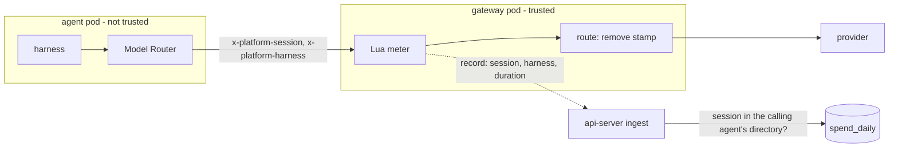
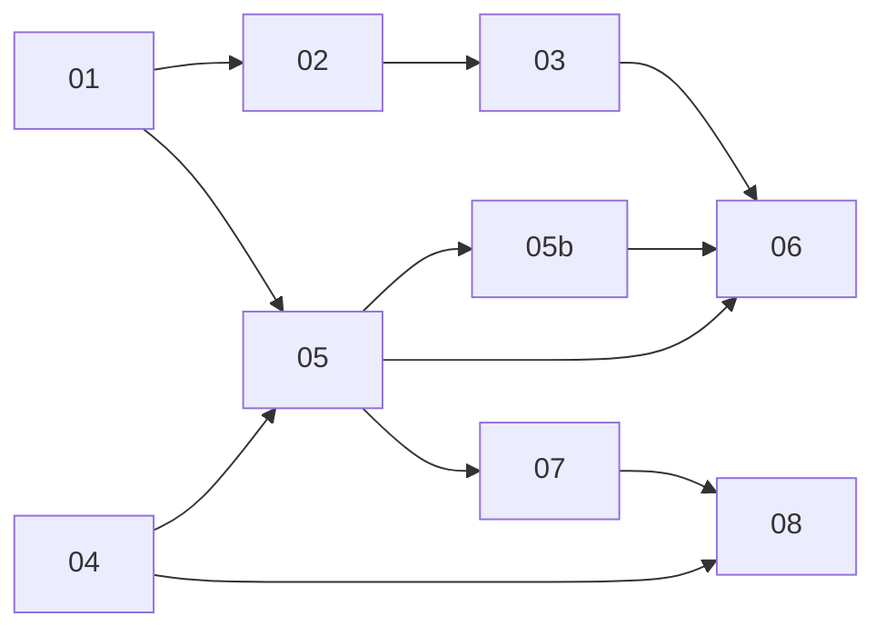

# Every screen shows measured spend, and says since when

> Working plan — temporary, committed on the feature branch.
> Deleted once the feature ships.

**Issue:** [dam-agents/dam#5240](https://github.com/dam-agents/dam/issues/5240) (parent epic [#4032](https://github.com/dam-agents/dam/issues/4032)).
The pull request also closes [#4898](https://github.com/dam-agents/dam/issues/4898).

**Prototype:** <https://claude.ai/artifact/SWFEPJHFVLRwpX5VPqD7Rn> (private; ask Petr for access).
It shows the Home card and Settings › Usage with sample data.
Match its screens; the [Wording](#wording) section below wins over the prototype's copy.

**Decisions:** Petr agreed on 13 decisions on 2026-10-16 ([Decisions](#decisions)).
Do not reopen them.

## Goal

The spend limits of #3428 count the spend that the agent's gateway measures (Metered Spend).
Home's spend card switched to that number in place.
Measured spend has no history, so on the dev deployment users read the change as a drop in spend, and no screen explained it.
Every other spend figure still reads the reports that each agent sends about itself.

After this feature:

- Every spend figure comes from the gateway meter: totals, per day, per agent, per model, per provider, per session, per session type and per sub-agent.
- The parts add up to the Home total and match the spend limits.
- Each screen says what it counts and since when ‹Brand› measures.
- Agents read their own measured cost through `get_metrics`, and `dam metrics` prints it.

## Release gate and order

- This feature blocks the production release that carries #3428.
  Production (v0.2.21) and staging (v0.2.22-rc1) have neither #3428 (#4731) nor the Model Router (#4620).
  No release candidate is cut from a main that has #3428 without slices 01–03.
- One pull request, one commit per slice, in the order of the table below.
- **Escape hatch:** slices 01–03 are the screen slices.
  If the release date comes before slices 04–08 are done, slices 01–03 go out as their own pull request, and the rest follows on this branch.
  So slices 01–03 must not depend on slices 04–08.
  Until slice 06 lands, the sidebar session cost and the Bob "Harness spend" card still read the agents' reports, so a release of slices 01–03 alone keeps them for that time.

## Decisions

Agreed with Petr on 2026-10-16 (grill-me), plus the four gap answers of the planning session (G1–G4).

1. **No agent reports in any spend figure.** Every total and chart reads measured spend only.
2. **The earlier reports stay reachable for a short time.** Settings › Usage shows "View the earlier estimates", which opens today's reported view, unchanged.
   The line hides 30 days after T, and on a deployment without the telemetry store.
3. **Periods.** Home: Today · This month (default) · Last month, with the real range under the total.
   Settings › Usage: a picker like Toggl's: a range button with arrows that step one period of the same kind, presets (Today, Yesterday, This week, Last week, This month, Last month), and a calendar with week numbers for a custom range of up to 366 days.
   Days before T are struck out.
   All days are UTC days, and weeks start on Monday.
   No "Last 30 days", no "1y", no "All dates".
4. **Place.** The detail stays at Settings › Usage.
   The Home card gets "View details", which keeps the selected period.
   The agent Usage section gets the same layout.
5. **Units.** Paid US dollars are the big number on every screen.
   Use that a plan covers (the Claude subscription) is hidden by default; the checkbox "Show use covered by plans" adds a lighter part to each bar and a plan line, never to the big number.
   The checkbox is off by default, remembered per browser, and applies on Home and the Usage pages.
   A near-zero paid total with plan use gets the line "Most of your use was covered by your plan, at no extra cost".
   Bobcoins have their own line and their own provider row, never in a dollar chart.
   Free providers show "No cost"; unpriced and unmetered providers show "Not priced".
   The own-limit meter counts paid dollars only.
6. **Start time T.** A migration in this release stores `now()` once, before the meter can store a record.
   On a deployment where the meter already runs (dev), it stores the first day in `spend_daily`.
   Every label, the struck-out days, the notice and the earlier-estimates line read T.
7. **Notice.** It shows to users who had an agent created before T, until T + 30 days or until the viewer dismisses it (remembered per browser).
   It shows on the Home card and at the top of Settings › Usage.
   The text is fixed ([Wording](#wording)).
8. **Spend per session.** The Model Router stamps the session and the harness on each call that it forwards.
   The gateway meter copies the stamp and the call's duration into the call record, and the gateway removes the stamp before the call reaches the provider.
   The split per session is for display only; totals and limits do not depend on it.
   The calling agent comes from the identity of the gateway's record stream, not from the stamp.
   A new ADR amends the spend part of the Model Router decision (ADR-098).
   These move to measured spend: spend by session type, the sidebar session cost, Model time, `get_metrics` (total, by model, per session, per sub-agent; fixes #4898) and `dam metrics`.
   The Bob "Harness spend" card goes; the measured Bobcoins line replaces it.
   Calls that skip the Model Router count in every total, with no session.
9. **The agent reports stay** for logs, spans, context per call, the per-call rows of `get_metrics`, HyperDX and the earlier-estimates view.
   No screen reads a spend figure from them.
   The Model Router keeps its own telemetry record, without a cost.
10. **Storage.** `spend_daily` gets two key columns, `session_id` and `calling_agent_id` (empty means none), and a `duration_ms` counter.
    One write per call stays (G10 adds one more, once per call, for `spend_calls`).
    At ingest, a session that the calling agent's session directory does not have counts as no session.
    The agent's own pod writes that directory, so the check stops stray and wrong ids, not a deliberate agent (G6).
11. **One pull request, with the escape hatch** above.
12. **The meter is checked against the provider before the release** — done on 2026-10-16: 16 calls on IBM LiteLLM, DAM $0.594414 against LiteLLM's key spend +$0.594406.
13. **The proxy cost cross-check works on IBM LiteLLM.** It runs only on a call with no cache read and no cache write.
    It reads `x-litellm-response-cost`; when that header is absent, it takes `x-litellm-response-cost-original` − `x-litellm-response-cost-discount-amount` + `x-litellm-response-cost-margin-amount`.
    Checked in LiteLLM's code (`litellm/cost_calculator.py`, 2026-10-16): the final cost is the original cost minus the discount plus the margin, and the margin applies after the discount, so the formula equals LiteLLM's own final cost.

Gap answers (Petr, 2026-10-16, after the first plan review):

- **G1 — Pi gets a session marker in this pull request (slice 04).** Pi sends no session marker today.
  Pi 1.1.0 has the extension hook `before_provider_headers`, which can set a header on each model call, and its context gives the session id.
  pi-acp uses Pi's own session id as the ACP session id and runs one Pi process per session, so that id is the id that the screens use.
  Our Pi extension sets `x-platform-session`, and the Model Router reads it for Pi.
- **G2 — Sidebar units.** Paid spend shows as "· $0.12"; plan use only as "· $0.40 covered"; Bob as "· 0.05 Bobcoins".
- **G3 — #4898.** The pull request closes #4898, because `get_metrics` reads the meter.
  The cause in telemetry stays unknown, and the pull request says so.
- **G4 — Wording.** The [Wording](#wording) table is approved, with the changes that G1 and G5 need.
- **G5 — Sub-agent spend per session.** A driver's total includes its sub-agents' calls, but its own sessions hold only its own calls.
  So "Spend by session type" gets a "Sub-agents" row, as in the prototype: the calls whose calling agent is not the payer.
  The sidebar cost of a session includes the sub-agents spawned from it, directly or below, through the spawning session that main records for each sub-agent (`invocations.driver_session_id`, #5229); the tooltip shows that part.
- **G6 — The session check, no session limit.** The session directory comes from the agent's own pod, so an agent can report an invented session id and then stamp it.
  Rows are also keyed by the calling agent, so such rows count only under that agent: they reach no other agent's screens and change no total and no limit.
  Each new row still needs one call through the gateway; at a limit, a refused call also adds a row and costs nothing.
  The worst case is table growth that one owner's agent causes for that owner, so there is no per-agent session limit.
  The plan and the ADR describe the check as "a session that the agent never reported counts as no session".
- **G7 — No retention job.** The session key multiplies the rows by about the sessions of a day; see [Storage](#storage) for the numbers.
  A fold of old rows would not change the screens (the session directory forgets a session after 180 days anyway) and would remove old sessions' costs from the sidebar.
- **G8 — Terminal sessions are translated (slice 04).** In a terminal session, Codex, Bob and Pi run under their own new id, not our session id.
  Codex keeps its thread id in `~/.codex/platform-sessions/<our id>`, Bob its task id in `~/.bob/platform-sessions/<our id>`, and Pi writes a new random id into `~/.pi/agent/sessions/<our id>.jsonl`.
  The Model Router maps such an id back to our session id; Claude Code's terminal already runs with `--session-id <our id>`.
  G9 replaces the Pi part.

Implementation answers (Petr, 2026-10-16, before slice 04):

- **G9 — Pi's terminal stamps our id itself.** Pi's extension sets `x-platform-session` to `HARNESS_SESSION_ID` when it is set, else to Pi's own session id.
  Only the terminal's PTY sets `HARNESS_SESSION_ID`, so a chat sends Pi's id, which is our id there.
  Pi writes its session file only after the first reply, and `/new` or `/fork` in Pi's TUI starts another Pi id, so a router lookup of the file would miss those calls.
  Codex and Bob keep the router mapping of G8: their SessionStart hooks write the pin before the first call.
  The smoke test showed that Codex's TUI also calls on a title thread with no parent, so a Codex terminal stamps `HARNESS_SESSION_ID` too (`env_http_headers` in `/etc/codex/config.toml`); the router takes a harness's stamp only for an id that is no session of the runtime and has no pin (Petr, 2026-10-16).
- **G10 — A measured cost per turn (slice 05b).** The chat's turn line (`TurnTelemetry`) summed the harnesses' own cost, against decisions 1 and 9.
  It now reads measured spend: a table `spend_calls` keeps one row per call (calling agent, session, start time, unit, cost), and a turn's cost is the sum of the calls of its session that start inside the turn's time range.
  This amends decision 10 (a call gets a second write, once, when it ends) and G7 (`spend_calls` has a 30-day retention job, the window that the chat reads turns from).

## Approach

Read these architecture pages first: [spend-limits](../../architecture/spend-limits.md), [metrics](../../architecture/metrics.md), [harness-config — The Model Router](../../architecture/harness-config.md#the-model-router), [credential-gateway](../../architecture/credential-gateway.md), [observability](../../architecture/observability.md).

### Where each figure comes from

| Figure                                             | Today                                     | After this feature                                     | Slice   |
| -------------------------------------------------- | ----------------------------------------- | ------------------------------------------------------ | ------- |
| Home card                                          | `spend.daily` (meter), rolling days       | `spend.breakdown` (meter), calendar periods            | 02      |
| Settings › Usage                                   | `metrics.spendBreakdown` (telemetry)      | `spend.breakdown`; telemetry only in "earlier"         | 03      |
| Agent Usage section                                | `metrics.spendBreakdown` (telemetry)      | `spend.breakdown`                                      | 03, 06  |
| Model time                                         | telemetry latency sum                     | `spend_daily.duration_ms`                              | 06      |
| Spend by session type                              | telemetry + session directory             | `spend_daily.session_id` + session directory           | 05, 06  |
| Sidebar session cost                               | `metrics.sessionCosts` (telemetry)        | `spend.sessions`                                       | 05, 06  |
| Turn cost (chat, delegation card, docked panel)    | telemetry turn summary `costUsd`          | `spend.turns` (`spend_calls`)                          | 05b, 06 |
| Bob "Harness spend" card, session row Bob fallback | the Bob harness's own count, from the pod | removed; measured Bobcoins line                        | 06      |
| `get_metrics` totals, by model, session, sub-agent | telemetry                                 | the meter                                              | 07      |
| `get_metrics` per-call rows                        | telemetry                                 | telemetry, without cost                                | 07      |
| `dam metrics <agent>`                              | `metrics.overview` (telemetry)            | `spend.breakdown` + `spend.sessions`; calls: telemetry | 07      |

### Measuring start T

A one-row table `spend_metering` keeps T (`started_at`).
A data migration in slice 01 fills it: the first `spend_daily` day at 00:00 UTC when rows exist, else `now()`.
On production and staging, the migration of #3428 (`0078_spend_daily`) and this one run in the same start, before the api-server serves, so `spend_daily` is empty and T is the upgrade time.
T never changes after that, so the api-server reads it once and keeps it in memory.

### The contract

The slices split along the tRPC contract: the backend slice comes first, and the UI slice implements against these shapes.
All amounts are integer micro-units of their unit (`MICROS_PER_UNIT`), as in the existing `spend` contract.
All days are UTC days, `YYYY-MM-DD`.

**`spend.metering`** (slice 01), a query with no input:

```ts
interface SpendMetering {
  startedAt: string; // T, ISO instant
  startDay: string; // the UTC day of T
  noticeUntil: string | null; // T + 30 days, when the caller owns an agent created before T and now < T + 30 days
  earlierEstimatesUntil: string | null; // T + 30 days, when the telemetry store is on and now < T + 30 days
}
```

**`spend.breakdown`** (slice 01; slice 05 adds the marked fields), input as `spend.daily`: `{ agentId?, from, to }`, at most `SPEND_DAILY_MAX_DAYS` (366) days.

```ts
interface SpendAmount {
  unit: SpendUnit; // "usd" | "usd_list" | "bobcoin" | "free"
  costMicros: number;
}
interface SpendCounts {
  calls: number;
  estimatedCalls: number;
  uncachedInputTokens: number;
  outputTokens: number;
  cacheReadTokens: number;
  cacheWrite5mTokens: number;
  cacheWrite1hTokens: number;
  webSearches: number;
}
interface SpendBreakdown {
  from: string;
  to: string;
  totals: (SpendAmount & SpendCounts)[]; // one row per unit
  byDay: (SpendAmount & { day: string })[];
  byAgent: (SpendAmount & { agentId: string; calls: number })[]; // by payer: a sub-agent's spend folds into its root driver
  byModel: (SpendAmount & SpendCounts & { model: string })[];
  byConnection: (SpendAmount &
    SpendCounts & {
      connectionId: string; // "unknown" for a call without a Connection
      providerTemplate: string;
      connectionName: string | null; // live name; null for a deleted Connection
    })[];
  modelTimeMs: number; // slice 05: sum of duration_ms
  bySessionType: (SpendAmount & {
    category: SessionCategory | "subagents" | "none"; // "subagents": calls whose calling agent is not the payer
  })[]; // slice 05
  byCallingAgent: (SpendAmount & { agentId: string; calls: number })[]; // slice 05: only when agentId is set; the agent and each sub-agent
}
```

Scope: without `agentId`, all agents of the caller (the `agentBinding` rule of `spend.daily`).
With `agentId`, the rows that the agent pays for (`payer_agent_id`), so a driver's figures include its sub-agents.
From slice 05, for a sub-agent (its payer is another agent), the rows that it made (`calling_agent_id`).

**`spend.sessions`** (slice 05):

```ts
// input
{ agentId: string; from?: string; to?: string; sessionIds?: string[] /* at most 200 */; limit?: number /* default 50, at most 200 */ }
// output
interface SpendSessions {
  rows: {
    sessionId: string;
    amounts: SpendAmount[]; // the session's own calls plus the sub-agents spawned from it
    subAgentAmounts: SpendAmount[]; // the part of `amounts` that the sub-agents spent
    calls: number;
    durationMs: number;
    uncachedInputTokens: number;
    outputTokens: number;
    cacheReadTokens: number;
    cacheWrite5mTokens: number;
    cacheWrite1hTokens: number;
    firstDay: string;
    lastDay: string;
  }[];
  truncated: boolean;
}
```

It reads the rows that the agent made (`calling_agent_id = agentId`) with a session, newest `lastDay` first.
It adds to each session the rows of the sub-agents spawned from it (G5): follow `invocations` from a row's calling agent (`id`) to its `driver_agent_id`, up the chain, until the driver is this agent, and take that last link's `driver_session_id`.
When that link has no `driver_session_id`, the sub-agent's spend belongs to no session; the links below it do not change the session, since a grandchild is part of its parent's work.
The counts (`calls`, tokens, `durationMs`) include the sub-agents too.
`from` defaults to T's day and `to` to today.
`truncated` comes from reading `limit + 1` rows, never from a full page.

**`spend.turns`** (slice 05b, G10):

```ts
// input
{ agentId: string; sessionId?: string; windows: { from: string; to: string }[] /* ISO instants, 1 to 200 */ }
// output
interface SpendTurns {
  windows: { from: string; to: string; amounts: SpendAmount[]; calls: number }[]; // in the order of the input
}
```

It sums the `spend_calls` rows that the agent made (`calling_agent_id = agentId`), in the session when `sessionId` is set, whose `started_at` is inside each window (both ends included).
The delegation card and the docked panel pass the sub-agent's id and no session.
The windows span at most 31 days, the window that the chat reads turns from.

### The session stamp



1. The Model Router finds the session as today (`domain/session-of.ts`: Bob `x-task-id`, Codex `session-id`, Claude Code `metadata.user_id`; a harness sub-agent's call maps to its parent session), and from Pi's new `x-platform-session` (G1, G9).
   When the id is not a session of the runtime, the router maps a Codex or Bob terminal session's harness id back to our session id through their pin files (G8).
   It sets `x-platform-session` (when it found one) and `x-platform-harness` on the call that it forwards, and it never passes a value that a harness sent.
2. The gateway's Lua meter copies both values into the call's `platform.spend` metadata, so periodic records, final records, refusals and estimates carry them.
3. The terminating chain's route removes both headers before the provider, on every chain, the same way it removes `x-platform-conn`.
4. Envoy's access-log entry carries the call's `duration` (`AccessLogCommon` field 23 in Envoy v1.39.3); the api-server's trimmed proto adds that field.
5. At ingest, the api-server keeps the session only when the session directory (`agent_sessions`) has it for the calling agent; else the row has no session.
   The calling agent is the record stream's identity (`spend-records.ts`, `agentFromAuthority`), never a value from the agent's pod.
   The payer stays the gateway's constant (the root driver).

The stamp comes from the agent's pod, so a session split is for display only.
A forged stamp can only move the agent's own spend between sessions that the agent reported, or add rows under the agent itself (G6).
It changes no total and no limit.

### Storage

`spend_daily` key after slice 05: day, payer, Connection, model, session, calling agent.
`session_id` and `calling_agent_id` are `NOT NULL DEFAULT ''`, so rows from before the migration keep "none".
`duration_ms` is a counter like the token counts.
Every existing read is a sum, so the limits, the ceiling, the Redis counter rebuild and the estimate sweep read the table as before.
Only the two upserts (`spend-ledger.ts` `add`, `addRefusal`) and the Redis call row (`call-states.ts` `ROW_FIELDS`) change.
A busy agent gets one row per day, Connection, model and session.
On the local database (2026-10-16), `spend_daily` holds 2.9 rows per agent per day on average (at most 8), and an agent starts a median of 1 session per day (at most 26, over 30 days).
For an install with 300 agents, 5 sessions and 3 rows each, that is about 4,500 rows per day, or 1.6 million per year; Postgres reads them per owner on the (owner, day) index.
There is no retention job for `spend_daily` (G7).

`spend_calls` (slice 05b, G10) keeps one row per call: call id (the key), owner, payer, calling agent, session, start time, unit and cost.
The ingest writes it once per call, when the call is settled (its final record, the sweep's estimate, or a late real record that corrects an estimate), with the call's totals; periodic records do not write it.
A daily periodic job (BullMQ, one worker per run) deletes rows older than 30 days, like the session directory's job.
On the local database (2026-10-16), the agents made 17 to 119 calls a day; an install with 300 agents at about 200 calls each gets about 60,000 rows a day, about 1.8 million at the 30-day limit.

### Units and display rules

| Unit       | Provider templates (contract `spendUnitOfProvider`)  | Shown as                                                                                            |
| ---------- | ---------------------------------------------------- | --------------------------------------------------------------------------------------------------- |
| `usd`      | anthropic, ibm-litellm, platform-llm                 | paid dollars: the big number, bars, rows                                                            |
| `usd`      | openai, bedrock (`connectionLimitRule` `not_priced`) | paid dollars when an operator price exists; a provider row with $0 shows "Not priced"               |
| `usd_list` | anthropic-oauth (Claude subscription)                | "covered by plans": only with the checkbox, as a lighter bar part and the plan line                 |
| `bobcoin`  | bob                                                  | the Bob line and its own provider row; never in a dollar chart                                      |
| `free`     | curve-bender                                         | "No cost" in its provider row                                                                       |
| none       | any template that is not metered                     | not in the ledger; the caller's such provider Connections show "Not priced" under Spend by provider |

The plan part, the near-zero line and the sidebar's plan text compare `usd_list` with `usd` as dollars.

### Periods

| Id                       | Range (UTC days)                      | Arrow step             | Where                              |
| ------------------------ | ------------------------------------- | ---------------------- | ---------------------------------- |
| `today`                  | today                                 | one day                | Home, Settings                     |
| `yesterday`              | yesterday                             | one day                | Settings                           |
| `this-week`              | Monday of this week to Sunday         | one week               | Settings                           |
| `last-week`              | Monday to Sunday of last week         | one week               | Settings                           |
| `this-month`             | the 1st to the last day of this month | one calendar month     | Home (default), Settings (default) |
| `last-month`             | the 1st to the last day of last month | one calendar month     | Home, Settings                     |
| `YYYY-MM-DD..YYYY-MM-DD` | a custom range, at most 366 days      | the range's own length | Settings                           |

A period can end after today; days after today have no rows.
A period that starts before T shows its measured part ([Wording](#wording)).
The Settings URL carries the period: `/settings/usage?period=<id>`.
"View details" on Home opens that URL with the Home card's period.

### Known limits

- Calls that skip the Model Router (Bedrock, a custom template's own harness) have no session.
- A sub-agent without a recorded spawning session (spawned before #5229, spawned from a driver script, or when the spawn could not name its session) adds its spend to no session of its driver; it still counts under "Sub-agents" and in every total.
- A turn's cost counts the calls that start inside the turn's time range, which telemetry gives; calls between turns, such as a compaction, count in no turn.
  The turn line needs the telemetry store, as before.
- `spend_daily` has no retention: rows grow with the sessions of each day (G7).
- A `claude -p` run that the agent starts in its own shell has its own session id, which is not in the session directory, so it counts as no session.
  Telemetry folded such a run into its parent session; the meter cannot.
- A reply can name its model differently from the request (IBM LiteLLM streams drop the `aws/` prefix), so one model can show as two rows under Spend by model.
  The ledger keeps the reply's model, as today.
- The earlier-estimates view reads telemetry; after slice 08, the Model Router's records carry no cost, so that view shows little for days after the upgrade.
  It exists for the days before T.

## Sub-issues

| #      | Title                                                                            | Scope                                                                                                                                                                                                                                                 | Depends on  |
| ------ | -------------------------------------------------------------------------------- | ----------------------------------------------------------------------------------------------------------------------------------------------------------------------------------------------------------------------------------------------------- | ----------- |
| ✅ 01  | [Measuring start and the grouped read](01-measuring-start-and-grouped-read.md)   | Table `spend_metering` with T; `spend.metering`; `spend.breakdown` (totals, by day, agent, model, Connection). Backend only.                                                                                                                          | —           |
| ✅ 02  | [Home card](02-home-card.md)                                                     | Today · This month · Last month, range line, paid total, plan line and checkbox, near-zero line, Bob line, notice, "View details" with the period in the URL.                                                                                         | 01          |
| ✅ 03  | [Usage pages on measured spend](03-usage-pages.md)                               | Settings › Usage and the agent Usage section: the picker, the measured cards, the notice and "View the earlier estimates" (the old view, unchanged).                                                                                                  | 01, 02      |
| ✅ 04  | [The session stamp](04-session-stamp.md)                                         | Pi's session marker; terminal ids mapped back to our session id; the router stamps session and harness; the meter copies them; the gateway removes them; the record gets `duration`; a new session reaches the directory at once. Logged, not stored. | —           |
| ✅ 05  | [Spend per session: storage and reads](05-session-storage-and-reads.md)          | Migration of the new keys; the session check at ingest; `spend.breakdown` gains model time, session type (with "Sub-agents"), calling agent; `spend.sessions` with the sub-agents spawned from each session. Backend only.                            | 01, 04      |
| ✅ 05b | [Spend per call and per turn](05b-call-rows-and-turns.md)                        | Table `spend_calls` with one row per call and its 30-day retention job; `spend.turns`. Backend only (G10).                                                                                                                                            | 05          |
| ✅ 06  | [Spend per session on the screens](06-session-screens.md)                        | Sidebar session cost with its sub-agent part, Spend by session type, Model time, the agent's sub-agents, a sub-agent's own page, the measured turn cost; the Bob card goes.                                                                           | 03, 05, 05b |
| 07     | [`get_metrics` and `dam metrics` on measured spend](07-agent-metrics-and-cli.md) | Totals, by model, per session, per sub-agent from the meter; per-call rows on telemetry without cost.                                                                                                                                                 | 05          |
| 08     | [Clean-up and records](08-cleanup-and-records.md)                                | Router record without cost; the proxy cost cross-check; the ADR; the architecture pages.                                                                                                                                                              | 04, 07      |



## Conventions & glossary

- **Skills:** apply `/typescript-engineering` for server-side TS and `/react-ui-engineering` for `packages/ui`.
  Each slice names the one it needs.
- **Commands:** use `mise run` for every build, check, test, migration and cluster step ([`AGENTS.md`](../../../AGENTS.md)).
  For the local cluster, use the `cluster-ops` skill.
- **Tests:** do not write new tests.
  Verify with the existing suite (`mise run check`, `mise run test`) and the manual smoke test of each slice.
  When a change breaks an existing test or golden file, update it to the new behavior.
- **Migrations:** edit `packages/db/src/schema.ts`, then `mise run //packages/db:generate -- --name <tag>`; a data statement goes in its own migration from `mise run //packages/db:new -- <tag>`.
  Main moves fast: take the next free number when you generate, and regenerate after a rebase.
- **ADR number:** take the next free number from `docs/adrs/index.md` when slice 08 writes it.
- **Brand:** never hardcode it; the UI uses `getBrand().name` ([`packages/ui/src/brand.ts`](../../../packages/ui/src/brand.ts)).
- **Comments:** follow [`docs/guidelines/comment-guidelines.md`](../../guidelines/comment-guidelines.md); run `mise run check:comment-types`.
- **Docs:** each slice updates the architecture pages that it changes, in Simplified Technical English, one sentence per line; run `mise run fix:markdown`.
  Bump `Last verified:`.
  The doc-size check caps a page at 40,000 letters and digits; `observability.md` is near or over the cap, so edit it without growing it.
- **UI:** use only existing primitives and tokens; take sizes from the primitive that you reuse.
  The prototype's colors are its own; map them to the app's tokens.

| Term              | Meaning                                                                                                                                           |
| ----------------- | ------------------------------------------------------------------------------------------------------------------------------------------------- |
| T                 | The measuring start: the moment from which ‹Brand› measures spend on this deployment (`spend_metering.started_at`).                               |
| Paid spend        | Measured spend in unit `usd`. The big number on every screen.                                                                                     |
| Plan use          | Measured spend in unit `usd_list`: the Claude subscription, valued at list price. "Covered by plans" on the screens.                              |
| Payer             | The agent that a call counts for: the root driver of a sub-agent, else the agent itself. Set by the gateway.                                      |
| Calling agent     | The agent whose gateway sent the record: the identity of the record stream.                                                                       |
| Stamp             | The `x-platform-session` and `x-platform-harness` headers that the Model Router sets on a forwarded call.                                         |
| Session directory | `agent_sessions`: which sessions each agent has, and their kind ([metrics — session directory](../../architecture/metrics.md#session-directory)). |
| Earlier estimates | The spend that the agents reported about themselves before T, read from the telemetry store.                                                      |

## Wording

Approved by Petr on 2026-10-16, with the "Sub-agents" row, the new "No session" tooltip and the sidebar's sub-agent line that G1 and G5 brought.
Dates: a single date shows as "4 Nov 2026"; a range as "1–31 Oct 2026", "28 Sep – 4 Oct 2026" or "28 Dec 2026 – 3 Jan 2027".
‹Brand› is `getBrand().name`; ‹T› is T's UTC day; ‹T+30› is 30 days later.
Keep every text in one place: `packages/ui/src/modules/spend/lib/copy.ts`.

### Home card

| Part                                                             | Text                                                                                                                                                                                                                                                                                               |
| ---------------------------------------------------------------- | -------------------------------------------------------------------------------------------------------------------------------------------------------------------------------------------------------------------------------------------------------------------------------------------------- |
| Title                                                            | API spend                                                                                                                                                                                                                                                                                          |
| Help tooltip                                                     | What your agents paid for model calls, in US dollars. ‹Brand› measures each call in the agent's gateway, at your real prices. Days are UTC days. Use that a plan covers, such as a Claude subscription, is not in this total. OpenAI and Bedrock calls count only when your operator sets a price. |
| Periods                                                          | Today · This month · Last month (default: This month)                                                                                                                                                                                                                                              |
| Total                                                            | $1,234.56 — or "—" when the whole period is before T                                                                                                                                                                                                                                               |
| Range line                                                       | 1–31 Oct 2026 · UTC days                                                                                                                                                                                                                                                                           |
| Range line, period starts before T                               | 4–30 Nov 2026 · UTC days (tooltip: Measuring started on 4 Nov 2026.)                                                                                                                                                                                                                               |
| Range line, whole period before T                                | Not measured. Measuring started on 4 Nov 2026.                                                                                                                                                                                                                                                     |
| Plan line (checkbox on)                                          | + $12.30 covered by plans, at no extra cost                                                                                                                                                                                                                                                        |
| Near-zero line (plan value above paid spend; checkbox on or off) | Most of your use was covered by your plan, at no extra cost.                                                                                                                                                                                                                                       |
| Bob line (Bobcoins above zero)                                   | Bob: 3.1 Bobcoins                                                                                                                                                                                                                                                                                  |
| Bob tooltip                                                      | Bob counts in its own unit, Bobcoins. A Bob call that ends without usage data counts as your most expensive Bob call of the day. So this figure can be higher than Bob's own count.                                                                                                                |
| Agent row, checkbox on                                           | $12.30 + $4.00 covered                                                                                                                                                                                                                                                                             |
| Empty list (measured period)                                     | No API spend in this period.                                                                                                                                                                                                                                                                       |
| Own limit (Today only)                                           | unchanged: Your spend limit (all agents) · $3.10 of $10.00 today                                                                                                                                                                                                                                   |
| Notice, bold line                                                | From 4 Nov 2026, ‹Brand› measures the cost of each model call itself, at your real prices.                                                                                                                                                                                                         |
| Notice, second line                                              | Before that, it only had estimates from the agents, so earlier days are not shown.                                                                                                                                                                                                                 |
| Notice dismiss (aria)                                            | Dismiss this notice                                                                                                                                                                                                                                                                                |
| Checkbox                                                         | Show use covered by plans                                                                                                                                                                                                                                                                          |
| Link                                                             | View details                                                                                                                                                                                                                                                                                       |
| Error                                                            | unchanged: Spend could not be loaded.                                                                                                                                                                                                                                                              |

### Settings › Usage

| Part                                     | Text                                                                                                                                                                                                                                                                                                                                                              |
| ---------------------------------------- | ----------------------------------------------------------------------------------------------------------------------------------------------------------------------------------------------------------------------------------------------------------------------------------------------------------------------------------------------------------------- |
| Header                                   | unchanged: Usage · Spend limits, and what your agents spend on models.                                                                                                                                                                                                                                                                                            |
| Notice                                   | as on Home, then the link: View the earlier estimates / Hide the earlier estimates                                                                                                                                                                                                                                                                                |
| Earlier section heading                  | Earlier estimates, reported by the agents                                                                                                                                                                                                                                                                                                                         |
| Earlier section text                     | Each agent reported these figures about itself. They are estimates at list prices, and they include use that a plan covers. No spend limit uses them. This view closes on ‹T+30›.                                                                                                                                                                                 |
| Earlier section body                     | the current telemetry view with its month switcher, unchanged; its lead line ("The figures below come from each agent's own reports…") goes, because the text above replaces it                                                                                                                                                                                   |
| Picker button                            | 1–31 Oct 2026 (aria: Choose dates)                                                                                                                                                                                                                                                                                                                                |
| Arrows (aria)                            | Previous period · Next period                                                                                                                                                                                                                                                                                                                                     |
| Presets                                  | Today · Yesterday · This week · Last week · This month · Last month                                                                                                                                                                                                                                                                                               |
| Calendar                                 | October 2026; arrows (aria) Previous month · Next month; Mon … Sun; week column W42                                                                                                                                                                                                                                                                               |
| Calendar footer                          | UTC days. Weeks start on Monday. · button: Done                                                                                                                                                                                                                                                                                                                   |
| Day before T                             | struck out; tooltip: Not measured yet                                                                                                                                                                                                                                                                                                                             |
| Day after today                          | disabled                                                                                                                                                                                                                                                                                                                                                          |
| Day past 366 days from the first pick    | disabled; tooltip: Choose at most 366 days                                                                                                                                                                                                                                                                                                                        |
| Main card label                          | API spend                                                                                                                                                                                                                                                                                                                                                         |
| Total, range, plan, near-zero, Bob lines | as on Home                                                                                                                                                                                                                                                                                                                                                        |
| Stat cards                               | API calls · Tokens in / out · Model time (Model time from slice 06)                                                                                                                                                                                                                                                                                               |
| Estimated note                           | 12 calls are estimated and counted high, because their replies had no usage data.                                                                                                                                                                                                                                                                                 |
| Sections                                 | Spend by day · Spend by agent · Spend by model · Spend by provider · Spend by session type (from slice 06)                                                                                                                                                                                                                                                        |
| Day bar tooltip                          | 16 Oct: $12.30 — checkbox on: 16 Oct: $12.30 + $4.00 covered — before T: 3 Nov: not measured — ranges over 62 days show weeks: W42: $80.10                                                                                                                                                                                                                        |
| Row, paid                                | $12.30                                                                                                                                                                                                                                                                                                                                                            |
| Row, checkbox on                         | $12.30 + $4.00 covered                                                                                                                                                                                                                                                                                                                                            |
| Row, plan only, checkbox off             | Covered by a plan                                                                                                                                                                                                                                                                                                                                                 |
| Row, Bob                                 | 3.1 Bobcoins                                                                                                                                                                                                                                                                                                                                                      |
| Row, free provider                       | No cost                                                                                                                                                                                                                                                                                                                                                           |
| Row, unpriced or unmetered provider      | Not priced (tooltip: ‹Brand› has no price for this provider, so its calls count as $0. Your operator can set a price.)                                                                                                                                                                                                                                            |
| Card empty                               | No API spend in this period.                                                                                                                                                                                                                                                                                                                                      |
| Session types                            | unchanged labels (Chats, Scheduled, Channels, Runs, Terminal), plus "Sub-agents" (tooltip: Calls of the sub-agents that your agents started. They count for the agent that started them.), and "No session" in place of "Unattributed" (tooltip: Calls that ‹Brand› cannot link to a session, such as Bedrock calls and calls that do not pass the model router.) |
| Limits section                           | unchanged                                                                                                                                                                                                                                                                                                                                                         |

### Agent Usage section

| Part                                                 | Text                                                                                                                |
| ---------------------------------------------------- | ------------------------------------------------------------------------------------------------------------------- |
| Limit card                                           | unchanged ("Spend today", Agent spend limit)                                                                        |
| Below it                                             | the picker, checkbox, card, stat cards and sections of Settings, for this agent; no notice and no earlier estimates |
| Spend by agent (slice 06, only with sub-agent spend) | first row "‹name› (this agent)", then one row per sub-agent                                                         |
| A sub-agent's own page (slice 06)                    | its own calls, with the line: These are this sub-agent's own calls. They count for the limits of ‹root driver›.     |
| Bob "Harness spend" card                             | removed (slice 06)                                                                                                  |

### Sidebar session row (slice 06)

| Case                     | Text                                                                                                |
| ------------------------ | --------------------------------------------------------------------------------------------------- |
| Paid spend               | · $0.12                                                                                             |
| Plan use only            | · $0.40 covered                                                                                     |
| Bob                      | · 0.05 Bobcoins                                                                                     |
| Tooltip                  | 12 API calls · 40k tokens in / 3k out · $0.1234 paid · $0.40 covered by your plan, at no extra cost |
| Tooltip, with sub-agents | the same, then: incl. $0.05 by sub-agents started in this session                                   |

### Turn line (slice 06, G10)

The turn line in the chat, the delegation card and the docked panel keeps its duration, calls and tokens; its cost reads measured spend in the units of the sidebar row: "$0.12", "$0.40 covered" or "0.05 Bobcoins".
A turn with no measured call shows no cost.

### `dam metrics <agent>` (slice 07)

- Summary columns: AGENT · WINDOW (10–16 Oct 2026, UTC days) · API CALLS · SESSIONS · MODEL TIME · SPEND (each unit, for example "$12.30; $4.00 subscription value; 0.5 Bobcoins").
- By model and by session tables: COST USD becomes SPEND, in the row's unit.
- Recent calls: from telemetry, without a cost column.
  Without the store: "Recent calls are not available: this deployment does not collect agent telemetry."
- `--since <hours>` stays; the spend parts cover the UTC days that the window touches.

### `get_metrics` (slice 07)

- Totals and rows carry each unit with its formatted amount, `measuredSince` (T), and the window as UTC days (today and the days before it).
- Per-call rows stay on telemetry, without cost; without the store, only that granularity answers `available: false`.
- A sub-agent reads its own calls (calling agent = itself); a root driver reads all calls that it pays for.

## Whole-feature smoke test

Run it on the local cluster after slice 08, with every image rebuilt (`cluster-ops` skill).
Use the IBM VPN for IBM LiteLLM, or an agent on the Claude subscription when the VPN is off.

1. **T.** In Postgres, `spend_metering.started_at` is the first `spend_daily` day at 00:00 UTC on the dev database, and `now()` on a fresh one.
2. **One number.** Home "This month", Settings › Usage "This month" and the sum of this month's `usd` rows in `spend_daily` (psql) are equal.
   Home "Today" equals the own-limit meter's "spent" figure.
3. **Periods and T.** "Last month" before T shows "—" and "Not measured.
   Measuring started on ‹T›."; the Settings calendar strikes out the days before T; "View details" opens Settings › Usage with the same period in the URL.
4. **Units.** With an agent on the Claude subscription and one on IBM LiteLLM: the checkbox adds the plan part and line, and never changes the big number; it is still set after a reload, on both screens.
   With a Bob agent: the Bob line and the Bob provider row show Bobcoins, also while the agent is stopped.
5. **Per session.** One prompt each in a Claude Code, a Codex, a Bob and a Pi chat, and one prompt in a terminal session of each harness: each session row in the sidebar shows its cost.
   The sum of the session costs plus the "No session" spend equals the agent's total for the day (`spend.sessions` against `spend.breakdown`).
   Model time on the agent section grows by about the duration of the calls.
   With the telemetry store on, each chat turn line shows a cost, and the turn costs of a session add up to its sidebar cost, less the calls between turns.
6. **Sub-agents.** A driver spawns a sub-agent from a chat, and the sub-agent makes a call: Settings › Usage counts it under the driver; the driver's agent section lists the sub-agent under Spend by agent and its spend under "Sub-agents"; the chat's sidebar cost includes it, and the tooltip names that part; the driver's `get_metrics` with `granularity: "subagent"` returns a row with the sub-agent's id; the sub-agent's own page shows its calls.
7. **The stamp does not leave the gateway.** An Envoy probe with an echo upstream (see the slice 04 smoke test) shows no `x-platform-session` or `x-platform-harness` header upstream.
8. **CLI.** `dam metrics <agent>` prints the summary, by-model and session tables with SPEND per unit; recent calls show the telemetry note when the store is off.
9. **Earlier estimates.** With the telemetry store on, Settings shows "View the earlier estimates", and it opens the old view; with the store off, the line is gone.
10. **Notice.** A user with an agent created before T sees the notice on Home and Settings; dismissing it on one screen hides it on both after a reload.
    With T set to 31 days ago in Postgres, the notice and the earlier-estimates line are gone.
11. **Cross-check.** An uncached, non-streamed call on IBM LiteLLM logs no `spend.proxy_cost_mismatch`; a cached call is not checked.

## Delivery

Each sub-issue is one atomic commit.
The whole feature lands as a single pull request for [#5240](https://github.com/dam-agents/dam/issues/5240), which also closes [#4898](https://github.com/dam-agents/dam/issues/4898).
If the release date comes first, slices 01–03 go out as their own pull request (see [Release gate and order](#release-gate-and-order)).
Follow-ups to propose, not to file without Petr's OK: removing the earlier-estimates view after every deployment is past T + 30 days; the all-users operator view.
