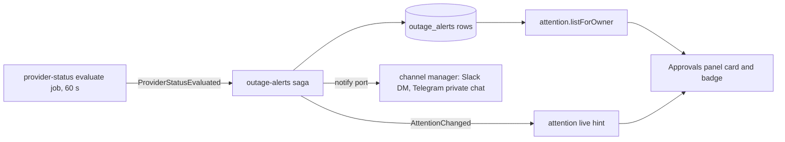

# Owners hear when a provider outage hits their unattended agents

> Working plan — temporary, committed on the feature branch.
> Deleted once the feature ships.

**Issue:** [dam-agents/dam#5387](https://github.com/dam-agents/dam/issues/5387) (part of the Notifications epic [dam-agents/dam#3100](https://github.com/dam-agents/dam/issues/3100))

**Builds on:** Provider Status from [dam-agents/dam#5410](https://github.com/dam-agents/dam/pull/5410), which is merged.

## Goal

A schedule or a Slack or Telegram channel runs an agent while nobody watches.
When the model provider of that agent is down, the agent fails and nobody is told.
The owner finds out days later, if at all.

Provider Status shows an outage only to users who have the app open.
This feature tells the owner of the affected agents when they are away:

- **A Slack direct message**, and a message in the owner's private Telegram chat with the platform's bot, when an outage lasts longer than a delay, and again when the provider works again.
- **A card in the Approvals panel**, counted in the panel's badge, that names the provider, the affected agents and why each one is affected, until the owner dismisses it.

This plan covers only the provider outage part of #5387.
Removed models and provider-side limits are out of scope (see [Out of scope](#out-of-scope)).

## Decisions

Decisions that Petr made while this plan was discussed:

| #   | Decision                                                                                                                                                                                                                                                                                                                                                                                                                                                                                      |
| --- | --------------------------------------------------------------------------------------------------------------------------------------------------------------------------------------------------------------------------------------------------------------------------------------------------------------------------------------------------------------------------------------------------------------------------------------------------------------------------------------------- |
| D1  | The delay before the first message is one platform default of 15 minutes, in the Helm value `apiServer.outageAlertDelay`. Detection already takes up to about 2 minutes, and most overload bursts end within 10 minutes. No delay per user or per agent.                                                                                                                                                                                                                                      |
| D2  | Telegram: the alert also goes to each private chat that the owner bound to one of their own agents, with times in UTC. It never goes to a group chat or a business chat. Changed on 2026-10-20 from "no Telegram message". Owners without such a chat get no Telegram message; no Telegram link from a person to a platform user is planned.                                                                                                                                                  |
| D3  | The slices below (04 added with D2). Provider Status emits one event after each evaluation, with every degraded template, its start time and its failed payers, not separate "outage started" and "outage ended" events. See [The event](#the-event) for the reason.                                                                                                                                                                                                                          |
| D4  | The owner's notice lives in the attention list, next to the default-model notices: a card in the Approvals panel, counted in the panel's badge, a dismissal in the attention record, and the `attention` live hint. Decided on 2026-10-21, because default-model notices already tell an owner there that unattended runs fail; it replaces a separate notice on Home. It adds no line to the banner on Home, because the outage banner of Provider Status already shows a live outage there. |
| D5  | A told alert recovers only on evidence that the provider answers: a call to its template in the window that did not fail, or, for an outage that a public source reported, that source answering again without reporting it. Provider Status also drops a template that nobody calls, so a template that leaves the outages without evidence stays told. Decided on 2026-10-21.                                                                                                               |

Decisions made alone while planning (open for review):

| #   | Decision                                                                                                                                                                                                                                                                                  |
| --- | ----------------------------------------------------------------------------------------------------------------------------------------------------------------------------------------------------------------------------------------------------------------------------------------- |
| O2  | The alert state is one Postgres row per owner and Connection template, as resource alerts keep one row per owner and kind. A row is "told" or "recovered". So a start time that changes, because the snapshot expired, does not send a second message for the same outage.                |
| O3  | One message per outage and one recovery message. No reminders while the outage lasts (an open question of the issue).                                                                                                                                                                     |
| O4  | While the fault is on the platform's side, an outage found only from failed calls sends no new message, because the provider can be innocent. Owners are not told about the fault on the platform's side; that is the operator's problem.                                                 |
| O5  | An owner who becomes affected later in an outage gets their first message then. An owner who was told already gets no second message for more agents.                                                                                                                                     |
| O6  | The card shows told alerts, and recovered alerts for 7 days after the recovery. A dismissal is per owner, on the server, keyed by template, start time and state, so it holds on every device, and a new outage or the recovery shows the card again (D4).                                |
| O7  | The Slack message links to Home, as resource alerts do. The card lists the agents, each with a link to the agent's Providers section.                                                                                                                                                     |
| O8  | The outage alerts live in a new api-server module `outage-alerts`. Provider Status stays the same for every user, and the new module owns everything per owner. The attention module reads the owner's alerts through a port, as it reads the default-model notices.                      |
| O9  | No new tests (Petr's rule). Verification is the existing suite and the smoke tests.                                                                                                                                                                                                       |
| O10 | Resource alerts stay Slack-only: the channel manager sends to Telegram only when the caller gives a Telegram text.                                                                                                                                                                        |
| O11 | The module emits `AttentionChanged`, not an event of its own. Only the live-hint saga consumes that event, and its `attention` hint makes open tabs read the whole attention list again.                                                                                                  |
| O12 | An agent is unattended by the rule of the default-model notices: an enabled schedule, a Slack Channel bound in `channels`, or a Telegram chat bound in `telegram_conversations`. Sub-agents that a session spawned are left out. Both features then agree on which agents run unattended. |
| O13 | No Figma frame exists for the card (Petr, 2026-10-21). The card design in slice 03 uses only existing parts: the frame of the default-model card, the command box of the approval card, and the term, tone and status link of the Provider Status banner.                                 |

## Out of scope

- **Removed models.** A model that the provider no longer offers is permanent, so a delay does not help.
  It belongs with #5304 and #5385.
- **Limits and quota at the provider.** They belong to one key, not to the provider, so Provider Status does not see them.
  The platform's own spend limits already ask the owner ([spend-limits](../../architecture/spend-limits.md)).
- **A message to the people in a bound channel.** A failed addressed channel turn already answers the sender in plain words, and an ambient turn fails silently ([channel-turns](../../architecture/channel-turns.md)).
  Naming the outage in that answer is a follow-up; no issue tracks it yet.
- **A Telegram link from a person to a platform user**, for owners without a bound private chat (D2).
- **A line in the banner on Home.** The outage banner of Provider Status already shows a live outage on every page but the chat, Home included (D4).
- **A delay per user or per agent, reminders, and an opt-out.**
- **The fault on the platform's side** (O4).

## Approach

Read [provider-status](../../architecture/provider-status.md), [budgets § Resource alerts](../../architecture/budgets.md#resource-alerts), [channels](../../architecture/channels.md) (the platform can message a linked person), [home-feed § Default-model notices](../../architecture/home-feed.md#default-model-notices) and [harness-config](../../architecture/harness-config.md) (the chat, channel and scheduled defaults) first.



### Terms

- **Payer:** the agent that pays for a model call, which is the root driver for a sub-agent.
  The gateway's call window keeps the payers with failed calls per template.
- **Unattended agent:** an agent that runs while nobody watches, by the rule of O12.
- **Fire provider:** the provider Connection that a fire uses ([schedules § Session choices](../../architecture/schedules.md#session-choices), [channel-turns](../../architecture/channel-turns.md)).
  For a schedule, `firePair(agentId, "scheduled", { harness, model })` with the schedule's harness and its model passed through `scheduleModelFor`, as the scheduler does; a choice the schedule does not set takes the agent's scheduled default, which falls back to the chat default.
  For a channel turn, `firePair(agentId, "channel", {})`, the agent's channel default, which falls back to the chat default.
- **Evidence:** a sign that a template answers again (D5).
  The template had a call in the window that did not fail, or its public source answered in this run and did not report it.
- **Outage alert:** the message to an owner that an outage hits their agents, its recovery message, and the card.
  Slice 01 adds the term to `docs/ubiquitous-language.md` under Provider Status.

### The event

Provider Status runs its evaluate job every 60 seconds through BullMQ, on any replica (`packages/api-server/src/core/periodic-jobs.ts`).
The start time of an outage lives only in the Redis snapshot, which expires after 3 minutes.
So start and end events have two gaps:

- When the job does not run for 3 minutes, the next run has no previous snapshot: it misses every end, and every outage looks new.
- The delay needs a clock.
  With start and end events, the notifier needs a second periodic job and its own table of pending outages.

One event after each evaluation closes both gaps.
It repeats the full state every minute, so a lost event changes nothing, and the next event is the clock for the delay.
The saga runs on the replica that ran the job, and the compare-and-set on the Postgres row stops a double send.

`packages/api-server/src/events.ts` gets:

```ts
type ProviderStatusEvaluated = {
  type: EventType.ProviderStatusEvaluated;
  checkedAt: Date;
  outages: readonly {
    templateId: string;
    reason: ProviderOutageReason; // "failing-calls" | "unreachable" | "provider-reported"
    since: Date;
    statusPageUrl: string | null;
    failedPayers: readonly string[]; // every payer with a failed call since the outage started
  }[];
  damSide: { since: Date } | null; // the fault is on the platform's side
  answering: readonly string[]; // templates with a call in the window that did not fail
  cleared: readonly string[]; // templates whose public source answered in this run and did not report them
};
```

`outages` lists every degraded template, also the ones that the status query hides while the fault is on the platform's side.
The failed payers leave the call window after about 6 minutes.
So the snapshot keeps, per degraded template, the union of the failed payers of each run since the outage started (slice 01).
The snapshot is internal; the status query does not return payers.

`answering` and `cleared` are the evidence of D5.
`answering` uses `hasSucceededCalls` on the window of each template.
`cleared` uses `answered` on each reading of a public source, minus the templates that the reading reports.
A proxy's readiness says only that the proxy runs, not that its models answer, so `cleared` ends only an outage that a public source reported (see [The alert rules](#the-alert-rules)).

### The alert rules

The saga handles each `ProviderStatusEvaluated` in order (`concatMap`):

1. **Recover.** A "told" row recovers when its template is not in `outages` and there is evidence: the template is in `answering`, or the row's reason is not `failing-calls` and the template is in `cleared`.
   For such a row: write "recovered" with compare-and-set, then send the recovery message.
   A told row whose template is still degraded, with any start time, stays told.
   A told row with no evidence stays told (D5).
2. **Tell.** An outage is tellable when `checkedAt - since >= delay`, and not (`damSide` and reason `failing-calls`).
   For a tellable outage, find the affected agents and group them by owner (slice 01: the failed payers; slice 02: also the unattended agents).
   For each owner with no row, or with a "recovered" row: write "told" with the outage's reason and compare-and-set, then send the outage message.
   An owner with a "told" row gets nothing (O5).
3. One owner's failure is logged and does not stop the others, as in resource alerts.

The compare-and-set follows `ResourceAlertsRepository.claim` (`packages/api-server/src/modules/resource-alerts/infrastructure/resource-alerts-repository.ts`): an insert that does nothing on conflict for a new row, and an update that names the version it read for a row that exists.
The write comes before the send: a send that fails is lost, not repeated.
After each won write, the service emits `AttentionChanged { ownerSub, agentId }` with the first agent of the row (O11).

### The table

`outage_alerts`, primary key `(owner_sub, template_id)`:

| Column            | Meaning                                                                                                 |
| ----------------- | ------------------------------------------------------------------------------------------------------- |
| `owner_sub`       | The owner's real Keycloak sub, from the agent's owner label (not the pseudonymized `agents.owner_sub`). |
| `template_id`     | The Connection template of the outage.                                                                  |
| `state`           | `told` or `recovered`.                                                                                  |
| `reason`          | The outage's reason when it was told; it decides which evidence ends it (D5).                           |
| `since`           | The start time of the outage, as told.                                                                  |
| `told_at`         | When the outage message went out.                                                                       |
| `recovered_at`    | When the recovery message went out; `null` while told.                                                  |
| `agents`          | JSON list of the affected agents at the time of the message: id, name, and why (see the contract).      |
| `status_page_url` | The provider's public status page from the event, or `null`.                                            |
| `version`         | The compare-and-set counter.                                                                            |
| `updated_at`      | The time of the last write.                                                                             |

The rows stay small: at most one per owner and template.
A dismissal is not a column: it lives in the attention record (`attention_state`), as the dismissals of default-model notices do (D4).
Check the deletion rules of [persistence § Lifetime](../../architecture/persistence.md#lifetime) for a row that names a deleted owner.

### The contract

No new router: the attention contract carries the alerts (D4).
In `packages/api-server-api/src/modules/attention/` (slice 03):

```ts
type AttentionItemKind = "session" | "approval" | "default-model" | "outage-alert";

type OutageAlertAffectedBy = "failed-calls" | "schedule" | "slack" | "telegram";

interface OutageAlertAgent {
  agentId: string;
  name: string;
  affectedBy: OutageAlertAffectedBy[];
}

interface OutageAlertNotice {
  id: string; // `${templateId}:${since}:${state}`, the dismissal key
  templateId: string;
  since: string; // ISO time
  recoveredAt: string | null; // ISO time
  statusPageUrl: string | null;
  agents: OutageAlertAgent[];
}

interface AttentionList {
  items: AttentionItem[];
  dismissed: DismissedEntry[];
  defaultModels: DefaultModelNotice[];
  outageAlerts: OutageAlertNotice[]; // told rows, and recovered rows of the last 7 days
}

// attention.dismiss: the item kind "outage-alert" with a notice id
```

The UI names a template's provider with `providerNameFor` (`packages/ui/src/modules/provider-status/lib/provider-name.ts`).

### The delay

A new Helm value `apiServer.outageAlertDelay`, a duration, default `"15m"` (D1).
The chart passes it as `OUTAGE_ALERT_DELAY`.
`packages/api-server/src/config.ts` reads it into `outageAlertDelayMinutes` with `durationToMinutesStrict`, as `agentIdleTimeoutMinutes` reads `AGENT_VM_IDLE_TIMEOUT`, so a value it cannot read stops the start.

## Sub-issues

| #     | Title                                                           | Scope                                                                                                                                              | Depends on |
| ----- | --------------------------------------------------------------- | -------------------------------------------------------------------------------------------------------------------------------------------------- | ---------- |
| ✅ 01 | [Slack alert for agents with failed calls](./01-slack-alert.md) | Failed payers and evidence in the event, the `outage-alerts` module, table, rules, Slack outage and recovery messages, Helm delay, docs            | —          |
| 02    | [Unattended agents on the failing provider](./02-unattended.md) | Owners of agents whose schedules or channel bindings fire on the failing template, by kind of default; the message says why each agent is affected | 01         |
| 03    | [Outage alert in the Approvals panel](./03-attention-card.md)   | The alerts in `attention.listForOwner`, the dismissal kind `outage-alert`, the card in the Approvals panel, the panel badge                        | 01         |
| 04    | [Telegram alert in the owner's private chat](./04-telegram.md)  | The owner's private chats bound to their agents, the channel manager's notice with a Telegram text, UTC times                                      | 01         |

Slices 02, 03 and 04 do not depend on each other.

## Conventions & glossary

- Server-side TS: apply `/typescript-engineering`.
  The new module has `domain/` (pure rules and message text), `infrastructure/` (the repository), `services/`, `sagas/`, `compose.ts` and `index.ts`.
  Other modules see only `index.ts`.
  The module gets its ports from the composition root (`packages/api-server/src/bootstrap.ts`), as `composeResourceAlerts` does: `notify` is `channelManager.notifyPerson`.
- UI: apply `/react-ui-engineering`.
  The alerts are server state: they live only in the TanStack Query cache of the attention query.
- Every new `EventType` needs an arm in `packages/api-server/src/modules/live-events/sagas/live-hints.ts`, and `mise run //docs:fix:activity-events` regenerates `docs/activity-events.md`.
  The coverage script fails an event that is emitted and never consumed.
- The message texts use the provider's name and `config.uiBaseUrl`; never write the brand in code.
  The provider's name comes from `providerTypeForTemplateId`: `config.brand.name` for the `platform` type, `PROVIDERS[type].displayName` for the other types, and the template id for a template outside the presets.
- Times in a Slack message use Slack's date token (`<!date^…>`), so each reader sees local time; a Telegram message shows times in UTC.
- No new tests (O9).
- Comments follow `docs/guidelines/comment-guidelines.md`; run `mise run check:comment-types`.
- Architecture: slice 01 adds the section "Outage alerts" to `docs/architecture/provider-status.md`.
  If the page then goes over its size cap, move the section to a new page `docs/architecture/outage-alerts.md`, linked from `docs/architecture.md`.

## Wording

`{Provider}` is the provider's name; `{since}` and `{end}` are times; `{agents}` is the list of agent lines.
An agent line is `• {Agent} — {why}`, where `{why}` joins: "calls failed", "schedule", "Slack channel", "Telegram chat".
The message lists at most 10 agents, then "and {n} more".

| Place                         | Text                                                                                                                                                                                                                                               |
| ----------------------------- | -------------------------------------------------------------------------------------------------------------------------------------------------------------------------------------------------------------------------------------------------- |
| Slack, outage                 | {Provider} has had problems since {since}. These agents of yours use it, and they can fail until it works again: {agents} Wait, or switch an agent to another provider: {home URL} {Provider} status: {status page URL, when one exists}           |
| Slack, recovery               | {Provider} works again. It had problems from {since} to {end}. Runs that failed in that time do not run again, so check the last runs of: {agents} {home URL}                                                                                      |
| Telegram, outage and recovery | The Slack texts, plain, with times in UTC (for example "20 Oct 10:02 UTC").                                                                                                                                                                        |
| Card, outage                  | Meta line: "Provider outage". Headline: "{Provider} is not responding". Detail: "Since {since}. {n} of your agents use it and can fail until it works again." Then the agent rows, each with "Switch provider".                                    |
| Card, recovered               | Meta line: "Provider recovered". Headline: "{Provider} works again". Detail: "It had problems from {since} to {end}. Runs that failed in that time do not run again." Then the agent rows.                                                         |
| Card, agent row               | Line 1: the agent's name. Line 2: the reasons, joined with " · ": "Calls failed", "Schedule", "Slack channel", "Telegram chat".                                                                                                                    |
| Card, actions                 | "{Provider} status" when a status page exists. Told: "Dismiss", with the title "Hides this from Approvals. The agents can still fail until {Provider} works again." Recovered: "OK". More than five agents: "Show all {n} agents" and "Show less". |

## Known limits

- A Slack message reaches only an owner who linked Slack (`/platform login`); a Telegram message reaches only an owner who bound their own private chat to one of their agents; the Approvals panel reaches everyone.
- The first message comes after the delay plus up to about 2 minutes of detection.
- An outage that only failed calls show must keep failing for the whole delay: a 5-minute pause in calls ends it in Provider Status, and the delay starts again.
- A told alert without evidence stays told: when no agent calls the provider again, the card stays until the owner dismisses it, and no recovery message goes out.
- A provider that flaps sends an outage message and a recovery message for each outage that lasts longer than the delay.
- The fire provider of a channel turn is the agent's channel default.
  A thread's session follows that default unless someone picked its model by hand; such a session can run on another provider (the same rule as the spend hold).
- A one-time schedule that continues its session keeps that session's choices, which this feature does not read, so it never names that schedule.
- When the snapshot expires, the next outage start time is new, so the delay starts again.
- A reply in the owner's private Telegram chat is a turn of the agent bound there; during the outage it fails with the usual failure text.
- A Telegram message trusts that the person in a bound private chat is the owner, as the binding does: that person already drives the agent with the owner's credentials.
- During a rolling deploy, an old replica can refuse the new notice shape over the channel RPC; that send is lost, because the row is written first.

## Whole-feature smoke test

On the dev cluster, after all slices, with the api-server and UI images rebuilt and the chart redeployed with `apiServer.outageAlertDelay: "2m"`:

1. Link Slack for the dev user (`/platform login` in the Mother Core OS workspace), and bind agent A to Petr's private chat with the dev Telegram bot (`/bind`).
2. Prepare three agents on IBM LiteLLM: agent A for chat, agent B with an hourly schedule, agent C bound to `#general`.
   Boot them before step 3.
3. Cut IBM LiteLLM off with the iptables recipe from the outage memory (REJECT in the Lima VM), and delete the gateway pods of the agents to drop open connections.
4. Send two messages each to agents A and C, and run the schedule of B now.
5. Within about 4 minutes (2 minutes delay plus detection):
   - one Slack DM names IBM LiteLLM, the start time, and the three agents with "calls failed", "schedule", "Slack channel" and "Telegram chat";
   - the private Telegram chat gets the same message, with times in UTC;
   - the Approvals panel shows the card with the same agents in both layouts, and its badge counts it.
6. Dismiss the card; reload: it stays dismissed.
7. Remove the iptables rules and send again.
   Within about 6 minutes, one recovery message arrives in Slack and in the Telegram chat, and the Approvals panel shows the recovered card.
8. Redeploy with `apiServer.outageAlertDelay: "8m"`, repeat step 3 for less than 2 minutes, then remove the rules and send again: no message arrives.
   With a 2-minute delay, a short cut still counts as an outage longer than the delay, because its failures stay in the 5-minute call window.
9. Cut off only the agents' calls: add the REJECT rule with `! -s <api-server pod IP>`, so the readiness check still passes.
   Send messages until the alert arrives, then stop sending for 7 minutes and keep the rule: no recovery message arrives.
   Remove the rule and send again: within about 6 minutes, the recovery message arrives.

## Delivery

Each sub-issue is one atomic commit.
The whole feature lands as a single PR for [dam-agents/dam#5387](https://github.com/dam-agents/dam/issues/5387).
The PR covers only the provider outage part, so it says "Refs #5387", not "Closes": #5387 stays open for removed models and limits.
