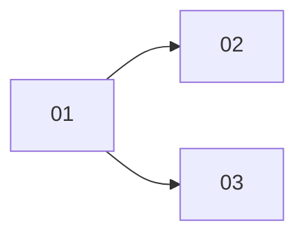

# Spend per model call and for less than a day

> Working plan — temporary, committed on the feature branch. Deleted once the feature ships.

**Issue:** https://github.com/dam-agents/dam/issues/5403

## Goal

Each model call shows its measured cost where the call is listed: in the turn timeline, in the agent's own call list (`get_metrics` with `granularity: "call"`) and in the CLI's recent calls.
An estimated call is marked as an estimate.
Spend can be read for a window in hours, by the agent (`get_metrics`) and by the CLI (`dam metrics --since <hours>`).
A session's spend row shows its start and end time, not only its days.
All figures come from the gateway measurement, the same source as the limits.

## Approach

Read [`docs/architecture/spend-limits.md`](../../architecture/spend-limits.md) (Meter, Ledger, Call rows, Estimates) and [`docs/architecture/agent-telemetry.md`](../../architecture/agent-telemetry.md) first; [`docs/architecture/metrics.md`](../../architecture/metrics.md) for `get_metrics`; [`harness-config.md` › The Model Router](../../architecture/harness-config.md#the-model-router) for the stamp.

Two records describe one model call today, and they share no id:

- The **Model Router** (agent pod) forwards the call and exports a `platform.model_call` telemetry record (model, tokens, time, `request_id`). The timeline and `get_metrics` call rows read these.
- The **gateway meter** measures the call; the api-server writes one `spend_calls` row per settled call (cost, session, start time) and adds it to the `spend_daily` rollup.

**Join by a router call id.** The router gives each forwarded call a random id and stamps it as `x-platform-call`, beside `x-platform-session` and `x-platform-harness`.
It also exports the id as `call.id` on its `platform.model_call` record.
The meter copies the stamp into the call's metadata like the session (same 128-char printable-ASCII rule) and removes it before the provider.
The api-server stores it on the `spend_calls` row as `router_call_id`.
The stamp comes from the agent's pod, so it serves display only: a forged id can move a cost between rows of the same agent's own display, never change a total or a limit.
A harness's own call record (`claude_code.api_request`, …) reaches the cost through the router record with the same `request_id`, the link the timeline already uses.
Calls settled before slice 01 ships have no router call id and show no per-call cost.

**Richer call rows.** `spend_calls` also gets the call's Connection, model, token counts, web searches, model time and an `estimated` flag, so an hours read returns the same shape as a daily read.
Retention stays 30 days.

**Hours windows.** A read with a window in hours sums `spend_calls` rows that started inside it, grouped like the daily read.
A window that starts more than 30 days ago (before the call rows' retention) widens to whole UTC days and reads `spend_daily`; the result says that it counts whole days.
Both start no earlier than the measuring start T.

**Session times.** A session row takes its start and end time from the first and last `spend_calls` row of the session (start time of each call).
A session older than 30 days has no call rows and keeps its days only.

### tRPC and tool contract

```ts
// packages/api-server-api/src/modules/spend/schemas.ts
// spend.breakdown and spend.sessions take either UTC days (as now) or an exact window:
const spendAtWindowSchema = z.object({
  fromAt: z.string().datetime(), // inclusive
  toAt: z.string().datetime(),   // exclusive, ≤ now + slack
});
// breakdown: { agentId, from, to } | { agentId, at: spendAtWindow }
// sessions:  { agentId, from?, to?, … } | { agentId, at: spendAtWindow, … }

// packages/api-server-api/src/modules/spend/types.ts
export interface SpendReadWindow {
  granularity: "hour" | "day"; // "day" when the asked window started before the call rows' retention
  fromAt: string;
  toAt: string;
}
// SpendBreakdown and the sessions result gain `window: SpendReadWindow`.
// SpendSessionRow gains `firstAt: string | null; lastAt: string | null` (null when the session has no call rows).

// packages/api-server-api/src/modules/telemetry/types.ts
export interface TelemetryCallCost {
  unit: SpendUnit;
  costMicros: number;
  estimated: boolean;
}
// TelemetryLog gains `cost: TelemetryCallCost | null` on platform.model_call records
// and on harness call records attached to one by request id.

// packages/api-server-api/src/modules/metrics/types.ts
// CallContext keeps its fields; costUsd becomes `cost: TelemetryCallCost | null`.

// packages/api-server-api/src/modules/metrics/schemas.ts
// get_metrics: `hours` (int, 1..720) beside `days`; give one or the other.
```

## Sub-issues

| #  | Title | Scope | Depends on |
|----|-------|-------|------------|
| 01 | ✅ Call rows carry the router call id and the call's detail | Router stamp + export, meter copy, migration, ingest writes | — |
| 02 | ✅ Cost of each model call | Telemetry turn + `get_metrics`/CLI call rows read cost by call id; timeline shows it | 01 |
| 03 | Spend windows in hours | `hours` in `get_metrics`, exact window in `spend.breakdown`/`spend.sessions`, CLI `--since`, session start/end times | 01 |



## Conventions & glossary

- **Call row:** a `spend_calls` row. **Router call id:** the id the Model Router stamps as `x-platform-call`; not the gateway's internal `call_id`, which stays the row's key.
- **Estimated:** the ingest's existing estimate (`measureCall` in `packages/api-server/src/modules/spend/domain/call.ts`); the row flag is true when the settled amount counted `estimatedCalls`.
- Apply **/typescript-engineering** for server-side TS (agent-runtime, api-server, api-server-api, cli) and **/react-ui-engineering** for `packages/ui`.
- Prefer Carbon icons. Copy follows `packages/ui/src/modules/spend/lib/copy.ts`.
- **Related work:** PR #5642 (all-agents provider limit) changes the spend gate, `spend.status`, the limit meters and `spend-limits.md`. No functional overlap; expect merge conflicts in `spend-limits.md` and the spend `schemas.ts`/`types.ts`. `spend-limits.md` is near the 40,000-character doc cap: put new call-row text in its **Call rows** paragraph tersely, and the `get_metrics` text in `metrics.md`.

## Whole-feature smoke test

On the local cluster (`mise run cluster:build -- api-server agents controller`), with the UI from a local Vite dev server:

1. Run a chat turn that makes several model calls. Expand its timeline: each `platform.model_call` row and each harness call row shows a cost; the costs sum to the turn line's cost.
2. Ask the agent: "Use get_metrics with granularity call for the last hour." Each call has a cost; a call with no measured usage shows `estimated: true`.
3. `dam metrics <agent> --since 2`: totals count only the last two hours; the header says hours, not days. `--since 800` says it counts whole days.
4. The session row tooltip and `dam metrics` session rows show start and end times.

## Delivery

Each sub-issue is one atomic commit. The whole feature lands as a single PR for https://github.com/dam-agents/dam/issues/5403.
