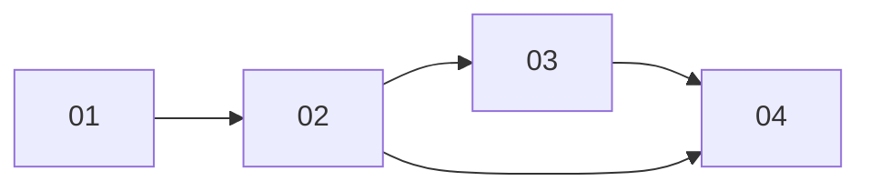

# Provider spend limit for all agents

> Working plan — temporary, committed on the feature branch. Deleted once the feature ships.

**Issue:** https://github.com/dam-agents/dam/issues/5434

## Goal

A user sets one daily limit for a connected provider, and it holds for all their agents together,
including agents they create later, sub-agents, and agents deleted that day.

The main case is **dollar providers with separate budgets**: a personal Anthropic key next to the
company IBM LiteLLM. Today "Your spend limit (all agents)" caps only the sum of all paid providers,
and a per-agent provider limit caps one agent at a time, so nothing caps one dollar provider across
agents. The Claude subscription and Bob are the second case: today only per-agent provider limits
stop them, so a new agent starts unlimited and one busy agent can use up the shared plan.

Every place that shows a limit tells the user which limit stops the calls first: the one with the
least left today.

## Approach

Read [`docs/architecture/spend-limits.md`](../../architecture/spend-limits.md) first; this feature
extends its **Limits**, **Unattended work**, **Continue** and **Screens** sections.

**A fourth limit scope.** `LimitScope` (`packages/api-server/src/modules/spend/domain/limits.ts`)
has `agent`, `owner` and `connection` (one agent on one Connection). Add
`{ kind: "owner-connection", connectionId }`: all agents of the owner on one Connection, in that
Connection's unit. It applies to every Connection that takes a per-agent Connection limit today
(`connectionLimitRule(templateId).limitable`), dollar Connections included.

- **Storage:** `spend_limits` already fits — `scope = 'owner-connection'`, `agent_id` null,
  `connection_id` set. The unique key is `nulls not distinct`, so one limit per owner and
  Connection. No migration.
- **Counter:** a new `DayCounter` `{ scope: "owner-connection", day, ownerSub, connectionId }`,
  key `spend:<day>:ownerconn:<ownerSub>:<connectionId>`, added by `dayCountersOf` and rebuilt by
  `SpendLedger.total` from `spend_daily` on `(day, owner_sub, connection_id)`. The rollup keeps
  the rows of sub-agents (they count for their payer) and of deleted agents, so both count.
- **Gate:** `limitsOnCall` matches it when `call.ownerSub` and `call.connectionId` match.
  `SpendLimits.applying` returns it with the owner's other limits. Holds, the refusal and the
  continue question then follow with no new code paths: the check already refuses on any reached
  limit and asks one question per reached limit.
- **Ownership:** only the owner of the Connection sets it; `setLimit` checks the Connection
  belongs to the caller and takes a limit. The limit is deleted when the Connection is removed
  (`EventType.ConnectionRemoved`).

**"Stops first" moves to the server.** Today the UI works out "your limit for all agents / the
ceiling stops this agent first" in the browser, for dollars only
(`packages/ui/src/modules/spend/lib/nearer-limit.ts`). The issue wants the same answer in the
CLI and the agent's tool, across units. `spend.status` computes it once; every surface reads it.

### tRPC contract (pinned; 01 and 02 implement it, 03 and 04 read it)

```ts
// packages/api-server-api/src/modules/spend/schemas.ts
spendLimitScopeSchema = z.discriminatedUnion("kind", [
  { kind: "agent", agentId },
  { kind: "owner" },
  { kind: "connection", agentId, connectionId },
  { kind: "owner-connection", connectionId },            // NEW (01)
]);

// packages/api-server-api/src/modules/spend/types.ts
interface SpendStatus {
  day; resetsAt; limits; ceiling; spent; spentByConnection;  // unchanged
  ownerSpentByConnection: SpendConnectionTotal[];         // NEW (01): today's spend of all
                                                          //   the owner's agents per Connection
  binding: SpendBinding[];                                // NEW (02): only with input.agentId
}

// NEW (02): for one agent, per unit and Connection it can spend on, what is left and which
// limit leaves the least. `limitId` null means the ceiling.
interface SpendBinding {
  connectionId: string | null;   // null: the agent's dollar spend across Connections
  unit: SpendUnit;
  leftMicros: number;
  stopsFirst: { kind: SpendLimitScope["kind"] | "ceiling"; limitId: string | null };
  others: { kind: SpendLimitScope["kind"] | "ceiling"; leftMicros: number }[];
}
```

`spend.setLimit` keeps its input; a `{ kind: "owner-connection" }` scope is new to it.

## Sub-issues

| #  | Title | Scope | Depends on |
|----|-------|-------|------------|
| 01 | [All-agents provider limit in the gate](./01-gate.md) | New scope, counter, gate check, `setLimit`, `dam spend limit --me --connection`, cleanup on Connection removal, Home question text, architecture page | — |
| 02 | [Which limit stops first, from the server](./02-binding.md) | `binding` in `spend.status`; the agent's tool and `dam spend status` show it | 01 |
| 03 | [Limit meters: black, thin, one family](./03-meter.md) | `DailyLimitMeter` and Home's memory bars restyled; Settings › Providers block; Settings › Usage summary | 02 |
| 04 | [Agent › Providers: every limit at a glance](./04-agent-providers.md) | Headline + one meter per limit, gap for this agent's part, dialog line, agent Usage card on `binding` | 02, 03 |



## Conventions & glossary

- **All-agents provider limit** — the new limit: one Connection, all agents of its owner. Named
  on screens "Your ‹Connection name› spend limit (all agents)"; titled "Daily limit for all agents"
  inside a provider row. Scope kind `owner-connection`.
- **Agent provider limit** — the existing per-agent Connection limit (`connection` scope).
- **Your spend limit (all agents)** — the existing `owner` dollar limit. **Spend ceiling** — the
  operator's hard dollar maximum. Neither is drawn as a bar on a provider; they show as a message.
- **Stops first / binding** — the limit with the least left today among those counting a call.
- **Left** — `max(0, effective − spent)`, effective = amount × (1 + extensions).
- Apply **/typescript-engineering** for server-side TS (`api-server`, `api-server-api`, `cli`) and
  **/react-ui-engineering** for `packages/ui`. Copy follows the existing `spend/lib/copy.ts` voice:
  plain sentences, the reset time in the reader's own time on screens, UTC for agents.

### Approved UI design

[`mockup.html`](./mockup.html) (open it in a browser) is the design the operator approved. Its
purple boxes are design notes. Decisions taken there:

- **Meters are black**, `h-2` (8 px, the height of Home's compute slot bars), on a light tint of
  the same colour; orange at 80 %, red when reached. No grey, no brand blue on bars; links stay
  `text-accent`.
- **A shared bar is one colour**, split by a 2 px gap where this agent's part ends.
- **Settings › Providers** is where the all-agents limit is set. **Settings › Usage** shows only a
  small read-only summary inside the existing "Daily spend limit" card.
- **Agent › Providers** (variant A): a headline with what this agent may still spend on the
  provider and which limit stops it, then one meter per limit, "stops first" on the binding one.
  "Your spend limit (all agents)" and the ceiling show only as a tinted message when close or
  reached, on dollar Connections.
- **Home's memory/CPU pool bars** take the same black fill and height.

## Whole-feature smoke test

On a local cluster (`mise run cluster:install`), signed in as one user:

1. Connect an Anthropic key and IBM LiteLLM; create agents A and B on Anthropic.
2. In Settings › Providers, set Anthropic's daily limit for all agents to $0.05. Settings › Usage
   shows a small Anthropic bar under "Daily spend limit".
3. Run a turn on A, then on B. Once the shared spend passes $0.05, the next call of either agent is
   refused with "Spend limit reached"; Home asks one question naming "Your Anthropic spend limit
   (all agents)" and saying Continue lets all agents go on. LiteLLM calls still go through.
4. On A's Providers page: the headline says "Nothing left today", the "All agents" meter is red
   with a gap at A's part, the link points to Settings › Providers.
5. Set A's own Anthropic limit to $0.02 and continue the shared one: A's headline now names its own
   limit as stopping first; `dam spend status A` and A's `describe_spend_limits` say the same.
6. A scheduled fire on B while the shared limit is reached is held; a sub-agent spawned by A
   counts toward the shared limit.
7. Delete agent B: today's spend still counts. Disconnect Anthropic: the limit is gone.

## Delivery

Each sub-issue is one atomic commit. The whole feature lands as a single PR for
https://github.com/dam-agents/dam/issues/5434.
