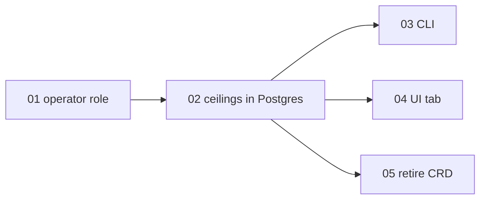

# Spend ceilings in Postgres, set by platform operators

> Working plan — temporary, committed on the feature branch.
> Deleted once the feature ships.

**Issue:** https://github.com/dam-agents/dam/issues/5712

## Goal

The per-user Spend Ceiling moves out of the cluster and into the platform's database, next to the other spend limits.
A platform operator sets, changes, clears and lists ceilings through the platform: from the CLI (`dam spend ceiling`) and from a new Settings › Operator tab.
No operator needs cluster access for this any more.
A new general realm role, `platform-operator`, decides who is an operator.
Each ceiling records who set it and when.
A user with no ceiling of their own still gets the install's default ceiling from the chart.
Users see no change: the ceiling stops their agents the same way as before, and spend status says that an operator set it.
The chart and the controller stop defining the `UserSpendLimit` custom resource type.

The operator role is general on purpose.
After this feature, compute budgets (`UserBudget`) move out of custom resources the same way and use the same role and the same Settings tab.
That move is not part of this feature.

## Approach

Read these architecture pages first:
[spend-limits](../../architecture/spend-limits.md) (sections Spend ceiling, Limits, Screens),
[security-and-credentials](../../architecture/security-and-credentials.md) (section Identity),
[cli](../../architecture/cli.md),
[usage-tracking](../../architecture/usage-tracking.md) (the inspector role, the pattern the operator role copies),
[persistence](../../architecture/persistence.md).

### Today

- An operator writes a namespaced `UserSpendLimit` object named `spend-limit-<sub>` with `spec.dailyUsd`.
  The CRD is in [`helm/crds/agent-platform.ai_userspendlimits.yaml`](../../../helm/crds/agent-platform.ai_userspendlimits.yaml), from the Go type in [`packages/controller/api/v1/user_spend_limit_types.go`](../../../packages/controller/api/v1/user_spend_limit_types.go).
  The controller never reads it.
- The api-server reads it in [`spend/infrastructure/user-spend-ceilings.ts`](../../../packages/api-server/src/modules/spend/infrastructure/user-spend-ceilings.ts): a K8s `get` by name, a 60-second cache, and the chart default (`apiServer.spend.defaultUserCeilingUsd` → `SPEND_DEFAULT_USER_CEILING_USD`) when no object exists.
- Two readers use its `SpendCeilings.forOwner` port: the ext_authz gate check ([`spend-check.ts`](../../../packages/api-server/src/modules/spend/services/spend-check.ts)) and spend status ([`spend-service.ts`](../../../packages/api-server/src/modules/spend/services/spend-service.ts)).
- The status reports `ceiling.source` as `"default"` or `"UserSpendLimit"` ([`api-server-api/src/modules/spend/schemas.ts`](../../../packages/api-server-api/src/modules/spend/schemas.ts)).
  The CLI shows the source in words; the web UI does not show it.
- Realm roles today: `requiredRole` (platform access), `platform-inspector` (read-only usage data), `platform-slack-installer` (connect a Slack workspace), and a core-team marker.
  None of them is a general operator role.
  Role checks today are on Hono routes (`c.get("roles")`); the tRPC context does not carry roles.

### After

**Operator role (01).**
The chart creates the realm role `keycloak.operatorRole` (default `platform-operator`) and an `operators` group mapped to it, the same shape as the inspector and Slack installer roles.
The keycloak-config-cli provision job applies the new role and group to an existing realm too.
The api-server marks a principal as an operator at the auth seam: a JWT whose `realm_access.roles` holds the configured role.
An API key is never an operator, so every operator act needs an interactive login.
An install with an empty `operatorRole` has no operators, and every operator procedure refuses.
The contract package gets an `operatorProcedure`, and a small `operator.status` query that tells a client whether the caller is an operator.

**Storage (02).**
A new table `spend_ceilings`, one row per user: `owner_sub` (primary key), `amount_micros`, `set_by_sub`, `created_at`, `updated_at`.
It sits next to `spend_limits` in [`packages/db/src/schema.ts`](../../../packages/db/src/schema.ts) and in the spend module.
It is a separate table and not a `spend_limits` row with a new scope, because a ceiling has other rules: the owner never sets it, it has no extensions ("continue" cannot lift it), and it records who set it.
Clearing a ceiling deletes its row, and the user falls back to the chart default.
The chart default stays in the chart.

**Gate read (02).**
`SpendCeilings.forOwner` reads the user's row from Postgres on each check, in parallel with the limits read that the check already makes.
It keeps no cache, so a change applies at the next model call, not within a minute.
A failed read fails the check and the gate refuses the call, the same as a failed limits read.
The status source becomes `"operator"` for a row and stays `"default"` for the chart default.

**Naming a user (02).**
An operator names a user by email.
The api-server resolves the email to a Keycloak `sub` through the existing Keycloak user directory ([`keycloak-user-directory.ts`](../../../packages/api-server/src/modules/agents/infrastructure/keycloak-user-directory.ts), `resolveByEmail`), as environment access lists do.
The list resolves each `sub` back to an email with `resolveManyBySub`, which leaves out a user with no email.
A row in a list can be changed or cleared by its `ownerSub`, so a user without an email stays manageable.

**Audit (02).**
The row keeps the last operator and the time.
Every set, change and clear also writes one structured log line, `spend.ceiling_changed`, with the operator's sub, the user's sub, and the amounts before and after.
So a cleared ceiling still leaves a trace in the external log pipeline.

**Surfaces (03, 04).**
The CLI gets `dam spend ceiling list|set|clear`.
The web UI gets a Settings › Operator tab that only operators see, with a Spend ceilings section.
The tab is the home for later operator acts, such as compute budgets.

**Retirement (05).**
The chart, the controller and the api-server's RBAC stop defining and reading `UserSpendLimit`.
Existing `UserSpendLimit` objects on the dev and staging installs are not migrated: spend caps are not in production, and operators set those ceilings again with the new commands.
After every install on the shared cluster runs the new version, a cluster admin deletes the CRD by hand ([Delivery](#delivery)).

### Contract (pinned)

Sub-issues 03 and 04 implement against this contract, which 01 and 02 create.

```ts
// 01 — packages/api-server-api/src/modules/operator/
// Open to every signed-in caller. An API key gets false.
operator.status: query () => { isOperator: boolean }

// 02 — packages/api-server-api/src/modules/spend/, nested in spendRouter.
// Both procedures use operatorProcedure.
spend.ceilings.list: query () => SpendCeilingList
spend.ceilings.set: mutation (SpendCeilingSetInput) => SpendCeilingEntry | null

type SpendCeilingUser = { email: string } | { ownerSub: string };

interface SpendCeilingSetInput {
  user: SpendCeilingUser;
  amountMicros: number | null; // spendLimitAmountSchema; null clears the ceiling
}

interface SpendCeilingEntry {
  ownerSub: string;
  email: string | null;
  amountMicros: number;
  setBySub: string;
  setByEmail: string | null;
  updatedAt: string; // ISO 8601
}

interface SpendCeilingList {
  defaultMicros: number | null; // the chart default, null when it is off
  ceilings: SpendCeilingEntry[]; // by email, then by ownerSub
}

type SpendCeilingSource = "default" | "operator"; // was "default" | "UserSpendLimit"
```

`set` with a `null` amount clears the ceiling and returns `null`, the way `spend.setLimit` clears a limit.
Errors:

- A caller who is not an operator, an API key included: `FORBIDDEN`, with a message that names the platform operator role.
- An email that no Keycloak user has: `NOT_FOUND`, with a message that names the email.
- The operator never comes from the input: the api-server takes `setBySub` from the principal.

Clients parse an amount that a person types with the existing `spendCeilingUsdTextSchema` (dollars, at most 7 digits and 2 decimals), so the CLI, the UI and the chart default accept the same text.

## Sub-issues

| #   | Title                                                                  | Scope                                                                                                                                          | Depends on |
| --- | ---------------------------------------------------------------------- | ---------------------------------------------------------------------------------------------------------------------------------------------- | ---------- |
| 01  | ✅ [Platform operator role](./01-platform-operator-role.md)            | Realm role and group in the chart, the operator flag on the principal, `operatorProcedure`, `operator.status`, Identity docs                   | —          |
| 02  | [Ceilings in Postgres, set by operators](./02-ceilings-in-postgres.md) | `spend_ceilings` table and migration, the gate and status read it, `spend.ceilings.list/set`, email lookup, audit log line, Spend ceiling docs | 01         |
| 03  | [CLI ceiling commands](./03-cli-ceiling-commands.md)                   | `dam spend ceiling list\|set\|clear`, cli.md                                                                                                   | 02         |
| 04  | [Settings › Operator tab](./04-ui-operator-tab.md)                     | Operator-only Settings tab with the Spend ceilings section and dialog, Screens docs, screenshots                                               | 02         |
| 05  | [Retire the UserSpendLimit CRD](./05-retire-userspendlimit-crd.md)     | Delete the CRD, the Go type, the RBAC rule and the last mentions                                                                               | 02         |



Implement them in number order: 03, 04 and 05 do not depend on each other, but one order keeps each commit on a known base.

## Conventions & glossary

- **Spend Ceiling:** the operator's hard daily dollar maximum for one user, over all the user's agents ([spend-limits](../../architecture/spend-limits.md#spend-ceiling)).
  "Ceiling" alone still means the compute Ceiling of a Budget, so always write "spend ceiling" in code names, copy and docs.
- **Platform Operator:** a person who holds the `platform-operator` realm role.
  An operator acts on the whole install, for all users.
  Add the term to [`docs/ubiquitous-language.md`](../../ubiquitous-language.md) in 01.
- **Default ceiling:** the chart's `apiServer.spend.defaultUserCeilingUsd`; it applies to every user with no row in `spend_ceilings`.
- Apply `/typescript-engineering` to the api-server, the contract package and the CLI (01, 02, 03), and `/react-ui-engineering` to the UI (04).
- **No new tests.** Verify with the existing suites (`mise run check`, `mise run test`) and the manual smoke tests.
  Where an existing test breaks because a name or a value changed, update it; where a test covers only the retired CRD, delete it.
- **Brand:** never hardcode the brand.
  The role name uses the permanent codename `platform`, as `platform-inspector` does, and Helm text that names the product uses `.Values.brand.name`.
- **Migration:** generate it with `mise run //packages/db:generate` and check it with `mise run //packages/db:check:journal`.
  If main lands a migration with the same number before this PR merges, generate it again on top of main; do not renumber the file by hand.
- **Docs:** follow [`docs/guidelines/documentation-guidelines.md`](../../guidelines/documentation-guidelines.md), one sentence per line (`mise run fix:markdown`), and never reference an ADR.
  Each slice updates the architecture page of the behavior it changes, in the same commit.
- **Comments:** follow [`docs/guidelines/comment-guidelines.md`](../../guidelines/comment-guidelines.md) and run `mise run check:comment-types`.
- Always use `mise run` for builds, checks, tests and cluster work.
  Use the `cluster-ops` skill for the local dev cluster, and `mise run cluster:kubectl` instead of bare `kubectl`.

## Whole-feature smoke test

On the local dev cluster, with the branch built and installed (`cluster-ops` skill):

1. Add a second test user without the `operators` group, through `keycloak.extraTestUsers` in a local values override.
   The `dev` user is in the `operators` group.
2. As `dev`, run `dam spend ceiling set 0 --user <second-user>@platform.local`.
   `dam spend ceiling list` shows the user, `$0.00`, `dev`'s email as the setter, and the time.
3. As the second user, `dam spend status` shows the ceiling as set by the operator.
   A model call from one of the second user's agents gets "Spend ceiling reached" in the chat, with no "continue" question on Home.
4. As the second user, `dam spend ceiling list` fails with the operator role message, and Settings shows no Operator tab.
5. As `dev`, open Settings › Operator.
   The Spend ceilings section lists the second user.
   Change the ceiling to `5`, then remove it; the list follows each step.
6. With `apiServer.spend.defaultUserCeilingUsd: "50"` in the values, the second user's status shows a $50 ceiling from the platform default.
7. `mise run cluster:kubectl -- get crd userspendlimits.agent-platform.ai` finds nothing on a fresh install of the branch.

## Delivery

Each sub-issue is one atomic commit.
The whole feature lands as a single PR for https://github.com/dam-agents/dam/issues/5712, before spend caps reach production.

**After merge, not in the PR:** once every install on the shared cluster (dev, staging and production) runs a version with this change, a cluster admin deletes the old resource type:
`kubectl delete crd userspendlimits.agent-platform.ai`.
This also deletes any `UserSpendLimit` objects that are left.
The CRD carries `helm.sh/resource-policy: keep`, so no chart upgrade deletes it.
An older api-server that still runs reads a missing CRD as "no object" and falls back to the default ceiling, so the order is safe even if one install lags.
