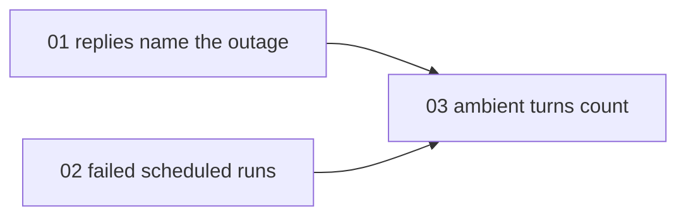

# Outage messages only where work failed

> Working plan — temporary, committed on the feature branch.
> Deleted once the feature ships.

**Issue:** https://github.com/dam-agents/dam/issues/5921

## Goal

Outage alerts tell the owner of every affected Agent, in Slack and in each private Telegram chat bound to their Agents, when a provider outage lasts more than 15 minutes.
An Agent counts as affected when its calls failed, also in the web chat, or when it only *could* fail: an enabled Schedule or a bound channel on that provider is enough.
On 24 October 2026, owners who used no Agent during a 25-minute Anthropic outage got an alert and a recovery message in Slack and in Telegram, and read them as spam.
Also, a person who meets the outage in Slack or Telegram reads only "Something went wrong", and that person is often not the owner.

After this change, a user hears about an outage only where it touches their work:

- A failed Slack or Telegram turn gets a reply that names the provider and its outage, in place of the generic failure reply.
- The owner gets one message per outage only when work that ran unattended actually failed: a scheduled run, or an ambient turn.
  An outage that failed nothing sends nothing.
- That message goes to the owner's Slack direct message, and to their private Telegram chats only when Slack reaches nobody.
- The Approvals panel card follows the same rule, because it reads the same alert rows.

The web chat already tells the user in place: the failed-turn card, the status line and the banner do not change.

## Acceptance criteria

### AC-1 — nothing failed, no message

Given the owner signed in, with an agent on Anthropic that has an enabled schedule and is connected to a Slack channel, and the banner names an Anthropic outage
When 30 minutes of the outage pass with no run of the agent
Then the owner gets no Slack direct message and no Telegram message about the outage

### AC-2 — a failed web chat turn sends no message

Given the banner names an Anthropic outage
When the owner sends a message in the chat of an agent on Anthropic and the turn fails
Then the owner gets no Slack direct message about the outage within 30 minutes

### AC-3 — the Slack reply names the outage

Given an agent on Anthropic connected to a Slack channel, and the banner names an Anthropic outage
When a person mentions the agent in that channel
Then within five minutes the thread gets a reply that says Anthropic has an outage

### AC-4 — the Telegram reply names the outage

Given an agent on Anthropic bound to a Telegram chat, and the banner names an Anthropic outage
When a person writes to the agent in that chat
Then within five minutes the chat gets a reply that says Anthropic has an outage

### AC-5 — the first failed unattended run sends one message

Given an agent on Anthropic with an enabled schedule, and the banner has named an Anthropic outage for more than 15 minutes
When the schedule fires and the run fails
Then within five minutes the owner gets one Slack direct message that names the agent and the outage

### AC-6 — later failures in the same outage send nothing more

Given that message
When a schedule of another of the owner's agents on Anthropic fires and its run fails in the same outage
Then the owner gets no new message about the outage

### AC-7 — one recovery message

Given that message
When a person mentions one of those agents in Slack after the outage ends
Then within five minutes the owner gets one Slack direct message that says Anthropic works again

## Approach

Read these architecture pages first:

- [provider-status](../../architecture/provider-status.md): detection, the snapshot and the evaluate job, the failed-turn card, and the section **Outage alerts**, which this feature rewrites.
- [channel-turns](../../architecture/channel-turns.md): the failure reply of an addressed turn, ambient turns, and the `ChannelTurnRelayed` event.
- [channels](../../architecture/channels.md): how the platform messages a person in Slack and in Telegram (`notifyPerson`).
- [home-feed](../../architecture/home-feed.md#outage-alerts): the outage card in the Approvals panel.
- [spend-limits](../../architecture/spend-limits.md): the gateway's call record, its Session stamp, and the Session check against the directory.
- [metrics](../../architecture/metrics.md#session-directory): the Session directory and session kinds.

### What stays

Outage detection stays as it is: the call window, the public sources, the snapshot and the 60-second evaluate job in Provider Status.
The `outage-alerts` module keeps its frame:

- One alert per owner and template in `outage_alerts`, `told` or `recovered`, written with a compare-and-set before a message goes out.
- The evaluate run is the only clock: each `ProviderStatusEvaluated` event repeats the whole state, so a lost run changes nothing.
- The delay (`apiServer.outageAlertDelay`, 15 minutes) before an owner hears anything; a failure from the start of the outage still counts once the delay has passed.
- No new message while the fault is on the platform's side and only failed calls show the outage.
- Recovery only on evidence, with one recovery message.

### What changes

**Who counts as affected.** Today an Agent is affected by a failed call in any session, or by work that could fire on the template (`services/unattended-agents.ts`).
Both rules go.
An Agent is affected only by work that ran unattended and failed on the template since the outage started:

| Work              | Evidence                                                                                                                                                                                                             | Slice |
| ----------------- | -------------------------------------------------------------------------------------------------------------------------------------------------------------------------------------------------------------------- | ----- |
| A scheduled run   | A failed gateway call (Provider Status's own definition: 500, 502, 503, 504 or 529) whose stamped Session the Session directory knows as a schedule Session (`schedule_cron`, `schedule_once`) of the calling Agent. | 02    |
| An ambient turn   | A `ChannelTurnRelayed` event with `ambient`, `outcome: "failed"` and the reason `provider-unavailable`, which names the template.                                                                                    | 03    |
| A web chat turn   | Never: the user sees the failed-turn card.                                                                                                                                                                           | —     |
| An addressed turn | Never: the person who wrote gets the reply that names the outage.                                                                                                                                                    | 01    |

The api-server does not learn that a scheduled run failed: the `trigger` event settles once the prompt is submitted, and the model call fails after that.
Only the gateway sees the failure, and its call record already carries the stamped Session; the spend breakdown by session type already uses the same directory lookup.
A run that retried and then succeeded after a failed call still counts; a run that fails on Pi counts too, because the gateway sees its calls.

**Where the evidence lives.** `outage-alerts` keeps a record of failed unattended work per template in Redis, scored by time, so the evaluate run reads every failure since `outage.since`.
Slice 02 writes failed calls with a Session into it; slice 03 adds ambient turns.
The evaluate run looks up the Sessions of tellable outages in one batched directory call (`sessionDirectory.categorize`) and keeps only schedule Sessions.

**One copy per owner.** `notifyPerson` sends to Slack first, and to Telegram only when Slack reached nobody.
Outage alerts are the only notices that carry a Telegram text, so the rule changes in the channel manager, for every notice.

**The alert grows without a message.** When more of an owner's Agents fail in the same outage, the stored alert's Agent list grows with a compare-and-set and no message, so the card and the recovery message name every Agent to check.

**The reply in place.** A failed addressed Slack or Telegram turn whose error says that the provider is down gets copy that names the provider, as the web chat's failed-turn card does:

- the provider is degraded: it has had an outage since its start time, with its status page link where it has one;
- the fault is on the platform's side: the platform cannot reach model providers;
- no outage is known yet: the provider did not respond, try again in a few minutes.

The chat's pattern for "the provider is down" (`PROVIDER_UNAVAILABLE` in `packages/ui/src/modules/acp/errors.ts`) moves into `api-server-api`, so the chat and the channels use one rule.
The turn's provider is the template of the Agent's channel default pair, resolved as outage alerts resolve it today in `bootstrap.ts` (`channelFirePair(agentId, "channel")`, then `grantedTemplates.templateOf`).
A thread whose model someone picked by hand runs elsewhere; the reply then names the channel default's provider, which can be wrong, and the copy for an unknown template says "the model provider".

### The decisions

The user made these decisions while the plan was discussed:

1. **Approvals card.** It stays and follows the same rule: an owner sees it only after their unattended work failed.
   No extra code beyond its copy, because it reads the same alert rows.
2. **Where the message goes.** Slack direct message first; the owner's private Telegram chats only when Slack reaches nobody.
   No user setting.
3. **The delay stays.** The unattended message waits until the outage has lasted 15 minutes, so a short blip sends nothing.
   A failure from the start of the outage counts once the delay has passed.
4. **Schedule failures come from the gateway.** A failed call in a schedule Session is the evidence; the agent-runtime does not report a turn's outcome.

### Known limit

Pi ends a failed turn like a normal one, with the error in its reply text, so its Slack or Telegram turn gets no outage reply.
The web chat's failed-turn card has the same limit.
A Pi Agent's scheduled run still counts for the owner's message, because the gateway sees its failed calls.
Bug [#5929](https://github.com/dam-agents/dam/issues/5929) tracks the fix: Pi's failed turn ends with its error, as on Claude Code.
Once it lands, slice 01 covers Pi with no extra code.

## Sub-issues

| #   | Title                                        | Scope                                                                                                                                  | Depends on |
| --- | -------------------------------------------- | -------------------------------------------------------------------------------------------------------------------------------------- | ---------- |
| 01  | Slack and Telegram replies name the outage   | Shared "provider down" pattern; failure copy from Provider Status; `provider-unavailable` reason and template on `ChannelTurnRelayed`. | —          |
| 02  | Owners hear only about failed scheduled runs | Failed-work store fed by gateway calls; schedule Sessions decide; old rules removed; Slack first; message, card and docs copy.         | —          |
| 03  | Failed ambient turns count too               | `ChannelTurnRelayed` ambient failures feed the failed-work store; copy and docs for the channel reasons.                               | 01, 02     |

## Conventions & glossary

- **Template**: a Connection template, the unit of Provider Status (Anthropic key, Claude subscription, OpenAI, …).
- **Unattended work**: a scheduled run, or an ambient channel turn: work that nobody watches as it runs.
- **Addressed turn**: a Slack mention or DM, or a Telegram message to the Agent; the person who wrote reads the reply.
- **Ambient turn**: a read-along turn in a channel with ambient mode on ("Ambient mode" in the UI); it posts nothing on failure.
- **Failed-work store**: the Redis record in `outage-alerts` of failed unattended work per template, scored by time.
- **Engineering skills**: apply `/typescript-engineering` to every api-server change, and `/react-ui-engineering` to the card copy in `packages/ui`.
- **Comments**: none, except typed comments ([comment guidelines](../../guidelines/comment-guidelines.md)).
  Run `mise run check:comment-types`.
- **Tests**: add no new tests.
  Update or delete an existing test only where this change breaks or retires it; the tests of `unattended-agents.ts` go with it.
- **Docs**: each slice updates the architecture pages that describe what it changes, in the same commit, with one sentence per line and a new `Last verified:` date.
- **Branding**: the platform's name comes from config (`config.brand.name` in the api-server); never write the brand in copy.

## Whole-feature smoke test

Run on the local dev cluster with Slack, and Telegram if it is configured ([`cluster-ops`](../../../.agents/skills/cluster-ops/SKILL.md)).
Set `apiServer.outageAlertDelay` to `2m` for the run, so AC-5 does not wait 15 minutes.
Simulate the Anthropic outage in the cluster VM (`mise run cluster:shell`): resolve the Anthropic API host and add an `iptables` REJECT rule for its address in the `FORWARD` chain.
Wake each test Agent before you add the rule, and delete each Agent's gateway pod after it, because open upstream connections bypass the rule.
Wait until the banner names an Anthropic outage, then walk the criteria:

1. AC-1: with one Agent on Anthropic that has an enabled Schedule (firing later than the test) and a bound Slack channel, wait past the delay: no Slack direct message, no Telegram message, no outage card in Approvals.
2. AC-2: send a message in that Agent's web chat; the turn fails with the outage card; no Slack direct message follows.
3. AC-3: mention the Agent in its Slack channel; within five minutes the thread gets a reply that says Anthropic has had an outage since its start time.
4. AC-4: write to an Agent bound to a Telegram chat; within five minutes the chat gets the same kind of reply.
5. AC-5: press Run now on the Schedule; within five minutes of the delay passing, the owner gets one Slack direct message that names the Agent and the outage, and the Approvals panel shows the card.
6. AC-6: press Run now on a Schedule of a second Agent on Anthropic; no new message; the card now lists both Agents.
7. AC-7: remove the REJECT rule, then mention one Agent in Slack; within five minutes the owner gets one Slack direct message that says Anthropic works again.

Remove every rule you added before you finish.

## Delivery

Each sub-issue is one atomic commit.
The whole feature lands as a single PR for https://github.com/dam-agents/dam/issues/5921.
