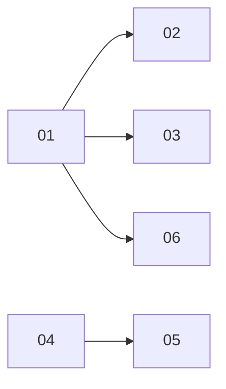

# Spend and limits read as one thing

> Working plan — temporary, committed on the feature branch.
> Deleted once the feature ships.

**Issue:** https://github.com/dam-agents/dam/issues/6165

## Goal

A user meets spend and spend limits on many screens, and each shows a different part, so it is hard to tell what an agent used, which limit stops it and how close it is.
The approved design ("Spend first, one element everywhere", Design Desk option v1, version 10) shows each limit with the spend it counts, in one quiet black-and-white form, in Settings → Providers, on an agent's Providers and Usage, and in the chat.
Red shows only where a limit has stopped an agent: a red dot in the sidebar, and the chat's existing error card.
Home stays exactly as it is today.

## Approach

UI-first: almost everything is in `packages/ui/src/modules/spend/` and the screens that mount its parts.
The one server change is a new owner-level query that says which agents a limit has stopped today (slice 04), because today's `spend.status` without an `agentId` carries only the owner-wide limits, not each agent's.

Read [`docs/architecture/spend-limits.md`](../../architecture/spend-limits.md) first: **Limits**, **Refusal**, **Continue** and **Screens**.
Each slice updates **Screens** for what it changes (the "Also counted by" pattern, the pill on provider rows, the meter colours, the chat refusal) in the same commit.

### The one element

Every meter is the product's `LimitBar` look at size `md` (`spend/components/limit-bar.tsx`): track `h-3 rounded-sm bg-foreground/10`, fill `bg-foreground`.
It stays black at every level: these meters stop using `LIMIT_STATE_FILL`, `LIMIT_STATE_TRACK`, `LIMIT_STATE_PERCENT` and `LIMIT_STATE_TEXT` (`spend/lib/state-colors.ts`), and amounts stay `text-foreground`.
A bar takes the free width of its row (`flex-1`) between the label and the amount.
A limit row (introduced in 01, reused by 02, 03): the limit's icon (`LevelIcon`: provider mark, provider mark with a people badge for "all agents", the agent's avatar, Σ for the total daily limit, a lock for the ceiling), its name (`w-[34%] truncate`), the bar, and the amount stacked as "$<spent>" over "of $<limit>" (`tabular-nums whitespace-nowrap`).
Bobcoins show in Bc ("50.00 Bc of 50.00 Bc") and are never added into dollar totals.
Each bar keeps `role="img"` with a label naming the limit and the share used, as `SpendBarTrack` does ("Limit on the agent: 24% used").
Dark theme needs nothing extra: `bg-foreground` turns light.

### Copy

| Where                                                        | Old                                                                              | New                                                                                 |
| ------------------------------------------------------------ | -------------------------------------------------------------------------------- | ----------------------------------------------------------------------------------- |
| Chat error card, owner, a limit (not the operator's ceiling) | `…so its model calls stop. Continue it on Home, or wait until {time} your time.` | `…so its model calls stop. Raise your spend limit, or wait until {time} your time.` |
| Chat error card, editor; the operator's ceiling              | today's words                                                                    | unchanged                                                                           |
| Chat error card, hint line                                   | `Details: {raw error}`                                                           | `Change the limit · See what it counts`                                             |
| Sidebar, stopped agent (label and tooltip)                   | —                                                                                | `Stopped by a limit: {limit name}. {left} left today, calls stop until {time}.`     |
| Settings → Providers, open row                               | —                                                                                | `Limit for all agents` … `Resets at {time} your time.`                              |
| Agent → Providers, open row                                  | —                                                                                | `Limit on the agent` …; `{Provider}, all agents`                                    |

Naming the exact limit in the chat card ("{limit} reached its {amount} limit today, so this agent's model calls on {provider} stop.")
waits until the refusal says which limit stopped the call; it is **not** in this feature.

### Contract for slice 04 (pinned)

In `packages/api-server-api/src/modules/spend/types.ts` and `router.ts`:

```ts
// spend.stopped — owner-level query, no input, readAgentProcedure
export interface SpendStoppedLimit {
  kind: SpendBindingKind; // "agent" | "connection" | "owner-connection" | "owner" | "ceiling"
  limitId: string | null; // null for the ceiling
  connectionId: string | null; // set for "connection" and "owner-connection"
  connectionName: string | null;
  unit: SpendUnit;
  amountMicros: number; // the limit's amount (the ceiling's for "ceiling")
  leftMicros: number; // 0 while reached
}
export interface SpendStoppedAgent {
  agentId: string; // the payer (root driver) of the refused calls
  sessionIds: string[]; // the sessions with a refused call today
  limit: SpendStoppedLimit; // the reached limit that refused them; narrowest first on a tie
}
export interface SpendStopped {
  resetsAt: string; // next UTC midnight, ISO
  agents: SpendStoppedAgent[]; // only the caller's own agents
}
```

**Stopped** means: the agent's sessions had at least one call refused by the gate today (the day's rollup counts them as `refused_calls`, per payer, Connection and Session), **and** a limit that counts those calls is still reached now.
A limit the owner raised or removed, or a continue, clears it at the next read.
Any limit counts: the agent's own, an agent's Connection limit, a Connection limit for all agents, the total daily limit, and the operator's spend ceiling.
The UI invalidates `spend.stopped` wherever it invalidates `spend.status` today (`spend/api/mutations.ts`, `approvals/api/mutations.ts`) and polls it like `spend.status` (15 s).

## Sub-issues

| #   | Title                                                               | Scope                                                                                               | Depends on |
| --- | ------------------------------------------------------------------- | --------------------------------------------------------------------------------------------------- | ---------- |
| 01  | ✅ One black meter and the limit row; agent Usage lists every limit | Meters drop the state colours; new `LimitRow`; Usage shows every other limit always, with no toggle | —          |
| 02  | ✅ Settings → Providers rows                                        | Closed: spend as text; open: "Limit for all agents" with bar, Change, reset                         | 01         |
| 03  | ✅ Agent → Providers rows                                           | Open: "Limit on the agent", then "{Provider}, all agents"                                           | 01         |
| 04  | ✅ Server: which agents a limit stopped                             | `spend.stopped` per the contract above                                                              | —          |
| 05  | Sidebar stopped dot                                                 | Red dot in the unread dot's place, with its label                                                   | 04         |
| 06  | Chat error card                                                     | New owner ending; two links to the agent's Usage at the limits list                                 | 01         |



## Conventions & glossary

- **Limit for all agents** — a Connection limit for all agents (`owner-connection` scope); the UI calls it "{Provider}, all agents" on an agent and "Limit for all agents" in Settings.
- **Limit on the agent** — the agent's own limit (`agent` scope) on the Usage card, or its Connection limit (`connection` scope) under a provider row.
- **Total daily limit** — the own limit (`owner` scope).
- **Stopped** — see the contract above.
- **Home is out of scope**: `spend-widget.tsx`, `top-spenders.tsx` and the Resources card keep today's look and code.
- UI slices apply `/react-ui-engineering`; slice 04 applies `/typescript-engineering`.
- Comments follow `docs/guidelines/comment-guidelines.md`; run `mise run check:comment-types`.
- Verification is the existing suite plus a manual smoke test; update the tests the change breaks, and add one only where a slice says so.

## Whole-feature smoke test

On the local cluster (`cluster-ops` skill), signed in as an owner with an Anthropic connection and Bob:

1. Set a total daily limit, an "all agents" limit on Anthropic, and a $0.01 limit on one agent.
2. Home: the API spend card is as on `main` (top three spenders, one scale, no limits).
3. Settings → Providers: closed rows show "$x.xx" as text; opening Anthropic shows "Limit for all agents", a black bar, "$x of $y", Change, "Resets at …".
4. The agent's Providers: open Anthropic shows "Limit on the agent" and "Anthropic, all agents", each with a black bar.
5. The agent's Usage: under its own limit, the Total daily limit and "Anthropic, all agents" are listed with no toggle.
6. Send a message to the limited agent: the chat shows "Spend limit reached: … Raise your spend limit, or wait until …"; "Change the limit" opens its Usage with the limits list in view.
7. The sidebar shows a red dot on that agent, labelled "Stopped by a limit: …"; raising the limit removes it within 15 s.
8. Switch to the dark theme: every bar fills light.

## Delivery

Each sub-issue is one atomic commit.
The whole feature lands as a single PR for https://github.com/dam-agents/dam/issues/6165.
