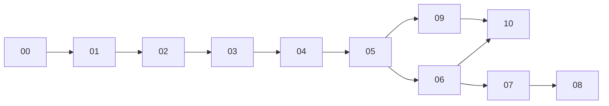

# An agent working in Slack or unattended asks its owner in Slack

> Working plan — temporary, committed on the feature branch.
> Deleted once the feature ships.

**Issue:** https://github.com/dam-agents/dam/issues/6287

## Goal

When an agent needs its owner's decision and nobody answers it in the app, the owner gets a direct message card from the app in Slack, answers on the card, and the agent continues.

Today such a request reaches the owner only inside the app:

- **Gateway holds** (network access, web search, MCP tool calls): a channel turn (Slack, Telegram, or a prompt from an artifact's viewer) with nobody attached refuses an unmatched request at once.
  A schedule fire or a sub-agent run holds it for 30 minutes on Home, where nobody is told, and then refuses it.
- **Sub-agent questions** wait in the Driver's web chat and the approvals bell only.
- **Harness permission prompts** on a Slack turn or an artifact turn are refused at once; in a schedule or sub-agent run they wait 10 minutes on Home and then fail.

Production, last 30 days:

- 78% of network holds expired unanswered, and the count per week doubled (602 to 1,165).
  17% of the expired rows were channel-turn refusals; the other 83% were holds that nobody answered, and all the growth is there.
- On a day with any expired network hold, an owner had 1 blocked (agent, host) pair at the median, 14 at the 90th percentile and 123 at most.
  The busiest owner had 172 pairs on one agent in 30 days; 47% of them came back in a later week.
- On a day with any channel-turn refusal, an owner had 2 at the median, 8 at the 90th percentile and 47 at most (Slack and Telegram together; inflated, because an agent that is refused at once tries more hosts).
- Answers in the app came after 0.2 minutes at the median and 9.5 minutes at the 90th percentile.

After this feature:

- A request on an addressed Slack turn reaches the owner as a card at once, and the turn waits for the answer while the agent's tool waits; when the tool gives up, or the person who asked presses "Don't wait" or Stop, the agent goes on without the step, and a later allow tells the person who asked to ask again.
- A request that nobody answers in the app reaches the owner as a card after a minute, unless the owner is active in the web UI.
- The cards cover network holds, web-search holds, MCP tool-call holds, sub-agent questions and launch rules and, last, harness prompts.
- `/dam approvals` gives the owner a private list of everything that waits for them, the same set the web approvals bell shows, and turns the cards off or on.
- The card shows its outcome wherever the request settles: Slack, the web, the deadline or a stopped turn.
- An owner without a Slack link keeps today's behavior; the agent can tell a Slack sender that its owner can link Slack to answer there.

## Approach

Read these pages first:
[security-and-credentials › HITL ext_authz](../../architecture/security-and-credentials.md#hitl-ext_authz) (holds, joins, unattended requests),
[web-search-control](../../architecture/web-search-control.md),
[connections](../../architecture/connections.md) and [mcp-connections](../../architecture/mcp-connections.md) (MCP tool-call holds),
[channel-turns](../../architecture/channel-turns.md) (the relay answers permission prompts; the working status and Stop),
[slack-guarantees](../../architecture/slack-guarantees.md) (how bot and app posts are routed),
[tool-approval](../../architecture/tool-approval.md),
[invocations › Asking the owner](../../architecture/invocations.md#asking-the-owner),
[channels](../../architecture/channels.md) (identity links; the platform can message a linked person),
[slack-dm-bridge](../../architecture/slack-dm-bridge.md) (an agent bound to the owner's 1:1 DM with the app),
[slack-commands](../../architecture/slack-commands.md),
[agent-editors](../../architecture/agent-editors.md) (who may answer an approval).

### What exists today

- **Gateway holds.** Three gates file a pending row for an unmatched request and hold it for `config.approvalHoldSeconds` (30 min): `ext-authz-gate.ts` (network), `web-search-gate.ts` (web search) and `tool-call-hold.ts` (MCP tool calls of a Connection on "needs approval", behind the experimental `mcp-tool-approval` feature).
  Each has its own copy of one check: a channel turn is open on the attendee and no interactive session is attached (`core/turn-attendance.ts`) → refuse at once, and leave the row on Home.
  The web-search gate also refuses a search of a scheduled session, whether or not someone is attached (`sessions.isScheduled`).
  A sub-agent with network access of its own is refused without a row.
- **Joins.** A request that matches a waiting row joins it; each gate emits `ApprovalRequested` only for a new row (`if (!existing)`).
  An MCP join waits until the row's expiry (`expiresAt`); a network join waits a full hold window from its own start, also after the row expired and nothing can answer it.
  `expirePending` flips a pending row to expired without reading its `expires_at`.
- **Attendance and presence are per agent.** The channel-turn key is counted per agent and replica and written, with the value `"1"`, when the first turn opens.
  Three callers open it: Slack (`beginTurn`, for every turn: ambient rounds and replies in an agent's own thread included), Telegram, and the prompt delivery of an artifact's viewer (`viewer-prompt-delivery.ts`).
  Presence is written by the chat relay, the terminal relay, the SSH relay and the browser display relay; it does not say who is attached or whether they look.
  The gate does not know which session made a request.
- **Stop.** The working status of a Slack turn carries Slack's Stop button only where the app has agent messaging set up; otherwise it shows the text without the button.
  Only the person who started the turn, a person whose message joined it, or the agent's owner may press it.
  Ambient rounds, replies in an agent's own thread (`ownedRefOf`) and a whisper sent with its message (`privateReply`, `SILENT_PRESENTER`) show no status, so they have no Stop.
  A tag from another bot, app or agent starts a turn like a person's mention.
- **Cancel and allow once.** The MCP hold passes the client's cancel `signal` to `waitForVerdict` and uses `consumeAllowOnce`: an approve once serves one request, also after the client left, and a second request that waited on the same row is refused.
  `consumeAllowOnce` reads only `mcp_tool_call` rows, matched on the call's key, and marks a row used with `deliveredAt`.
  The network hold passes no `signal`, and `WebSearchGateInput` has none.
  An approve once on a network row lets every request that waits on it through; with no waiter, it helps nobody.
  A rule verdict (`approvePermanent`, `approveHost`) still writes its rule on an expired row.
- **What the web shows.** A network row stores the full path, query string included, and the web shows it (`approval-copy.ts`).
- **Sub-agent questions.** `owner-questions.ts` writes the question on the run; `invocations.answer` and the deadline job settle it, first write wins; the default deadline is one day.
  An option can have up to 80 characters (`MAX_OWNER_OPTION_CHARS`).
- **Rule proposals.** An agent's own rule proposal waits seven days for the owner, and the agent does not wait for it.
  An allow rule that a Driver sets at a one-off sub-agent's launch also waits for the owner (an `egress_proposal` row with `forAgentId`), and the sub-agent's task is held until the owner has answered every one, up to the spawn's deadline.
- **Harness prompts.** The runtime sends a permission request to every channel engaged on the session; the first answer counts.
  The Slack relay, and the artifact viewer's relay, answer "no" at once (`requestPermission` in `core/acp-client.ts`).
  With no channel engaged, the runtime waits `DEFAULT_ORPHAN_TTL_MS` (10 min, `acp-runtime.ts`) for every request the agent sent on the session, not only permission prompts, and then recycles the machine's lease.
  The approvals service files an `acp_native` row for Home with a 24-hour `expiresAt` that the runtime never waits for.
  The runtime keeps `auto` on Slack turns and schedules; this feature does not change that.
- **Slack.** `notifyPerson` (`slack.ts`) sends plain text to each Slack identity linked to a user and returns no `ts`.
  The gateway can post Block Kit (`postMessage` returns `ts`), edit it (`updateMessage`), delete the app's own post, open a modal (`views.open`) and attach message metadata; agent posts already carry metadata, and the gateway parses it.
  Every click arrives in `bolt.action` (`bolt-slack-gateway.ts`) and reaches `handleMessageAction` (`slack.ts`); a button click carries the values of every input field of the post.
  The history tools (`read_channel_history`, `read_thread`) return the app's own posts, labelled as the bot's.
  The Slack gateway runs only on the channels leader; other replicas reach it through channel RPC (`channel-manager.ts`).
  A conversation runs one turn at a time.
  Slack's grant set is not stored in the database, and the Slack worker's `hasScope` treats unknown scopes as granted.

### Shape of the feature

- **Only the owner answers in Slack.** A card goes to every Slack identity linked to the agent's owner, from the app, with no agent persona.
  A click counts only when the clicking Slack user's identity link resolves to the owner.
  Editors keep answering in the web; their answer edits the card.
- **One source of truth.** A Slack answer goes through the same services as a web answer, with the same compare-and-set, so the first answer counts wherever it comes from.
- **Addressed Slack turn.** A turn that a person's message started (`SlackSender.kind === "person"`) and that shows the working status: a mention, a message in a DM, a whisper thread in a DM, or the nudge after an undelivered reply to such a turn.
  It holds in every workspace: where the app has no agent messaging, Slack shows no Stop, but the "Don't wait" button on the thread's line works.
  Not addressed: ambient rounds, replies in an agent's own thread, a whisper sent with its message, turns that a bot, an app or an agent started, Telegram turns and artifact turns.
  In such a turn the line cannot work, so its requests keep today's refusal: nobody asked (an ambient round), a bot cannot press (a tag from a bot, an app or an agent), a private line is lost when Slack reloads (a whisper sent with its message), or one turn mixes people and threads.
  Example of the last: in an agent's own thread (a scheduled run posted "Reply here with questions"), every message from anyone starts a turn, one turn can carry several such threads, and it can join the owner's web chat or a scheduled run.
- **Route of a request.** The shared decision gives each gateway row a route:
  - `turn`: an addressed Slack turn is open on the attendee and the owner can get cards; the request holds and its card goes at once.
  - `background`: every other row that the gates file, held or refused: schedule fires, sub-agent runs, sessions where someone is attached, and the refused requests of turns that are not addressed.
    A refused row records that the gate refused it at once, and in which kind of conversation (Slack, Telegram or an artifact's viewer).
    The gate cannot tell which session made a request, so while an addressed Slack turn runs, a schedule's request of the same agent also gets the `turn` route.
- **When a card goes out.**
  - `turn` → at once.
  - `background` and sub-agent questions → when the request still waits after 60 seconds, the owner can get cards, and the owner is not active in the web UI.
    The web UI sets the owner's activity key every 60 seconds while its tab is visible and was used in the last two minutes, and the key lives 120 seconds: the owner counts as active for two to four minutes after the last input, and for up to two minutes after the tab is hidden.
    An SSH session or an editor's browser does not count.
- **Wait.** A hold waits until the owner answers, its client gives up, or the hold window (30 min) ends, Slack turns included.
  The client decides first in most cases: Claude Code's WebFetch gives up after 60 s and its Bash tool after 120 s, Codex and Pi wait for the gateway, and the gateway itself ends a hold after 15 s to 5 minutes until #6855 is fixed ([Measured](#measured)).
  So nothing the owner or the member reads promises a time for the wait; a row stays answerable until its expiry, whatever ended the wait.
  Stop on a turn ends the wait at once: the client goes away, the gateway's `signal` fires, and the request stays pending for the owner.
  Each row counts the waits that still listen for its answer; when the last one ends without a verdict, the row is "nobody waits", and a request that joins it later makes it "waits" again.
  When a `turn` request joins an older row, the row's expiry moves to now plus the hold window.
  Sub-agent questions keep their own deadline and default.
- **Don't wait.** The thread's line carries a "Don't wait" button; the person who started the turn, a person whose message joined it, or the owner may press it, as with Stop.
  It is the one exit a member can count on: a typed "skip it" reaches the agent only between tool calls, and Bob and Copilot can keep it waiting with no limit while a tool call runs.
  A press makes the turn stop counting as addressed, so its new requests are refused at once, also while someone has the agent open in the web; it then ends the turn's current waits with a neutral refusal (the wait ended, the request was not denied), and the agent finishes its answer without those steps.
  The member rejects the wait, not the request: the rows stay pending for the owner until their expiry, because only the owner decides access, and the gateway cannot tell which thread or run sent a request.
  An approve once or a rule that the owner gives later counts for the next try; an approve once stays usable for a full hold window after the answer.
  A held harness prompt is released in its own turn's relay, gets the reject option at once, and its row expires, because the harness takes one answer per prompt.
  A release ends only waits that began after the turn did; a web search is released only when it comes from one of the turn's sessions.
  Network and MCP requests carry no session, so while two threads of the agent wait at the same time, a press in one ends the current network and MCP waits of both.
  Example: at 10:00 a member asks for a report and the agent waits for a host; at 10:03 the member presses "Don't wait" and the agent answers without that page; at 10:20 the owner allows the host, a reply in the thread tells the member, and the member asks again.
- **Late allow.** An allow that comes when nobody waits on the row any more, whatever ended the wait (the tool gave up, Stop, or "Don't wait"), posts a new reply in the thread that mentions the people who asked, because Slack sends no notice for an edit: "<owner's display name> allowed it.
  Ask again by <time>."
  Example: at 10:00 a member asks the agent to summarize a page, and the fetch is held; at 10:01 the fetch tool gives up and the agent answers without the page; at 10:12 the owner clicks Allow once, and a reply in the thread tells the member to ask again by 10:42.
- **Approve once.**
  - Network and web search: an approve once lets every request that waits on the row through, as today; with no waiter, the next identical request within the hold window uses it, once.
  - MCP tool calls keep #6421's rule: one call per approve once.
- **Card kinds.**
  - **Turn card:** one open card per agent while any of its `turn` requests waits; one row per request with its own buttons.
    The card names each thread it holds requests from, with the display name of the person who started it; it cannot tell which thread sent which request.
    "Allow all once" and "Deny all" show only when the card names one thread, and cover only the network and web-search rows that the card shows; an MCP call or a harness prompt needs its own click.
    At most 10 rows show, then "<n> more: Open in app".
    A new `turn` request joins the open card.
    When it comes from a thread the card does not name yet, and the card was posted more than 5 minutes ago, the app deletes the post and posts the card again, so Slack notifies the owner once more.
    When no row waits, the card takes no new rows; an expired network or web-search row becomes a rule row, and the card closes 24 hours after its last row settled.
  - **Background card:** one open card per agent for its `background` requests, built like the turn card: a row per host for network and web-search blocks (its paths and their count; a web search counts as one host), a row per harness prompt ([10](./10-harness-prompts-in-unwatched-runs.md)), and a row per Driver rule that holds a one-off sub-agent's launch ([07](./07-subagent-questions.md)).
    Rows that wait come first; at most 10 rows show, then "<n> more: Open in app".
    A new block on a host joins that host's row and raises its count.
    When a new row that waits is added and the card was posted more than 5 minutes ago, the app deletes the post and posts the card again; otherwise it edits the card, and Slack sends no notice.
    An expired network or web-search row becomes a rule row.
    A row of a request the gate refused at once says so and where ("Refused at once in a Slack channel", "… in a Telegram chat", "… in an artifact's viewer"), and offers only the rule buttons.
    When the agent is blocked on 10 or more different hosts in a day, the card says so and links to the agent's network settings in the app; it never suggests a rule for every host.
    The card closes when nothing on it waits and its last row changed 24 hours ago.
  - **Call card:** one per `background` MCP tool call.
  - **Question card:** one per sub-agent question.
- **No cap.** Each agent has at most one open turn card and one open background card; calls and questions each need their own answer, so they always get their own card.
- **Rule rows.** An expired network or web-search row, and a row the gate refused at once, offer:
  - "Allow whole host";
  - "Always allow this path" (when the row has one path), with a Slack `confirm` step when the rule restarts the agent's gateway, the same check the web makes (`gatewayRestartImpact`);
  - "Always deny…", with a `confirm` step, mapped to the web's `denyForever`; a deny rule refuses the next request at once and files no row;
  - "Dismiss", which removes the row and stops a new row for that agent and host for 7 days.
    `approvePermanent`, `approveHost` and `denyForever` already write their rule on an expired row.
- **Safe rendering.** Agent-written text (paths and query strings, arguments, questions, options, a harness's title and input) shows only as `plain_text` or in a code block, never as Slack markup.
  Host and Connection names come from the gate's row.
  A query string is cut at about 200 characters, MCP arguments and a harness's input at about 2,500; all of them leave the card when the request settles.
  An option's label is cut to Slack's 75 characters.
- **Cards are no agent input.** Every card carries Slack message metadata (illustrative event type `owner_request`, with the card's id).
  Message intake, history catch-up, edits, `read_channel_history` and `read_thread` drop such posts, so an agent bound to the owner's DM never reads a card.
- **Owner can get cards.** The owner has a Slack identity link in an installed, active workspace, has not turned the cards off with `/dam approvals off`, and the operator has not turned the feature off.
  The leader checks the workspace's scopes when it posts.
  When a turn card cannot post for a lasting reason (a missing scope, a DM that cannot open, a revoked token), its waiting rows are denied at once, so no thread waits for a card that never comes; a passing error is retried by the sweep.
- **The thread.** While an addressed Slack turn waits on a request, the app posts one visible line in its thread, with the card metadata so no agent reads it: "<Agent> asked its owner, <owner's display name>, to approve a step.", with the "Don't wait" button and the context line "The person who asked can go on without the step."
  The line gives no time, names no host, path or command, and does not mention the owner, so the owner gets no second notice.
  When nobody waits on the agent's `turn` rows any more and one of them is still pending (the tool gave up, Stop, or "Don't wait"), the line changes to "<Agent> went on without the step.
  <owner's display name> can still approve it until <time>.", with the latest expiry of those rows, and the rows on the turn card get the note "Nobody waits for this now.
  Your answer counts for the next try."
  When a request waits on them again, the line and the notes change back.
  When every row the line covered has settled, the line changes to "The wait ended."; a late allow also posts its reply.
  An owner who sent the turn also gets a private note with a link to the card; an editor who sent it gets a private note that they can answer in the app.
  In the owner's own 1:1 DM with the app, no line goes out, because the card lands in that conversation.
- **Operator switch.** One Helm value (illustrative `slackOwnerRequests.enabled`), on by default; off makes `canCard` answer `unlinked` for every owner, which gives today's behavior everywhere, for an incident.
- **Measures.** The leader logs one line when it posts a card and one when a carded request settles (who answered, where, and the delay since the post).
  They give the share of carded requests answered before expiry and the time to answer; a log line for `/dam approvals off` and `on` gives the share of owners who turn cards off.
- **Pull for everything.** `/dam approvals` lists every request that waits for the caller, the same set as the web bell, carded or not.
- **Cards off, and unlinking.** `/dam approvals off` refuses new Slack-turn requests at once and posts no new card; a card whose request still waits stays until it settles, and every other card closes.
  Unlinking Slack closes the owner's cards in that workspace.

### Pinned contract

These seams cross sub-issues; implement against them.
Names are illustrative where marked.

- **Attendance names the channel and whether a person addressed the turn.** `openChannelTurn(agentId, { channel, addressed })` takes `slack`, `telegram` or `artifact`.
  The channel-turn key gains the channel (illustrative: `channel-turn:agent:<id>:<replica>:<channel>`), each counted apart, so a read answers whether a channel turn is open and of which kinds.
  An addressed Slack turn also counts in a second key (illustrative: `addressed-turn:agent:<id>:<replica>`), counted per agent and replica in the same way, so an ambient round and a mention that overlap on one replica read correctly.
  A read answers whether an addressed Slack turn is open on the agent.
  `releaseAddressed(handle)` moves a turn from the addressed count to a released count (illustrative: `released-turn:agent:<id>:<replica>`) and resolves once Redis confirms it; a read answers whether a released Slack turn is open.
  A replica on the old code writes the old key: its turns count as channel turns of an unknown kind, never as addressed Slack turns.
- **Owner can get cards.** The channels module answers `canCard(ownerSub)` with `ok`, `unlinked` or `muted`, from the database (identity links, workspace installs, and the mute of [08](./08-dam-approvals-and-mute.md)); a port wired at the composition root gives it to the approvals module.
  The read fails toward `unlinked`, and the operator switch turns every answer into `unlinked`.
  A missing scope shows only when the leader posts (see "Owner can get cards" above).
- **Owner activity** ([06](./06-when-cards-go-out.md)).
  A core seam (illustrative: `core/owner-activity.ts`) keeps a per-owner Redis key with a 120-second TTL: `touch(ownerSub)` and `isActive(ownerSub)`, failing toward "not active".
- **One hold-or-refuse decision.** A pure function in `approvals/domain/` (illustrative: `ownerRequestRoute`) takes: an addressed Slack turn is open, a released Slack turn is open, any channel turn is open, an interactive session is attached, the request is a web search of a scheduled session, and `canCard`.
  It returns the verdict and the route, by the first rule that matches:
  1. addressed Slack turn open, `canCard` is `ok` → hold, `turn`;
  2. released Slack turn open → refuse, `background`;
  3. channel turn open, nobody attached → refuse, `background`;
  4. web search of a scheduled session, `canCard` is not `ok` → refuse, `background`;
  5. otherwise → hold, `background`.
     `ext-authz-gate.ts`, `web-search-gate.ts` and `tool-call-hold.ts` call it; the sub-agent refusal stays before it.
     Rule 2 makes "Don't wait" hold for the rest of the turn, also while someone is attached.
     Rule 4 keeps today's refusal of a scheduled search for an owner who cannot get cards, attached or not.
- **Route on the row.** `pending_approvals` gains `owner_route` (`turn` or `background`, null for types that never get a card).
  A `turn` request that joins a waiting `background` row raises it to `turn`, moves its `expires_at` to now plus the hold window, and emits (illustrative) `ApprovalRouteRaised`; a route is never lowered.
  `expirePending` flips only a row whose `expires_at` has passed, and a waiter whose timer fires reads the row's expiry and waits on when it moved.
  `ApprovalRequested` and `ApprovalResolved` carry the route as an optional `ownerRoute`.
  A row the gate refused at once records where (illustrative payload field `refusedIn`: `slack`, `telegram`, `artifact` or `unknown`).
  A Driver rule that holds a one-off sub-agent's launch (an `egress_proposal` row with `forAgentId`) gets the route `background`; an agent's own rule proposal gets none.
  The invocations module emits `OwnerQuestionAsked` and `OwnerQuestionClosed` (how it closed: `owner`, `default` or `stopped`), each with the run id, the invocation id and the owner.
- **A release ends the turn waits.** One channel per agent on the Redis bus (illustrative `turn-release:<agentId>`).
  `waitForVerdict` listens to it only for a `turn` wait and then ends with a new reason (illustrative `hold-released`), which leaves the row pending; each gate answers its client with its own neutral refusal text (a network refusal with a body, a new web-search refusal reason, a new end of the MCP hold).
  A release carries the time the turn began and the turn's session ids: a wait that began earlier is not released, and a web search is released only when its session stamp is one of the turn's sessions.
  The Slack worker calls `releaseAddressed` for every `TurnRef` of the turn and sets each stored `addressed` to false, then publishes the release once Redis has confirmed the change.
  A held harness prompt ([09](./09-harness-prompts-on-slack-turns.md)) is released in its turn's own relay, not on the bus.
- **Who still waits.** `waitForVerdict` counts the live waits of each routed row on the Redis bus (illustrative key `approval-waiters:<id>`), up when a wait starts and down when it ends, refreshed with the attendance heartbeat so a lost replica's waits expire.
  When the count leaves zero or returns to zero without a verdict (the client went away, or a release), it emits (illustrative) `ApprovalWaitChanged` with the row id, the agent, the owner, the route and `waiting: true` or `false`.
  The thread lines and the "Nobody waits for this now" notes follow that event ([02](./02-card-base.md)); a late allow is an allow on a row whose count was zero ([05](./05-card-lifecycle.md)).
- **Approve once outlives the client.** `consumeAllowOnce`, generalized by type: a network row matches on host, port, method and path; a web-search row on the query key; an MCP row on the call's key.
  For network and web search, every waiter that gets "allow" marks the row used without refusing the others; a request that finds an unused approve once of its shape uses it and passes.
  An unused approve once stays usable until its decision time plus the hold window, not until the row's own expiry.
- **Card tables** (new, channels-owned):
  - a card: id, owner, kind (`turn`, `background`, `call` or `question`), agent, team, DM channel, message `ts` (empty until posted), when it was posted, the threads a turn card names (each with the person who started it, the people whose messages the turn carried, the `ts` of its thread line, when its asker pressed "Don't wait", and when its line last changed to the went-on text), the last change, and when it was closed;
  - a card item: the card, the request kind (`approval` or `question`), the request id, the host its row groups it under (network and web-search items of a background card), and its state on the card (`waiting`, `rule` or `settled`); a request is an item of at most one open card per workspace;
  - a dismissal: owner, agent, host, and until when no new row goes out for them.
    The place method writes the card row before it posts.
- **Placing a request.** One channel RPC method on the leader (illustrative: `placeOwnerRequest`) runs under a per-owner lock: it joins the request to an open card, posts a new card, or moves a raised item from the background card to the turn card, for each Slack identity link of the owner.
  Every placement, edit and close goes through the leader.
- **Card actions.** Every element the platform writes on a card has an action id with the prefix `owner-request:`; the value carries the card id, the item (or `all`) and the choice.
  The thread line's "Don't wait" uses `owner-request:release`, with the team, the channel and the thread `ts` as its value.
  The prefix never collides with the agent prefixes in `channels/domain/channel-blocks.ts`.
- **Ports into the Slack worker** (wired in `bootstrap.ts`, like `spendHold` and `providerOutage` today; illustrative names):
  - `ownerRequests.view(kind, id)` returns what a card shows ([02](./02-card-base.md), [03](./03-mcp-tool-call-cards.md), [04](./04-network-and-web-search-cards.md), [07](./07-subagent-questions.md), [09](./09-harness-prompts-on-slack-turns.md));
  - `ownerRequests.decide({ kind, id, choice, ownerSub, slackUserId })` applies a choice as the owner through the owning service;
  - `ownerRequests.refuseUnreachable(id)` denies a waiting `turn` row whose card cannot post ([02](./02-card-base.md));
  - `ownerRequests.waiting({ route, olderThan, limit })` returns pending routed rows and open questions for the sweep, bounded by age ([05](./05-card-lifecycle.md));
  - `ownerRequests.listWaiting(ownerSub)` returns the bell's set ([08](./08-dam-approvals-and-mute.md)).
- **Card renderers.** Pure functions in `channels/domain/`, from a request view to Block Kit: the open card, its rows, the rule state, and the outcome line.
  A type with no renderer gets the fallback: a one-line summary and an "Open in app" link.
- **Outcome lines** (copy settles in implementation): "Allowed once by you", "Always allowed by you", "Denied by you", "Answered in the app by <name>", "Expired: the call was refused", "The turn was stopped", "The person who asked went on without it", "Dismissed for 7 days", "You turned cards off", "Slack was unlinked: answer in the app", "Answered: <answer>", "Took its default <option> after the deadline", "The sub-agent was stopped".

## Sub-issues

| #   | Title                                                  | Scope                                                                                                                                                                                                                             | Depends on |
| --- | ------------------------------------------------------ | --------------------------------------------------------------------------------------------------------------------------------------------------------------------------------------------------------------------------------- | ---------- |
| 00  | ✅ Measure before building                             | How long common clients and harness model clients wait on a held request; whether Stop and a closed client cancel the gateway's check; results in this README                                                                     | —          |
| 01  | ✅ One hold-or-refuse decision for the three gates     | Addressed turns, the shared decision, the route on the row, the raise, expiry that follows the row, `canCard`, holds that end with their client, the release of turn waits, approve once, turn-contract copy, the operator switch | 00         |
| 02  | ✅ The card base                                       | Card tables, placing on the leader, the turn card with fallback rows, fallback cards, card metadata kept out of agent input, the repost, refusal on a lasting failure, the thread line with "Don't wait", the measures            | 01         |
| 03  | ✅ MCP tool-call rows and cards                        | MCP rows and call cards with buttons, the click route and the owner check, audit                                                                                                                                                  | 02         |
| 04  | ✅ Network and web-search cards                        | Rows on turn and background cards with the web's verdicts, "Allow all once" for one thread, query strings, rule rows with "Always deny…" and confirm steps, Dismiss for 7 days, refused rows, a raised row moves to the turn card | 03         |
| 05  | Cards follow their request to the end                  | Every settle edits every card, who decided, rule state after expiry, the thread line after a late answer, several workspaces, the repair sweep, the 24-hour close, unlinking, Slack errors                                        | 04         |
| 06  | When background cards go out                           | Owner activity from the web UI, the 60-second escalation, the hint for an agent blocked on many hosts                                                                                                                             | 05         |
| 07  | Sub-agent questions and launch rules reach the owner   | Question events, radio + Other + Send, labels cut to Slack's limit, the answer through the invocations service, rows for a sub-agent's launch rules, the same timing rule, the Slack mobile check                                 | 06         |
| 08  | `/dam approvals` lists everything, and turns cards off | Private list in the bell's set, fallback rows, Slack's block limit, refresh in place, `/dam approvals off` and `on`                                                                                                               | 07         |
| 09  | Harness prompts on Slack turns                         | Data check first, real prompt shapes, the relay holds addressed-turn prompts, Stop and "Don't wait" settle the wait, prompt rows                                                                                                  | 05         |
| 10  | Harness prompts in runs nobody watches                 | The runtime waits the hold window for permission prompts only, the card shows the runtime's deadline, prompt rows on the background card under the timing rule                                                                    | 06, 09     |

## Conventions & glossary

- **Owner request:** a gateway hold, a sub-agent question or a harness prompt that waits for the agent's owner.
- **Gateway hold:** a network (`ext_authz`), web-search (`web_search`) or MCP tool-call (`mcp_tool_call`) approval the gateway holds.
- **Attendee:** the agent whose attendance the gate reads: the agent itself, or its Driver for a sub-agent.
- **Addressed Slack turn:** a turn that a person's message started and that shows the working status (see "Shape of the feature").
- **Route:** `turn` or `background`, set by the shared decision on the row.
- **Owner can get cards:** `canCard` is `ok`: linked in an installed, active workspace, and cards not turned off.
- **Active in the web UI:** the owner's activity key is set.
- **Hold window:** `config.approvalHoldSeconds` (`APPROVAL_HOLD_SECONDS`, 30 min by default).
- **Rule row:** an expired network or web-search row, or a row the gate refused at once; it offers only the rule buttons and Dismiss.
- Apply `/typescript-engineering` to every sub-issue: commands from the Slack worker to another module go through ports wired at the composition root; reactions to another module's state go through domain events and sagas.
  Apply `/react-ui-engineering` to the one `packages/ui` change ([06](./06-when-cards-go-out.md)); it shows nothing new but changes what the UI does, so the pull request carries a capture of its network request in place of screenshots.
- Telegram turns, and Telegram delivery of cards, are out of scope.
- Docs: each sub-issue updates the architecture pages of its subject in its own commit.
  01 creates `docs/architecture/slack-owner-requests.md`, which owns the routes, the card rules, the cards and their lifecycle; the other pages link to it.
  `security-and-credentials.md` is near its size cap: link the new page there instead of adding prose.
  Every page change bumps its `Last verified:` date.
- Verification is the existing suite (`mise run //packages/api-server:test`, `mise run //packages/agent-runtime:test`, `mise run //packages/ui:test`, `mise run check`) plus the manual smoke tests.
  No sub-issue prescribes a new test.

## Measured

Measured on the local cluster on 2026-11-24, with a temporary log line on the gRPC check's `cancelled` event, against main `3f5dbecf6` (Envoy 1.40.2).

**The gateway ends every hold long before the hold window.**

| Held request                                                                                   | The gateway ends it after                                                                                                                                                                                                                           |
| ---------------------------------------------------------------------------------------------- | --------------------------------------------------------------------------------------------------------------------------------------------------------------------------------------------------------------------------------------------------- |
| HTTPS to a host with no rule of its own (SNI-only chain)                                       | When the upstream server drops the TLS handshake that never arrives: 15–17 s (example.org, www.iana.org), 32 s (duckduckgo.com), 63 s (www.bbc.co.uk), 122 s (en.wikipedia.org), over 3 min (httpbin.org); the client gets a TLS EOF, not a refusal |
| HTTPS on a TLS-terminated chain (a host with a path rule, a model provider, an MCP Connection) | 300 s: 504 `stream timeout` (Envoy's default stream idle timeout)                                                                                                                                                                                   |
| Plain HTTP                                                                                     | 300 s: 504                                                                                                                                                                                                                                          |
| Held web search (the model call on the provider chain)                                         | 300 s: 504                                                                                                                                                                                                                                          |

Causes: the SNI-only chain's `tcp_proxy` connects upstream at once (`upstream_connect_mode` `IMMEDIATE`), before the check answers; and no HTTP connection manager sets `stream_idle_timeout`, so Envoy's 5-minute default applies.
The network and web-search gates ignore the cancel and keep their waiter until the hold window ends: a check cancelled at 15 s logged its `deny` after 1,800 s.

**Clients and harnesses.**

| Client or harness                              | Gives up on a held request after                                                                                                                          | Stop or a closed client cancels the gateway's check                  |
| ---------------------------------------------- | --------------------------------------------------------------------------------------------------------------------------------------------------------- | -------------------------------------------------------------------- |
| `curl`, no timeout flag                        | The gateway's limit; with the gateway fixed, 300 s on an SNI-only chain (curl's connect timeout covers the TLS handshake), none on a TLS-terminated chain | Yes, at once                                                         |
| Python `requests`, no timeout                  | The gateway's limit; none with the gateway fixed                                                                                                          | Yes, at once                                                         |
| Node `fetch` (undici)                          | 10 s on an SNI-only chain (connect timeout covers the TLS handshake); 300 s on a TLS-terminated chain (headers timeout)                                   | Yes, at once                                                         |
| Claude Code, WebFetch                          | 60 s                                                                                                                                                      | Stop: yes, at once                                                   |
| Claude Code, Bash tool                         | 120 s, then the command moves to the background and keeps waiting; the turn ends without its result                                                       | Stop: yes, at once                                                   |
| Claude Code, model client on a held web search | The gateway's 300 s, then it retries at once and the retry joins the same approval                                                                        | Stop: yes, at once                                                   |
| Codex, shell tool                              | The gateway's 300 s; Codex polls the running command and keeps waiting                                                                                    | Stop: the turn ends at once, but the command keeps waiting 64 s more |
| Codex, web search                              | Not held: Codex's hosted search runs inside the provider's Responses API, which web search control does not cover                                         | —                                                                    |
| Pi, bash tool                                  | The gateway's 300 s; Pi has no fetch or web-search tool of its own                                                                                        | Stop: yes, at once                                                   |
| Bob                                            | Not measured: on 2026-11-26 Bob's backend answered every model call with a server error (models `premium`, `premium-shell`, `fast`)                       | Not measured                                                         |

Codex and Pi were measured on 2026-11-26 with `dam run` and its cancel, on IBM LiteLLM (`gpt-5.3-codex`, `claude-sonnet-4-6`), against a TLS-terminated chain.

**The gateway bug is filed as #6855.**
It is on main since held requests were added, and #6287 does not depend on it: an approve once that comes late counts for the next try.
The fix tried on the local cluster has three parts:

- the SNI-only chain's `tcp_proxy` connects after the check (`upstream_connect_mode: ON_DOWNSTREAM_DATA` with `max_early_data_bytes`);
- the gateway's DNS cache keeps a host for the hold window plus 60 s (`host_ttl`); with the default 5 minutes, an approve once after about 5 minutes failed with a TLS EOF, and a 60 s TTL moved that cutoff to between 45 s and 151 s;
- optionally, `stream_idle_timeout` at the check's timeout on the outer and the chain connection managers, for holds past 300 s on TLS-terminated chains, plain HTTP and web search.

With the first two parts, SNI-only holds passed after approve once at 20 s, 420 s, 481 s (a request that joined 4 minutes later passed too) and 600 s.
With all three, TLS-terminated, plain-HTTP and web-search holds passed after 6.5 minutes.
A running gateway takes the change only when the controller's template revision changes, so each agent's gateway restarts once.

## Choices made in planning

Petr has not confirmed these choices; a reviewer may challenge them.

- A muted owner is treated like an unlinked one: a Slack-turn request is refused at once.
- The activity numbers: the web UI calls every 60 seconds, counts input of the last two minutes, and the key lives 120 seconds.
- Sub-agent questions and launch rules follow the timing rule of `background` requests.
- Telegram turns keep refusing at once and get no cards.
- The platform-tool allow-once of the relay is not fixed in a separate pull request; [09](./09-harness-prompts-on-slack-turns.md) checks the real prompt shape of each harness.
- The thread's line names only "Don't wait", not Stop, so it needs no record of which workspace shows Stop.
- A press of "Don't wait" moves the turn to a released count, and the decision refuses at once while a released Slack turn is open, so a retry does not wait 30 minutes when someone has the agent open in the web.
- A message that joins a released turn does not make it addressed again.
- An unused approve once stays usable for a hold window after the owner's answer, not until the row's own expiry, so a late answer leaves the member time to ask again.

## Choices made in implementation

Petr accepted these while the slices were built.

- [02](./02-card-base.md): a turn card names a thread's starter by a Slack mention, not by a display name it looks up.
- [02](./02-card-base.md): an editor who starts a thread gets no private note; only the owner gets one.
- [02](./02-card-base.md): `docs/architecture/channel-turns.md` does not mention "Don't wait", because the page is at its size cap; `slack-guarantees.md` and `slack-owner-requests.md` describe it.
- [03](./03-mcp-tool-call-cards.md): a click on a request that is already settled redraws the card with the request's real outcome, because Slack shows no private note in the app's DM; the note "Already answered" is still sent through the click's response URL.
- [04](./04-network-and-web-search-cards.md): every card uses one set of Slack labels: Allow once, Deny, "Always allow this path", "Allow whole host", "Always deny…" and Dismiss, with "Always allow web search" and "Always deny web search…" for a web search; MCP rows of [03](./03-mcp-tool-call-cards.md) changed from Approve once and Deny once to Allow once and Deny.
- [04](./04-network-and-web-search-cards.md): "Always deny…" on a row with several paths writes the web's deny rule for each path, which is a whole-host rule for a plain HTTPS request.
- [04](./04-network-and-web-search-cards.md): Dismiss denies the row's waiting requests once, and its 7-day dismissal stops background rows only; a Slack-turn request still gets a row, because a person waits on it.
- [04](./04-network-and-web-search-cards.md): "Always allow this path" shows only when the row's requests share one real path, query string included, because the rule matches the whole path; a plain HTTPS request has no path.

## Open items

- **A note to #6421's author.** [01](./01-one-hold-decision.md) replaces the unattended check in `tool-call-hold.ts` with the shared decision and generalizes `consumeAllowOnce`; tell Tomáš Weiss before 01 starts.
- **Issue #6287 is out of date.** Its body predates these decisions (gateway holds, unattended runs, MCP tool calls, harness `auto` kept) and still says "Done when: TBD"; its first user story ("keep it strict" for the harness's own tools) is replaced by keeping `auto`.
  Its "Done when" gets three measures: the share of carded requests answered before expiry, the time from card to answer, and the share of owners who turn cards off.
- **The Bob issue is drafted, not filed.** Two causes still make unattended Bob runs ask (a write into `~/.bob` or a command Bob's own safety check flags; a schedule saved with "Ask every time"); [09](./09-harness-prompts-on-slack-turns.md) starts by checking what is left.
- **A late network join waits for nothing.** Today a network request that joins a row late keeps its client waiting after the row expired; an issue is drafted, not filed.
  [01](./01-one-hold-decision.md) changes the same wait (the expiry follows the row), so whichever lands first, the other builds on it.
- **Attendance is per agent.** While an addressed Slack turn runs, a schedule's request of the same agent gets the `turn` route and its card at once; today the gate refuses it at once.
- **Unknown volumes.** Production has no data on sub-agent questions or launch rules per owner, on how many agents one owner has blocked on a bad day (the busiest owner had 172 pairs on one agent), nor on how many owners have a Slack link (100 of the 127 owners with expired network holds have an agent that works in Slack).
- **Radio lists on Slack mobile.** [07](./07-subagent-questions.md) checks them; a modal for "Other" is the fallback only if they render poorly.
- **A sleeping owner.** A 30-minute hold cannot cover an owner who is asleep; a rule row stays on the background card the next morning, and parked runs (#3627) are out of scope.
- **Session-tied network approvals.** Out of scope: the machine has one proxy setting, so a request carries no session.
- **#5054.** An automatic mode for network access would cut the background cards; this plan does not depend on it.

## Whole-feature smoke test

On the local cluster with Slack wired (the `cluster-ops` skill; a worktree passes `--helm-values=`), with a Slack test workspace whose app has agent messaging, a second one whose app has none, and two people: the owner (linked with `/dam login`) and a second member.
Set `APPROVAL_HOLD_SECONDS=300` for the run, and turn on `mcp-tool-approval` for the owner.
Until #6855 is fixed, a site can drop a held HTTPS request after 15 s, and the agent's fetch tool gives up after 60 s: answer a request that must pass while it waits within 10 seconds.

1. Bind an agent to a test channel.
   As the second member, ask it to fetch three pages from three hosts no rule covers, in one message.
   The owner gets one turn card with three rows at once; the thread shows a line that the agent asked its owner, with "Don't wait" and no time.
2. Click "Allow all once" within 10 seconds: the agent answers with the three pages.
   Ask for one more new host and do not answer: when the fetch gives up, the agent answers without the page, the line says that it went on without the step and until when the owner can approve it, and the row gets the note "Nobody waits for this now".
   Click Allow once: a new reply in the thread mentions the member and says by when to ask again; ask again: it passes.
3. Ask again for one new host and press Stop on the working status: the turn ends at once, and the row stays answerable until the hold window ends.
4. Ask again for another new host and, as the member, press "Don't wait" on the thread's line: the agent answers at once without the page, and the line says that the owner can still approve it.
   As the owner, click Allow once on the card: a new reply in the thread tells the member; ask again: it passes.
   Repeat this step in the second workspace: the status there shows no Stop, and "Don't wait" works the same way.
5. Tag the agent from another app (a workflow or a webhook post) with a request for a new host: refused at once, as today, and no turn card.
6. Give the agent a schedule whose task fetches `https://example.net/?q=test`, close the web UI and run it: about a minute later the owner gets a background card with a row that shows the query string.
   Let the hold window pass: the row keeps "Allow whole host"; click it, run the schedule again: it passes.
7. Keep the web UI open and active, and run a schedule that fetches another new host: no card; the bell shows the request.
8. Run a schedule that fetches seven different unallowed hosts with the web UI closed: the agent's background card shows seven rows.
   Click "Always deny…" on one row and confirm, and Dismiss another: the next run is refused at once on the denied host, and neither row comes back.
9. Set a test MCP Connection to "needs approval" and run a schedule that calls one of its tools: a call card arrives, with the tool, the Connection and the arguments as plain text; Approve once runs the call.
10. Ask the agent (with sub-agent tools) to spawn a sub-agent that asks the owner to choose between two options; close the web UI: a question card arrives; pick "Other", type an answer, Send: the sub-agent continues with it.
11. Bind an agent to the owner's 1:1 DM with the app (the DM Bridge) and ask it there to read that conversation's history: its answer names no card.
12. Run `/dam approvals`: the private list shows what still waits; act on an entry from the list.
    Run `/dam approvals off` and repeat step 1: refused at once, and the agent says its owner does not take requests in Slack; `/dam approvals on` turns the cards back on.
13. Unlink the owner (`/dam logout`): the open cards close; repeat step 1: refused at once as before, and the agent says its owner can link Slack to answer there.
14. Link the owner again, turn the operator switch off in the Helm values, and repeat step 1: refused at once, as today, and no card.

## Delivery

Each sub-issue is one atomic commit.
The whole feature lands as a single PR for https://github.com/dam-agents/dam/issues/6287.
