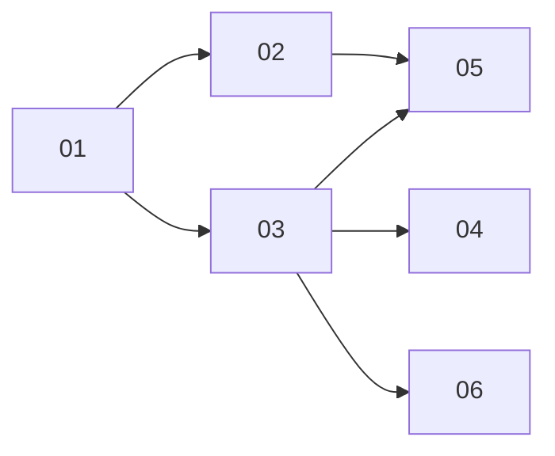

# An owner controls what an agent does with each tool of an MCP connection

> Working plan — temporary, committed on the feature branch.
> Deleted once the feature ships.

**Issue:** https://github.com/dam-agents/dam/issues/6421

The design was grilled in the issue: read the comments [7043789391](https://github.com/dam-agents/dam/issues/6421#issuecomment-7043789391) (decisions) and [7043811205](https://github.com/dam-agents/dam/issues/6421#issuecomment-7043811205) (where the issue body is out of date) before the issue body.
Where they disagree, the comments win.

## Goal

An owner connects MCP servers that can read and change data: Slack, mail, calendar, a custom server.
Today an agent that holds such a Connection calls every tool the server offers without asking, except a Slack Account, which #6760 and #6761 made read only unless the owner sets "Can post as me".

After this feature:

- Every MCP Connection has one **mode**: allow all, read only or needs approval.
- **Read only** lets through the server's read tools (the tools with `readOnlyHint`, or the Template's own read list for Slack) and refuses every other tool.
- **Needs approval** lets the read tools through at once, as read only does, and holds every other `tools/call`, a tool the stored list does not name included, until someone answers approve once or deny once.
  Nothing is remembered for the next call.
- The waiting call shows wherever network approvals show, with its tool and arguments.
  A Slack call that posts shows as the message it will post.
- The platform enforces the mode in the gateway, for every harness, in chat, channel turns and schedules.
- The mode replaces the Slack Account's "Can post as me" switch.
  Existing Slack Account Connections keep their behavior: `fullAccess` becomes allow all, and no `fullAccess` becomes read only.
- It ships behind the experimental feature `mcp-tool-approval`.
  With the flag off, nothing a person sees changes.

## Approach

Read these first: [connections](../../architecture/connections.md#connection) (the read-only paragraphs from #6760), [credential-gateway](../../architecture/credential-gateway.md) (how a chain sends the body to ext_authz), [security-and-credentials › HITL ext_authz](../../architecture/security-and-credentials.md#hitl-ext_authz) (holds, joins, unattended requests) and [web-search-control](../../architecture/web-search-control.md) (the last approval type that was added, the closest model for this one).

**What exists on main (from #6760 and #6761).**

- The gateway sends the whole request body to ext_authz on a chain whose Secret marks the host `checkBody` (`connectionSecretAnnotations` in `packages/api-server/src/modules/connections/domain/connection-sds.ts`, controller `envoy.go` `CheckBody`, `envoy_bootstrap.go` `withWholeRequestBody`).
  Today only a Template's `toolAccess.host` gets it (`checkBodyHostsOf` in `connections-service.ts`), so only `mcp.slack.com`.
- The ext_authz gate runs a read-only step (`packages/api-server/src/modules/approvals/services/read-only-gate.ts`) after spend and web search and before the rules.
  It finds the limiting Connection through the `ReadOnlyConnections` port (`createReadOnlyConnections` in `modules/connections/compose.ts`, domain `readOnlyAccessFor` in `domain/read-only-access.ts`), reads the body with `readMcpRequestBody` (`approvals/domain/mcp-tool-calls.ts`) and refuses a tool outside `readTools` with a JSON-RPC error on HTTP 200 (`approvals/domain/read-only-refusal.ts`).
- The read-only choice is `auth.fullAccess` on an `oauth` Connection.
  GitHub uses the same key with another meaning (an unnarrowed child, `domain/github-parent.ts`); this feature must not touch GitHub's use.

**What this feature changes.**

- The mode moves out of `auth.fullAccess` into its own column on `connections`, with the tool list the api-server read from the server.
- The read-only step becomes the **tool access step**: it reads the Connection's mode and answers pass, refuse or hold.
- A hold reuses the network-approval machinery (`insertPending`, `waitForVerdict`, `ApprovalResolved`, the unattended check) with a new approval type, `mcp_tool_call`.
- Every MCP Connection that has a Secret gets `checkBody`, whatever its mode, so a mode change holds from the next request without a gateway restart.

**Out of scope.**

- A custom MCP Connection with no auth has no Secret, so its traffic is not TLS-terminated and the gate cannot read the body.
  It offers only allow all; a follow-up issue adds `checkBody` on allow-only chains.
- Hiding tools from `tools/list` (ext_authz never sees a response).
- Per-tool or per-group settings, and "always" verdicts.
- Who may answer an approval: tool calls follow network approvals exactly, including an Agent that holds the DAM Connection.
- Asking for approval in Slack (#6287), REST connections (#3323), platform-locked rules (#6422).

## Sub-issues

| #   | Title                              | Scope                                                                                                                       | Depends on |
| --- | ---------------------------------- | --------------------------------------------------------------------------------------------------------------------------- | ---------- |
| 01  | Tool mode on the Connection        | `tool_access` column, migration from Slack `fullAccess`, contract, gate reads the mode, feature flag                        | —          |
| 02  | Read the tool list from the server | api-server `tools/list` at create and refresh, `checkBody` on every MCP Connection with a Secret, read only for generic MCP | 01         |
| 03  | Hold a tool call for approval      | `mcp_tool_call` approval type, gate hold and join, unattended refusal, synth frame, CLI approvals                           | 01         |
| 04  | Approve after the client gave up   | An approve once used up by the next identical call, harness MCP timeouts                                                    | 03         |
| 05  | Mode picker and CLI                | UI picker replacing the Slack access choice, tool list with refresh, CLI `--mode`, `setFullAccess` removed                  | 02, 03     |
| 06  | Tool-call approval views           | The `mcp_tool_call` card in every approval surface, generic JSON view, Slack renderers                                      | 03         |



## Pinned contract

Slices 01, 02 and 03 pin these shapes; the UI slices (05, 06) build on them.

```ts
// packages/api-server-api/src/modules/connections/types.ts
type ToolMode = "allow-all" | "read-only" | "needs-approval";

interface ConnectionTool {
  name: string;
  readOnly: boolean; // the server's readOnlyHint, or the Template's read list
}

// on connectionView, present only on an MCP Connection
interface ConnectionToolAccess {
  mode: ToolMode;
  modes: readonly ToolMode[]; // what this Connection offers: ["allow-all"] for a no-auth custom MCP
  tools: readonly ConnectionTool[] | null; // null until the first tools/list succeeded
  listedAt: string | null; // ISO time of the last tools/list
  listError: string | null; // why the last tools/list failed, shown to the owner
}

// procedures (connections router, manageCredentialsProcedure)
setToolMode(input: { id: string; mode: ToolMode }): Promise<void>; // 01
refreshTools(input: { id: string }): Promise<ConnectionToolAccess>; // 02

// packages/api-server-api/src/modules/approvals/types.ts
interface McpToolCallPayload {
  kind: "mcp_tool_call";
  connectionId: string;
  connectionName: string;
  templateId: string | null;
  tool: string;
  key: string; // sha256 of connectionId + tool + canonical JSON of arguments: the join key
  arguments?: unknown; // present while pending, at most 64 KiB of JSON; dropped when the approval settles or expires
  argumentsBytes: number; // the size of the full arguments, so the UI can say they were cut
  viaAgentId?: string;
  viaEnvironment?: string;
  forAgentId?: string;
}
```

## Conventions & glossary

- **MCP Connection**: a Connection with an `mcp-entry` contribution (Slack Account, Figma, custom MCP, shared knowledge base).
  The Slack Template has `category: "app"`, so do not test for `category: "mcp"`.
- **Tool mode** (UI: "allow all", "read only", "needs approval"): the one choice per Connection.
  Code: `ToolMode`, `toolAccess.mode`.
- **Read tools**: tools that pass in read only, and pass at once in needs approval: a Template's declared list (Slack, `SLACK_READ_TOOLS`), else the stored tools with `readOnly: true`.
  A tool the stored list does not name is not a read tool.
- **Tool-call approval**: approval type `mcp_tool_call`.
  Verdicts `allow_once` and `deny_once` only; `allow` and `deny` answer `not_actionable`.
- Editors answer a tool-call approval under the `egressRules` permission, as a network approval (`APPROVAL_NEEDS` in `packages/api-server/src/apps/api-server/trpc/agent-target.ts`).
- Server-side TypeScript: apply `/typescript-engineering`.
  UI (`packages/ui`): apply `/react-ui-engineering`.
- Each slice updates the architecture pages and the glossary rows its change touches ([documentation guidelines](../../guidelines/documentation-guidelines.md)), one sentence per line, and runs `mise run fix:markdown`.
- After code changes run `mise run check:comment-types` ([comment guidelines](../../guidelines/comment-guidelines.md)).
- Never hardcode the brand in code.

## Whole-feature smoke test

On the dev cluster (`cluster-ops` skill), with `mcp-tool-approval` on for the test user and `chat-network-approvals` on:

1. Connect a custom MCP server with header auth (any public test server that lists tools with `readOnlyHint`) and grant it to a Claude Code agent and a Codex agent.
   The connections panel shows the tool list, grouped read / write, and the mode allow all.
2. Set read only.
   In a chat, ask each agent to call a write tool: the agent reports a refusal that names the Connection and the mode.
   A read tool still answers.
3. Set needs approval.
   Ask the agent to call a read tool: it answers at once, with no card.
   Ask the agent to call a write tool: a card shows in the chat and on Home with the tool and its arguments.
   Approve once: the call runs.
   Ask again: a new card shows.
   Deny once: the agent reports a refusal and its session goes on.
4. On the Codex agent, wait more than one minute before approving: the call still runs, or, if Codex gave up, the agent's next identical call runs without a new card.
5. With a Slack Channel Binding and no browser open, ask the agent in Slack to use the tool: it answers that the call waits for the owner, and Home shows the approval.
6. On a Slack Account Connection, set needs approval and ask the agent to post: the card shows the channel and the message text.
7. `dam connection list` shows each MCP Connection's mode; `dam connection scope <name> --mode read-only` changes it.
8. Turn `mcp-tool-approval` off: the Slack Account shows the read only / "Can post as me" choice as before, and generic MCP Connections show no mode.

## Delivery

Each sub-issue is one atomic commit.
The whole feature lands as a single PR for https://github.com/dam-agents/dam/issues/6421.
