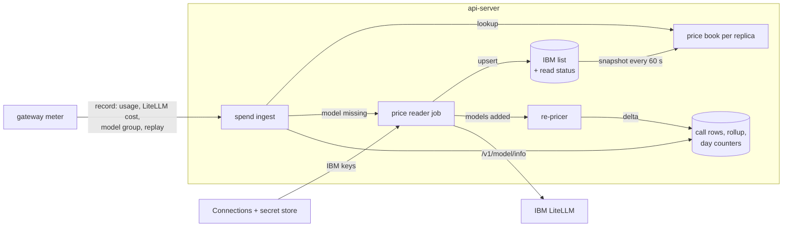
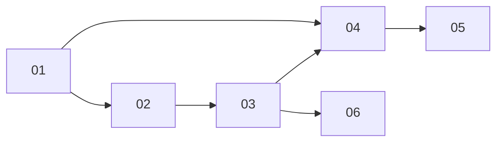

# IBM LiteLLM calls priced from LiteLLM's own model info

> Working plan — temporary, committed on the feature branch.
> Deleted once the feature ships.

**Issue:** https://github.com/dam-agents/dam/issues/6596 (also closes https://github.com/dam-agents/dam/issues/6488)

## Goal

DAM charges an IBM LiteLLM call the price that LiteLLM bills, also for a model that IBM adds after a DAM release and for a price that IBM changes.
Today DAM prices these calls from a list written by hand into the chart on 2026-10-15: 9 of 27 models have no price, and their estimate charges between $0 and 131x LiteLLM's cost.
After this feature, DAM reads IBM's own prices from LiteLLM's model info with the Connections' keys while it runs, keeps them in Postgres, and prices each call from them.
A call that no source can price counts $0 until its price arrives, and DAM then prices it again.
The same read gives the model catalogs the real reasoning flag and context window of each model (#6488).

The acceptance criteria are in the issue's **Done when** (29 checks); each sub-issue below names the ones it delivers.

## Approach

Read first: [`docs/architecture/spend-limits.md`](../../architecture/spend-limits.md) (Meter, Prices, Ledger, Estimates), [`docs/architecture/owner-model-catalog.md`](../../architecture/owner-model-catalog.md), and the model catalog part of [`docs/architecture/harness-config.md`](../../architecture/harness-config.md).

**What changes, by layer:**

- **The meter** (Lua, generated by the controller) also reads LiteLLM's cost in a chat stream's usage, the Chat Completions cache writes, and the `x-litellm-model-group` and `x-litellm-cache-key` reply headers (01).
- **The cost rules** follow LiteLLM's in two more places: a cache write without a split costs the five-minute price, and a price can have several prompt-size steps (02).
- **The IBM list** lives in Postgres, keyed by template and model group name: one row per model, filled from every IBM Connection's read (03).
  A per-Connection status row records the last good read, the last refusal and the model count.
- **The price book** stops being fixed at start: each replica keeps a copy of the IBM list and reloads it every 60 seconds and after its own reads (04).
  `measureCall` stays synchronous on that copy.
- **The lookup order for `ibm-litellm`** becomes: operator price, the RITS rule, IBM list (by model group, then reply model, exact before loose), LiteLLM's cost in the reply, then $0 "awaiting price" (04).
  Other providers keep today's order, estimate included.
- **Re-pricing** moves the cost of an awaiting call, and once the estimates of the last 30 days, from the estimate to the list price, in the call row, the rollup row and today's counters (05).
- **The catalogs** list IBM LiteLLM and CurveBender through `/v1/model/info`, with `/v1/models` as fallback (06).

**Contracts pinned here, so that slices implement against them:**

- `CallRecord` (`packages/api-server/src/modules/spend/domain/call.ts`) gains `modelGroup: string | null` and `replay: boolean` (01).
  `ProxyCostHeaders` (`spend/domain/cost.ts`) gains `body: string | null`, LiteLLM's `usage.cost` from the reply body (01).
- `PriceSource` (`spend/domain/prices.ts`) takes these values: `override`, `list`, `table`, `provider-rule`, `reply`, `replay`, `awaiting`, `estimate`, `unpriced` (04).
- `spend_calls` gains `price_source text not null default ''`, `price_model text not null default ''` (the name that the lookup used) and `estimate_reasons text[] not null default '{}'` (04).
- `EstimateReason` gains `awaiting-price` (04); `model-unpriced` stays for the providers that still estimate.
- The IBM list row holds a `PriceRow` as JSON, a `freeSearchQuota` flag and the list of price fields that DAM does not apply (03).

## Sub-issues

| #   | Title                                                                                  | Scope                                                                                                                                   | Depends on |
| --- | -------------------------------------------------------------------------------------- | --------------------------------------------------------------------------------------------------------------------------------------- | ---------- |
| 01  | [The meter reads LiteLLM's reply facts](01-meter-reply-facts.md)                       | Lua meter and record parser: `usage.cost`, Chat Completions cache writes, model group, replay; a replay costs $0                        | —          |
| 02  | [DAM's cost rules match LiteLLM's](02-cost-rules-match-litellm.md)                     | Unsplit writes at the five-minute price, several prompt-size steps, the comparison on every reply, comparison counters                  | 01         |
| 03  | [DAM reads and keeps the IBM price list](03-read-and-keep-ibm-prices.md)               | Tables, reader job, Connections port, conversion, drift and incomplete-price logs, read counters                                        | 02         |
| 04  | [DAM prices IBM calls from the list](04-price-ibm-calls-from-the-list.md)              | Price book copy per replica, lookup order, awaiting price, read on a missing model, price source column, chart rows removed, Usage copy | 01, 03     |
| 05  | [DAM corrects spend that waited for a price](05-correct-awaiting-spend.md)             | Re-price awaiting calls after a read, one-time 30-day back-fill                                                                         | 04         |
| 06  | [The catalogs read model details from model info](06-model-details-from-model-info.md) | IBM LiteLLM and CurveBender listings through `/v1/model/info` in the owner catalog and the Model Router (#6488)                         | 03         |

## Conventions & glossary

- **IBM list** — the one list of IBM LiteLLM prices that DAM keeps in Postgres, by model group name.
- **Model group** — LiteLLM's name for a model, as a key's model info lists it and as the `x-litellm-model-group` reply header names it, for example `azure/gpt-6-luna`.
- **Reply cost** — LiteLLM's own cost of one call: the `x-litellm-response-cost` headers, else `usage.cost` in a chat stream.
- **Awaiting price** — an IBM call that no source could price: it counts $0, is marked estimated, and is priced again when its price arrives.
- **Replay** — a reply that LiteLLM served from its response cache (`x-litellm-cache-key`); LiteLLM charges $0 for it.
- **Price incomplete** — a model-info price field that DAM does not apply and that would change a cost: a reasoning-token price that differs from the output price, a regional uplift other than 1, unequal web-search prices per context size, a free search quota.

Rules for every slice:

- Apply `/typescript-engineering` to server-side TypeScript and `/react-ui-engineering` to `packages/ui`.
  The controller's Lua and Go follow the existing code in `envoy_spend_meter.go`.
- Use `mise run` for every build, check, test and cluster step.
- **Secrets.** Never print a Connection's key, and never print or store LiteLLM's `litellm_params`; the reader keeps only price fields.
  On a production cluster, follow the rule in `AGENTS.md`.
- **Tests.** Do not add tests unless a sub-issue says so; verify with the existing suite (`mise run check`, `mise run test`) and the manual smoke test.
  Update an existing test only where the slice changes the behavior it checks.
- **Docs in the slice.** Each slice updates the paragraphs of the architecture pages that its change makes wrong, one sentence per line (`mise run fix:markdown`), and bumps the page's `Last verified:` date.
- **Comments.** Follow `docs/guidelines/comment-guidelines.md`, and run `mise run check:comment-types` after changing code.
- **IBM is VPN-only.** Smoke steps that call IBM LiteLLM need the IBM VPN; the probe pattern is `dam ssh connect <agent> -- bash -s -- <args> < script.sh`, from inside an agent machine.

## Whole-feature smoke test

Needs the IBM VPN and the branch installed on the local cluster (`cluster-ops` skill).

1. On an agent with an IBM LiteLLM Connection, wait for the price job, or restart the api-server.
   The IBM list holds every model of `/v1/model/info` for that key, and the Connection's read status shows a good read.
2. Run one Claude Code turn each on `aws/claude-haiku-5-5`, `azure/gpt-6-luna` and `gcp/gemini-4-argon`, and one Pi turn on `azure/gpt-5.6-luna`.
   For each non-streamed call, `spend_calls.cost_micros` equals LiteLLM's `x-litellm-response-cost` rounded up to the micro-dollar.
   The api-server logs no `spend.proxy_cost_mismatch` for these calls, and none of them is estimated.
3. Delete one model's row from the IBM list, then call that model with a Claude stream.
   The call first has `price_source = 'awaiting'` and cost 0; within a minute it has `price_source = 'list'` and the list price, and the rollup and the day counter moved by the same amount.
4. Send one identical non-streamed request twice with LiteLLM's response cache on; the second call costs $0 with `price_source = 'replay'`.
5. When estimates exist, the Usage note calls them estimates, without "high" or "likely lower".
6. The owner catalog and the agent's Model Router describe `gemini-4-argon` with reasoning on and a 1,048,576-token window.

Before the PR leaves draft:

- Grep a fresh `dam-ops` for `priceOverrides` and `SPEND_PRICE_OVERRIDES` (none on 2026-10-24).
- Probe one non-streamed Gemini call with Google Search grounding and read its cost headers.
- Ask IBM whether `apply_search_free_tier` is on, and whether the model info stays open to ordinary keys.

## Delivery

Each sub-issue is one atomic commit.
The whole feature lands as a single PR for https://github.com/dam-agents/dam/issues/6596.
Slice 04 changes what the web UI shows, so the PR carries a screenshot of the Usage note.
