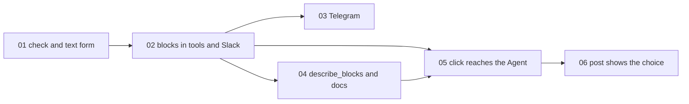

# Channel cards on Slack Block Kit, with buttons that reach the Agent

> Working plan — temporary, committed on the feature branch.
> Deleted once the feature ships.

**Issue:** https://github.com/dam-agents/dam/issues/6633

## Goal

An Agent can post a dashboard-style message to Slack: KPI tiles side by side, a chart next to a text panel, section headings between groups.
It does so by sending Slack Block Kit blocks as they are, so every block Slack has today or adds later is usable without a platform change.
A button in such a post can send a choice back: the click reaches the Agent as a message, and the post then shows who chose what.
Telegram keeps receiving a readable answer: the same content as text, with link buttons as Telegram buttons.

## Approach

Today a [Channel Card](../../architecture/channel-cards.md) is a tree against json-render's chat catalog, converted to Slack blocks by Chat SDK's converter.
Neither library has a layout or tile element, and json-render converts through a fixed list of component names, so the catalog cannot grow from our side.
This feature replaces the catalog with the blocks themselves.

- **The agent-facing format is raw Block Kit.** `reply`, `post`, `start_thread` and the edit of an own post take `blocks` in place of `card`.
  The `card` parameter and `describe_card_components` go away with no alias.
- **The platform checks, it does not render.** Any block passes.
  The check refuses a named set of input elements that have no way back to the Agent, and writes its own `action_id` on every button.
- **The text form is derived.** A generic walk over the blocks collects their texts in order.
  It is the Slack notification text, the Telegram message and the reply text a turn records.
- **Slack is the judge of the schema.** When Slack refuses the blocks nothing posts, and the tool returns Slack's own wording to the Agent.
  The silent retry with the text form goes away.
- **A click is a message.** A click on a choice button behaves as a message in the post's thread, addressed to the Agent that made the post, under today's thread routing ([channel-turns](../../architecture/channel-turns.md#threading-model), [slack-threads](../../architecture/slack-threads.md)).
  Anyone who sees the post may click; the turn names who clicked and what.
- **A post takes one answer.** After the first click the platform removes the choice buttons and adds a line that names who chose what.

The code lives in the channels module of the api-server (`packages/api-server/src/modules/channels/`) and the MCP endpoint that offers the tools (`packages/api-server/src/apps/harness-api-server/`).
Cards arrived in pull request #6411 and were extended by #6453 (artifact links) and #6489 (edit of an own post).

### Shared contract

Every sub-issue builds against these shapes.
Names are fixed here so the slices meet; internal structure is the implementer's.

- `ChannelBlock`: a JSON object with a string `type`, nothing else assumed.
- `ChannelCard` in `services/worker-contract.ts` becomes `{ blocks: ChannelBlock[]; text: string }`, where `text` is the text form.
- The pure module `domain/channel-blocks.ts` exports:
  - `checkChannelBlocks(input, options)` → `{ blocks }` with platform `action_id`s written, or `{ issues: string[] }`.
    `options.choiceButtons` is `"refuse"` until sub-issue 05 and `"allow"` from then on.
  - `channelBlocksText(blocks)` → the text form.
  - `channelBlockLinkButtons(blocks)` → `{ label: string; url: string }[]`.
  - `countChannelBlocks(blocks)` → the number of blocks, nested ones included.
- The platform's button id is `agent-button:<agentId>:<index>`.
  Only the platform writes it, so a click with this prefix names its Agent without reading the post.

### The security rule every slice keeps

`handleMessageAction` in `infrastructure/slack.ts` runs the commands of the private command menu for a click on an ephemeral message whose `action_id` starts with the command-menu prefix.
A private answer to a whisper is ephemeral and carries the Agent's blocks.
So an `action_id` or a `value` the Agent wrote must never reach Slack on a button: the platform overwrites the id on every button and drops the value on link buttons.
An element that carries an `action_id` and is not a button is refused as an input element.

## Sub-issues

| #     | Title                                           | Scope                                                                                                                         | Depends on |
| ----- | ----------------------------------------------- | ----------------------------------------------------------------------------------------------------------------------------- | ---------- |
| 01 ✅ | Block check and text form                       | The pure module: check, text form, link buttons, block count. Not wired yet.                                                  | —          |
| 02 ✅ | `blocks` replaces `card` in the tools and Slack | Tool parameters, worker contract, Slack posting, Slack's refusal back to the Agent, read-back, removal of the card libraries. | 01         |
| 03 ✅ | Telegram                                        | Derived text with link buttons as Telegram buttons, and the length check.                                                     | 02         |
| 04 ✅ | `describe_blocks` and the docs                  | The on-demand tool with rules and a block reference; the architecture page and the glossary.                                  | 02         |
| 05 ✅ | A button click reaches the Agent                | Choice buttons pass the check; a click becomes an addressed message in the post's thread.                                     | 02, 04     |
| 06 ✅ | The post shows the choice                       | After the first click the choice buttons go and a line names who chose what; a second click is not delivered.                 | 05         |

## Conventions & glossary

- **Channel Card**: the Block Kit part of an Agent post.
  The glossary term stays and is redefined in sub-issue 04.
- **Link button**: a `button` element with a `url`.
  It opens a page and sends nothing to the Agent.
- **Choice button**: a `button` element without a `url`.
  A click on it reaches the Agent.
- **Input element**: a select, a text or number input, checkboxes, radio buttons, a date or time picker, an overflow menu, a workflow button, or an `input` block.
  Refused; issue #6532 owns them.
- **Text form**: the text derived from a card's blocks.

Apply the `/typescript-engineering` skill to every server-side change.
Follow [`docs/guidelines/comment-guidelines.md`](../../guidelines/comment-guidelines.md) before any code comment, and run `mise run check:comment-types` after changing code.
Follow [`docs/guidelines/documentation-guidelines.md`](../../guidelines/documentation-guidelines.md) for the docs: one sentence per line, no ADR references.
Never hardcode the brand in a message an Agent or a person reads.
Use `mise run` for every build, check and test.

### Decisions this plan carries

The pull request records these in its `author-decisions` block.

1. The agent sends raw Slack Block Kit blocks; they replace the json-render component card.
2. The platform derives the text form with a generic walk over the blocks.
3. Telegram gets the derived text, with every link button as a Telegram button.
4. Choice buttons are allowed, and a click is delivered to the Agent as a message in its session.
5. A click behaves as a message in the post's thread, addressed to the Agent that made the post.
6. Anyone who sees the post may click; the turn names who clicked and what.
7. After the first click the platform removes the choice buttons and adds a line naming who chose what.
8. Any block passes the check; only the named input elements are refused.
9. When Slack refuses the blocks nothing posts, and the Agent gets Slack's own wording.
10. An on-demand tool returns the platform's rules and a hand-written reference of the newer blocks.
11. Choice buttons work in Slack only; in Telegram they show in the text as options (default).
12. `blocks` replaces `card`; `describe_card_components` becomes `describe_blocks`; the glossary keeps "Channel Card" (default).
13. No decision record; the architecture page is rewritten (default).
14. One pull request, built as ordered commits.
15. A private answer to a whisper carries no choice buttons (default).
16. The click path is documented in `channel-cards.md` (default).
17. The old tool and parameter are removed with no alias; a `card` argument is refused with a pointer to `blocks`.

### Out of scope

- Selects, inputs and forms in Slack: issue #6532.
- Choice buttons in Telegram.
- A move of Slack onto the Chat SDK Slack adapter.

## Whole-feature smoke test

On the local cluster with a Slack workspace and a Telegram chat connected to one Agent ([`cluster-ops`](../../../.agents/skills/cluster-ops/SKILL.md)):

1. In Slack, mention the Agent and ask for three KPI tiles side by side with invented numbers, and under them a bar chart next to a short text panel.
   The reply shows the tiles in one row and the chart beside the panel.
2. Ask for the same answer with a deliberately wrong block.
   Nothing new appears in the channel, and the Agent's next reply shows it fixed the blocks or sent text.
3. Ask the Agent to post a question with "Approve" and "Reject" buttons and a link button.
   Click "Approve": the Agent answers in the thread and names the person who clicked, and the post now shows the link button and a line with the choice.
4. Have a second person click on a copy of the post still open in their client.
   The Agent gets no second message.
5. In Telegram, ask for the same KPI answer.
   The numbers arrive as text and the link button as a Telegram button.
6. Run `/<brand> whisper` to the Agent and ask for buttons.
   The private answer shows no choice button.

The new blocks are not verified in a live workspace yet, so step 1 is also the first proof that the workspace shows them.

## Delivery

Each sub-issue is one atomic commit.
The whole feature lands as a single PR for https://github.com/dam-agents/dam/issues/6633.
