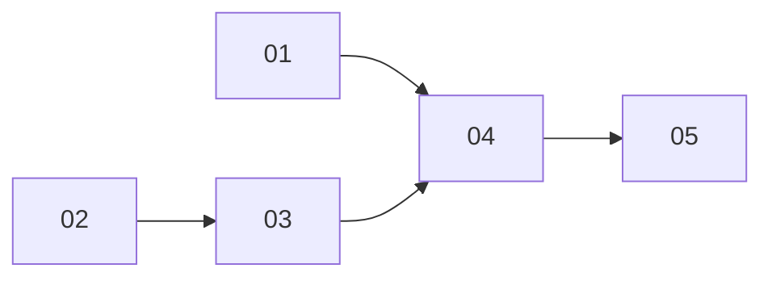

# Left nav: one list of sessions, with pinned sessions

> Working plan — temporary, committed on the feature branch. Deleted once the feature ships.

**Issues:** [#6744](https://github.com/dam-agents/dam/issues/6744) (one list of sessions), [#6745](https://github.com/dam-agents/dam/issues/6745) (pin a session — per-user pins only)
**Design:** Figma _DAM-DEV_, page "#6744 Left nav: one list of sessions" (flows 1–7)

## Goal

The left nav lists every Session once. Activity becomes **Sessions**, the only list of sessions; Agents no longer nest their sessions.
Clicking an Agent opens its **agent view**: the other Agents hide, "← All agents" appears above the selected Agent, the Sessions list shows only that Agent's sessions, and the main pane opens its new chat.
"← All agents" brings everything back and scrolls the list to the open session when its row is loaded.
A user can **pin** a session from its ⋯ menu; pinned sessions show in a **Pinned** section above Sessions, in both views, and are never repeated in Sessions.

## Approach

Everything except pins is UI (`packages/ui`). Read [`docs/architecture/home-feed.md`](../../architecture/home-feed.md) first: it describes today's sidebar (nested agent lists, Activity, the attention record) and is rewritten by this feature.

**Two data sources, unchanged.**

- **All agents** lists the **attention record** — `attention.listForOwnerPage`, as `SidebarActivity` does today (`packages/ui/src/modules/home/components/sidebar-activity.tsx`). Owner rows only; no agent wakes.
- **An agent view** lists **the Agent's own list** — `AgentSessionList` in `packages/ui/src/modules/sessions/components/sidebar-agent-sessions.tsx` (paging, fill, provisional rows, per-agent filter sent with page requests). Opening the view wakes a hibernated Agent once, as opening its nested list does today.

**Nav view state.** A new, non-persisted store value `sidebarAgent: string | null` in `packages/ui/src/modules/platform/store/sidebar.ts`.
Only a click on an Agent row sets it; only "← All agents" clears it — except that when the shown chat moves to a session of a _different_ Agent from outside the nav (link, notification, palette), it clears to All agents.
It is independent of the shown chat (`view === "chat"`, `selectedAgent`): opening a session from All agents leaves the nav in All agents; going back to All agents leaves the session open.
`sidebarAgentOpen` and its open/fold overrides are removed.

**Pins.** A new api-server module, `session-pins`, modelled on `sidebar-order` (per-user table in `packages/db`, tRPC router in `packages/api-server-api`, an `agentCleanupSources` entry in `bootstrap.ts`).
A pin is only `(owner, agentId, sessionId, pinnedAt)`; it never decides that a session exists.
`list` joins each pin with the owner's `attention_records` row — the same row Activity reads — so a pinned row looks exactly like any session row without waking an Agent.
The attention record files no rows for an Agent Editor, so a pin on a Shared Agent comes back with no row: it is shown in Pinned only in that Agent's view, from the Agent's own list.
The 90-day attention retention skips rows of pinned sessions; the session watcher drops pins of sessions it sees gone.

### tRPC contract (`sessionPins`)

```ts
// packages/api-server-api/src/modules/session-pins/types.ts
export interface SessionPin {
  agentId: string;
  sessionId: string;
  pinnedAt: string;            // ISO
  item: AttentionItem | null;  // the owner's attention row; null for a Shared Agent or no row
}
export interface SessionPinList { pins: SessionPin[] }   // newest activity first, then pinnedAt

// router
sessionPins.list   : query    ()                                  -> SessionPinList
sessionPins.pin    : mutation ({ agentId, sessionId })            -> void   // idempotent
sessionPins.unpin  : mutation ({ agentId, sessionId })            -> void   // idempotent
```

`pin` is allowed only on an Agent the caller owns or holds `sessions` on (Agent Editor); otherwise `FORBIDDEN`. It does not ask the Agent whether the session exists.

## Sub-issues

| #   | Title                                  | Scope                                                                                                                                                            | Depends on |
| --- | -------------------------------------- | ---------------------------------------------------------------------------------------------------------------------------------------------------------------- | ---------- |
| 01  | ✅ Session pins on the server          | `session-pins` table, module and router; cleanup on agent and session delete; retention skips pinned rows                                                        | —          |
| 02  | ✅ Agent view and one Sessions list    | `sidebarAgent`; "← All agents"; agent-row clicks; nested lists removed; Activity → Sessions by view; view-following filter; Shared with me; collapsed rail; docs | —          |
| 03  | ✅ ⋯ menu on every session row         | Rename, Delete, Export telemetry on all-agents rows                                                                                                              | 02         |
| 04  | ✅ Pinned section                      | Pin/Unpin in the menu; Pinned above Sessions in both views; never repeated in Sessions                                                                           | 01, 03     |
| 05  | ✅ Back to All agents keeps your place | Scroll to the open session's row when loaded                                                                                                                     | 04         |



## Decisions (from the grilling)

1. The agent view is its own store value `sidebarAgent`, set only by clicking an Agent row, cleared only by "← All agents"; not persisted (a reload opens All agents); opening another Agent's session from outside the nav clears it to All agents.
2. The Sessions header filter follows the view: All agents edits the Activity filter (`sidebarActivityFilters`); an agent view edits that Agent's saved filter (`agent-session-filters`, still sent with page requests). The filter button on Agent rows goes; a filtered Agent keeps its mark on its row. Filters do not carry over between views.
3. Shared with me stays its own section below Agents in All agents; its sessions never appear in the all-agents list. A Shared Agent with session access opens the same agent view; one without opens its settings. Hidden in an agent view. The all-agents empty state says sessions on shared agents show when the agent is opened.
4. Every session row, in both views, has the same ⋯ menu: Pin/Unpin, Rename, Export telemetry (only when telemetry is on), Delete.
5. Pins are per user only; the owner "pin for all editors" story of #6745 is a follow-up. Stored in the api-server next to the sidebar order; a pin is only `(agentId, sessionId)`, dropped when its session or Agent is deleted.
6. A pinned session shows only in Pinned, never also in Sessions, in both views, and looks exactly like any session row — no placeholder.
7. Pinned rows read the same `attention_records` rows Activity reads; no change to the producer. Pins on Shared Agents show in Pinned only in that Agent's view. The 90-day retention skips pinned rows.
8. Pinned is ordered by last activity, newest first (no manual order — #5220 removed a pin feature that mixed the two); filters never hide pins; All agents shows every pin, an agent view only its own; no cap, no View more; hidden while empty.
9. "← All agents" scrolls to the open session only when its row is already loaded (Pinned or Sessions); it never fetches more. Otherwise the list stays at the top.
10. In All agents a click on an Agent opens its view and its new chat; in the agent view a click on the selected Agent reopens its new chat; only "← All agents" leaves. Hover actions New session, Agent settings and ⋮ stay. The hibernated fold stays in All agents; drag order only in All agents.
11. The collapsed rail's Activity flyout becomes Sessions (Pinned + Sessions, as expanded); the Agents flyout lists Agents and Shared with me without nested sessions and sets the agent view on click. Both reuse the expanded components and the same `sidebarAgent`.

## Conventions & glossary

- **All agents** — the nav's default view. **Agent view** — the nav narrowed to one Agent by a click on its row. Copy says "All agents" and "Sessions"; code may say `sidebarAgent`.
- **Sessions** (the sidebar list) replaces **Activity**. Add "Activity, for the sidebar's list of sessions → Sessions" to _Retired words_ in `docs/ubiquitous-language.md` and to `design.retired_words` in `.quality-inspector/qi-profile-dam/profile.json` (02). _Activity Event_ (usage tracking) is unrelated and keeps its name.
- **Pinned session** — a session a user pinned; it shows in Pinned. Not the agent-store `session_pinned` signal nor the Invocation Pin.
- Apply `/react-ui-engineering` for every UI slice and `/typescript-engineering` for 01.
- Keep `UNIT_BOUNDARY_DESCRIPTION` comments truthful: rewrite the ones on the components you change.
- No new tests by default. Existing tests that assert the removed behaviour (nested lists, `sidebarAgentOpen`, Activity label) are updated or deleted with the behaviour; run `mise run test` and `mise run check` (plus `check:format`, `check:lint`) per slice.

## Whole-feature smoke test

On the local cluster (`mise run cluster:install`), as a user with three own Agents and one Agent shared with them:

1. All agents: Agents, Shared with me, Sessions (mixed agents, agent name on each row); no session listed under any Agent.
2. Click Agent B: other Agents hide, "← All agents" shows, B's new chat opens, Sessions shows only B's sessions without agent names; the header filter edits B's filter.
3. Open a B session, pin it from ⋯: Pinned appears above Sessions with it; it is gone from Sessions. Back to All agents: it is in Pinned, not in Sessions, and is scrolled to and marked open.
4. Reload: All agents; the pin is still there. Open another browser as the same user: same pin.
5. Pin a session on the shared Agent: it shows in Pinned only in that Agent's view.
6. Delete a pinned session: it leaves Pinned. Unpin another: it returns to Sessions in its recency place.
7. Collapse the sidebar: the Sessions flyout shows Pinned + Sessions; the Agents flyout sets the agent view.

## Delivery

Each sub-issue is one atomic commit. The whole feature lands as a single PR that closes #6744 and refs #6745: the owner "pin for all editors" story stays open there.
