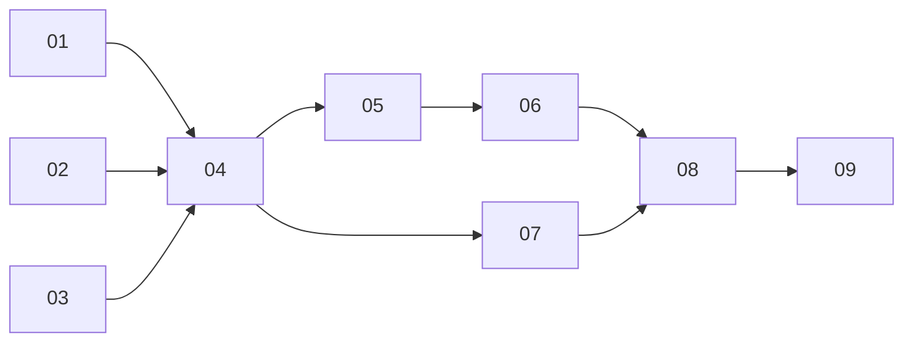

# One gateway pod per owner for vm Agents

> Working plan — temporary, committed on the feature branch.
> Deleted once the feature ships.

**Issue:** none yet.

## Goal

A warm wake of a vm Agent is ready when its guest answers, about 0.9 s, rather than when a fresh gateway pod becomes Ready, about 1.9 s (dev, 2026-10-16).
Each owner gets one long-lived gateway pod beside their VM runner.
It serves every vm Agent of that owner, each on ports of its own behind the Agent's own gateway Service.
Hibernation stops only the machine.
The per-agent gateway StatefulSet, its ConfigMap, leaf Certificate, ServiceAccount and NetworkPolicies go away for vm Agents.

Out of scope: container Agents, which keep their per-agent gateway until the container Backend is deleted, and any change to what the gateway does to a request.

## Approach

Read first: [security-and-credentials](../../architecture/security-and-credentials.md), [credential-gateway](../../architecture/credential-gateway.md), [vm-runner](../../architecture/vm-runner.md) (gates, lines on the allowlist and the gateway's ingress policy), [agent-lifecycle](../../architecture/agent-lifecycle.md#hibernate), [spend-limits](../../architecture/spend-limits.md), [observability](../../architecture/observability.md#trusted-attribution), [vm-host-runner](../../architecture/vm-host-runner.md).

### What stays

- **The agent's gateway Service and its ClusterIP.**
  The machine's allowlist (`AllowCIDRs`, `[gatewayIP/32]` in `packages/controller/pkg/reconciler/vm_agent.go`) and its resolver (`GuestResolver`) keep naming it, so cut-over changes no machine spec and reboots no machine (`plan.rs` restarts a machine whose `allow_cidrs` change).
  The runner's admission (`one_remote_host` in `packages/vm-runner/src/plan.rs`) is unchanged.
- **The per-agent ext-authz Service** `<release>-extauthz-<id>`.
  The api-server keeps deriving the agent from `:authority` (`packages/api-server/src/apps/ext-authz/grpc.ts`, `spend-records.ts`), so the api-server needs no change.
- **Every chain's content.** `chainsFromSecrets`, the spend meter, address step, signing and attribution stamping in `envoy.go`, `envoy_bootstrap.go` and `envoy_spend_meter.go` render per agent exactly as today; only where they are placed changes.

### What changes

- **Identity = Service port.** The agent's gateway Service selects the owner's gateway pod and maps its ports (proxy 10000, 80, 443, 53/udp, 53/tcp) onto that agent's **agent ports** on the pod: one proxy port and one resolver port from a controller-allocated range.
  A guest reaches only its own ClusterIP, and a ClusterIP forwards only its declared ports, so a guest cannot reach a sibling's listener.
  The allocation is recorded in the Service's own target ports, the single source of truth, allocated under the owner's lock (`ownerLock` in `vm_agent.go`).
- **Envoy loads listeners and clusters from files.** A static bootstrap holds the admin-less shared parts; `dynamic_resources` reads LDS and CDS from files in a ConfigMap directory through `watched_directory`, the pattern Envoy documents for kubelet's symlink swap.
  Envoy diffs resources by name: an unchanged listener keeps its connections, and a changed one drains alone.
  Per-agent listeners and clusters are suffixed with the agent name.
  Shared clusters (harness, object store, dynamic forward proxies, collector) appear once per owner.
- **The internal listener per agent.** The CONNECT tunnel's internal listener (`tls_inspect_internal`) becomes one per agent, so SNI chains never mix agents.
- **Harness path guard.** The mesh identity is now the owner's, so the waypoint can no longer tell an owner's agents apart.
  Each agent listener routes the harness authority through an HTTP connection manager that admits only `/api/agents/<id>/` paths (WebSocket upgrade kept for the runtime's tRPC) instead of `harness_passthrough`'s TCP passthrough.
- **Resolver.** One CoreDNS container with one server block per agent port, each answering with that agent's ClusterIP as a literal; the `reload` plugin picks up a changed Corefile.
- **Credentials.** The controller copies the credential keys of every Secret granted to any of the owner's vm Agents into one per-owner Secret, mounted once; each agent's SDS and signing files point into it.
  Rotation keeps today's annotation stamp (`refreshGatewayCredentials` in `gateway.go`) so the kubelet syncs at once.
- **Leaf.** One per-owner Certificate whose SANs are the union of the owner's agents' intercepted hosts (`BuildEnvoyLeafCertificate` in `leaf.go`).
- **Mesh.** One ServiceAccount per owner for the gateway pod; each agent's harness and ext-authz AuthorizationPolicies admit that principal (`authorization_policy.go`).
- **Policies.** One ingress policy on the owner pod: the owner's runner on the agent port range, and the controller on the proxy ports for the readiness probe.
  One egress policy with today's content (`BuildGatewayEgressNetworkPolicy`).
  The runner's egress (`runnerEgress` in `vm_runner.go`) names the owner gateway on the agent port range (`endPort`).
- **Readiness.** Each agent listener answers `/__platform_healthz` with the revision the controller rendered for it.
  The controller probes it through the agent's Service; `GatewayPodReady` holds when the body matches.
- **Hibernation.** The vm path reads "should the pair be up" from the gateway StatefulSet's replicas today (`pairAwake` in `agent_reconciler.go`, `agentDesiredUp` in `budget.go`, `scaleAgentPairToZero` in `idlechecker.go`).
  That moves to a controller-owned annotation on the agent's gateway Service.
- **Workload.** A Deployment of one replica with `maxSurge: 1, maxUnavailable: 0`, so a template change brings the new pod up before the old one drains.
  It is named and labelled after the runner (`runnerName`, `vmRunnerSelector` in `vm_runner.go`), created by an agent reconcile under the owner's lock, and removed by the orphan sweep with the runner.
- **Flag.** Everything sits behind `virtualization.gateway.perOwner` (chart) → controller config, off by default, so dev can switch back.

### Numbers to keep in view

- Gateway pod today: about 59 MiB used (Envoy 40, CoreDNS 19), 80 MiB requested (`envoyContainer` 64Mi, `machineDNSContainer` 16Mi).
- Rendered bootstrap (measured with `renderEnvoyBootstrap`, transparent, telemetry on): 11.2 KB with no chains, 15.2 KB with 1, 31.2 KB with 5, 71.2 KB with 15 credentialed hosts, about 4 KB per host before spend metering.
  The owner's LDS file must fit in one ConfigMap of 1 MiB.
- Dev: 104 vm Agents, 30 owners; prod: about 319 Agents, 151 owners.

### Open questions

- **Q1** Largest owner's rendered LDS size: measure on dev in 01 from real Secrets.
  If any owner passes about 512 KiB, either dedupe the spend meter's Lua through shared source, or move to an xDS server in the controller.
- **Q2** Envoy memory per extra listener and per extra chain: measure in 04 to size the request formula (`40 MiB + k × agents`).
- **Q3** OVN-Kubernetes (dam-cl) and k3s kube-proxy both drop traffic to undeclared ports of a ClusterIP: confirm on both in 05, since the identity rests on it.
- **Q4** Gateway termination grace: 5 s today (`gatewayTerminationGracePeriod`); a per-owner roll should drain model streams longer, but long streams lengthen every roll.
- **Q5** Whether a hibernated agent's listener should stay configured.
  It costs little and keeps a wake to a machine start; an escaped guest can already wake a sibling through the harness.

## Sub-issues

| #   | Title                                       | Scope                                                                                          | Depends on |
| --- | ------------------------------------------- | ---------------------------------------------------------------------------------------------- | ---------- |
| 01  | Per-owner Envoy configuration render (done) | Static bootstrap plus LDS/CDS files, per-agent listener with harness guard and health revision | —          |
| 02  | Per-owner resolver render                   | Corefile with one block per agent port and literal answer                                      | —          |
| 03  | Per-owner credential Secret and leaf        | Aggregate granted credential keys, union-SAN leaf, rotation stamp                              | —          |
| 04  | Owner gateway workload behind a flag        | Deployment, SA, ConfigMap, policies, mesh policies, lifecycle with runner, sizing              | 01, 02, 03 |
| 05  | Agent ports, Service cut-over, readiness    | Port allocation, Service retarget, revision probe, host runner                                 | 04         |
| 06  | Hibernation and wake without the gateway    | Desired-up record, idle checker, budget, wake publishing                                       | 05         |
| 07  | Owner gateway rolls and restarts            | Surge roll, paced across owners, superseded-pod eviction, failure surfacing                    | 04         |
| 08  | Migration on dev and cleanup                | Move existing vm Agents, delete per-agent objects, rollback, runtime-migration switch          | 06, 07     |
| 09  | Architecture pages                          | Rewrite the gateway parts of the pages listed above                                            | 08         |

## Conventions & glossary

- **Owner gateway**: the one gateway pod of an owner, a Deployment named after the owner's runner.
- **Agent ports**: the proxy port and the resolver port on the owner gateway that belong to one agent.
- **Agent listener**: the Envoy listener on an agent's proxy port, with that agent's internal listener, chains and clusters.
- **Listener revision**: a hash of what the controller rendered for one agent, served on that agent's health path.
- Go only, except 09; follow [`docs/guidelines/code/index.md`](../../guidelines/code/index.md) and the typed-comment rule (`mise run check:comment-types`).
- Run Go through mise: `mise run //packages/controller:test`, `mise run //packages/controller:check`.

## Whole-feature smoke test

On the local cluster (`cluster-ops` skill) with `virtualization.gateway.perOwner=true`:

1. Two vm Agents of one owner, each with a different header Connection; one hibernated.
2. Wake the hibernated one from the UI; the controller trace shows no gateway pod start, and the runtime's first hello succeeds.
3. From each guest, `curl` the other's ClusterIP on 10000: times out or is refused.
4. From one guest, a harness request for the sibling's `/api/agents/<sibling>/…` is refused by the gateway.
5. Rotate one Connection: in use within seconds, no pod restart (`kubectl get pod` restart count and age unchanged).
6. Grant a new Connection to one agent: the other agent's long `curl` stream through the gateway is not cut.
7. A metered model call shows spend on the right agent, and a held egress request shows on the right agent's Home.
8. `mise run e2e:run` with the flag on.

## Delivery

Each sub-issue is one atomic commit.
The whole feature lands as a single PR.

## Effort and risk

- **Effort:** about 3 to 4 weeks of one engineer for 01–09, 01–03 parallel; 05 and 07 carry most of the risk and half the time.
  The cheaper alternative (keep each vm Agent's gateway at one replica through hibernation) is about a day.
- **Risk, high:** the agent identity rests on ClusterIP port filtering by the cluster's Service proxy (Q3); if a CNI forwards undeclared ports, a guest reaches its siblings' listeners and their credentials.
- **Risk, high:** the harness boundary between an owner's agents moves from the mesh into rendered Envoy config (01's guard); a render bug lets one agent act as a sibling on the harness.
- **Risk, medium:** an owner gateway restart cuts all of an owner's running agents' egress and model streams at once (07).
- **Risk, medium:** a large owner's configuration outgrows one ConfigMap (Q1), forcing the xDS server early.
- **Risk, low:** file-watched LDS/CDS is a documented Envoy feature but new in this codebase; a bad file leaves the last good config running, so a render error shows as a stale revision (05), not an outage.
