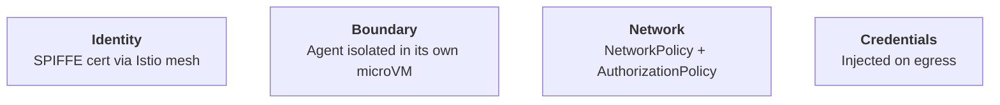
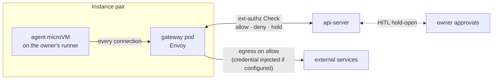

# Security overview

How Platform keeps an AI agent from doing damage — to other agents, to the cluster it runs on, or to the accounts it's allowed to use.

The starting assumption is that the agent is **untrusted**.
It runs code and makes web requests on its own; we have to plan for the case where it goes off the rails and tries to leak a password, contact a server it shouldn't, or attack something running nearby.
So we build real walls around it, and we never assume good behaviour.

## Layers of defense

- **Identity.** Some calls go *back into* the platform on the agent's behalf — the gateway pod talks to the api-server's harness (the channel the agent's LLM uses) and to a per-instance `ext-authz` service that approves outgoing requests.
  Both of those have to be authorized: only the gateway from the matching instance is allowed in.
  Istio's identity service (`istiod`) gives each gateway pod a digital ID card — a SPIFFE certificate, signed by the cluster and impossible to forge.
  The doors on those api-server endpoints check the ID and admit only the right one, so one instance can never call another instance's harness or ext-authz.

- **Boundary.** The agent runs in its own microVM — a small virtual machine with its own kernel, its own filesystem and its own network, sharing nothing with anyone else.
  Each one is booted by smolvm on its owner's runner pod, so the agent has no roommate it could share memory or a network namespace with.
  The machine is a guest, not a pod, so it has no Kubernetes login token at all: even if the agent tries to ask Kubernetes "what else is around?", it has no credentials to do so.

- **Network.** Several locks restrict where the agent can talk.
  The machine's own network lets it reach exactly one place: the **gateway pod** we paired it with, by address — no sibling machine, no node, no cloud metadata endpoint, no internet directly.
  Every name the agent looks up is answered by the gateway's own resolver with the gateway's address, and no query ever goes on to a real DNS server, which closes a sneaky exfil channel where the agent could smuggle data out in DNS queries.
  As a backup of the same lock, at the kernel — the part of the OS that decides which network packets are allowed out — a Kubernetes NetworkPolicy lets the runner pod the machine boots on reach its owner's gateways and nothing else, and each gateway admits only its owner's runner; if the machine's own network ever broke, this second layer would still hold.
  Every outgoing request the gateway pod then forwards on the agent's behalf runs through an `ext-authz` check at the api-server before leaving the cluster.

- **Credentials.** Real upstream passwords (API keys, OAuth tokens) never reach the agent.
  They live in Kubernetes Secrets that only the gateway pod can read.
  When the agent wants to call something like GitHub, the request goes through the gateway pod.
  For hosts where a credential is configured, the gateway adds the credential header onto the wire after the `ext-authz` check has approved the call — for everything else, traffic passes through unchanged.

## Security boundary

The microVM is the wall.
Everything inside it — the agent process, any tools it starts, any containers or cluster it runs itself, any content it reads — is treated as untrusted.
The controls above all live *outside* it: in the mesh, in the runner pod's network policy, in the gateway pod that holds the credentials.
A compromised agent can't reach any of them.

Each machine runs its own guest kernel, so a kernel exploit inside it — the runc container-escape CVEs disclosed in November 2025 and the "Copy Fail" Linux-kernel LPE in April 2026 are recent examples — takes over only that guest.
Getting further needs a hypervisor escape as well.
Even that lands inside the owner's runner pod, which runs in a Kubernetes user namespace — an unprivileged user on the node — with each virtual machine's process confined to its own files and an allowlist of system calls.
The runner is shared by one owner's machines, so an escaped guest reaches that owner's other agents and gateways, and never another owner's.
See [security-model § Execution](security-model.md#execution) for the longer framing.

## Authorization flow

Every internal hop carries a SPIFFE ID stamped by `istiod`, and every door checks it.

Two AuthorizationPolicies sit at the doors that matter: the harness path on the api-server, and the per-instance `ext-authz` service.
Each one only admits the gateway whose SPIFFE ID belongs to the right instance, so one instance can never call another instance's harness or ext-authz — the address resolves, but the call never lands.
The gateway pod itself has no AuthorizationPolicy in front of it; the agent → gateway hop is gated by the machine's own network, which reaches only its gateway, and by two NetworkPolicies, one at each end: the runner's reaches only its owner's gateways, and the gateway's admits only its owner's runner.

On top of that, every outgoing request through the gateway runs through a second gate.
Envoy (the program running inside the gateway pod) makes a gRPC `ext-authz` Check to the api-server before forwarding the request, with the calling instance proven cryptographically by the ServiceAccount on the connection.
The api-server looks the request up against the instance's egress rules and answers one of three things:

- **Allow** — forward the request and, if a credential is configured for the destination host, stamp it on just before it leaves.
- **Deny** — refuse.
  The agent gets a 403.
- **Hold-open** — pause the Check while the owner approves or denies it from Home in the UI.
  If the verdict is deny, or no answer arrives, the Check fails closed and the agent still gets a 403.

## Threats and mitigations

| Threat                                                                                    | Mitigation                                                                                                                                                                                                                                                                                 |
| ----------------------------------------------------------------------------------------- | ------------------------------------------------------------------------------------------------------------------------------------------------------------------------------------------------------------------------------------------------------------------------------------------ |
| Agent steals an upstream token                                                            | Tokens live only in the gateway pod; Envoy injects them on the wire and the agent never sees a real one                                                                                                                                                                                    |
| Agent escalates via its ServiceAccount token                                              | The machine is a guest, not a pod, and holds no ServiceAccount token; the gateway pod mounts none either (`automountServiceAccountToken: false`) — `istiod` issues its SPIFFE workload cert without one                                                                                    |
| Agent reaches a peer instance's gateway                                                   | The machine's network reaches only its own gateway's address; even an escaped guest reaches only its owner's gateways, by the runner's NetworkPolicy                                                                                                                                       |
| Gateway calls a peer instance's harness or `ext-authz`                                    | AuthorizationPolicies on each api-server endpoint only admit the matching instance's gateway SPIFFE principal                                                                                                                                                                              |
| Agent bypasses the proxy to call external hosts directly                                  | The machine's network admits only its gateway; the runner's NetworkPolicy enforces the same shape at the kernel independently                                                                                                                                                              |
| Agent exfiltrates data through cluster DNS                                                | The gateway's resolver answers every name with the gateway's own address and forwards no query; the runner admits no DNS port at all                                                                                                                                                       |
| Route-confusion exfil through the gateway                                                 | Per-host Envoy filter chains pinned to each credential's host, with SAN-bound upstream TLS validation                                                                                                                                                                                      |
| Direct pod-IP bypass of the api-server                                                    | Pod-level DENY AuthorizationPolicy admits only the waypoint's SA (harness) or a per-instance SA (`ext-authz`)                                                                                                                                                                              |
| Agent exploits a kernel bug (the late-2025 runc CVEs; Linux kernel LPEs like "Copy Fail") | A kernel exploit lands in the agent's own guest kernel, not the host's. Getting further needs a hypervisor escape too, which lands as an unprivileged user in the owner's runner pod: that owner's other agents, never another owner's — see [Security boundary](#security-boundary) above |

## See also

- [security-and-credentials](../architecture/security-and-credentials.md) — the technical details of how this is wired today
- [security-model](security-model.md) — the longer story behind the three big risks: execution, credentials, confidentiality
